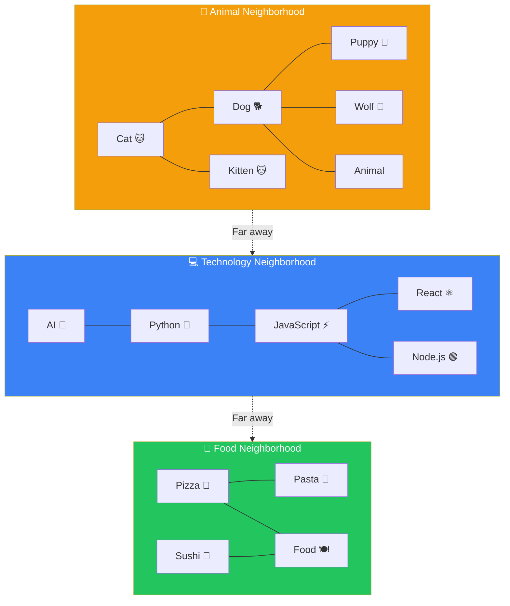
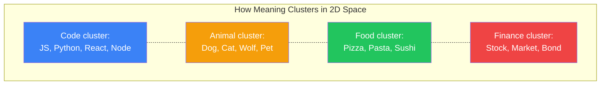
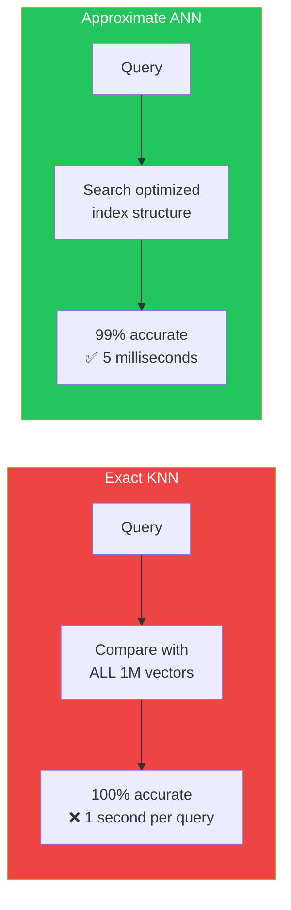

## Introduction

> **A vector space is the mathematical "world" where embeddings exist. Every word, sentence, or document has a coordinate in this world. Similar things live in the same neighborhood.**

You've heard that embeddings are "close together" when meanings are similar. But what does that actually mean? Where do these vectors live? How do we measure "closeness"? This document answers those questions — without any heavy mathematics.

---

## Why This Concept Exists

### The Problem

You know that embeddings are numbers. But numbers alone don't tell you anything about *relationships* between pieces of text.

Is "dog" closer to "wolf" or to "cat"? Is "JavaScript" closer to "React" or to "Java"? These questions can only be answered if you understand the *space* where these vectors exist.

### The Story

Imagine Google Maps. Every city has specific coordinates — latitude and longitude.

- New York is at (40.7, -74.0)
- Boston is at (42.4, -71.1)
- Los Angeles is at (34.1, -118.2)
- San Francisco is at (37.8, -122.4)

Using these coordinates, you can:
- **Calculate distance:** Boston is ~190 miles from New York. LA is ~2,800 miles away
- **Find neighbors:** The closest major city to New York is Philadelphia
- **Detect clusters:** East Coast cities (New York, Boston, Philly) form a cluster. West Coast cities (LA, SF, Seattle) form another

**Vector space works exactly the same way — just in hundreds of dimensions instead of two.**

---

## Real-World Analogy

### The Neighborhood Map

Think of vector space as a giant map of meaning:



Every word or phrase has a position. Words that appear in similar contexts end up in the same neighborhood:

- **"Dog"** and **"Puppy"** are neighbors because they appear in similar sentences
- **"JavaScript"** and **"React"** are neighbors because they're discussed together
- **"Pizza"** and **"Sushi"** are distant — they're both food but discussed in different contexts

---

## Clustering in Vector Space

### Why Things Cluster

Words cluster because the embedding model has learned that certain words co-occur. "Dog" and "leash" appear together frequently. "Dog" and "CPU" rarely do. The vector for "dog" gets pushed toward other animal-related words and away from technology-related words.



### Semantic Distance

**Semantic distance** is just how far apart two points are in vector space.

The closer two vectors are, the more similar their meanings:

| Pair | Distance | Relationship |
|------|----------|-------------|
| "Dog" — "Puppy" | Very close | Almost the same meaning |
| "Dog" — "Cat" | Close | Both animals |
| "Dog" — "Wolf" | Very close | Biologically related |
| "Dog" — "Car" | Far | Unrelated |
| "Dog" — "JavaScript" | Very far | Completely different domains |

---

## How We Measure Similarity

### Cosine Similarity (Intuitively)

Without getting into formulas, here's what you need to know:

**Cosine similarity** measures the *angle* between two vectors — not their distance.

Imagine two arrows pointing from the center of a circle:
- If they point in **exactly the same direction**: similarity = 1.0 (identical meaning)
- If they point in **completely different directions**: similarity = 0.0 (unrelated)
- If they point in **opposite directions**: similarity = -1.0 (opposite meaning)

```
                    Same Direction           90° Angle           Opposite
                     (Similar)              (Unrelated)        (Opposite)
                    
                       ↑                        ↑                    ↑
                       |                       /                    |
                       |                      /                     |
                       |                     /                      |
                  ↑    |                    /                  ↓    |
                  |    |                   /                   |    |
                 Dog  Puppy             Dog  Car              Happy Sad
                
              similarity: 0.95       similarity: 0.12      similarity: -0.80
```

**Why cosine similarity is popular:** It focuses on the *direction* of the vector (the pattern of meaning) rather than the *magnitude* (how "intense" the text is). Two documents about the same topic but different lengths will still have high cosine similarity.

### Euclidean Distance (Intuitively)

**Euclidean distance** is the straight-line distance between two points — like measuring distance on a map with a ruler.

```
    Dog ●─────────────────────● Car
         |  30 units apart    |
         
    Dog ●── 2 units ──● Cat
```

**When to use each:**

| Method | Best For | Why |
|--------|----------|-----|
| **Cosine Similarity** | Text search, RAG | Focuses on meaning pattern, ignores magnitude |
| **Euclidean Distance** | Clustering, anomaly detection | Captures absolute distance in space |

---

## Vector Search: Finding Neighbors

### K-Nearest Neighbors (KNN)

Given a query vector, KNN finds the *k* closest vectors in the entire dataset.

```
Query: "What is machine learning?"

Step 1: Convert query to vector → [0.67, -0.23, 0.89, ...]
Step 2: Compare with every vector in the database
Step 3: Return the top k results

Results:
1. "Machine learning is a subset of AI..."   (distance: 0.05)
2. "Supervised learning in ML involves..."    (distance: 0.08)
3. "Deep learning is a subset of ML..."       (distance: 0.12)
4. "Neural networks are used for..."          (distance: 0.18)
5. "Python libraries for data science..."     (distance: 0.45)
```

### The Problem with KNN

KNN requires comparing the query against **every single vector** in the database. For 1 million vectors, that's 1 million comparisons per query. This is too slow for real-time applications.

### Approximate Nearest Neighbors (ANN)

ANN is the practical solution. Instead of finding the *exact* nearest neighbors, it finds *approximate* neighbors — sacrificing a tiny bit of accuracy for massive speed gains.



| Approach | Accuracy | Speed | Use Case |
|----------|----------|-------|----------|
| **Exact KNN** | 100% | Slow (seconds) | Small datasets, offline analysis |
| **ANN** | 95-99% | Fast (milliseconds) | Production search, RAG |

---

## Real Production Example

### How Netflix Finds Shows You'll Like

When Netflix recommends a show:
1. Your viewing history is converted to vectors
2. Millions of shows are organized in vector space
3. The system finds shows closest to your taste vector
4. The top results become your recommendations

This is why:
- If you watch "Stranger Things," you get recommended "Dark" and "The OA"
- If you watch "The Office," you get recommended "Parks and Rec" and "Brooklyn Nine-Nine"
- If you watch cooking shows, you don't get recommended horror movies

**Similar content clusters in vector space. Your taste vector finds the nearest cluster.**

---

## Common Mistakes

| Mistake | Why It's Wrong |
|---------|----------------|
| ❌ "I can visualize 1536-dimensional space" | Humans can visualize 2-3 dimensions. Higher dimensions are abstract — treat them as a concept, not an image |
| ❌ "Cosine similarity above 0.9 means they're factually similar" | Cosine similarity measures topic similarity, not factual agreement. Two contradictory statements about the same topic can have high cosine similarity |
| ❌ "ANN is always worse than KNN" | Modern ANN algorithms (HNSW, IVF) achieve 99%+ recall with 100x speedup. The tiny accuracy loss is worth the massive performance gain for most production use cases |

---

## Interview Questions

### Easy

**Q: What does it mean for two vectors to be "close together"?**

> It means their meanings are similar. The embedding model has learned to place semantically similar texts at nearby coordinates in vector space, so the distance between vectors reflects how related their meanings are.

### Intermediate

**Q: Explain cosine similarity without using formulas.**

> Imagine two arrows pointing from the center of a circle. Cosine similarity measures the angle between these arrows. If they point in the same direction, similarity is high (close to 1). If they point in perpendicular directions, similarity is zero. If they point opposite ways, similarity is negative. It focuses on the *direction* of meaning rather than the magnitude.

### Senior

**Q: Your vector search returns poor results for some queries. How do you debug this?**

> Debug systematically: (1) Check embedding quality — are the query and documents being embedded correctly? (2) Check similarity metric — is cosine similarity the right choice, or would a different metric work better? (3) Check for distribution shift — does your query look like the data the embedding model was trained on? (4) Check indexing parameters — is your ANN index optimized correctly? (5) Check for domain-specific terminology — you may need a fine-tuned embedding model for specialized domains.

---

## Summary

| Concept | Key Point |
|---------|-----------|
| **Vector Space** | The mathematical "world" where embeddings exist |
| **Clustering** | Similar meanings gather in the same neighborhood |
| **Semantic Distance** | How far apart two points are in vector space |
| **Cosine Similarity** | Measures angle between vectors (direction of meaning) |
| **KNN** | Exact nearest neighbor search (slow but precise) |
| **ANN** | Approximate search (fast, nearly as accurate) |

---

## Navigation

**Previous:** [02 — Embeddings Deep Dive →](./02-embeddings-deep-dive)

**Next:** [04 — Similarity Search →](./04-similarity-search)
