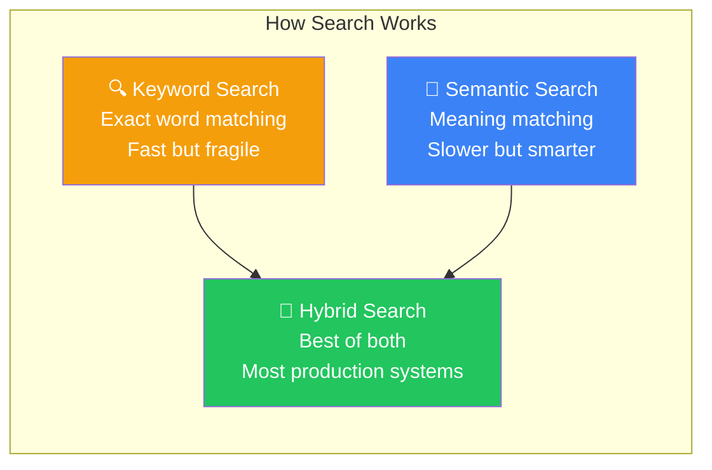
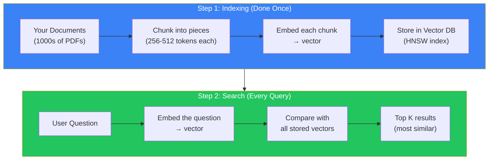
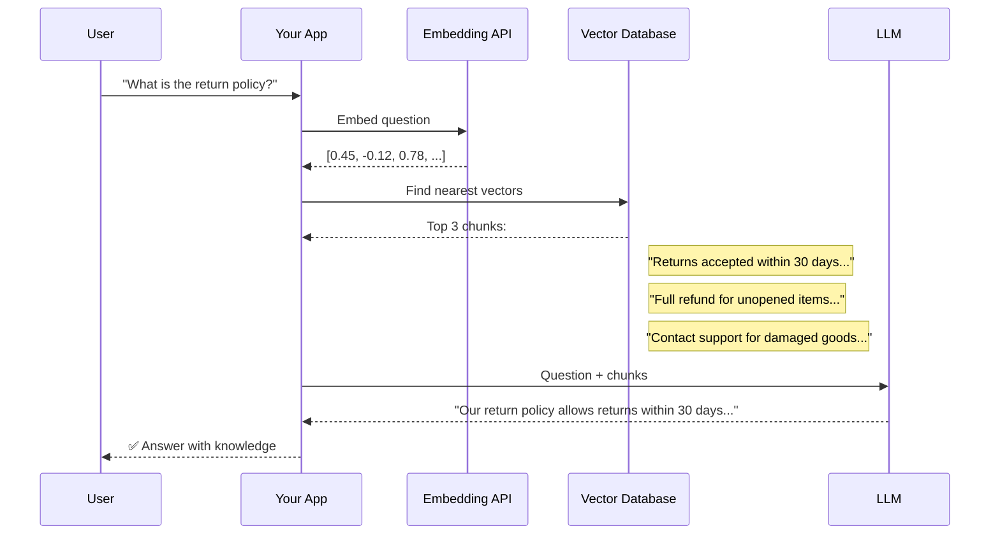

## Introduction

> **Similarity Search is the process of finding documents or content that match the *meaning* of a query — not just the keywords. It's how modern search understands intent.**

You know how Google understands that "best place to eat pizza near me" means you want a restaurant recommendation — even if your query didn't include the word "restaurant"? That's similarity search in action.

---

## Why This Concept Exists

### The Problem

Keyword search is fragile. It matches exact words — not meaning.

| Query | Keyword Search Finds | What You Actually Want |
|-------|---------------------|------------------------|
| "How do I fix a bug in React?" | Pages with "fix", "bug", "React" | Tutorials on React debugging |
| "Cheap flights to London" | Pages with "cheap", "flights", "London" | Budget travel options |
| "Dog won't stop barking" | Pages with "dog", "stop", "barking" | Pet training advice |
| "Feeling sad lately" | Pages with "feeling", "sad", "lately" | Mental health resources |

Keyword search misses:
- **Synonyms:** "car" vs "automobile" vs "vehicle"
- **Intent:** "I want to learn" vs "teach me" vs "how do I"
- **Context:** "Apple" (fruit) vs "Apple" (company)
- **Typos:** "recieve" vs "receive"

### The Story

Imagine a library where the librarian only searches by exact book titles. You say "I need a book about ancient Egyptian pyramids." The librarian searches for books with "ancient", "Egyptian", and "pyramids" in the title.

A book called "The Great Monuments of Old Egypt" wouldn't match — even though it's exactly what you need. That's keyword search.

Now imagine a librarian who *understands meaning*. They hear your question and think: "This person wants books about Egyptian architecture, pharaohs, and historical monuments." They find "The Great Monuments of Old Egypt" immediately. That's similarity search.

---

## Real-World Analogy

### The Airport Terminal

You're at a huge airport. You need to find your gate. There are two ways to find it:

**Keyword Search (Gate Number):** You search for "Gate B12". You find it instantly — but only if you know the exact number.

**Similarity Search (Destination):** You type "I'm flying to Tokyo". The system finds all gates with flights to Japan. You don't need to know the gate number — you just describe what you want.


---

## Keyword Search vs Semantic Search



| Aspect | Keyword Search | Semantic Search | Hybrid Search |
|--------|---------------|-----------------|---------------|
| **How it works** | Exact word matching | Vector similarity | Both combined |
| **Handles typos** | ❌ No | ✅ Yes | ✅ Yes |
| **Handles synonyms** | ❌ No | ✅ Yes | ✅ Yes |
| **Handles context** | ❌ No | ✅ Yes | ✅ Yes |
| **Speed** | ⚡ Fast | 🐢 Slower | ⚡ Fast |
| **Requires setup** | Minimal | Embedding model + vector DB | Both |
| **Example** | Ctrl+F, SQL LIKE | ChatGPT Retrieval | Perplexity |

---

## How Similarity Search Works

### The Pipeline



### Step by Step

**Step 1: Indexing (prepare your data)**
1. Take all your documents (PDFs, wikis, code files)
2. Split them into chunks (paragraphs or sections)
3. Convert each chunk to a vector using an embedding model
4. Store all vectors in a vector database

**Step 2: Search (answer a query)**
1. User asks a question
2. Convert the question to a vector using the same embedding model
3. Search the vector database for the nearest vectors
4. Return the original text chunks corresponding to those vectors

### Visualizing the Search



---

## Real Production Examples

### Where You See Similarity Search Every Day

| Product | What It Searches | Why It Works So Well |
|---------|-----------------|---------------------|
| **Google Search** | Billions of web pages | Understanding intent, not just keywords |
| **Netflix** | Movies and shows | "If you liked this, you'll like that" |
| **Spotify** | Songs and playlists | "Discover Weekly" — based on music taste vectors |
| **Amazon** | Products | "Customers who bought this also bought..." |
| **GitHub** | Code repositories | Finding relevant code by functionality |
| **Cursor** | Your codebase | "Find where this function is used" by meaning |
| **Pinterest** | Images | "Visual similarity" search |

### Code Example: Simple Similarity Search

```python
# This is a simplified example — production uses vector databases
import numpy as np

# Assume these are embeddings (in reality, you'd use an API)
docs = {
    "Return policy": np.array([0.1, 0.5, 0.3]),
    "Shipping info": np.array([0.4, 0.1, 0.8]),
    "Product specs": np.array([0.9, 0.2, 0.1]),
}

def cosine_similarity(a, b):
    """Simplified cosine similarity"""
    dot = sum(a_i * b_i for a_i, b_i in zip(a, b))
    norm_a = sum(x * x for x in a) ** 0.5
    norm_b = sum(x * x for x in b) ** 0.5
    return dot / (norm_a * norm_b)

query = np.array([0.15, 0.48, 0.31])  # "How do I return an item?"

results = [
    (doc, cosine_similarity(query, vec))
    for doc, vec in docs.items()
]
results.sort(key=lambda x: x[1], reverse=True)

print("Top result:", results[0])
# → "Return policy" with similarity 0.99
```

---

## Common Mistakes

| Mistake | Why It's Wrong |
|---------|----------------|
| ❌ "Semantic search replaces keyword search" | In practice, **hybrid search** (combining both) almost always outperforms either alone. Keyword search is great for exact matches (product codes, names) |
| ❌ "I can search raw PDFs without chunking" | Embedding models have input limits (typically 512 tokens). Long documents must be split into chunks first |
| ❌ "Higher similarity always means better answers" | Similarity measures *meaning*, not *quality*. A well-written wrong answer can have high similarity to the query |
| ❌ "One embedding per document is enough" | A single embedding for a 50-page document loses all granularity. Each section needs its own embedding |

---

## Interview Questions

### Easy

**Q: What's the difference between keyword search and semantic search?**

> Keyword search matches exact words or phrases in the text. Semantic search understands the meaning of the query and finds content with similar meaning, even if it uses different words.

### Intermediate

**Q: When would you use keyword search over semantic search?**

> Keyword search is better for: (1) Exact matches (product SKUs, order numbers, exact phrases), (2) Very small datasets where semantic search setup overhead isn't worth it, (3) When you need predictable, deterministic results. Most production systems use hybrid search — combining both.

### Senior

**Q: Design a search system for a customer support knowledge base. How would you handle queries that keyword search does well vs queries that need semantic understanding?**

> Design: (1) Route queries through a classifier — is this an exact-match query (order number, product code) or a natural language question? (2) For exact matches, route to keyword/elastic search. (3) For natural language, use semantic search with a vector database. (4) Implement hybrid search that combines both scores: `final_score = 0.3 × keyword_score + 0.7 × semantic_score`. (5) Use reranking: take top 50 results from both methods, then rerank with a cross-encoder for the highest accuracy.

---

## Summary

| Concept | Key Point |
|---------|-----------|
| **Keyword Search** | Matches exact words — fast but fragile |
| **Semantic Search** | Matches meaning — understands intent |
| **Hybrid Search** | Combines both — best of both worlds |
| **How It Works** | Embed query → find nearest vectors → return chunks |
| **Real Examples** | Google, Netflix, Spotify, GitHub, Cursor, ChatGPT |

---

## Navigation

**Previous:** [03 — Vector Space →](./03-vector-space)

**Next:** [05 — Introduction to Vector Databases →](./05-vector-databases-introduction)
