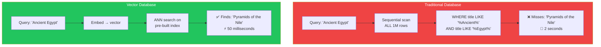
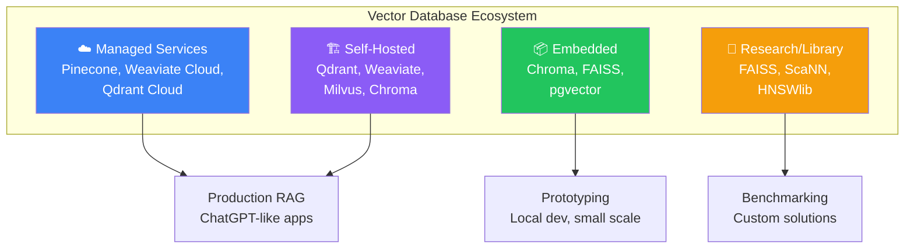
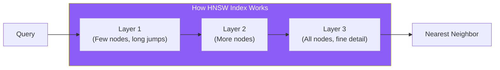
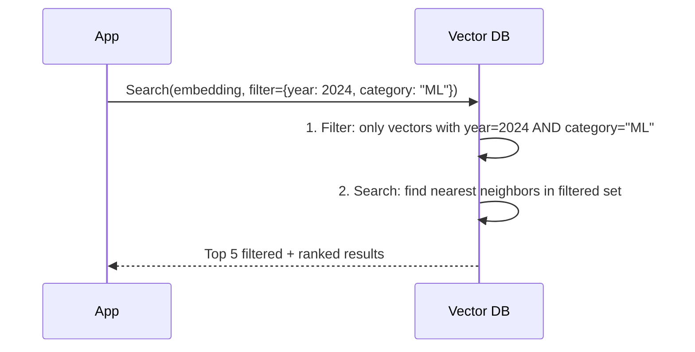
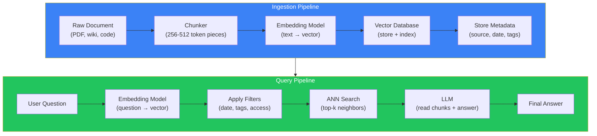
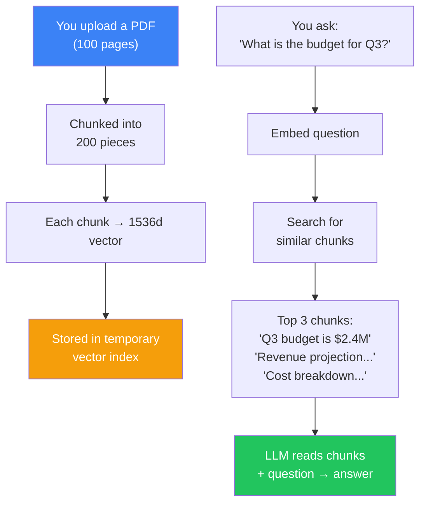

## Introduction

> **A vector database is a database designed specifically for storing and searching vectors. It's optimized for similarity search — finding the "nearest neighbor" vectors to a query — at massive scale.**

You have a million documents. Each document is a 1536-dimensional vector. You need to find the 5 most similar documents to a query in under 100 milliseconds. MySQL can't do that. MongoDB can't do that. Elasticsearch can't do that. **Vector databases were created to solve exactly this problem.**

---

## Why This Concept Exists

### The Problem

Traditional databases are designed for exact matches and range queries. They can find "WHERE price = 100" or "WHERE created_at > '2024-01-01'" instantly. But they cannot efficiently answer "Find the 5 rows most *semantically similar* to this 1536-dimensional vector."

| Operation | SQL Database | Vector Database |
|-----------|-------------|-----------------|
| Find exact match by ID | ✅ Fast | ✅ Fast |
| Find rows where price > 100 | ✅ Fast | ❌ Can't do |
| Sort by column | ✅ Fast | ❌ Not built for |
| Find semantically similar text | ❌ Can't do | ✅ Fast |
| Hybrid: filter by tag + semantic search | ❌ Hard | ✅ Supported |

### The Story

Imagine sorting 1 million grains of sand by color. You lay them out in a line and examine each one. That's what a traditional database does when you ask for a similarity search — it looks at every single row, one by one.

Now imagine a special sorting tray that groups sand by color family automatically. You don't look at every grain — you go directly to the red section and find the closest red grains. That's what a vector database does.

---

## Real-World Analogy

### The Library Card Catalog

A library has millions of books. You want to find books about "ancient Egyptian architecture."

**Traditional Database approach:** Look at every book's metadata and check if "ancient", "Egyptian", and "architecture" appear in the description. Slow, and you'll miss "The Great Monuments of Old Egypt" — which doesn't contain any of those exact words.

**Vector Database approach:** Every book has already been analyzed and placed on a "meaning map." Books about similar topics are shelved together. You find your location on the map and walk to the nearest shelf. You find relevant books in milliseconds.

---

## How Vector Databases Are Different

### Traditional vs Vector Database

| Aspect | SQL (PostgreSQL, MySQL) | MongoDB | Elasticsearch | Vector DB (Pinecone, Qdrant) |
|--------|------------------------|---------|---------------|------------------------------|
| **Primary data** | Tables, rows, columns | JSON documents | Text logs | Vectors (+ metadata) |
| **Search method** | B-tree indexes | B-tree indexes | Inverted index | ANN (HNSW, IVF) |
| **Similarity search** | ❌ Not supported | ❌ Not natively | ❌ Limited | ✅ Built-in |
| **Filtering** | ✅ Excellent | ✅ Excellent | ✅ Good | ✅ Supported |
| **Scalability** | Good | Good | Good | Excellent for vectors |
| **Best for** | Transactions | Documents | Logs, full-text | Semantic search |

---

## Popular Vector Databases

| Database | Type | Open Source | Best For | Key Strength |
|----------|------|-------------|----------|--------------|
| **Pinecone** | SaaS | ❌ | Production RAG | Zero maintenance, managed |
| **Qdrant** | Self-hosted/SaaS | ✅ | Performance | Written in Rust, very fast |
| **Weaviate** | Self-hosted/SaaS | ✅ | Hybrid search | Built-in vectorizer modules |
| **Milvus** | Self-hosted | ✅ | Large scale | Billion-scale ANN |
| **Chroma** | Embedded | ✅ | Prototyping | Simple API, runs locally |
| **FAISS** | Library (not a DB) | ✅ | Research | Fastest index, no built-in persistence |
| **pgvector** | PostgreSQL extension | ✅ | Python/ML stack | Store vectors in existing Postgres |

---

## Key Concepts

### Collections

A **collection** is like a table in SQL — a logical grouping of vectors. You might have one collection for "support-docs", another for "product-catalog", and another for "user-notes".

### Indexes

An **index** is the data structure that enables fast search. The most popular is **HNSW (Hierarchical Navigable Small World)** — a graph-based index that can search billions of vectors in milliseconds.

**How HNSW works (intuitively):**
1. Start at the top layer (fewest nodes, longest connections)
2. Find the closest node at this layer
3. Move to the next layer (more nodes, shorter connections)
4. Refine the search
5. Repeat until you reach the bottom layer with the exact nearest neighbor

This is like finding a city on a map: first zoom out to see continents, then countries, then states, then streets. Each level narrows down the search area.

### Metadata

**Metadata** is additional structured data attached to each vector — like tags, category, date, author, or source URL. Vector databases can filter by metadata *during* similarity search, so you can say: "Find the 5 most similar documents *from 2024* about *machine learning*."

### Namespaces

**Namespaces** are a way to partition data within a collection — like folders. You can have separate namespaces for different customers, projects, or environments, all within the same collection and index.

---

## The Complete Search Pipeline

---

## Real Production Example

### How ChatGPT Answers Questions About Your PDFs

When you upload a PDF to ChatGPT and ask a question:

1. **Ingestion:** ChatGPT chunks the PDF (every ~500 words), embeds each chunk, and stores the vectors
2. **Query:** Your question is embedded with the same model
3. **Search:** The vector database finds the most relevant chunks
4. **Generate:** ChatGPT reads those chunks + your question and generates an answer

---

## Common Mistakes

| Mistake | Why It's Wrong |
|---------|----------------|
| ❌ "I'll use PostgreSQL for everything" | PostgreSQL with pgvector is fine for small-scale, but dedicated vector databases have significantly better performance and features for production RAG at scale |
| ❌ "I don't need a vector database — I'll just loop over all my data" | Looping over 1M vectors in application code is ~2 seconds with optimized numpy. Production requires sub-100ms. Vector databases use ANN indexes to achieve this |
| ❌ "All vector databases are the same" | Different vector databases optimize for different things: Pinecone for ease of use, Qdrant for performance, Weaviate for hybrid search, Milvus for scale, Chroma for prototyping |
| ❌ "Vector databases replace my existing database" | Vector databases complement, not replace, traditional databases. You typically use both — a SQL/NoSQL database for application data and a vector database for semantic search |

---

## Interview Questions

### Easy

**Q: What is a vector database and when would you use one?**

> A vector database is a database designed for storing and searching vectors using similarity. You use it when you need semantic search — finding content by meaning rather than exact keywords. Common use cases include RAG, recommendation systems, and semantic search.

### Intermediate

**Q: How is a vector database different from a traditional database like PostgreSQL?**

> Traditional databases use B-tree indexes for exact matches and range queries. Vector databases use ANN indexes (like HNSW) for similarity search. Vector databases are optimized for finding "nearest neighbors" in high-dimensional space, while traditional databases are optimized for structured queries, joins, and transactions.

### Senior

**Q: Your RAG system needs to search across 10 million documents with sub-100ms latency. Each document has access control tags. Design the architecture.**

> Solution: (1) Use HNSW index with appropriate M (16-32) and ef_construction (200-400) parameters for fast search. (2) Pre-filter using metadata — ensure the vector database supports efficient filtering during ANN search (some databases filter before search, others after — pre-filtering is faster). (3) Use partitioning/namespaces to separate data by access level. (4) Consider a two-tier approach: coarse filter first (by access level), then fine-grained semantic search. (5) Benchmark with your specific data — different vector databases perform differently depending on data distribution and query patterns.

---

## Summary

| Concept | Key Point |
|---------|-----------|
| **Vector Database** | Specialized for storing and searching vectors |
| **Why It Exists** | Traditional databases can't do efficient similarity search |
| **HNSW Index** | Graph-based ANN index for fast approximate search |
| **Metadata Filtering** | Filter by structured fields during similarity search |
| **Popular Options** | Pinecone, Qdrant, Weaviate, Milvus, Chroma, pgvector |
| **Use Case** | RAG, semantic search, recommendations, clustering |

---

## Navigation

**Previous:** [04 — Similarity Search →](./04-similarity-search)

**Next:** Coming soon — **Chunk 2: Building Your First RAG Pipeline** →
