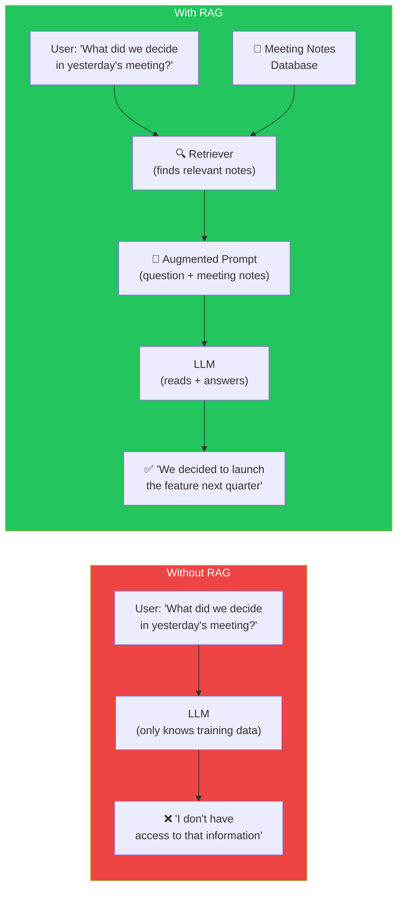
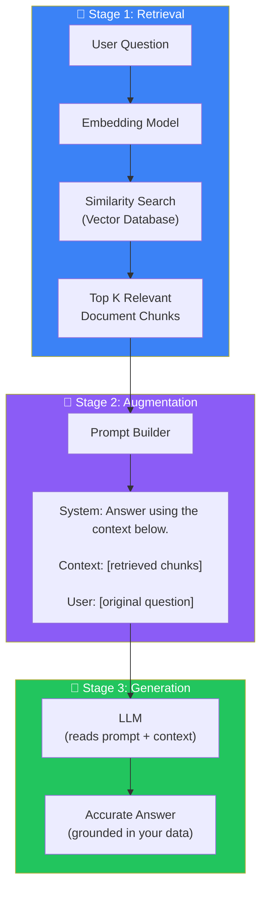
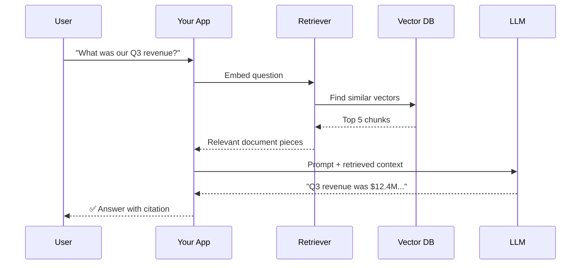
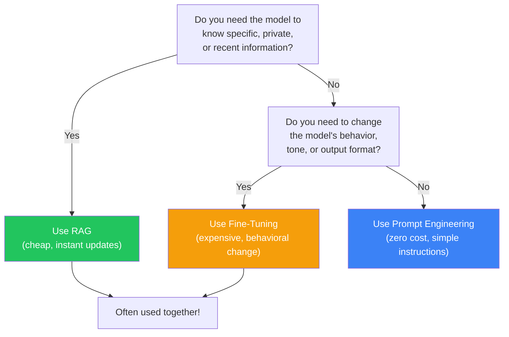

## Introduction

> **Retrieval-Augmented Generation (RAG) is the architecture that lets an LLM answer questions about documents it has never seen — by retrieving relevant information and feeding it into the prompt at query time.**

If you've ever uploaded a PDF to ChatGPT and asked questions about it, you've used RAG. If you've used NotebookLM to ask about your notes, Perplexity to search with citations, or Cursor to understand your codebase — that's RAG. It is the single most important pattern in production AI engineering.

---

## Why This Concept Exists

### The Story

Imagine a doctor who has years of medical training. She knows anatomy, pharmacology, and diagnosis. But before treating a new patient, she doesn't rely on memory alone. She reads the patient's chart — latest blood work, medical history, current symptoms.

The doctor's training is the LLM. The patient's chart is the retrieved knowledge.

Without the chart, the doctor can only give general advice. With the chart, she gives a precise, personalized answer.

**That's RAG.**

---

## Real-World Analogy

### The Open-Book Exam

In school, there are two types of exams:

**Closed-book:** You must answer from memory. If you didn't study it, you can't answer it. This is a pure LLM — limited to its training data.

**Open-book:** You can refer to your notes and textbook during the exam. The questions test your ability to *find and apply* information, not just memorize. This is RAG.

RAG turns every LLM interaction into an open-book exam. The model doesn't need to memorize everything — it just needs to know where to look.

---

## The Three Stages of RAG

### 1. Retrieval

The system searches a knowledge base (vector database) for documents relevant to the user's question. This involves embedding the question and finding nearest neighbors.

### 2. Augmentation

The retrieved documents are inserted into the LLM's prompt alongside the original question. The prompt tells the LLM: "Answer based on these documents."

### 3. Generation

The LLM generates a response using the retrieved context. Because the relevant information is right there in the prompt, the answer is accurate and grounded in your data.

---

## The Complete RAG Flow

---

## Why RAG Exists

### The Problem RAG Solves

| Problem | Without RAG | With RAG |
|---------|-------------|----------|
| **Knowledge cutoff** | LLM doesn't know recent events | Retrieves current documents |
| **Private data** | LLM has never seen your docs | Retrieves from your knowledge base |
| **Hallucinations** | LLM guesses when unsure | Grounds answers in retrieved facts |
| **Cost** | Fine-tuning is expensive | No training needed, just indexing |
| **Updates** | Must retrain to add knowledge | Just add new documents |

### When to Use RAG vs Alternatives

| Approach | Best For | Cost | Update Frequency |
|----------|----------|------|-----------------|
| **RAG** | Specific knowledge, private data, frequent updates | Low (per-query) | Instant |
| **Fine-tuning** | Changing model behavior, tone, format | High (training) | Weeks |
| **Prompt engineering** | Simple instructions, no new knowledge | Zero | Instant |
| **Retraining** | Updating core knowledge | Very high | Months |

### RAG vs Fine-Tuning: Decision Flow

---

## Real Production Examples

| Product | What It Retrieves | How RAG Helps |
|---------|------------------|---------------|
| **ChatPDF** | Your uploaded PDFs | Ask questions about any document |
| **NotebookLM** | Your notes, sources, transcripts | Research assistant that knows your materials |
| **Cursor / Copilot** | Your codebase | Code completion aware of your project |
| **Perplexity** | Web search results | Answers with real-time sources |
| **Claude Projects** | Your uploaded files | Project-specific knowledge |
| **Customer Support Bots** | Knowledge base articles | Accurate answers from company docs |

---

## Common Mistakes

| Mistake | Why It's Wrong |
|---------|----------------|
| ❌ "RAG replaces fine-tuning" | They serve different purposes. RAG adds knowledge; fine-tuning changes behavior. Use both together |
| ❌ "I can send my entire knowledge base in one prompt" | Context windows are limited. RAG selects the *most relevant* pieces — you can't fit everything |
| ❌ "RAG guarantees no hallucinations" | RAG reduces hallucinations by grounding answers, but the LLM can still ignore or misinterpret retrieved context |

---

## Interview Questions

### Easy

**Q: What does RAG stand for and what does it do?**

> Retrieval-Augmented Generation. It retrieves relevant documents from a knowledge base, augments the LLM's prompt with them, and generates a response grounded in those documents.

### Intermediate

**Q: What are the three stages of RAG and what happens in each?**

> (1) **Retrieval** — search a vector database for documents similar to the query. (2) **Augmentation** — insert retrieved documents into the LLM prompt. (3) **Generation** — LLM reads the prompt and generates an answer based on the provided context.

### Senior - Architecture

**Q: Design a RAG system for a customer support chatbot that serves 10,000 users. Consider latency, cost, and accuracy.**

> Architecture: (1) **Indexing pipeline** — chunk support docs, embed with text-embedding-3-small, store in Pinecone/Qdrant with metadata filters (product, category). (2) **Query pipeline** — user question → embed → hybrid search (semantic + keyword) → top 5 chunks → rerank with cross-encoder → LLM generates answer. (3) **Caching** — cache frequent queries (same question, same answer). (4) **Monitoring** — track retrieval precision, hallucination rate, user feedback. (5) **Cost optimization** — use smaller LLM (GPT-4o-mini) for simple queries, fall back to larger model for complex ones.

---

## Summary

| Concept | Key Point |
|---------|-----------|
| **RAG** | Architecture that grounds LLM answers in retrieved documents |
| **Retrieval** | Find relevant documents from a knowledge base |
| **Augmentation** | Insert retrieved context into the LLM prompt |
| **Generation** | LLM produces answer using the provided context |
| **Why it matters** | Accurate, up-to-date, private, no retraining needed |

---

## Navigation

**Previous:** [05 — Vector Databases Introduction →](./05-vector-databases-introduction)

**Next:** [07 — Document Chunking →](./07-document-chunking)
