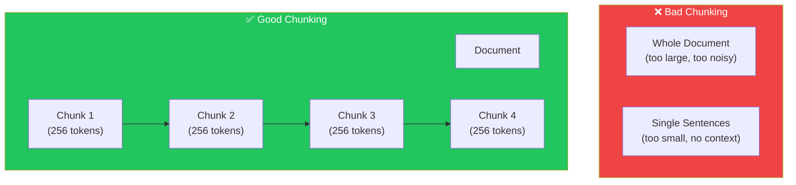
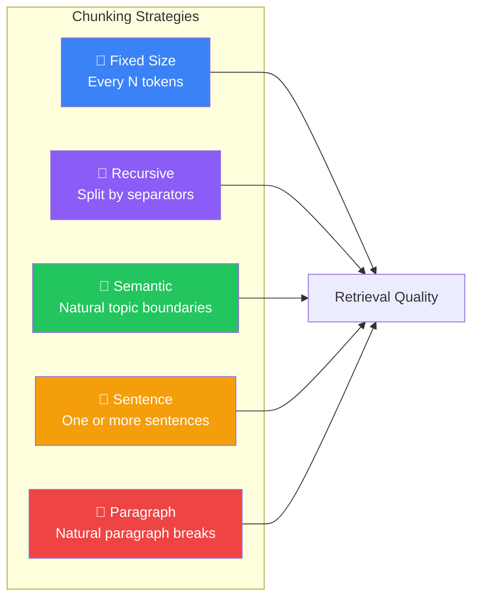
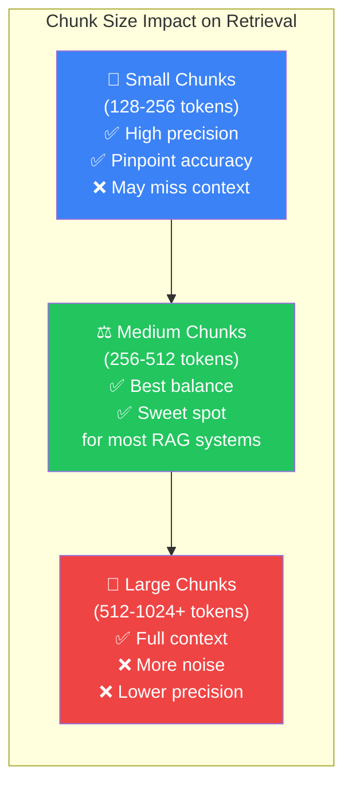
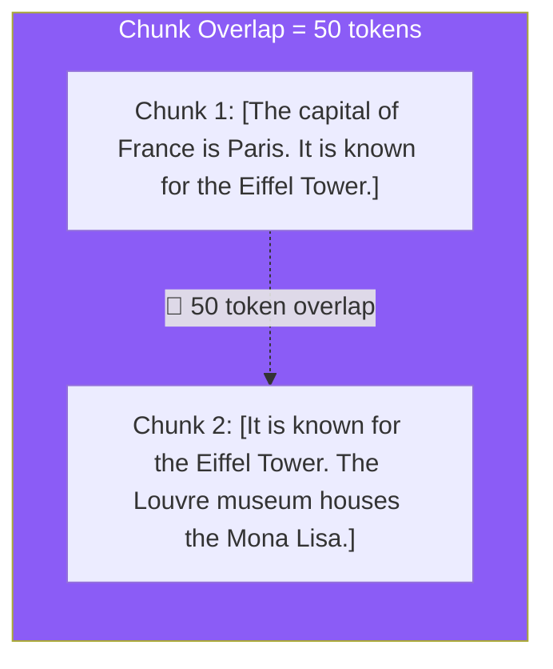

## Introduction

> **Chunking is the process of splitting a document into smaller pieces before embedding them. It's the single most impactful design decision in any RAG system — get it wrong, and retrieval quality suffers dramatically.**

You can't embed an entire 100-page PDF as one vector — the embedding model has a maximum input length (typically 512 tokens), and a single vector for a whole document would lose all its detail. You also can't embed every sentence separately — individual sentences often lack enough context to be meaningful. Chunking finds the sweet spot.

---

## Why This Concept Exists

### The Story

You have a 1000-page textbook. You need to find information about "quantum entanglement."

**Bad approach:** Hand the LLM the entire textbook and say "find it." The context window is too small, and the relevant paragraph is buried in 200,000 words of noise.

**Also bad:** Cut the textbook into individual sentences. Now "Quantum entanglement was first described by Einstein" and "He called it 'spooky action at a distance'" are in separate chunks. The LLM misses the connection.

**Good approach:** Cut the textbook into meaningful sections — paragraphs or pages — where each chunk is self-contained but has enough context to be useful. Now the LLM finds the right section and understands the full explanation.



---

## Real-World Analogy

### The Highway Rest Stops

Imagine driving across a country. You need to stop for fuel, food, and rest. Chunking is like deciding where to place rest stops.

**Too few stops:** You run out of fuel between stops. (Chunks too large — lose granularity.)

**Too many stops:** You spend all your time exiting and re-entering the highway. (Chunks too small — lose context and increase cost.)

**Good spacing:** Rest stops every 50-100 miles, with enough services at each stop. (Good chunk size — balanced for retrieval.)

---

## Chunking Strategies



### 1. Fixed-Size Chunking

Split the document every N tokens (e.g., every 256 or 512 tokens). Simple, fast, but may cut sentences in half.

```
[The capital of France is Paris. It is known for the Eiffel Tower.][The Louvre museum houses the Mona Lisa. Paris is also famous for its cuisine.]
  ↑ Chunk 1 (256 tokens)                                    ↑ Chunk 2 (256 tokens)
```

| Pros | Cons |
|------|------|
| Simplest to implement | May split mid-sentence |
| Predictable chunk sizes | Loses semantic boundaries |
| Fast processing | Context may be broken |

### 2. Recursive Chunking

Split the document by natural separators — paragraphs first, then sentences, then words — until chunks are within the target size. This is the default in most RAG frameworks.

```
Document → Split by paragraphs → If chunks > max size, split by sentences → Repeat
```

| Pros | Cons |
|------|------|
| Respects natural boundaries | Slightly more complex |
| Cleaner chunks | May produce uneven sizes |
| Best default choice | — |

### 3. Semantic Chunking

Use an embedding model to detect natural topic boundaries — where the topic shifts, that's where a new chunk begins. The most sophisticated approach.

```
[The history of ancient Rome...] ← Topic: Roman Empire
[Quantum mechanics revolutionized...] ← Topic: Physics (new chunk)
```

| Pros | Cons |
|------|------|
| Best topic coherence | Computationally expensive |
| Most meaningful chunks | Requires additional model calls |
| Ideal for long documents | Overkill for simple docs |

### 4. Sentence Chunking

Split into individual sentences or merge sentences until reaching the target size. Good for question-answering where answers are typically sentence-length.

### 5. Paragraph Chunking

Use the existing paragraph structure of the document. Natural for well-structured content like Wikipedia articles.

---

## Chunk Size & Overlap

### Chunk Size

The number of tokens per chunk. This is your most important parameter.

#### Chunk Size Impact



| Chunk Size | Best For | Trade-off |
|-----------|----------|-----------|
| **128-256 tokens** | Factual Q&A, specific lookups | May miss broader context |
| **256-512 tokens** | General RAG (sweet spot) | Good balance |
| **512-1024 tokens** | Summary, analysis | More noise per chunk |
| **1024+ tokens** | Long-form content | Loses granularity |

### Chunk Overlap

Overlap ensures that context isn't lost at chunk boundaries. If a sentence spans two chunks, overlap preserves the full meaning.



| Overlap | Effect |
|---------|--------|
| **0 tokens** | No redundancy, but may lose context at boundaries |
| **10-20% of chunk size** | Recommended default |
| **50%+** | High redundancy, more storage, but safer |

---

## Good Chunk vs Bad Chunk

### Good Chunk ✅

```
"The Eiffel Tower was completed in 1889 as the centerpiece of the World's Fair.
It is 330 meters tall and was the tallest structure in the world until 1930.
Today, it is one of the most visited monuments in the world."
```

- Self-contained meaning
- Enough context to understand
- Clear topic (Eiffel Tower facts)

### Bad Chunk ❌

```
"t was completed in 1889 as the center"
```
- Cuts mid-sentence
- Meaningless on its own
- Cannot be retrieved usefully

---

## Common Mistakes

| Mistake | Why It's Wrong |
|---------|----------------|
| ❌ "I'll use the same chunk size for all documents" | Different content needs different chunking. Code needs smaller chunks than articles. Legal docs need larger chunks than FAQs |
| ❌ "I don't need chunk overlap" | Without overlap, sentences split across chunk boundaries lose context. Always use at least some overlap (10-20%) |
| ❌ "Bigger chunks are always better" | Larger chunks contain more noise and reduce the precision of retrieval. The LLM has to find the needle in a bigger haystack |
| ❌ "I'll chunk once and never revisit" | Chunking strategy should be tested and iterated. What works for one use case may fail for another |

---

## Interview Questions

### Easy

**Q: What is chunking in the context of RAG?**

> Chunking is splitting documents into smaller pieces before embedding them. Each chunk becomes a searchable unit. The goal is to create chunks that are self-contained and meaningful for retrieval.

### Intermediate

**Q: How do you choose the right chunk size?**

> It depends on your content and use case. For factual Q&A (short answers), use smaller chunks (128-256 tokens). For summarization or analysis, use larger chunks (512-1024 tokens). The sweet spot for general RAG is 256-512 tokens. Always test different sizes with your specific data.

### Senior - Architecture

**Q: Design a chunking strategy for a RAG system that handles PDFs, code repositories, and meeting transcripts.**

> Use different strategies per content type: (1) **PDFs/articles** — recursive chunking at 512 tokens with 20% overlap, splitting by paragraphs then sentences. (2) **Code** — function-level chunking (one function per chunk), with imports as metadata. (3) **Meeting transcripts** — speaker-turn-based chunking (each speaker's segment is a chunk), with timestamp metadata. (4) Store chunk type as metadata for retrieval filtering. (5) Implement a fallback: if a chunk is too small (<50 tokens), merge with the next chunk.

---

## Summary

| Concept | Key Point |
|---------|-----------|
| **Chunking** | Splitting documents into searchable pieces |
| **Chunk Size** | 256-512 tokens is the sweet spot |
| **Overlap** | 10-20% prevents context loss at boundaries |
| **Strategies** | Recursive is best default; semantic for long docs |
| **Impact** | The most important RAG parameter — get it right |

---

## Navigation

**Previous:** [06 — What is RAG? →](./06-what-is-rag)

**Next:** [08 — Document Ingestion Pipeline →](./08-document-ingestion-pipeline)
