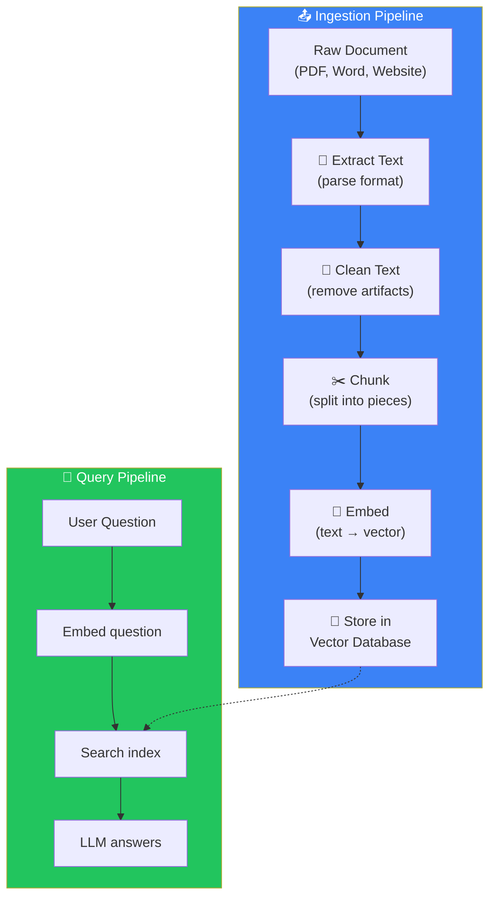
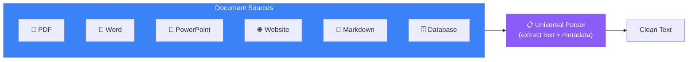
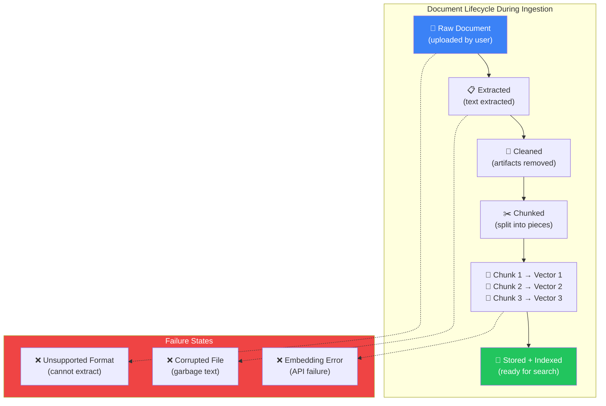
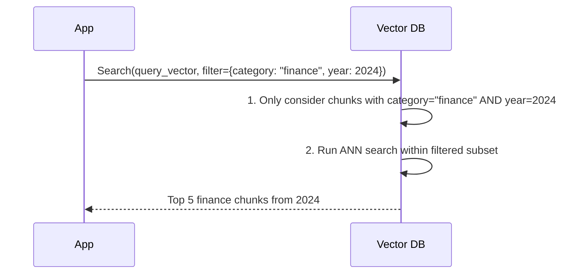
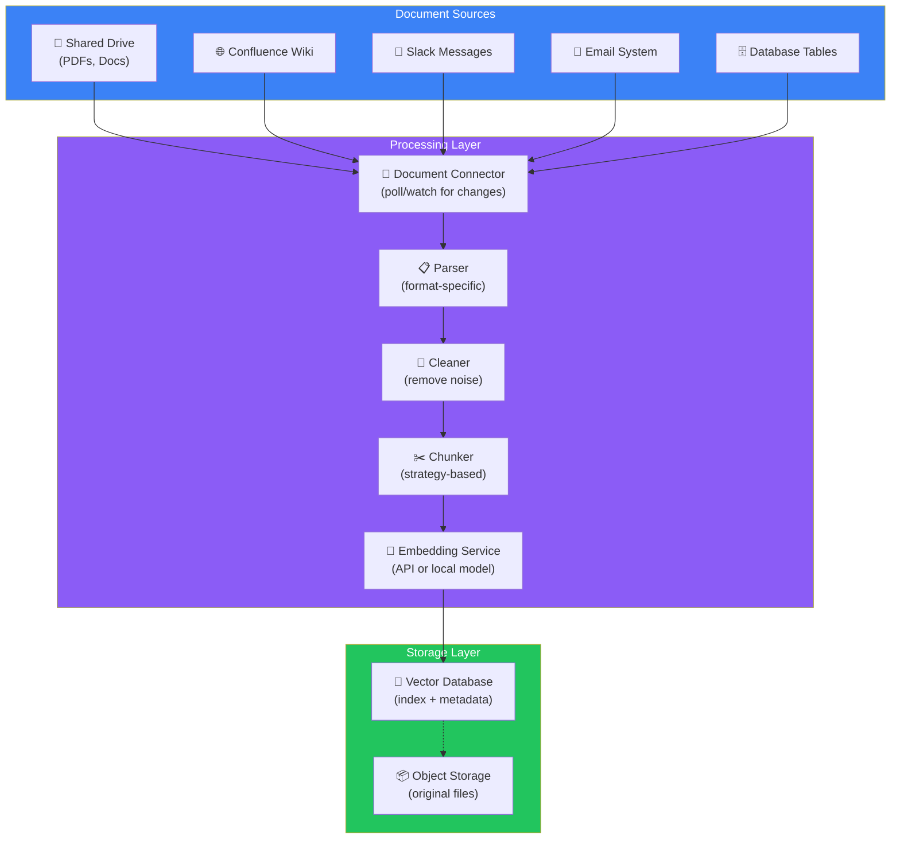

## Introduction

> **The ingestion pipeline is the process that converts raw documents into searchable vectors. Every time you upload a PDF to ChatGPT, a document goes through this pipeline before you can ask questions about it.**

Ingestion happens *before* anyone asks a question. It's the "indexing" phase — preparing your knowledge base so that retrieval is fast and accurate when queries arrive.

---

## Why This Concept Exists

### The Story

You upload a 50-page PDF to ChatGPT. What happens inside?

You click "upload." A few seconds later, you can ask questions. But between those two moments, an entire pipeline runs — extracting text from the PDF, splitting it into chunks, converting each chunk to an embedding vector, and storing everything in a vector database.

If you understand this pipeline, you understand how every RAG system works.



---

## Real-World Analogy

### The Library Cataloging System

When a library receives a new book, it doesn't just throw it on a shelf. It goes through a process:

1. **Catalog the book** — register its title, author, ISBN (like extracting text from PDF)
2. **Clean the record** — fix typos, standardize formatting (like cleaning text)
3. **Create index cards** — write summary cards for each chapter (like chunking)
4. **File the cards** — organize in the card catalog by topic (like embedding and storing)

When you later ask a librarian a question, they go to the card catalog, find the relevant cards, and retrieve the books. The cataloging happened *before* you asked.

**That's the ingestion pipeline.**

---

## Step-by-Step Pipeline

### Step 1: Extract Text

Documents come in many formats. Each needs a different extraction method:

| Format | Extraction Method | Example Tools |
|--------|------------------|---------------|
| **PDF** | Parse pages, extract text + metadata | PyMuPDF, pdfplumber, Unstructured |
| **Word (.docx)** | Read XML-based document structure | python-docx |
| **PowerPoint** | Extract text from slides | python-pptx |
| **Excel** | Read cell values | openpyxl |
| **Website** | Crawl and scrape content | BeautifulSoup, Trafilatura |
| **Markdown** | Read raw markdown | Built-in parsers |
| **GitHub Repo** | Clone and read source files | GitPython |
| **Database** | Run SQL queries | SQL connectors |
| **Email** | Parse .eml or .msg files | extract_msg |



### Step 2: Clean Text

Raw extracted text often contains artifacts that hurt retrieval quality:

- **Headers and footers** — "Page 23 of 150" repeated on every chunk
- **Navigation menus** — "Home | Products | About Us" from web scraping
- **Special characters** — broken Unicode, emojis, non-printable characters
- **Extra whitespace** — double spaces, line breaks in the middle of sentences
- **OCR errors** — especially in scanned PDFs ("c1ear" instead of "clear")

**Cleaning transforms:**
```
"Page 23 of 150\n\nHome | Products | About Us\n\nThe Eiffel Tower was\ncompleted in 1889..."
```

Into:
```
"The Eiffel Tower was completed in 1889..."
```

### Step 3: Chunk

#### Document Processing States



Split the cleaned text into pieces. This is covered in detail in [Document 07](./07-document-chunking). Each chunk should be:

- Self-contained (makes sense on its own)
- Correctly sized (256-512 tokens)
- Properly overlapped (10-20% overlap)

### Step 4: Embed

Convert each chunk into a vector using an embedding model. This creates the numerical representation that enables similarity search.

```
Chunk → Embedding Model → [0.45, -0.12, 0.78, ..., 0.33]
                           (768 or 1536 numbers)
```

### Step 5: Store

Store the vectors in a vector database, along with metadata:

```
Vector DB Entry:
{
  vector: [0.45, -0.12, 0.78, ..., 0.33],  // The embedding
  metadata: {
    chunk_id: "doc-042-chunk-07",
    document_id: "q3-report-2024.pdf",
    source: "internal-drive/finance/Q3_2024.pdf",
    page: 12,
    author: "John Smith",
    date: "2024-09-30",
    category: "finance",
    tags: ["quarterly", "revenue", "projections"]
  },
  text: "Q3 revenue reached $12.4M, up 18% year over year..."
}
```

---

## Metadata: Why It Matters

Metadata is structured data attached to each chunk. It enables filtering *during* retrieval, so you can search within specific subsets of your knowledge base.



**Common metadata fields:**

| Field | Example | Use |
|-------|---------|-----|
| `document_id` | "doc-042" | Link back to source document |
| `source` | "https://example.com/page" | URL or file path |
| `page` | 12 | Page number in PDF |
| `author` | "John Smith" | Document author |
| `date` | "2024-09-30" | For temporal filtering |
| `category` | "finance" | Topic/department |
| `tags` | ["urgent", "approved"] | Custom labels |
| `access_level` | "internal" | Access control |

---

## Production Ingestion Pipeline



---

## Common Mistakes

| Mistake | Why It's Wrong |
|---------|----------------|
| ❌ "I'll re-ingest everything every time" | Incremental updates are critical. Re-ingesting 1M documents daily is expensive. Track what changed and only update those |
| ❌ "Metadata doesn't matter for search" | Metadata is essential for filtering, access control, and provenance tracking. Without it, every search searches *everything* |
| ❌ "I'll store original files in the vector DB" | Vector databases are not blob storage. Store vectors + metadata in the vector DB, and original files in object storage (S3, GCS) |
| ❌ "Text extraction always works perfectly" | Scanned PDFs, complex layouts, and non-standard fonts frequently produce garbage text. Always inspect a sample of extracted output |

---

## Interview Questions

### Easy

**Q: What are the five steps of a document ingestion pipeline?**

> (1) Extract text from raw document, (2) Clean the extracted text, (3) Chunk into pieces, (4) Embed each chunk into a vector, (5) Store vectors + metadata in a vector database.

### Intermediate

**Q: Why do we store metadata alongside vectors in the database?**

> Metadata enables filtering during retrieval (search only within a date range, category, or access level). It also provides provenance — linking each chunk back to its source document for citation and debugging.

### Senior - Architecture

**Q: Design an ingestion pipeline that handles 10,000 new documents per day with incremental updates.**

> Architecture: (1) **Event-driven triggers** — watch file system / S3 bucket / webhook for new or modified documents. (2) **Message queue** (RabbitMQ/SQS) to decouple ingestion from document arrival. (3) **Worker pool** — scalable workers that process documents: extract → clean → chunk → embed → store. (4) **Change tracking** — store document hash to detect modifications. (5) **Incremental indexing** — only re-index changed documents. (6) **Failure handling** — dead letter queue for failed documents with retry logic. (7) **Monitoring** — track ingestion throughput, error rate, and indexing delay.

---

## Summary

| Step | What Happens | Why It Matters |
|------|-------------|----------------|
| **Extract** | Parse document format | Different formats need different parsers |
| **Clean** | Remove artifacts | Dirty text = bad embeddings = bad retrieval |
| **Chunk** | Split into pieces | Right chunk size is critical |
| **Embed** | Convert to vector | Enables similarity search |
| **Store** | Save in vector DB | Fast retrieval at scale |

---

## Navigation

**Previous:** [07 — Document Chunking →](./07-document-chunking)

**Next:** [09 — Retrievers →](./09-retrievers)
