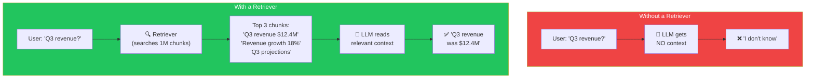
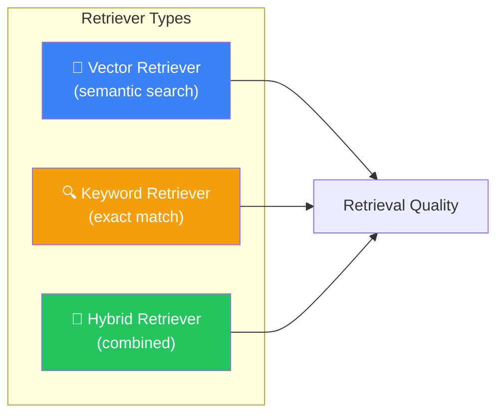
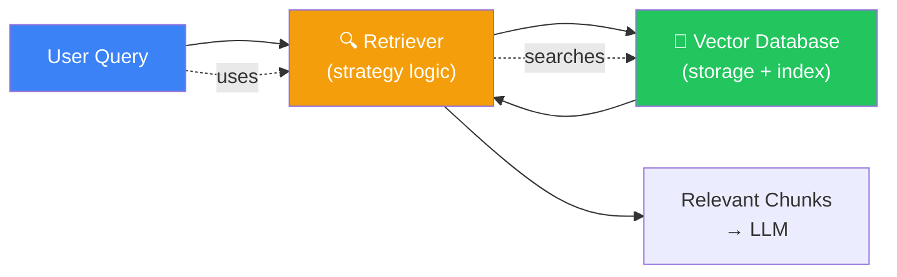
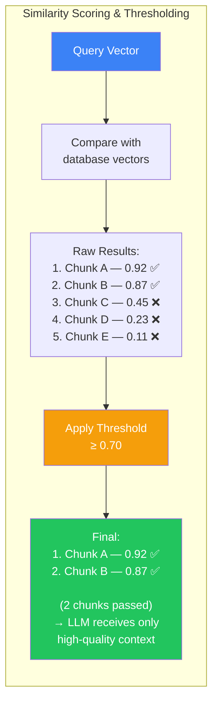
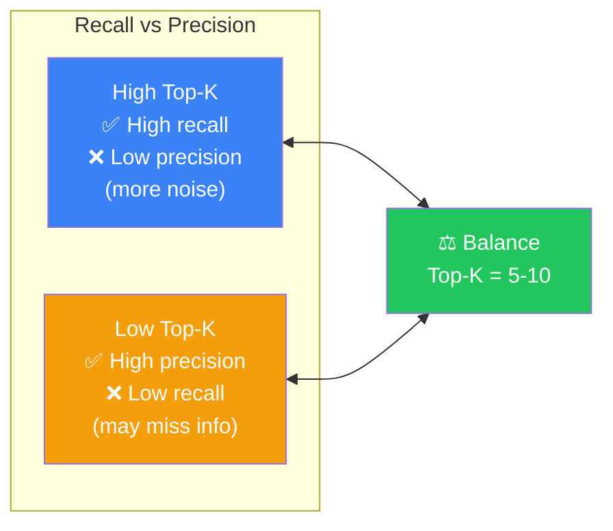

## Introduction

> **A retriever is the component that decides which document chunks to fetch for a given query. It's the "search" part of RAG — the bridge between the user's question and the knowledge base.**

The retriever takes a user's question, converts it to an embedding, searches the vector database, and returns the most relevant chunks. It's the component that determines *what the LLM gets to read* — making it arguably the most important piece of the RAG pipeline in terms of output quality.

---

## Why This Concept Exists

### The Story

Imagine a librarian with a million books. You ask "What was our Q3 revenue?"

**Without a retriever:** The librarian brings you every book in the library. You'll never find the answer.

**With a bad retriever:** The librarian brings you 5 random books. You might get lucky, but probably not.

**With a good retriever:** The librarian goes directly to the finance section, picks the Q3 report, opens to the revenue page, and hands you exactly the paragraph you need.

The retriever is what makes this possible at machine scale.



---

## Real-World Analogy

### The Research Assistant

A retriever is like a research assistant who:
- Hears your question
- Goes to the filing cabinet
- Finds the most relevant files
- Brings them back to you
- You read them and answer

The research assistant is NOT the filing cabinet. The filing cabinet is the vector database. The assistant is the *search strategy* — how they decide which files to grab.

---

## Types of Retrievers



### 1. Vector Retrieval (Semantic Search)

The most common retriever type. Embeds the query and finds nearest neighbors in vector space.

```
Query: "How do I reset my password?"
→ Embed query → Find nearest chunks
→ Returns: "Password reset instructions", "Account recovery", "Forgot password flow"
```

**Pros:** Understands meaning, synonyms, intent
**Cons:** Can miss exact keyword matches, requires embedding model

### 2. Keyword Retrieval (BM25 / Elasticsearch)

Uses traditional text search — matching exact words and phrases.

```
Query: "reset password"
→ Find chunks containing "reset" AND "password"
→ Returns: "Password reset instructions", "Reset security questions"
```

**Pros:** Fast, predictable, good for exact matches
**Cons:** Misses synonyms, no understanding of meaning

### 3. Hybrid Retrieval

Combines vector and keyword search — takes the best of both worlds. Most production systems use this.

```
Query: "How do I get a new password?"
↓
Vector search finds: "Password recovery steps", "Account reset guide"
Keyword search finds: "New password requirements", "Password policy"
↓
Merge + rerank → Top K results
```

---

## Retriever vs Vector Database

This is one of the most common points of confusion for beginners:

| Component | What It Does | Analogy |
|-----------|-------------|---------|
| **Vector Database** | Stores vectors and provides efficient ANN search | The filing cabinet |
| **Retriever** | The strategy/logic for *how* to search and *what* to retrieve | The research assistant |

**The retriever uses the vector database.** The vector database provides the raw search capability; the retriever decides how to use it.



---

## Key Retriever Concepts

### Top-K

The number of chunks to retrieve. Most common values:

| Top-K | Use Case | Trade-off |
|-------|----------|-----------|
| 3-5 | Factual Q&A, precise answers | Fast, focused |
| 5-10 | General RAG (sweet spot) | Good balance |
| 10-20 | Summarization, analysis | More context, more noise |

### Filtering

Retrieve only from chunks matching certain metadata criteria:

```
"Find chunks about Q3 revenue, but only from documents tagged 'finance' in 2024"
→ Vector search + metadata filter: {category: "finance", year: 2024}
```

### Scoring & Thresholding

Don't just return top-K blindly. Set a minimum similarity threshold:

```
Similarity scores: [0.92, 0.87, 0.45, 0.23, 0.11]
Threshold: 0.7
Return: [0.92, 0.87]  ← Only 2 chunks, not 5
```

#### Thresholding Visualization



This prevents the LLM from reading irrelevant chunks when no good matches exist.

---

## Retrieval Quality Metrics

### Recall

How many *relevant* chunks did we retrieve out of all the relevant chunks that exist?

> If there are 10 relevant chunks in the database and we retrieved 8 of them, recall = 80%.

### Precision

How many of the chunks we retrieved are actually relevant?

> If we retrieved 10 chunks and only 5 are relevant, precision = 50%.

### The Trade-off



**Goal:** Retrieve *enough* chunks to have the answer (recall) without so many that the LLM gets confused by noise (precision).

---

## Common Mistakes

| Mistake | Why It's Wrong |
|---------|----------------|
| ❌ "Retriever and vector database are the same thing" | The vector database stores and indexes vectors. The retriever is the strategy for searching them. You can have the same vector DB with different retrievers |
| ❌ "I'll always retrieve top-K chunks regardless of relevance" | If no chunks are relevant, the LLM will hallucinate. Always use a similarity threshold to filter out low-quality matches |
| ❌ "Vector retrieval alone is always enough" | For many use cases, hybrid retrieval (vector + keyword) significantly outperforms either alone. Keyword search catches exact matches that vector search misses |
| ❌ "Higher top-K always means better answers" | More context means more noise. The LLM can get distracted by irrelevant chunks. Find the minimum top-K that captures the answer |

---

## Interview Questions

### Easy

**Q: What is a retriever in a RAG system?**

> A retriever is the component that searches the knowledge base for document chunks relevant to the user's question. It takes the query, finds the most relevant chunks (using vector search, keyword search, or both), and returns them to be included in the LLM's prompt.

### Intermediate

**Q: What's the difference between a retriever and a vector database?**

> A vector database stores vectors and provides efficient ANN search. A retriever is the strategy that decides *how* to search — which embedding model to use, what filters to apply, whether to combine vector and keyword search, and how many results to return. The retriever *uses* the vector database.

### Senior - Architecture

**Q: Design a retriever strategy for a legal document search system where precision is critical (wrong answers could have legal consequences).**

> Strategy: (1) **Hybrid retrieval** — combine BM25 (keyword) for exact legal terminology + vector search for semantic matches. (2) **High threshold** — set similarity threshold at 0.85 to ensure only highly relevant chunks are returned. (3) **Reranking** — take top 50 from hybrid search, rerank with a cross-encoder for maximum precision. (4) **Multi-stage** — first retrieve by case number/statute (metadata filter), then search within that subset. (5) **Confidence check** — if top chunk similarity < 0.7, return "I couldn't find a definitive answer" rather than guessing. (6) **Audit trail** — log which chunks were retrieved for every query.

---

## Summary

| Concept | Key Point |
|---------|-----------|
| **Retriever** | The strategy for finding relevant document chunks |
| **Top-K** | How many chunks to retrieve (5-10 is sweet spot) |
| **Filtering** | Search within metadata constraints |
| **Thresholding** | Don't return low-relevance chunks |
| **Retriever ≠ Vector DB** | Retriever = strategy, Vector DB = storage |
| **Hybrid Search** | Combine vector + keyword for best results |

---

## Navigation

**Previous:** [08 — Document Ingestion Pipeline →](./08-document-ingestion-pipeline)

**Next:** [10 — Building a Complete RAG Pipeline →](./10-building-a-complete-rag-pipeline)
