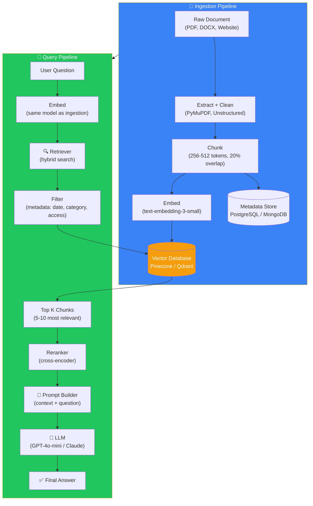
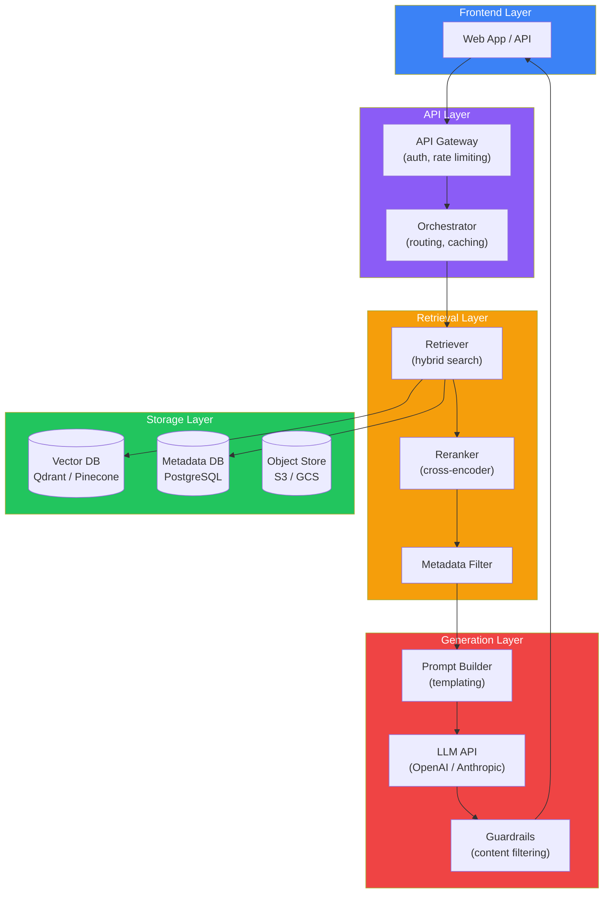
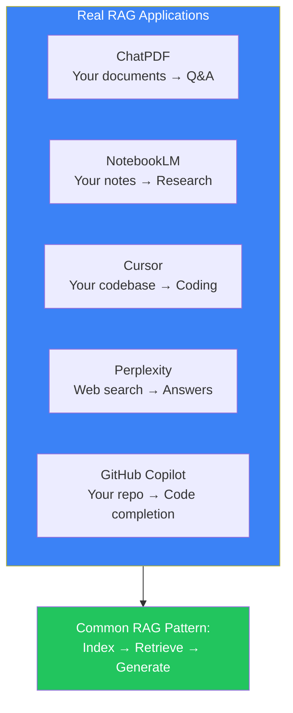

## Introduction

> **This is the final document in the RAG fundamentals series. Everything you've learned — embeddings, vector databases, chunking, ingestion, retrievers — comes together here into a complete, production-ready RAG pipeline.**

By the end of this document, you'll understand how systems like ChatPDF, NotebookLM, Cursor, and Perplexity work under the hood. And you'll know how to build one yourself.

---

## Why This Concept Exists

### The Story

You've learned the individual ingredients:
- Embeddings (how meaning becomes vectors)
- Vector databases (where vectors live)
- Chunking (how documents are split)
- Ingestion (how documents enter the system)
- Retrievers (how relevant chunks are found)
- RAG (how retrieval + LLM work together)

Now it's time to see the **full recipe** — how all these ingredients combine into a complete system that can answer questions about any document.

---

## Architecture Overview

---

## Real-World Analogy

### The Complete Restaurant

A RAG pipeline is like a restaurant:

| Component | Analogy | Role |
|-----------|---------|------|
| **Raw documents** | Ingredients in storage | Unprocessed data |
| **Extraction** | Washing and chopping | Preparing data |
| **Chunking** | Portioning into servings | Creating searchable units |
| **Embedding** | Labeling each portion | Making it findable |
| **Vector DB** | The organized pantry | Fast storage and retrieval |
| **Retriever** | The chef's order system | Finding the right ingredients |
| **Reranker** | Taste-testing | Ensuring quality |
| **LLM** | The head chef | Creating the final dish |
| **Answer** | The plated meal | The final output |

---

## Step-by-Step Full Pipeline

### Step 1: User Uploads a Document

1. User uploads a PDF (or Word doc, or website URL)
2. The system extracts text content from the file
3. Text is cleaned (remove headers, footers, artifacts)
4. Cleaned text is chunked into pieces (400 chunks for a 100-page PDF)
5. Each chunk is embedded into a vector
6. All vectors + metadata are stored in a vector database

### Step 2: User Asks a Question

1. User asks a question
2. Question is embedded with the same embedding model
3. Vector database finds the nearest neighbor chunks
4. Retrieved chunks are combined with the original question in a prompt
5. LLM reads the prompt and generates a grounded answer

---

## Production Architecture

---

## How Real Products Use RAG

| Product | What It Indexes | How It Retrieves | What It Generates |
|---------|----------------|------------------|-------------------|
| **ChatPDF** | Your uploaded PDFs | Semantic search on chunks | Answers about document content |
| **NotebookLM** | Your notes, sources | Semantic + keyword hybrid | Research insights, summaries |
| **Cursor** | Your entire codebase | Code-aware embeddings | Code completions, edits |
| **Perplexity** | Live web pages | Web search → rerank | Answers with citations |
| **GitHub Copilot** | Your repository | Context-aware retrieval | Code suggestions |
| **Claude Projects** | Your uploaded files | Semantic search | Project-specific answers |

---

## Production Considerations

### Latency

| Component | Typical Time | Optimization |
|-----------|-------------|--------------|
| Embedding the query | 50-100ms | Cache frequent queries |
| Vector search | 10-50ms | Optimize HNSW parameters |
| Reranking | 20-100ms | Only rerank top 20-50 |
| LLM generation | 500-2000ms | Use smaller model when possible |
| **Total** | **~600-2250ms** | Streaming for faster perceived time |

### Cost

| Component | Cost Driver | Saving Strategy |
|-----------|-------------|-----------------|
| Embedding | Per-query API costs | Self-host open-source models |
| Vector DB | Storage + compute | Proper index tuning, tiered storage |
| LLM | Token generation | Caching, smaller models, prompt compression |

### Security

- **Access control** — Filter retrieval by user permissions (only retrieve documents the user can see)
- **PII detection** — Scan documents for personal information before ingestion
- **Prompt injection** — Validate that user queries don't try to override the system prompt
- **Audit logging** — Log every retrieval and generation for compliance

### Monitoring

| Metric | What It Tracks | Target |
|--------|---------------|--------|
| **Retrieval precision** | % of relevant chunks in top-K | >80% |
| **Hallucination rate** | % of answers not grounded in context | <5% |
| **Latency p95** | Response time for 95th percentile | <3s |
| **User feedback** | Thumbs up/down rate | >90% positive |

---

## Comparison Tables

### RAG vs Fine-Tuning

| Aspect | RAG | Fine-Tuning |
|--------|-----|-------------|
| **Goal** | Add knowledge at query time | Change model behavior |
| **Cost** | Low (per-query) | High (training) |
| **Update speed** | Instant (add documents) | Slow (retrain) |
| **Knowledge type** | Specific, private, recent | Behavioral, format, style |
| **Best for** | Q&A on your data | Tone, output format, role-play |
| **Can be combined?** | ✅ Yes — RAG + fine-tuned model together | ✅ Yes |

### Retriever vs Vector Database

| Aspect | Retriever | Vector Database |
|--------|-----------|-----------------|
| **Role** | Search strategy | Storage + index |
| **Examples** | Hybrid retriever, BM25 retriever | Pinecone, Qdrant, Weaviate |
| **Decides** | How to search, what to filter | Where to search, how fast |
| **Output** | Top-K chunks + scores | Raw nearest neighbors |

### Chunking Strategies

| Strategy | Quality | Speed | Best For |
|----------|---------|-------|----------|
| Fixed size | Medium | Fastest | Simple documents |
| Recursive | Good | Fast | General RAG |
| Semantic | Best | Slowest | Long-form content |
| Sentence | Medium | Fast | Factual Q&A |

### Keyword vs Semantic Search

| Aspect | Keyword (BM25) | Semantic (Vector) |
|--------|---------------|-------------------|
| **Matches** | Exact words | Meaning |
| **Synonyms** | ❌ Misses | ✅ Finds |
| **Typos** | ❌ Misses | ✅ Handles |
| **Speed** | ⚡ Very fast | 🐢 Slower |
| **Best for** | Product codes, names | Natural language queries |

---

## Common Mistakes

| Mistake | Why It's Wrong |
|---------|----------------|
| ❌ "I'll use the same model for embedding and generation" | Embedding models and generation models serve different purposes. Use specialized models for each (e.g., text-embedding-3-small for embedding, GPT-4o-mini for generation) |
| ❌ "RAG is a set-it-and-forget-it system" | RAG requires ongoing monitoring — retrieval quality degrades as documents are added, user queries change, and embedding models are updated |
| ❌ "I don't need a reranker if my retriever is good" | Retrievers find *semantically similar* chunks. Rerankers find *factually relevant* chunks. They optimize for different things. Rerankers consistently improve top-K quality by 10-20% |
| ❌ "I'll deploy RAG without testing retrieval quality" | Test retrieval quality BEFORE building the full pipeline. Bad retrieval = bad answers. Use metrics like recall@K and MRR to validate |

---

## Interview Questions

### Easy

**Q: Walk through the complete RAG pipeline from document upload to answer.**

> (1) Upload document → (2) Extract + clean text → (3) Chunk into pieces → (4) Embed each chunk → (5) Store in vector DB → (6) User asks question → (7) Embed question → (8) Search vector DB for nearest neighbors → (9) Retrieve top-K chunks → (10) Build prompt with chunks + question → (11) LLM generates answer → (12) Return answer to user.

### Intermediate

**Q: Compare RAG with fine-tuning. When would you use each?**

> Use RAG when you need to inject specific, private, or frequently updated knowledge into the model. It's cheap, fast, and doesn't require training. Use fine-tuning when you need to change the model's behavior — its tone, output format, or ability to follow specific patterns. They're complementary: you can fine-tune a model for behavior and use RAG for knowledge.

### Senior - Architecture

**Q: Design a complete RAG system for a multinational company with 500,000 documents across 20 languages, serving 50,000 employees. Consider retrieval quality, cost, latency, and access control.**

> Architecture: (1) **Ingestion** — multilingual embedding model (Voyage-multilingual or BGE-m3), recursive chunking at 512 tokens with 20% overlap. (2) **Storage** — Qdrant or Milvus for vector storage, partitioned by language and department. (3) **Retrieval** — hybrid search (BM25 + vector) with language-specific preprocessing. Top-K = 10, reranked with cross-encoder (rerank-multilingual-v2). (4) **Access control** — metadata-based filtering on document access level + user role. (5) **Caching** — two-tier cache: in-memory for frequent queries, Redis for medium-frequency. (6) **Cost optimization** — GPT-4o-mini for 80% of queries (simple lookup), GPT-4o for 20% (complex reasoning). (7) **Monitoring** — track retrieval precision by language, user satisfaction by department, cost per query.

---

## What You've Learned

### Chunk 1 (Documents 01-05)
- ✅ Why Retrieval Systems exist
- ✅ What embeddings are
- ✅ How vector space works
- ✅ How similarity search works
- ✅ What vector databases are

### Chunk 2 (Documents 06-10)
- ✅ What RAG is and why it exists
- ✅ How document chunking works
- ✅ How the ingestion pipeline works
- ✅ What retrievers do
- ✅ How a complete RAG pipeline is built

### Ready for Chunk 3
You're now ready for **Advanced Retrieval** — hybrid search, reranking, context compression, parent-child retrieval, multi-query retrieval, GraphRAG, and agentic RAG.

---

## Summary

| Component | Purpose | Key Decision |
|-----------|---------|--------------|
| **Ingestion** | Convert documents to searchable vectors | Chunking strategy, embedding model |
| **Storage** | Store vectors + metadata | Vector DB choice, index type |
| **Retrieval** | Find relevant chunks | Top-K, hybrid vs pure, threshold |
| **Reranking** | Improve result quality | Cross-encoder model |
| **Generation** | Produce final answer | LLM model, prompt template |
| **Production** | Deploy reliably | Caching, monitoring, access control |

---

## Navigation

**Previous:** [09 — Retrievers →](./09-retrievers)

**Next:** Coming soon — **Chunk 3: Advanced Retrieval** (Hybrid Search, Reranking, Context Compression, GraphRAG) →
