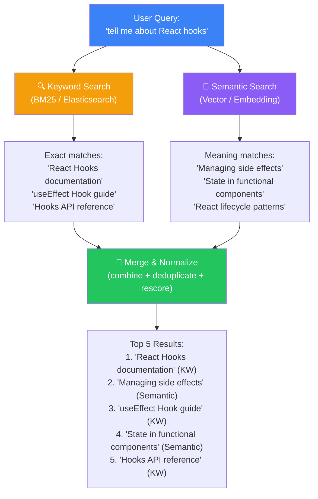
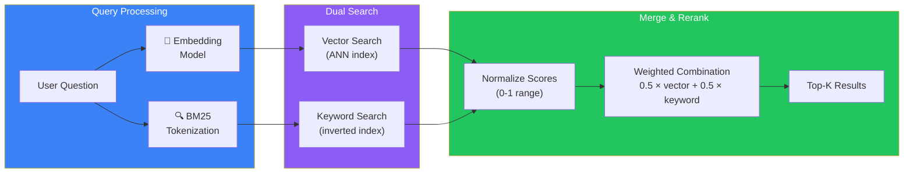
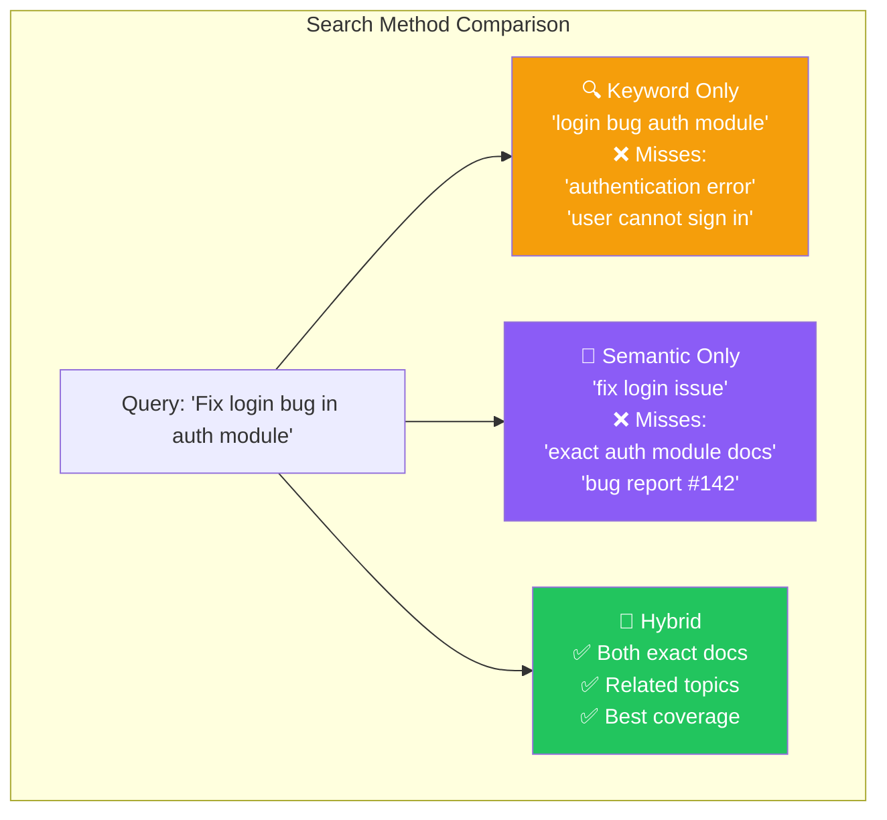

## Introduction

> **Hybrid search combines keyword search (exact matches) with semantic search (meaning matches) to deliver better results than either method alone. It's the standard approach used by every production RAG system.**

Semantic search understands meaning but can miss exact terms. Keyword search finds exact matches but misses context. Hybrid search takes both results, merges them, and returns the best overall matches. It's not an either/or — it's both.

---

## Why This Concept Exists

### The Story

You search for "React useState." What do you want?

**Semantic search** finds: "Managing component state in React," "useReducer vs useState," "React hooks tutorial" — all about the topic but none containing the exact phrase.

**Keyword search** finds: "React useState documentation," "React useState not updating," "useState returns undefined" — all containing the exact phrase but potentially missing related content.

**Hybrid search** finds both sets and returns the best combined results. You get the exact documentation AND related tutorials.

---

## Real-World Analogy

### The Two Librarians

Imagine a library with two specialist librarians:

**Librarian A (Keyword):** Matches exact words only. You say "ancient Rome" — she finds books with "ancient" and "Rome" in the title. She's fast and precise but misses "The Roman Empire" and "Caesar's legacy."

**Librarian B (Semantic):** Understands meaning. You say "ancient Rome" — she finds books about Roman history, culture, architecture. She's thorough but might bring you a book about Roman mythology when you wanted military history.

**Together:** They compare notes, merge their findings, and bring you the most relevant books from both approaches. That's hybrid search.

---

## How Hybrid Search Works

### The Architecture

### Step by Step

1. **User submits a query** — "How do I reset my password in the admin panel?"
2. **Vector search** — Embed the query, search ANN index for semantically similar chunks
3. **Keyword search** — Tokenize the query, search inverted index (BM25) for exact/partial matches
4. **Normalize scores** — Both methods return scores in different ranges. Normalize both to 0-1
5. **Weighted combination** — `final_score = alpha × vector_score + (1 - alpha) × keyword_score` (alpha is typically 0.5-0.7)
6. **Return top-K** — The highest combined scores become the final results

---

## Comparison: Semantic vs Hybrid vs Keyword

| Aspect | Keyword (BM25) | Semantic (Vector) | Hybrid |
|--------|---------------|-------------------|--------|
| **Exact match** | ✅ Perfect | ❌ May miss | ✅ Best |
| **Synonyms** | ❌ Misses | ✅ Finds | ✅ Best |
| **Typos** | ❌ Misses | ✅ Handles | ✅ Best |
| **Context** | ❌ No | ✅ Yes | ✅ Best |
| **Speed** | ⚡ Very fast | 🐢 Slower | ⚡ Fast |
| **Implementation** | Simple | Moderate | Complex |

---

## Production Examples

| Product | Hybrid Search Strategy |
|---------|----------------------|
| **Perplexity** | BM25 + vector search → rerank with cross-encoder |
| **Azure AI Search** | Built-in hybrid with semantic ranker |
| **Elasticsearch** | `knn` query + `match` query → `rrf` (Reciprocal Rank Fusion) |
| **OpenSearch** | Neural search + keyword → hybrid query |
| **Weaviate** | Built-in hybrid search with alpha parameter |
| **Qdrant** | BM25 extension + vector search |

---

## Best Practices

| Practice | Why |
|----------|-----|
| **Normalize scores** | Keyword and vector scores have different ranges. Normalize both to 0-1 before combining |
| **Tune alpha** | Start with 0.5 (equal weight) and adjust based on your data. More code/documentation → higher keyword weight. More natural language → higher vector weight |
| **Use RRF** | Reciprocal Rank Fusion is a simple, effective way to merge ranked lists without score normalization |
| **Set minimum threshold** | Don't return results below a minimum score from either method |

---

## Common Mistakes

| Mistake | Why It's Wrong |
|---------|----------------|
| ❌ "Hybrid search always outperforms pure vector" | For purely conversational queries on general topics, pure vector search can match hybrid. Hybrid excels when queries contain specific terms (codes, names, IDs) |
| ❌ "I can just average the scores" | Scores from different methods aren't comparable. Always normalize before combining, or use rank-based fusion (RRF) |
| ❌ "More weight on keyword is always better for code" | Code searches benefit from hybrid, but too much keyword weight misses semantically similar code patterns. Tune alpha per use case |

---

## Interview Questions

### Easy

**Q: What is hybrid search and why is it better than pure semantic search?**

> Hybrid search combines keyword search (exact word matching with BM25) and semantic search (vector similarity). It's better because it catches both exact matches (product codes, names) AND meaning-based matches (synonyms, paraphrases) — providing better coverage than either alone.

### Intermediate

**Q: How do you combine results from keyword and semantic search?**

> Two common methods: (1) **Score normalization** — normalize both scores to 0-1, then combine: `final = alpha × vector + (1-alpha) × keyword`. (2) **Reciprocal Rank Fusion (RRF)** — assign each result a score based on its rank in each list: `score = 1 / (k + rank)`. RRF is simpler and doesn't need score normalization.

### Senior - Architecture

**Q: Design a hybrid search system for a code documentation platform with 500K+ documents.**

> Architecture: (1) **Indexing** — index code docs with both BM25 (code-specific analyzer) and vector embeddings (code-aware model like Voyage-code). (2) **Query routing** — detect if query contains code terms (function names, keywords) → boost keyword weight. (3) **Hybrid strategy** — use RRF with k=60 for merging, alpha=0.6 vector bias for natural language queries. (4) **Performance** — run keyword and vector searches in parallel, cache frequent queries. (5) **Evaluation** — track NDCG@10 on a curated test set of code search queries.

---

## Summary

| Concept | Key Point |
|---------|-----------|
| **Hybrid Search** | Combines keyword + semantic search |
| **Why it's better** | Catches exact matches AND meaning matches |
| **Merging strategies** | Score normalization or RRF |
| **Alpha parameter** | Controls balance (0.5 = equal weight) |
| **Production use** | Every major search platform uses hybrid |

---

## Navigation

**Previous:** [10 — Building a Complete RAG Pipeline →](./10-building-a-complete-rag-pipeline)

**Next:** [12 — Re-ranking →](./12-re-ranking)
