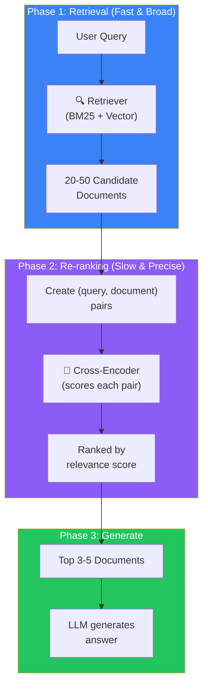
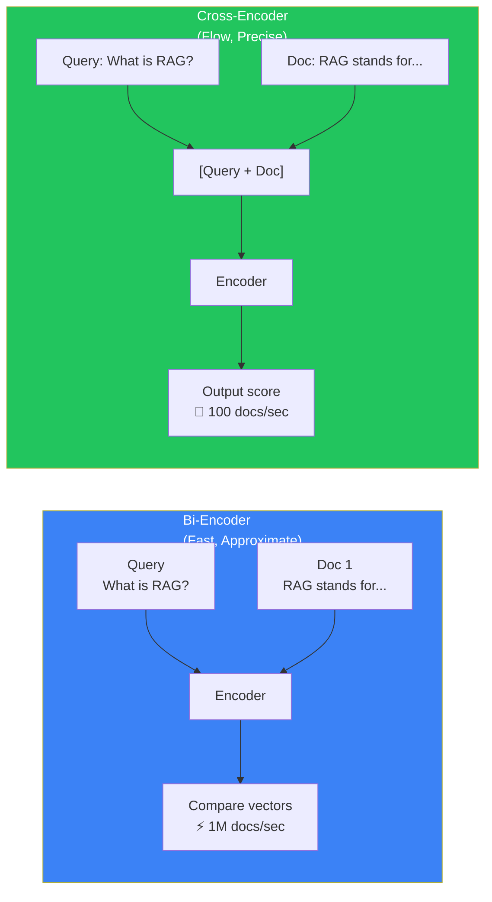
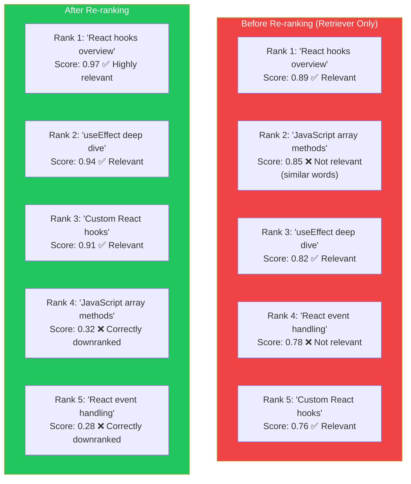
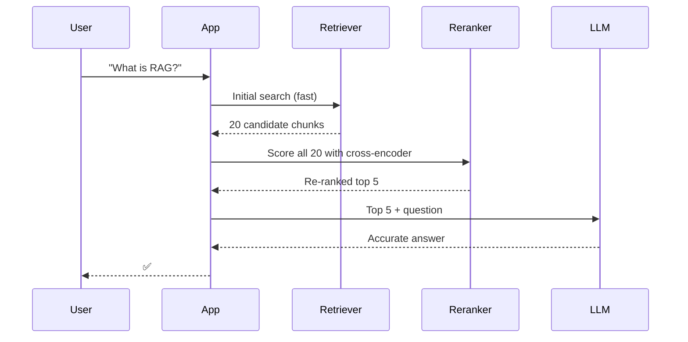

## Introduction

> **Re-ranking is the process of taking the initial set of retrieved documents and re-ordering them by true relevance. It's the single highest-impact optimization you can make to any RAG system — often improving retrieval quality by 10-20%.**

The retriever (vector or hybrid) does a fast, approximate first-pass search. It returns 20-50 candidates. The re-ranker then takes each candidate pair (query + document) and scores them together with a more powerful model. The result is a much more accurate ranking.

---

## Why This Concept Exists

### The Story

You search for a term in Google. Google's first pass finds millions of pages. But how does it decide which 10 to show on page 1?

A re-ranker.

The initial search (retrieval) is fast and broad. Then a more sophisticated algorithm re-orders the top results by actual relevance to your specific query.

**Retrieval finds candidates. Re-ranking selects the best.**

---

## Real-World Analogy

### The Teaching Assistant

Imagine a teacher who needs to grade 100 student essays. She can't read all 100 carefully.

**Step 1 (Retrieval):** She skims all essays and picks the 20 most promising ones. This takes 5 minutes.

**Step 2 (Re-ranking):** She reads the 20 essays carefully, scores each one, and ranks them from best to worst. This takes 30 minutes, but the result is far more accurate.

**Result:** The final ranking is much better than the initial skim alone.



---

## Bi-Encoder vs Cross-Encoder

### Bi-Encoder (Used in Retrieval)

The bi-encoder converts query and document into separate vectors, then compares them with cosine similarity.

```
Query → Encoder → [0.1, 0.5, 0.3]  ──┐
                                     ├── cosine similarity → score
Doc   → Encoder → [0.2, 0.4, 0.6]  ──┘
```

**Fast:** Can compare millions of documents in milliseconds (pre-computed vectors)
**Less accurate:** Encodes query and document independently — misses nuanced interactions

### Cross-Encoder (Used in Re-ranking)

The cross-encoder takes the query and document as a single input and directly outputs a relevance score.

```
[Query + Doc] → Cross-Encoder → relevance score (0.0 - 1.0)
```

**Slow:** Must process each (query, document) pair individually — can't pre-compute
**More accurate:** The model sees the full interaction between query and document



| Aspect | Bi-Encoder | Cross-Encoder |
|--------|-----------|---------------|
| **Speed** | ⚡ Millions/sec | 🐢 Hundreds/sec |
| **Accuracy** | 🟡 Good | 🟢 Excellent |
| **Pre-compute** | ✅ Yes (vectors) | ❌ No (per query) |
| **Use case** | First-pass retrieval | Second-pass re-ranking |

---

## How Re-ranking Improves Quality



After re-ranking, the top results are genuinely relevant. The false positives that looked similar in vector space are correctly pushed down.

---

## Production Re-ranking Pipeline



| Step | Component | Time | Documents |
|------|-----------|------|-----------|
| 1 | Retriever (bi-encoder) | 50ms | 1M → 20 |
| 2 | Re-ranker (cross-encoder) | 200ms | 20 → 5 |
| 3 | LLM generation | 1000ms | 5 → answer |
| **Total** | | **~1.25s** | |

---

## Production Examples

| Product | Re-ranking Strategy |
|---------|---------------------|
| **Perplexity** | Retrieve 50, rerank with cross-encoder → top 5 |
| **Cursor** | Retrieve 100 code chunks, rerank by relevance to task |
| **GitHub Copilot** | Retrieve similar code, rerank by context match |
| **Claude (Projects)** | Retrieve 20, rerank → top 5 |
| **Google Search** | Multi-stage ranking (hundreds of signals) |

---

## Best Practices

| Practice | Why |
|----------|-----|
| **Retrieve enough candidates** | Re-rankers only see what the retriever finds. Retrieve 20-50 to ensure good recall |
| **Use a specialized re-ranking model** | Don't use the same model for retrieval and re-ranking. Models like BGE-reranker, Cohere Rerank, or cross-encoder/ms-marco-MiniLM are optimized for re-ranking |
| **Re-rank at query time** | Unlike embeddings (which are pre-computed), re-ranking must happen live — include it in the query path |
| **Batch re-ranking** | Process all (query, document) pairs in a single batch for efficiency |

---

## Common Mistakes

| Mistake | Why It's Wrong |
|---------|----------------|
| ❌ "Re-ranking is optional, the retriever is good enough" | Re-ranking consistently improves top-5 relevance by 10-20%. Skipping it is leaving accuracy on the table |
| ❌ "I can use the embedding model as a re-ranker" | Embedding models are bi-encoders — they encode query and document separately. Cross-encoders are specifically designed for pairwise relevance scoring |
| ❌ "Re-ranking 50 documents is too slow" | Modern cross-encoders can process 50 pairs in 100-300ms — a tiny fraction of total latency that dramatically improves quality |

---

## Interview Questions

### Easy

**Q: What is re-ranking in a RAG system?**

> Re-ranking is the second stage of retrieval. After the retriever finds candidate documents (fast, approximate), the re-ranker scores each one more carefully using a cross-encoder model. It re-orders the documents by true relevance, improving the quality of what the LLM receives.

### Intermediate

**Q: What's the difference between a bi-encoder and a cross-encoder?**

> A bi-encoder processes query and document separately into vectors, enabling fast similarity search with pre-computed vectors. A cross-encoder processes query and document together as one input, directly scoring their relevance. Bi-encoders are faster (millions/sec) but less accurate. Cross-encoders are slower (hundreds/sec) but much more accurate.

### Senior - Architecture

**Q: Design a re-ranking strategy for a real-time chatbot that must respond in under 2 seconds.**

> Strategy: (1) **Efficient retrieval** — HNSW index with optimized parameters (M=16, ef_construction=200) for sub-50ms retrieval. (2) **Candidate pool** — retrieve 20 candidates, which is enough for good recall without overwhelming the re-ranker. (3) **Lightweight re-ranker** — use MiniLM-based cross-encoder (~100ms for 20 pairs) instead of larger models (BERT-large). (4) **Fallback** — if latency budget is exceeded, use retriever's original ranking. (5) **Caching** — cache re-ranking results for identical or similar queries. (6) **Monitoring** — track p95 latency and re-ranking quality metrics.

---

## Summary

| Concept | Key Point |
|---------|-----------|
| **Re-ranking** | Second-pass scoring using cross-encoder |
| **Bi-encoder vs Cross-encoder** | Fast/approximate vs slow/precise |
| **Quality improvement** | 10-20% better top-K relevance |
| **Candidate count** | Retrieve 20-50, re-rank to top 5 |
| **Production use** | Every serious RAG system uses re-ranking |

---

## Navigation

**Previous:** [11 — Hybrid Search →](./11-hybrid-search)

**Next:** [13 — Context Compression →](./13-context-compression)
