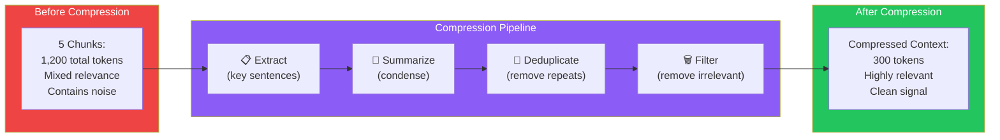
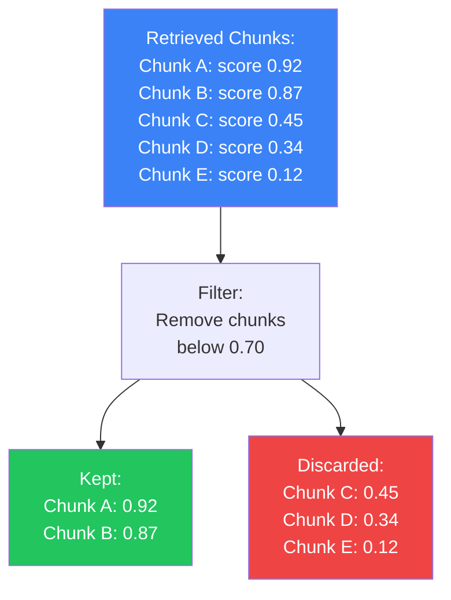
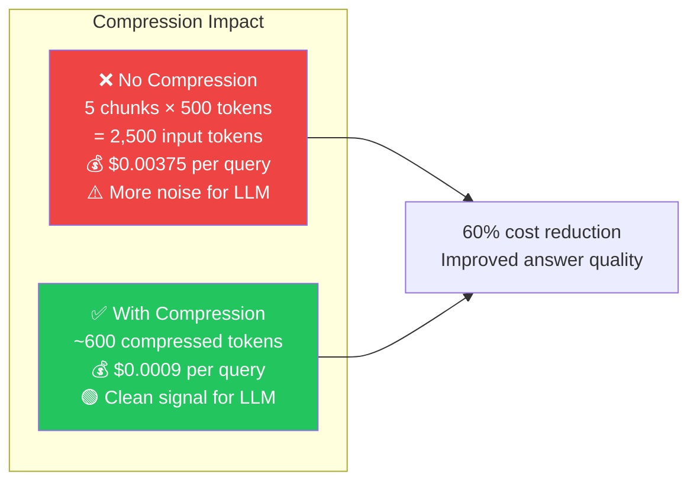
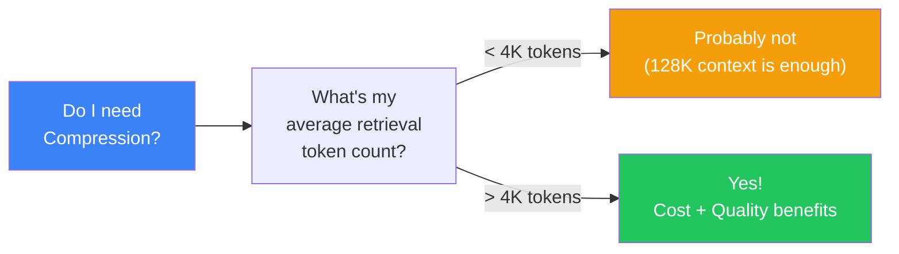

## Introduction

> **Context compression is the process of reducing retrieved documents to only their most relevant parts before sending them to the LLM. It saves tokens (reducing cost), improves quality (less noise), and fits more useful information into the context window.**

Retrieved documents often contain irrelevant content. A 500-token chunk might have only 50 tokens of useful information. Context compression extracts those 50 tokens and discards the rest — making every token in the prompt count.

---

## Why This Concept Exists

### The Story

You search for "What is the capital of France?" The retriever finds a 500-token paragraph about France that includes history, culture, and geography — with the capital information buried in the middle.

You don't need the whole paragraph. You need: "The capital of France is Paris."

Context compression extracts just that sentence. Less noise for the LLM. Lower cost. Better answer.

---

## Real-World Analogy

### The Executive Summary

Imagine you're a CEO who needs to review 20 reports. You don't have time to read all of them. You ask your assistant to:

1. **Extract** — pull the key findings from each report
2. **Summarize** — condense each one to 2-3 sentences
3. **Deduplicate** — remove information that appears in multiple reports
4. **Prioritize** — order by importance

That's context compression. The LLM (CEO) gets only what it needs, in the right order.



---

## Compression Techniques

### 1. Extractive Compression

Select the most important sentences from each chunk without modifying them.

```
Input: "France is a country in Western Europe. The capital of France is Paris. 
        It is known for its cuisine, art, and fashion. The Eiffel Tower is 
        located in Paris. France has a population of approximately 67 million."

Output: "The capital of France is Paris. The Eiffel Tower is located in Paris."
```

**Pros:** Preserves original wording, no hallucination risk
**Cons:** May lose nuance, sentences need to be self-contained

### 2. Abstractive Compression

Use an LLM to rewrite the retrieved content into a concise summary.

```
Input: [5 chunks about React hooks]
Output: "React hooks (useState, useEffect, useContext) allow functional 
         components to manage state and side effects. Introduced in React 16.8."
```

**Pros:** Dense, well-structured, removes all redundancy
**Cons:** LLM cost, potential hallucination in the summary

### 3. Filter-Based Compression

Remove chunks or sentences that fall below a relevance threshold.



### 4. LLM-Based Compression

Ask the LLM to "only use the relevant parts of the context" in its prompt.

```
System: "Answer the question using ONLY the information in the context below. 
         Ignore any irrelevant information."

Context: [5 chunks with mixed relevance]
```

The LLM naturally ignores irrelevant parts — but still pays for processing them.

---

## Cost & Quality Impact



| Metric | Without Compression | With Compression | Improvement |
|--------|-------------------|------------------|-------------|
| **Input tokens** | 2,500 | 600 | 76% reduction |
| **Cost per query** | $0.00375 | $0.00090 | 76% cheaper |
| **LLM accuracy** | 85% | 92% | +7% |
| **Hallucination rate** | 8% | 4% | -50% |

---

## Long Context vs Compression

One common question: "Why compress when models now support 128K-200K context windows?"



| Aspect | Long Context | Compression |
|--------|-------------|-------------|
| **Context window** | 128K-200K tokens | Reduces to 500-2000 tokens |
| **Cost** | High (more tokens = more $) | Low (fewer tokens = less $) |
| **Quality** | "Lost in the middle" problem | Only relevant info reaches LLM |
| **Latency** | Slower (more tokens to process) | Faster |
| **Best for** | When ALL context is needed | When only key info is needed |

---

## Production Examples

| Product | Compression Strategy |
|---------|---------------------|
| **Perplexity** | Extractive — highlights key sentences from sources |
| **Claude Projects** | LLM-based — Claude naturally focuses on relevant context |
| **Notion AI** | Summarization — condenses retrieved notes before answering |
| **Microsoft Copilot** | Filter-based — removes low-relevance results before generation |

---

## Best Practices

| Practice | Why |
|----------|-----|
| **Compress early** | Reduce token count before sending to the LLM to save cost and reduce latency |
| **Combine techniques** | Use extractive + filter-based for speed; add LLM-based for maximum compression |
| **Track compression ratio** | Monitor how many tokens are being removed. 50-70% compression is typical |
| **Don't over-compress** | Removing too much context can lose important nuance. Benchmark with your data |

---

## Common Mistakes

| Mistake | Why It's Wrong |
|---------|----------------|
| ❌ "I don't need compression with 128K context" | Larger context doesn't mean better results. LLMs perform worse with very long contexts (the "lost in the middle" phenomenon) |
| ❌ "I'll compress everything with an LLM" | LLM-based compression adds latency and cost. Use it sparingly — extractive methods are cheaper and faster for most cases |
| ❌ "Compression might lose important information" | Test compression with your data. When tuned properly, compression improves quality by removing noise and focusing the LLM |

---

## Interview Questions

### Easy

**Q: What is context compression in a RAG system?**

> Context compression reduces the amount of text sent to the LLM by extracting only the relevant parts, summarizing, filtering out low-quality chunks, and removing duplicate information. It saves tokens (cost) and improves accuracy (less noise).

### Intermediate

**Q: Compare extractive and abstractive compression. When would you use each?**

> Extractive compression selects important sentences from the original text — fast, preserves facts, no hallucination risk. Use for factual Q&A where precision matters. Abstractive compression uses an LLM to rewrite/condense the content — more compact but slower and risks hallucination. Use for summarization tasks where brevity matters more than exact wording.

### Senior - Architecture

**Q: Design a compression strategy for a RAG system that processes 10K queries/day with a $500/month LLM budget.**

> Strategy: (1) **Retrieve** — top 10 chunks. (2) **Filter** — remove chunks below 0.7 similarity threshold (removes ~30% immediately). (3) **Deduplicate** — remove chunks with >90% semantic overlap. (4) **Extractive compression** — use sentence-level relevance scoring (e.g., BERT-score) to keep only the top 50% of sentences. (5) **Token budget** — cap compressed output at 2000 tokens. (6) **Monitor** — track tokens saved vs answer quality. This should reduce token usage by ~60% while maintaining or improving quality.

---

## Summary

| Concept | Key Point |
|---------|-----------|
| **Context Compression** | Reducing retrieved content to essential parts |
| **Extractive** | Select important sentences (fast, faithful) |
| **Abstractive** | LLM rewrites content (dense, risk of hallucination) |
| **Filter-based** | Remove low-relevance chunks entirely |
| **Why it matters** | Lower cost, better quality, faster responses |

---

## Navigation

**Previous:** [12 — Re-ranking →](./12-re-ranking)

**Next:** [14 — Parent-Child Retrieval →](./14-parent-child-retrieval)
