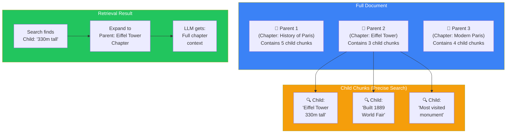
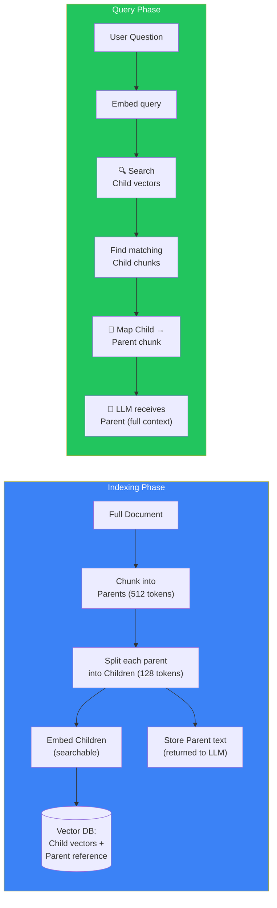
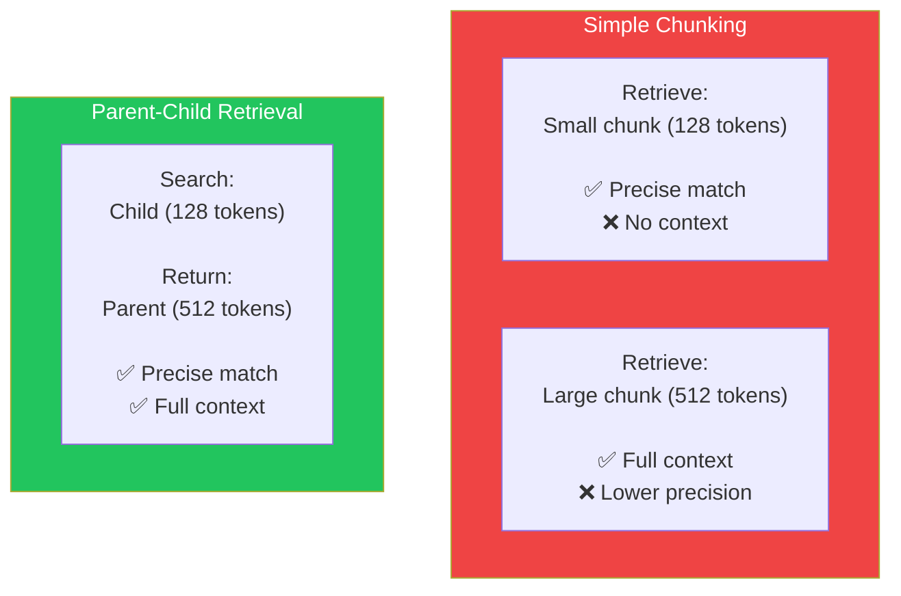

## Introduction

> **Parent-Child Retrieval stores two versions of each document chunk: small "child" chunks for precise matching and larger "parent" chunks for rich context. When a child is retrieved, its parent is returned to the LLM.**

This is one of the most effective optimization patterns in RAG. It solves a fundamental tension: small chunks are more precise for retrieval, but large chunks provide better context for the LLM. Parent-child retrieval gives you both.

---

## Why This Concept Exists

### The Story

You need to find a specific fact about the Eiffel Tower. The fact is buried in a paragraph about French landmarks, inside a chapter about European architecture, in a book about world monuments.

**Small chunk approach:** Each sentence is a separate chunk. You find the exact sentence ("The Eiffel Tower is 330 meters tall") — but the LLM has no context about what the Eiffel Tower is.

**Large chunk approach:** The whole chapter is one chunk. The LLM has full context, but the relevant fact is lost among thousands of words.

**Parent-child approach:** You search at the sentence level (precise), but return the paragraph (context). Best of both worlds.

---

## Real-World Analogy

### The Highlighted Book

Imagine reading a textbook and highlighting important sentences. Later, when you look at a highlighted sentence, you also look at the surrounding paragraph to remember the context.

The highlighted sentence is the **child** (precise, easy to find). The paragraph is the **parent** (context, meaning).

---

## How Parent-Child Retrieval Works

### The Architecture

### Step by Step

1. **Indexing:**
   - Split documents into parent chunks (e.g., 512 tokens each)
   - Split each parent into child chunks (e.g., 128 tokens each, with overlap)
   - Embed only the child chunks
   - Store each child vector with a reference to its parent

2. **Query:**
   - Embed the user's question
   - Search the child vectors (precise matching)
   - Find the top-K child matches
   - Map each child back to its parent
   - Return the parent chunks to the LLM (rich context)

---

## Parent-Child vs Simple Chunking

| Aspect | Simple Small Chunk | Simple Large Chunk | Parent-Child |
|--------|-------------------|-------------------|--------------|
| **Search precision** | ✅ High | ❌ Lower | ✅ High |
| **Context quality** | ❌ Low | ✅ High | ✅ High |
| **Storage** | Normal | Normal | ~20% more (overlap) |
| **Implementation** | Simple | Simple | Moderate |
| **Best for** | Factual lookups | Analysis tasks | General RAG |

---

## When to Use Parent-Child Retrieval

### Good for:
- **Factual Q&A** — where the answer is a specific piece of information but the LLM needs surrounding context
- **Long documents** — where small chunks lose the narrative thread
- **Code search** — retrieve a function (child) but show the whole file (parent)
- **Legal/medical** — where context is critical for correct interpretation

### Less useful for:
- **Simple FAQ matching** — where answers are short and self-contained
- **Summarization** — where you want the entire document anyway

---

## Production Examples

| Product | Parent-Child Strategy |
|---------|----------------------|
| **Cursor** | Child = function, Parent = file. Search at function level, return file for context |
| **GitHub Copilot** | Child = code block, Parent = surrounding context. Precise code completion with full file context |
| **Notion AI** | Child = paragraph, Parent = page. Precise search within full page context |

---

## Best Practices

| Practice | Why |
|----------|-----|
| **Child size: 128-256 tokens** | Small enough for precise matching, large enough for meaningful content |
| **Parent size: 512-1024 tokens** | Large enough for full context, small enough to fit multiple in the prompt |
| **Map children to parents** | Store the parent reference in each child's metadata for fast expansion |
| **Deduplicate parents** | Multiple children from the same parent should only return the parent once |
| **Overlap children** | 10-20% overlap between children prevents missing information at boundaries |

---

## Common Mistakes

| Mistake | Why It's Wrong |
|---------|----------------|
| ❌ "I'll store both parents and children in the vector DB" | Only children need embedding vectors. Parents are stored as text and retrieved by reference — no need to embed them |
| ❌ "I'll always return all matching parents" | If 5 children match but come from the same parent, return the parent once. Deduplicate |
| ❌ "I don't need child chunks if my retrieval is good" | Parent-child isn't about retrieval quality — it's about the precision-context trade-off. Even with perfect retrieval, the LLM may need more context than a small chunk provides |

---

## Interview Questions

### Easy

**Q: What is parent-child retrieval?**

> Parent-child retrieval stores small "child" chunks for precise search, but returns larger "parent" chunks to the LLM for context. Children are embedded and searched; parents contain the full context needed for accurate answers.

### Intermediate

**Q: Why does parent-child retrieval improve RAG quality compared to using only small or large chunks?**

> Small chunks are precise for search but lack context for the LLM. Large chunks have context but are less precise for search. Parent-child gives you both: search at the precise small-chunk level, but return the broader context the LLM needs to understand and answer correctly.

### Senior - Architecture

**Q: Design a parent-child retrieval system for a code documentation platform where users ask questions about specific functions.**

> Architecture: (1) **Indexing** — parse code files into function-level parents (entire function body + docstring). Split each function into logical child chunks (signature, parameters, return value, example). Embed only children with a code-aware embedding model (Voyage-code). (2) **Metadata** — store parent function name, file path, line numbers with each child. (3) **Query** — embed user question, search children, map to parent functions. (4) **Context assembly** — return the full parent function(s) to the LLM, plus the file's import statements as additional context. (5) **Limiting** — cap at 5 unique parents or 4000 tokens, whichever comes first.

---

## Summary

| Concept | Key Point |
|---------|-----------|
| **Parent-Child Retrieval** | Search small chunks, return large chunks |
| **Why it works** | Combines search precision with rich context |
| **Chunk sizes** | Children: 128-256, Parents: 512-1024 tokens |
| **Implementation** | Embed children only; map to parent references |
| **Use case** | Factual Q&A requiring surrounding context |

---

## Navigation

**Previous:** [13 — Context Compression →](./13-context-compression)

**Next:** [15 — Multi-Query Retrieval →](./15-multi-query-retrieval)
