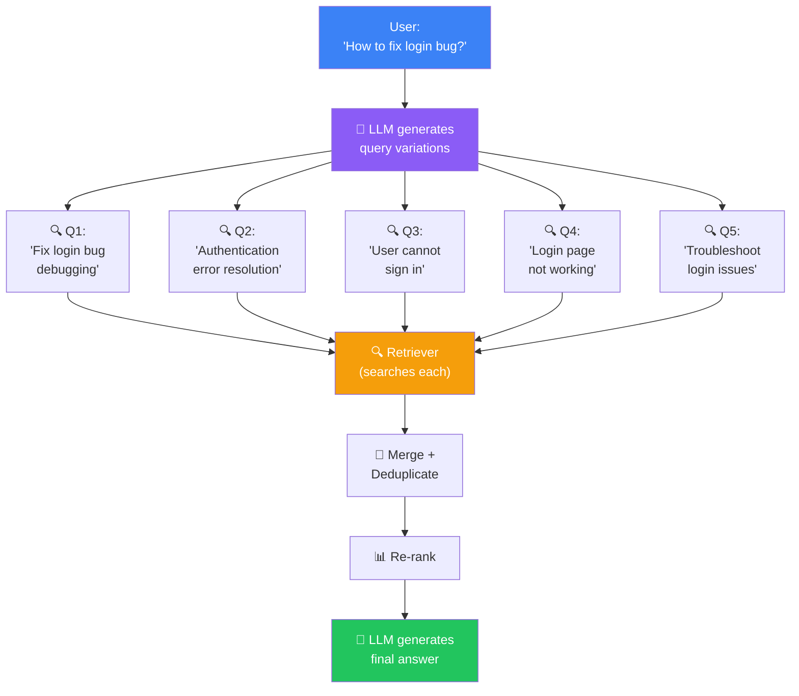
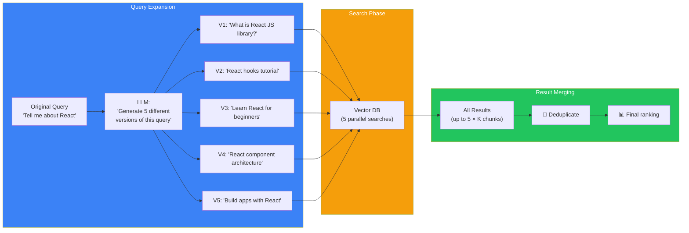
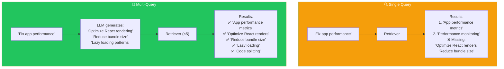

## Introduction

> **Multi-Query Retrieval uses an LLM to generate multiple versions of the user's question, searches for each one, and combines the results. It dramatically improves recall — especially for vague, ambiguous, or poorly-worded queries.**

A single query captures only one way of asking. But the user's intent might match documents that use completely different wording. By generating query variations, multi-query retrieval casts a wider net and catches relevant documents that a single query would miss.

---

## Why This Concept Exists

### The Story

A user asks: "Tell me about React." What do they want?

- React the JavaScript library?
- React as in "chemical reaction"?
- React as in "react to a situation"?

Even if it's clear to a human that they mean the JavaScript library, the document that says "Learn how useState works in functional components" might not rank highly for the single query "Tell me about React" — because it doesn't contain the word "React" prominently.

But if the LLM generates query variations like:
- "What is React JS?"
- "React hooks and components tutorial"
- "Learn React JavaScript library"

…then the document about useState is much more likely to be found.

---

## Real-World Analogy

### The Five Librarians

Imagine asking a single librarian a question. They search the catalog using your exact words. They might miss relevant books that use different terminology.

Now imagine asking **five librarians** the same question, but each one searches using different words:

- Librarian 1: "cars"
- Librarian 2: "automobiles"
- Librarian 3: "vehicles"
- Librarian 4: "transportation"
- Librarian 5: "motor vehicles"

Each librarian finds different books. Together, you get a much more complete set of results.

**That's multi-query retrieval.**

---

## How Multi-Query Retrieval Works

### The Architecture

### Step by Step

1. **Receive user query** — "How do I make my app faster?"
2. **Generate variations** — LLM produces 3-5 alternate phrasings:
   - "Performance optimization techniques"
   - "Speed up application loading time"
   - "Improve app response time"
   - "Reduce latency in my web app"
   - "Frontend performance best practices"
3. **Search each variation** — Run all 5 queries through the retriever in parallel
4. **Merge results** — Combine all retrieved documents, deduplicate by content
5. **Re-rank** — Score combined results and pick the top-K
6. **Generate** — LLM receives top chunks and produces the final answer

---

## Single Query vs Multi-Query

| Aspect | Single Query | Multi-Query |
|--------|-------------|-------------|
| **Recall** | Low (one angle) | High (multiple angles) |
| **Precision** | Can be high | May drop (more results) |
| **Cost** | 1 search + 1 generation | 1 LLM call + N searches |
| **Latency** | Fast | ~2x (parallel searches help) |
| **Best for** | Precise, well-formed queries | Vague, complex queries |

---

## When to Use Multi-Query Retrieval

### Good for:
- **Vague or short queries** — "Tell me about ML" → generates specific angles
- **Complex topics** — Questions that could be answered from multiple perspectives
- **Users who struggle with phrasing** — Non-native speakers, beginners
- **High-recall requirements** — Legal research, medical literature review

### Less useful for:
- **Precise, specific queries** — "What is the capital of France?" — one query is enough
- **Very short context windows** — If you can only fit a few chunks, multi-query may return too many candidates
- **Simple FAQ matching** — Exact match works fine

---

## Production Examples

| Product | Multi-Query Strategy |
|---------|----------------------|
| **Perplexity** | Generates multiple search queries, searches each, combines results |
| **Microsoft Copilot** | Expands user query into multiple search intents |
| **Claude (Analysis)** | Generates multiple research angles for complex questions |
| **Google Search** | Uses query expansion internally (related searches, "did you mean") |
| **Cursor** | Expands code search queries into multiple code patterns |

---

## Best Practices

| Practice | Why |
|----------|-----|
| **Generate 3-5 variations** | 1-2 doesn't help enough; 10+ is diminishing returns and adds cost |
| **Run searches in parallel** | All query variations can be searched simultaneously — doesn't add latency |
| **Deduplicate results** | Different queries will find the same documents. Remove duplicates before re-ranking |
| **Use the original query** | Always include the original query in the set — users often phrase things well |
| **Re-rank after merging** | Don't just take top-K from each query. Merge all, then re-rank the combined set |

---

## Common Mistakes

| Mistake | Why It's Wrong |
|---------|----------------|
| ❌ "More queries always means better results" | Beyond 5-7 queries, recall gains plateau while cost and noise increase. Quality over quantity |
| ❌ "I'll just use synonyms" | LLM-generated variations capture intent and context, not just synonyms. "How to fix login" might generate "Authentication workflow debugging" — much more than a synonym |
| ❌ "Multi-query always improves precision" | More queries can return more irrelevant results. Always pair with re-ranking to maintain precision |

---

## Interview Questions

### Easy

**Q: What is multi-query retrieval?**

> Multi-query retrieval uses an LLM to generate multiple variations of the user's question, searches for each one, and combines the results. It improves recall by capturing different ways the same information might be described in documents.

### Intermediate

**Q: How does multi-query retrieval improve recall without sacrificing too much precision?**

> By generating diverse query variations, it finds documents a single query would miss (improving recall). Precision is maintained by merging and re-ranking the combined results — only the most relevant documents across all queries make it to the final set.

### Senior - Architecture

**Q: Design a multi-query system for a medical research search tool where recall is critical (missing a paper could affect patient outcomes).**

> Architecture: (1) **Query generation** — LLM generates 7 variations covering synonyms, related terminology, broader and narrower terms. (2) **Search** — run all queries against a hybrid search index (BM25 + vector) in parallel. (3) **Merge** — collect up to 100 unique documents across all queries. (4) **Re-rank** — use a medical-domain cross-encoder for re-ranking. (5) **Coverage check** — track how many unique topics/subtopics are covered by the retrieved set. (6) **Fallback** — if recall confidence is low, run a second round with more aggressive query expansion. (7) **Audit** — log which queries retrieved which papers for traceability.

---

## Summary

| Concept | Key Point |
|---------|-----------|
| **Multi-Query Retrieval** | Generate multiple query variations to improve recall |
| **How it works** | LLM rewrites query → search each → merge results |
| **Number of queries** | 3-5 is optimal |
| **Deduplication** | Merge similar results before re-ranking |
| **Use case** | Vague queries, high-recall requirements, complex topics |

---

## Navigation

**Previous:** [14 — Parent-Child Retrieval →](./14-parent-child-retrieval)

**Next:** Coming soon — **Chunk 4: Production RAG Systems** (Metadata Filtering, Caching, Observability, Evaluation, Security, Scaling) →
