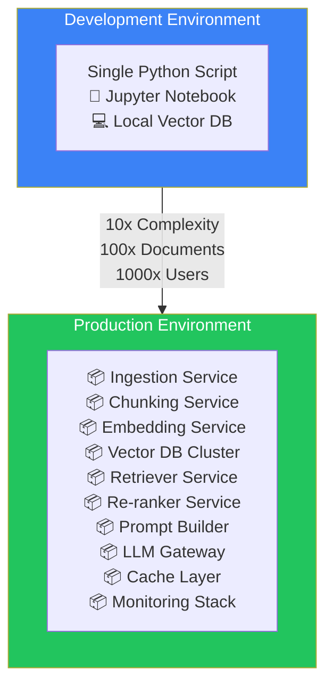
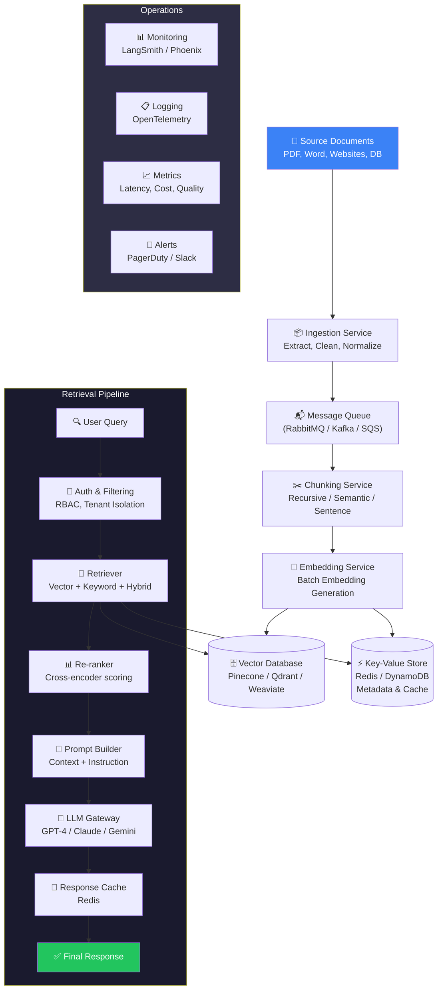
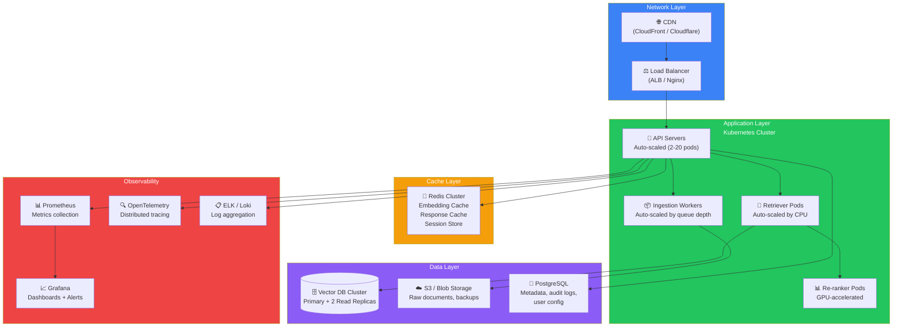
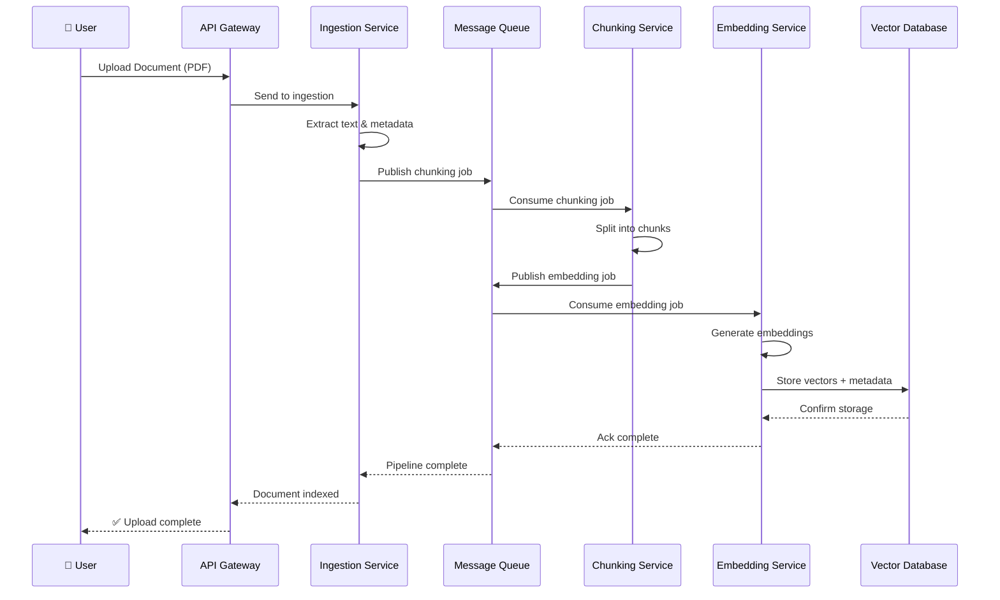
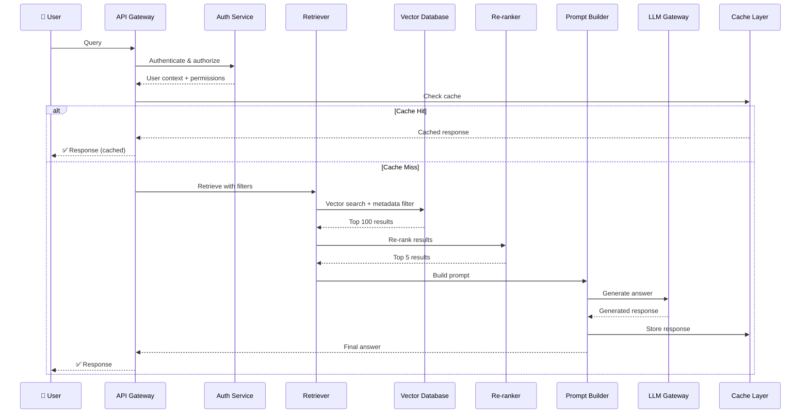

## Introduction

> **Production RAG is not a single script — it is a distributed system with microservices for ingestion, indexing, retrieval, re-ranking, prompt building, LLM inference, caching, monitoring, and security.**

You have built a RAG pipeline that works on your laptop. Now imagine scaling that to millions of documents, thousands of queries per second, and enterprise security requirements. That is Production RAG.

---

## Why This Exists

### The Problem: Prototype vs. Platform

Your local RAG script works for 10 documents and 1 user. Production requires:

| Dimension | Prototype | Production |
|-----------|-----------|------------|
| **Documents** | 10–100 | Millions |
| **Users** | 1 developer | Thousands of concurrent users |
| **Latency** | "It runs eventually" | < 2 seconds |
| **Reliability** | Run on demand | 99.9% uptime |
| **Security** | None | RBAC, encryption, audit logs |
| **Monitoring** | Print statements | Dashboards, alerts, tracing |
| **Updates** | Re-run manually | Continuous indexing |

### What Production RAG Solves

Production RAG systems solve four core problems:

1. **Scale** — Handle millions of documents and thousands of queries per second
2. **Reliability** — No single point of failure, automatic retries, circuit breakers
3. **Security** — Multi-tenant isolation, access control, compliance
4. **Observability** — Know exactly why every answer was produced

---

## Real-World Analogy

### The Library Factory

Imagine turning a single librarian into a **library factory** with specialized workers:

- **Ingestion Workers** — Receive new books, scan them, prepare them for storage
- **Chunking Specialists** — Divide books into chapters and sections
- **Indexing Team** — Create card catalog entries for every section
- **Retrieval Desk** — Find the right sections when someone asks a question
- **Quality Reviewers** — Re-rank results to ensure the best answers come first
- **Prompt Architects** — Package retrieved sections with the question
- **LLM Experts** — Generate the final answer
- **Cache Clerks** — Store frequent answers for instant response
- **Monitoring Team** — Track every request, measure quality, alert on issues

Each team works independently, scales independently, and can be improved independently.

---

## Production RAG Architecture

---

## Core Services Explained

### 1. Ingestion Service

The ingestion service handles everything that happens **before** a query arrives.

| Component | Responsibility | Technology Examples |
|-----------|---------------|-------------------|
| **Document Parser** | Extract text from PDF, Word, HTML, Markdown | Unstructured.io, LangChain, PyMuPDF |
| **Text Cleaner** | Remove headers, footers, noise | Custom rules, regex |
| **Normalizer** | Standardize format, fix encoding | utf-8, Unicode NFKC |
| **Metadata Extractor** | Extract author, date, source, tags | Custom extractors |
| **Router** | Send to appropriate processing queue | Kafka topics, SQS queues |

### 2. Chunking Service

A dedicated service for splitting documents into searchable pieces.

- **Input:** Clean raw text + metadata
- **Process:** Apply chunking strategy (recursive, semantic, sentence)
- **Output:** Structured chunks with parent IDs, metadata, and position info

### 3. Embedding Service

Generates vector embeddings for every chunk.

- **Batch Processing:** Embeds chunks in batches for efficiency
- **Model Selection:** Configurable embedding model (text-embedding-3-small, voyage-2, BGE)
- **Dimension Handling:** Supports 384, 768, 1024, 1536 dimensions
- **Caching:** Reuses embeddings for identical chunks

### 4. Vector Database

The storage and retrieval backbone.

- **Indexing:** HNSW, IVF, or DiskANN indexes for fast approximate nearest neighbor search
- **Metadata Storage:** Stores document IDs, timestamps, permissions alongside vectors
- **Filtering:** Pre-filtering by metadata before vector search
- **Replication:** Multi-node replication for high availability
- **Backup:** Snapshot-based backups for disaster recovery

### 5. Retriever Service

Orchestrates the retrieval strategy.

- **Multi-Strategy:** Supports vector, keyword, and hybrid search
- **Fusion:** Combines results from multiple strategies (RRF, weighted scoring)
- **Top-K Config:** Dynamically adjustable number of results
- **Fallback:** Falls back to keyword search if vector search fails

### 6. Re-ranker Service

Improves retrieval quality with cross-encoder scoring.

- **Slower but Better:** Cross-encoders are slower but more accurate than bi-encoders
- **Top-100 → Top-5:** Re-ranks the top 100 results to find the best 5
- **Configurable:** Can be skipped for latency-sensitive applications

### 7. Prompt Builder

Constructs the final prompt sent to the LLM.

- **Template System:** Versioned prompt templates
- **Context Packing:** Inserts retrieved chunks into context window
- **Instruction Injection:** Adds system instructions and formatting rules
- **Token Budgeting:** Ensures context fits within model limits

### 8. LLM Gateway

Manages LLM inference with production reliability.

- **Load Balancing:** Distributes requests across multiple models/providers
- **Fallback:** Switches to backup model on failure
- **Rate Limiting:** Prevents API quota exhaustion
- **Cost Tracking:** Logs token usage per request

---

## Deployment Architecture

In a production environment, these services are deployed as a distributed system with redundancy, auto-scaling, and observability.

---

## Data Flow: Ingestion Pipeline

---

## Data Flow: Query Pipeline

---

## Real Production Examples

### ChatGPT Enterprise

| Component | Implementation |
|-----------|---------------|
| **Ingestion** | Automated crawler that indexes company wikis, SharePoint, Google Drive |
| **Chunking** | Semantic chunking with overlap, optimized for different document types |
| **Embedding** | OpenAI's text-embedding-3-large (3072 dimensions) |
| **Vector DB** | Custom vector storage with metadata filtering for tenant isolation |
| **Retrieval** | Hybrid search (BM25 + vector) with re-ranking |
| **Security** | Enterprise SSO, RBAC, document-level permissions |
| **Monitoring** | Usage dashboards, audit logs, cost tracking per workspace |

### Microsoft Copilot (SharePoint / M365)

| Component | Implementation |
|-----------|---------------|
| **Ingestion** | Native M365 connectors — SharePoint, OneDrive, Teams, Exchange |
| **Chunking** | Document structure-aware chunking (respects headings, tables) |
| **Embedding** | Microsoft's internal embedding models |
| **Vector DB** | Azure AI Search with integrated vector + keyword search |
| **Security** | Inherits existing M365 permissions — users only see their authorized documents |
| **Monitoring** | Microsoft 365 admin center, compliance reports |

### Google Vertex AI Search

| Component | Implementation |
|-----------|---------------|
| **Ingestion** | Cloud Storage, BigQuery, web crawling connectors |
| **Chunking** | Configurable chunk size and strategy |
| **Embedding** | Google's embedding models via Vertex AI |
| **Vector DB** | Vertex AI Vector Search (formerly Matching Engine) — extremely scalable |
| **Retrieval** | Hybrid search with re-ranking, natural language understanding |
| **Security** | IAM roles, VPC-SC, CMEK encryption |

---

## Common Mistakes

| Mistake | Why It's Wrong | Fix |
|---------|---------------|-----|
| **Monolithic architecture** | One service does everything → hard to scale, deploy, debug | Split into microservices with clear responsibilities |
| **Synchronous ingestion** | User waits for document to be indexed | Use async queues, notify user when ready |
| **No retry logic** | Transient failures cause pipeline failures | Implement exponential backoff + dead letter queues |
| **Ignoring metadata** | No permission filtering → security leaks | Store metadata with every vector, filter before retrieval |
| **Single LLM provider** | Provider outage = system down | Multi-provider fallback strategy |
| **No caching** | Every query recomputes embeddings and LLM responses | Cache at multiple layers (embedding, response, retriever) |

---

## Best Practices

1. **Design for failure** — Every service should assume downstream services will fail. Use circuit breakers, retries, and fallbacks.

2. **Version everything** — Prompt templates, embedding models, chunking strategies, and retrieval configurations should all be versioned.

3. **Measure everything** — Latency per service, cost per query, retrieval recall, answer faithfulness. If you can't measure it, you can't improve it.

4. **Separate ingestion from retrieval** — Ingestion can be slower and batch-oriented. Retrieval must be fast and real-time.

5. **Use message queues** — Decouple ingestion stages with queues (Kafka, RabbitMQ, SQS) for reliability and scalability.

6. **Implement graceful degradation** — If the re-ranker fails, fall back to raw retriever results. If the LLM fails, return retrieved documents directly.

7. **Plan for index rebuilds** — When embedding models change, you need to re-embed all documents. Build this into your architecture from day one.

---

## Interview Questions

### Beginner

**Q: What is the difference between a prototype RAG system and a production RAG system?**

> A prototype runs on a single machine with a few documents. A production system is distributed across multiple services, handles millions of documents, supports concurrent users, implements security and access control, includes monitoring and alerting, and is designed for reliability with retries, fallbacks, and disaster recovery.

**Q: Why does production RAG use message queues?**

> Message queues decouple the ingestion pipeline stages. Documents can be uploaded immediately, but chunking and embedding happen asynchronously. This prevents slow ingestion from blocking users and allows each stage to scale independently.

### Intermediate

**Q: How would you design a multi-tenant RAG system where Company A and Company B both use the same infrastructure but should never see each other's documents?**

> Each document is tagged with a `tenant_id` metadata field. The vector database stores this as a filterable attribute. Every query includes the authenticated tenant's ID as a pre-filter. This ensures vector search only returns the tenant's documents. Additional isolation can be achieved with separate index partitions or separate database instances for compliance requirements.

**Q: What strategies would you use to reduce P95 latency in a production RAG system?**

> 1. **Caching** — Cache embedding results for frequent queries, cache LLM responses for identical questions
> 2. **Pre-computation** — Pre-compute embeddings during ingestion, never at query time
> 3. **Load balancing** — Distribute retrieval across replicas
> 4. **Connection pooling** — Reuse database and LLM connections
> 5. **Streaming** — Stream LLM responses to users instead of waiting for the full response
> 6. **Reduce re-ranking** — Only re-rank when quality is critical; skip for simple queries

### Senior

**Q: How would you handle embedding model version migration in production without downtime?**

> 1. **Dual-writing** — When a new embedding model is deployed, write vectors for both old and new models simultaneously
> 2. **Gradual migration** — Run both embedding models in parallel, serve queries using the old model while the new one indexes
> 3. **Index swap** — Build the new index in the background, then swap query routing atomically
> 4. **A/B testing** — Route a percentage of queries to the new model to validate quality before full cutover
> 5. **Rollback plan** — Keep the old index accessible for at least one week in case quality regression is detected

### Staff Engineer

**Q: Design a production RAG system that handles 10,000 queries per second across 1,000 tenants with document-level access control.**

> **Architecture:**
>
> **Ingestion:** Documents flow through a Kafka pipeline: Parser → Chunker → Embedder → Vector DB. Each document is tagged with `tenant_id` and `document_id` metadata.
>
> **Storage:** Vector database partitioned by tenant (tenant_id as partition key). Each partition has its own HNSW index. Metadata stored alongside vectors for document-level filtering.
>
> **Caching:** Two-layer cache — (1) Embedding cache: LRU cache mapping query text to embedding vector, (2) Response cache: Redis cluster mapping (query_hash + tenant_id) to response.
>
> **Retrieval:** Each query goes through: Auth service (extract tenant + permissions) → Cache check → Retriever (hybrid search with tenant pre-filter) → Re-ranker (cross-encoder for top 20) → LLM (with load balancing across GPT-4, Claude, and a local fallback model).
>
> **Scaling:** Horizontal scaling for all stateless services. Vector DB uses read replicas for retrieval, single writer for ingestion. Auto-scaling based on queue depth and query latency.
>
> **Reliability:** Circuit breakers between every service. Dead letter queues for failed ingestion. Multi-region deployment with active-passive failover.

### System Design

**Q: Draw the architecture of an enterprise RAG system and explain how you would ensure it meets SOC 2 compliance.**

> **Architecture:** (Refer to the Production RAG Architecture diagram above)
>
> **SOC 2 Compliance:**
> - **Security:** Encryption at rest (AES-256) and in transit (TLS 1.3). Access control via IAM roles. Secrets stored in HashiCorp Vault.
> - **Availability:** Multi-AZ deployment, auto-scaling, health checks, circuit breakers. SLA target: 99.9% uptime.
> - **Processing Integrity:** Prompt versioning, embedding model versioning, audit trail of all changes. Data validation at every pipeline stage.
> - **Confidentiality:** Document-level access control. PII masking in retrieved chunks. Tenant isolation via metadata filtering.
> - **Privacy:** Data retention policies. Automatic deletion of documents after specified TTL. User data export/deletion APIs for GDPR compliance.

---

## Summary

| Concept | Key Point |
|---------|-----------|
| **Production RAG** | Distributed system with specialized microservices, not a single script |
| **Ingestion Pipeline** | Async, queue-based document processing |
| **Retrieval Pipeline** | Multi-stage: filter → search → re-rank → prompt → LLM → cache |
| **Caching** | Embedding cache + response cache for latency reduction |
| **Security** | Tenant isolation, RBAC, encryption, audit logs |
| **Reliability** | Retries, circuit breakers, fallbacks, multi-region |
| **Observability** | Tracing, metrics, logging, dashboards, alerts |

---

**Previous:** [15 — Multi-Query Retrieval](/ai/phase-05-retrieval-systems/15-multi-query-retrieval)

**Next:** [17 — Metadata Filtering & Security](/ai/phase-05-retrieval-systems/17-metadata-filtering-and-security)

**Related Topics:**
- [What is RAG?](/ai/phase-05-retrieval-systems/06-what-is-rag)
- [Building a Complete RAG Pipeline](/ai/phase-05-retrieval-systems/10-building-a-complete-rag-pipeline)
- [Re-ranking](/ai/phase-05-retrieval-systems/12-re-ranking)
