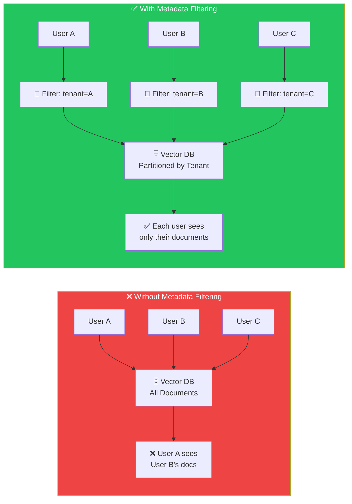
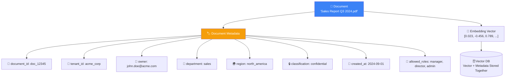
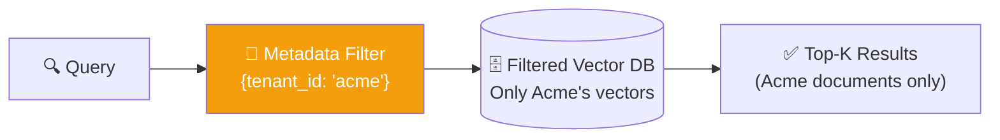
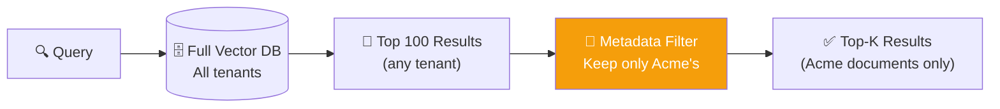
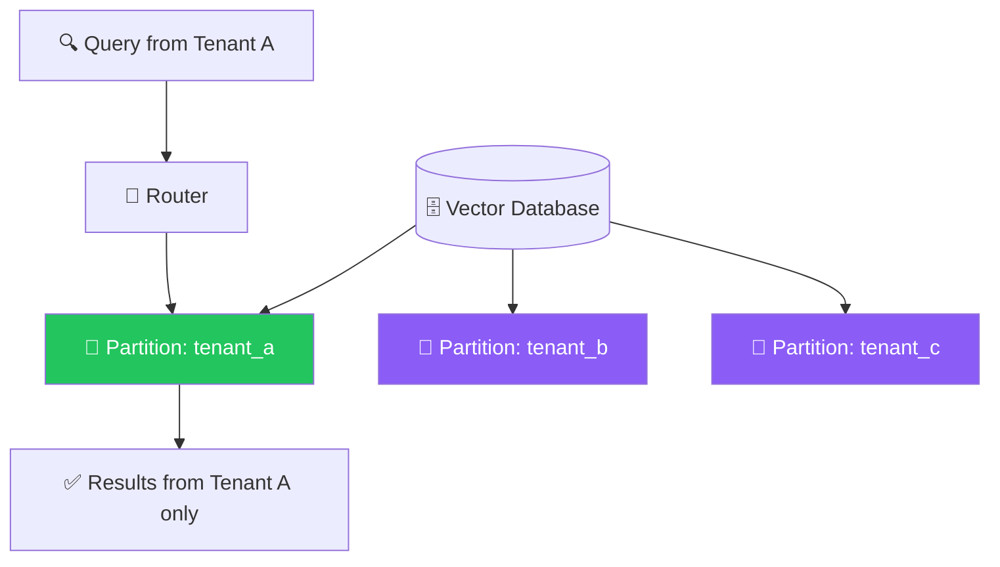
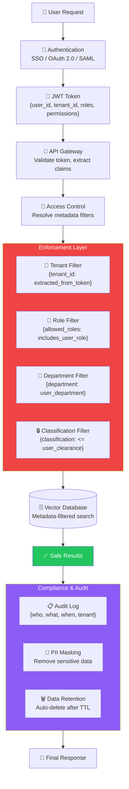

## Introduction

> **Metadata filtering is the mechanism that ensures users only retrieve documents they are authorized to access — it is the foundation of security in multi-tenant RAG systems.**

Without metadata filtering, every user can search every document. In production, that is unacceptable. Metadata filtering transforms a shared vector database into a secure, multi-tenant search system.

---

## Why This Exists

### The Problem: Shared Infrastructure, Private Data

In a multi-tenant RAG system, multiple organizations or users share the same vector database infrastructure. Without metadata filtering:

- **Company A's employees** could retrieve Company B's confidential documents
- **User X** could search documents owned by User Y
- **Public users** could access internal-only knowledge bases
- **Revenue data** could leak to unauthorized departments

### What Metadata Filtering Solves

1. **Access Control** — Users only see documents they have permission to view
2. **Tenant Isolation** — Different organizations' data is logically separated
3. **Compliance** — Meet GDPR, HIPAA, SOC 2 requirements for data access
4. **Auditability** — Every retrieval operation is logged with user context

---

## Real-World Analogy

### The Office Building with Security Badges

Imagine an office building with 10 companies. Each company has:

- **Employees** who can access only their company's floor
- **Rooms** that require specific clearance levels
- **Documents** that are labeled with department and confidentiality

When you enter the building:

1. Your **badge** identifies you (authentication)
2. The badge determines which **floors** you can access (authorization)
3. On your floor, you can only open **rooms** matching your role (RBAC)
4. Inside a room, you see documents tagged for your **department** (metadata filtering)

This is exactly how metadata filtering works in production RAG. The vector database is the building, tenant IDs are floor access, and document-level tags are room permissions.

---

## Metadata Fundamentals

### What is Metadata?

Metadata is data about data — it describes the document without being the document's content.

### Common Metadata Fields

| Field | Type | Example | Purpose |
|-------|------|---------|---------|
| `tenant_id` | string | `acme_corp` | Multi-tenant isolation |
| `document_id` | string | `doc_12345` | Unique document reference |
| `owner` | string | `user_678` | Document ownership |
| `department` | string | `engineering` | Organizational filtering |
| `region` | string | `eu-west` | Geo-restrictions |
| `classification` | enum | `public / internal / confidential / restricted` | Security levels |
| `allowed_roles` | array | `["admin", "manager"]` | Role-based access |
| `created_at` | datetime | `2024-09-01T00:00:00Z` | Time-based filtering |
| `source` | string | `sharepoint://sales/report.pdf` | Original source tracking |
| `tags` | array | `["quarterly", "revenue"]` | Custom categorization |

---

## Access Control Architecture

```mermaid
flowchart LR
    subgraph AUTH["Authentication Layer"]
        S1["🔑 SSO / OAuth"]
        S2["📋 JWT Token"]
        S3["👤 User Identity"]
    end

    subgraph PERM["Permission Resolution"]
        P1["📂 User Role\n(admin, manager, viewer)"]
        P2["🏢 User Tenant\n(acme_corp)"]
        P3["🌍 User Region\n(eu-west)"]
        P4["📋 User Attributes\n(department, clearance)"]
    end

    subgraph FILTER["Metadata Filter Construction"]
        F1["🔐 Pre-Filter Rules"]
        F2["📝 Filter Expression\n{tenant_id: 'acme_corp',\n department: 'engineering',\n classification: {lte: 'confidential'}}"]
    end

    subgraph SEARCH["Secure Retrieval"]
        S3["📡 Vector Search\n+ Metadata Filter"]
        S4["✅ Filtered Results\nOnly authorized docs"]
    end

    AUTH --> PERM
    PERM --> FILTER
    FILTER --> SEARCH

    style AUTH fill:#3b82f6,color:#fff
    style PERM fill:#8b5cf6,color:#fff
    style FILTER fill:#f59e0b,color:#fff
    style SEARCH fill:#22c55e,color:#fff
```

---

## Metadata Filtering Strategies

### 1. Pre-Filtering (Filter Before Search)

The most common approach — apply metadata filters **before** the vector search.

**Advantages:**
- Simple to implement
- Clear security boundary — unauthorized vectors are never searched
- Supported by most vector databases (Pinecone, Qdrant, Weaviate, Chroma)

**Disadvantages:**
- If the filter is too restrictive (e.g., only 10 matching vectors), search quality suffers
- Requires a good index on metadata fields

### 2. Post-Filtering (Search Then Filter)

Search all vectors, then filter results by metadata.

**Advantages:**
- Works with vector databases that don't support pre-filtering
- Can still find good results even if the filter is very restrictive

**Disadvantages:**
- **Security risk:** An attacker might be able to infer information from the unfiltered results
- Less efficient — searches all vectors, then discards many results

### 3. Partition-Based Filtering

Separate indexes per tenant/document group.

**Advantages:**
- Complete physical isolation between tenants
- No risk of cross-tenant data leakage
- Can optimize indexes per tenant

**Disadvantages:**
- More infrastructure to manage
- Harder to implement cross-tenant search (if needed)

---

## Enterprise Security Architecture

---

## Security Concerns in Production RAG

| Concern | Risk | Mitigation |
|---------|------|------------|
| **Prompt Injection** | User tricks LLM into bypassing filters | Input sanitization, output validation, system prompt hardening |
| **Indirect Prompt Injection** | Retrieved documents contain instructions that override system prompts | Separate user input from retrieved context, validate retrieved content |
| **Data Leakage** | LLM reveals information from other tenants | Strict pre-filtering, never include unauthorized data in context |
| **Model Inversion** | Attacker extracts embeddings to reverse-engineer training data | Differential privacy, rate limiting, monitoring |
| **Cache Poisoning** | Malicious response cached and served to other users | Tenant-scoped cache keys, cache validation |
| **Injection via Metadata** | Attacker embeds malicious content in metadata fields | Sanitize all metadata fields, validate types |

---

## Compliance Requirements

| Standard | Requirements | RAG Implementation |
|----------|--------------|-------------------|
| **GDPR** | Right to be forgotten, data portability | Document deletion API, export functionality, data retention TTL |
| **HIPAA** | PHI protection, access logs, BAA agreements | Encryption at rest/in transit, audit logging, role-based access |
| **SOC 2** | Access controls, monitoring, incident response | RBAC, activity logging, security incident detection |
| **CCPA** | Consumer data rights, opt-out | Privacy preference storage, data classification, deletion capability |

---

## Common Mistakes

| Mistake | Why It's Wrong | Fix |
|---------|---------------|-----|
| **Relying on post-filtering for security** | Attackers may infer information from raw results | Always use pre-filtering for security-sensitive filters |
| **Storing metadata separately from vectors** | Risk of desync between metadata and vector DB | Store vectors and metadata together in the vector database |
| **Ignoring metadata in development** | "It works on my machine" → fails in production | Always include metadata in development and testing |
| **No audit logging** | Cannot trace who accessed what | Log every retrieval with user context, timestamp, and query |
| **Hardcoded tenant IDs** | Mixing up tenants is catastrophic | Extract tenant ID from authentication, never from user input |

---

## Best Practices

1. **Filter before search** — Always apply security-critical metadata filters (tenant_id, role) **before** the vector search. Post-filtering is for non-security filtering like recency or category.

2. **Never trust client input** — Metadata filters must be constructed server-side based on authenticated user context, never from client-provided parameters.

3. **Use typed metadata** — Vector databases support different metadata types (string, number, boolean, array). Use the right type for efficient filtering.

4. **Index your metadata fields** — Metadata filtering is only fast if the fields you filter on are indexed.

5. **Test security boundaries** — Write integration tests that verify User A cannot retrieve User B's documents at the vector search level, not just at the application level.

6. **Encrypt sensitive metadata** — If metadata contains sensitive information (like document owner email), encrypt it or use hash-based identifiers.

---

## Interview Questions

### Beginner

**Q: What is metadata filtering in a RAG system?**

> Metadata filtering means attaching descriptive fields (like tenant_id, department, role) to every document chunk in the vector database, then using those fields to restrict search results to only the documents a user is authorized to access. It transforms a shared vector database into a multi-tenant secure system.

**Q: Why is metadata filtering important for enterprise RAG?**

> Without metadata filtering, any user could search all documents in the vector database. In an enterprise, different users have access to different documents based on their role, department, and organization. Metadata filtering enforces these access rules at the search level, preventing data leakage.

### Intermediate

**Q: Compare pre-filtering vs post-filtering for security.**

> Pre-filtering applies metadata filters before the vector search, so unauthorized vectors are never searched. This is the secure approach. Post-filtering searches all vectors first and then filters results — this is risky because raw search results could theoretically leak information. Pre-filtering is recommended for security-critical filters; post-filtering is acceptable for non-security filters like date range or category.

**Q: How would you implement document-level permissions in a shared vector database?**

> Every document chunk stores metadata fields: `document_id`, `owner`, `allowed_users[]`, `allowed_roles[]`, `minimum_clearance`. At query time, the user's identity and permissions are extracted from their JWT token. The metadata filter expression combines: `{owner: user_id OR allowed_users: contains user_id OR allowed_roles: overlaps user_roles}`. This ensures only permitted documents are retrieved.

### Senior

**Q: Design a metadata filtering strategy for a multi-tenant RAG system that supports both workspace-level and document-level permissions.**

> **Workspace Level:** Each workspace gets a `tenant_id`. Documents are tagged with `tenant_id`. At query time, the user's `tenant_id` is extracted from auth and used as a mandatory pre-filter. This ensures no cross-tenant data leakage.
>
> **Document Level:** Within a workspace, documents have `visibility` (public_to_workspace, restricted, private) and `allowed_viewers[]`. After the workspace pre-filter, a second post-filter applies: if `visibility == public_to_workspace`, show to all workspace members. If `visibility == restricted`, check if user's role is in `allowed_roles[]`. If `visibility == private`, check if user ID is in `allowed_viewers[]`.
>
> **Performance Optimization:** Index `tenant_id` and `visibility` for fast pre-filtering. For document-level permissions, create a composite index on `(tenant_id, allowed_viewers)`.

### Staff Engineer

**Q: How would you design a RAG security system to meet SOC 2 Type II compliance requirements?**

> **Access Control:** IAM-based authentication with SSO integration. JWT tokens containing user context (tenant_id, roles, permissions). Every API request validated against a centralized policy engine (e.g., Open Policy Agent).
>
> **Data Encryption:** AES-256 encryption at rest for vectors and metadata. TLS 1.3 for all in-transit communication. Customer-managed encryption keys (CMEK) option for enterprise customers.
>
> **Audit Logging:** Every retrieval operation logged with: user ID, timestamp, query hash, number of documents retrieved, tenant ID. Logs stored in immutable storage with 1-year retention.
>
> **Isolation:** Pre-filtering for tenant-level isolation. Optional dedicated index partitions for customers with strict compliance needs. Never mix data from different compliance tiers.
>
> **Monitoring:** Real-time anomaly detection for unusual access patterns. Automated alerts for: cross-tenant access attempts (blocked), unusual query volume, metadata filter bypass attempts.
>
> **Verification:** Quarterly penetration testing. Automated compliance scanning. Documented incident response plan. SOC 2 Type II audit with annual renewal.

### System Design

**Q: Design a secure RAG system that supports 500 enterprise customers with document-level permissions, GDPR compliance, and sub-200ms P99 retrieval latency.**

> **Architecture:**
>
> **Auth Service:** SSO (SAML/OIDC) → JWT issuance → Token carries tenant_id, user_id, roles, and department.
>
> **Vector DB:** Qdrant or Pinecone with tenant_id as payload index and shard key. Each tenant's vectors stored on dedicated shards for physical isolation.
>
> **Metadata Schema:** `{tenant_id, doc_id, owner, allowed_roles[], classification, created_at, region}`.
>
> **Security Flow:** API Gateway validates JWT → Constructs pre-filter `{tenant_id: exact_match, classification: <= user_clearance}` → Appends document-level filter `{allowed_roles: contains any user_role}` → Search with filters → Log operation.
>
> **GDPR:** Deletion API removes vectors and metadata for specific user documents. Export API returns all stored user data in machine-readable format. Automatic TTL-based deletion for expired data.
>
> **Latency:** Metadata indexes on tenant_id (primary) and classification (secondary). Connection pooling. Embedding cache. Response cache per tenant. P99 target: < 200ms for retrieval, < 2s end-to-end.

---

## Summary

| Concept | Key Point |
|---------|-----------|
| **Metadata filtering** | Attach security fields to every vector, filter before search |
| **Pre-filtering** | Apply security filters before vector search (secure) |
| **Post-filtering** | Search then filter (acceptable for non-security use) |
| **Tenant isolation** | Each tenant's data is logically or physically separated |
| **Access control** | RBAC + document-level permissions via metadata |
| **Compliance** | GDPR, HIPAA, SOC 2 requirements enforced at the search level |
| **Audit** | Every retrieval is logged for traceability |

---

**Previous:** [16 — Production RAG Architecture](/ai/phase-05-retrieval-systems/16-production-rag-architecture)

**Next:** [18 — RAG Evaluation & Observability](/ai/phase-05-retrieval-systems/18-rag-evaluation-and-observability)

**Related Topics:**
- [Production RAG Architecture](/ai/phase-05-retrieval-systems/16-production-rag-architecture)
- [Vector Databases Introduction](/ai/phase-05-retrieval-systems/05-vector-databases-introduction)
- [Retrievers](/ai/phase-05-retrieval-systems/09-retrievers)
