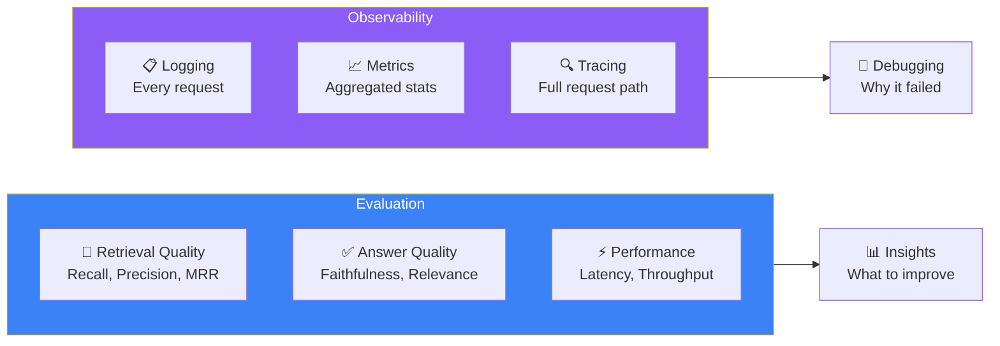
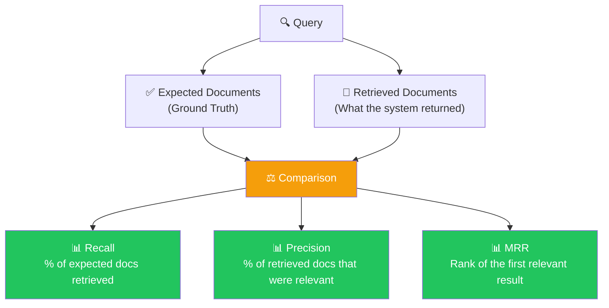
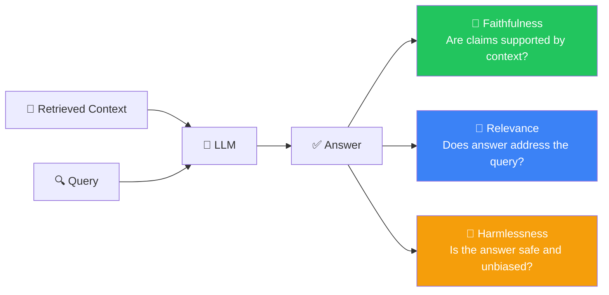
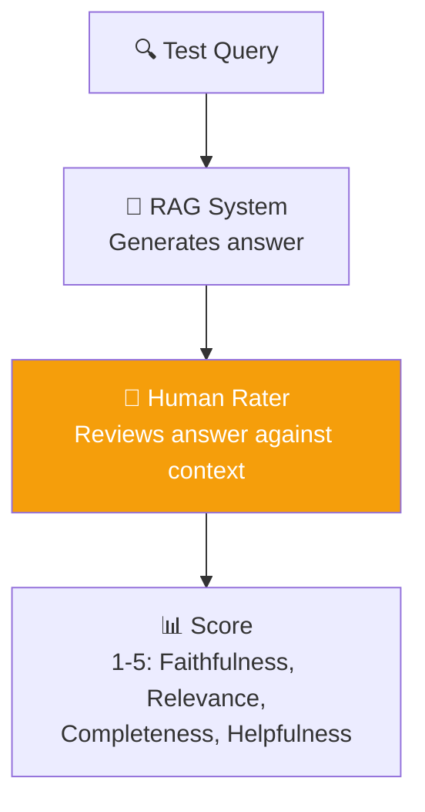
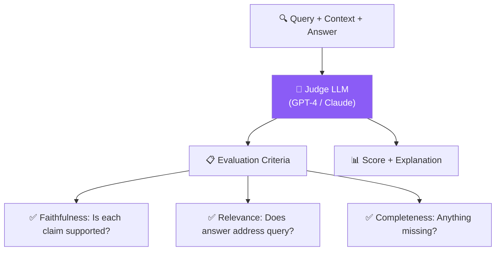
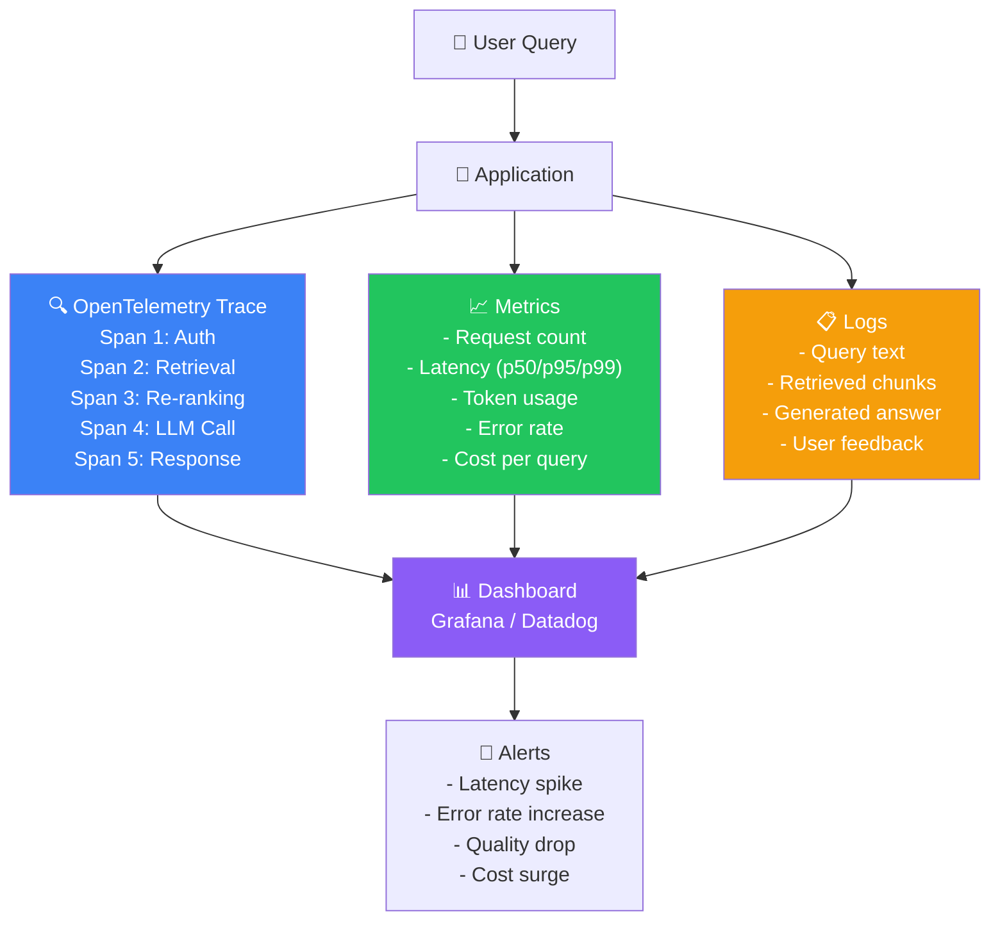
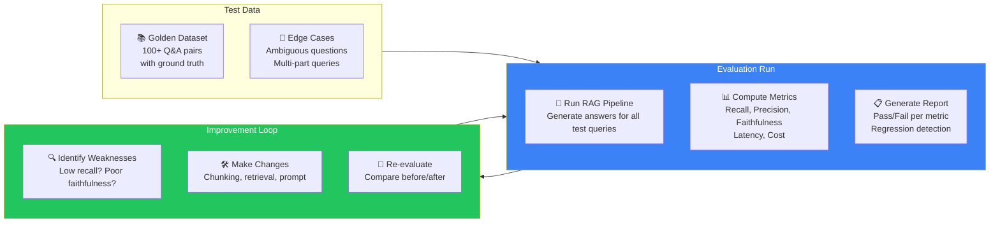

## Introduction

> **Without evaluation, you cannot improve. Without observability, you cannot debug. A production RAG system must measure retrieval quality, answer faithfulness, latency, cost, and user satisfaction — continuously.**

Evaluation tells you if your RAG system is good. Observability tells you why it's good — or why it's broken.

---

## Why This Exists

### The Problem: "It Works on My Laptop"

Your RAG pipeline generates good answers for the 10 test questions you tried. But in production:

- Does it work for **all** documents in the knowledge base?
- Does it work for **all** types of questions users ask?
- Is it getting better or worse after each change?
- Why did it return a wrong answer for the CEO's query yesterday?
- How much does it cost per query?

Without evaluation and observability, you are flying blind.

### What Evaluation & Observability Solve

| Dimension | Without | With |
|-----------|---------|------|
| **Quality** | "Seems good" | Measured recall, precision, faithfulness |
| **Debugging** | Random guesses | Trace every step of every query |
| **Improvement** | Blind changes | Data-driven optimization |
| **Cost** | Unknown | Per-query cost tracking |
| **Trust** | Gut feeling | Verified metrics |

---

## Real-World Analogy

### The Restaurant Quality Inspector

Imagine a restaurant. Without evaluation:

- The chef thinks the food is good
- Customers are complaining, but no one knows why
- Sometimes the food is cold, sometimes it's salty
- No one tracks which dishes are popular

With evaluation:

- **Quality scores** for every dish (taste, temperature, presentation)
- **Customer feedback** systematically collected and analyzed
- **Kitchen metrics** tracked (prep time, waste, cost per dish)
- **Improvement experiments** tested and measured

This is exactly what evaluation does for RAG systems.

---

## RAG Evaluation Metrics

### Retrieval Metrics

These measure how well the retriever finds relevant documents.

| Metric | What It Measures | Formula | Target |
|--------|-----------------|---------|--------|
| **Recall@K** | Did we find the relevant docs? | relevant retrieved / total relevant | > 0.8 |
| **Precision@K** | Were the results relevant? | relevant retrieved / total retrieved | > 0.7 |
| **MRR** (Mean Reciprocal Rank) | Was the first relevant result ranked high? | 1 / rank of first relevant | > 0.9 |
| **NDCG@K** | Were results ranked in the right order? | Normalized discounted cumulative gain | > 0.8 |
| **Hit Rate** | Did at least one relevant doc appear? | queries with at least 1 relevant / total queries | > 0.95 |

### Generation Metrics

These measure the quality of the LLM's final answer.

| Metric | What It Measures | How to Measure |
|--------|-----------------|----------------|
| **Faithfulness** | Is every claim in the answer supported by the retrieved context? | LLM-as-judge, NLI models, human evaluation |
| **Answer Relevance** | Does the answer directly address the user's question? | LLM-as-judge, cosine similarity between query and answer |
| **Context Relevance** | Does the retrieved context contain information relevant to the query? | LLM-as-judge, cosine similarity |
| **Groundedness** | Is the answer grounded in retrieved context (not hallucinated)? | Claim extraction + context verification |
| **Completeness** | Does the answer cover all aspects of the question? | Human evaluation, rubric-based scoring |

### Performance Metrics

| Metric | What It Measures | Target |
|--------|-----------------|--------|
| **P50 Latency** | Median end-to-end response time | < 1 second |
| **P95 Latency** | 95th percentile response time | < 3 seconds |
| **P99 Latency** | Worst-case response time | < 10 seconds |
| **Throughput** | Queries per second | Depends on scale |
| **Token Usage** | Total tokens consumed per query | Track for cost |
| **Cost Per Query** | Total cost (embedding + retrieval + LLM) | < $0.01 for most apps |

---

## Evaluation Methods

### 1. Human Evaluation

The gold standard — human raters assess answer quality.

**Advantages:**
- Most accurate assessment of real quality
- Can catch subtle issues (tone, politeness, safety)
- Ground truth for automated metrics

**Disadvantages:**
- Expensive and slow
- Not scalable for frequent evaluation
- Inter-rater variability

### 2. LLM-as-Judge

Use a strong LLM (GPT-4, Claude) to evaluate your RAG system's outputs.

**Advantages:**
- Fast and scalable
- Consistent evaluation criteria
- Can evaluate thousands of examples

**Disadvantages:**
- Judge LLM may have biases
- Cannot catch all errors (especially subtle hallucinations)
- Requires careful prompt engineering for reliable results

### 3. Automated Metrics

Compute metrics programmatically without human or LLM intervention.

| Metric Type | Examples | Tools |
|-------------|----------|-------|
| **Text similarity** | BLEU, ROUGE, METEOR | NLTK, evaluate |
| **Semantic similarity** | BERTScore, BLEURT, COMET | bert-score, sacrebleu |
| **NLI-based** | TrueTeacher, AlignScore | transformers, NLI models |
| **Retrieval metrics** | Recall, Precision, MRR, NDCG | RAGAS, LangSmith |

---

## Observability Stack

---

## Evaluation Tools

| Tool | What It Does | Best For |
|------|-------------|----------|
| **RAGAS** | Open-source RAG evaluation framework | Retrieval + generation metrics |
| **LangSmith** | LLM tracing and evaluation platform | Debugging, testing, monitoring |
| **Arize Phoenix** | Open-source LLM observability | Tracing, embeddings visualization |
| **Weights & Biases** | Experiment tracking | Comparing prompt/strategy changes |
| **DeepEval** | LLM evaluation framework | CI/CD integration |
| **Trulens** | RAG evaluation and monitoring | Production monitoring |
| **OpenTelemetry** | Open-source observability standard | Distributed tracing |

---

## Building an Evaluation Pipeline

---

## Real Production Examples

### Perplexity

| Aspect | Implementation |
|--------|---------------|
| **Evaluation** | Human raters score answer quality, relevance, and citation accuracy |
| **Observability** | Internal tracing across retrieval, search, and LLM calls |
| **Metrics** | User satisfaction surveys, answer accuracy audits, latency SLOs |
| **Feedback** | Thumbs up/down on every answer, used as training signal |

### Notion AI

| Aspect | Implementation |
|--------|---------------|
| **Evaluation** | Automated evaluation on a golden dataset before every deployment |
| **Observability** | Full request tracing from query to LLM response |
| **Metrics** | Retrieval recall, answer faithfulness, P95 latency |
| **Feedback** | User reactions (thumbs up/down) + optional text feedback |

### GitHub Copilot

| Aspect | Implementation |
|--------|---------------|
| **Evaluation** | Code compilation rate, acceptance rate, user retention |
| **Observability** | Telemetry on completions, accepted vs rejected suggestions |
| **Metrics** | Suggestion acceptance rate, latency P50/P95, code correctness |
| **Feedback** | User accepts/rejects suggestions (implicit feedback at scale) |

---

## Common Mistakes

| Mistake | Why It's Wrong | Fix |
|---------|---------------|-----|
| **Only measuring retrieval metrics** | High recall doesn't mean good answers | Always evaluate generation quality (faithfulness, relevance) |
| **Testing only with easy queries** | Easy queries hide system weaknesses | Include edge cases, ambiguous questions, multi-part queries |
| **Skipping human evaluation** | Automated metrics miss subtle issues | Combine automated + human evaluation |
| **No baseline measurement** | Can't tell if changes improve or degrade quality | Establish baseline metrics before making changes |
| **Evaluating once, never again** | System quality degrades over time | Continuous evaluation in CI/CD pipeline |
| **Ignoring cost metrics** | System may be too expensive to operate | Always track cost per query alongside quality |

---

## Best Practices

1. **Establish a golden dataset** — Create 100+ Q&A pairs with ground truth documents, maintained by domain experts.

2. **Evaluate before and after every change** — Every modification to chunking, retrieval, prompts, or models should be tested against the golden dataset.

3. **Use multiple evaluation methods** — Combine automated metrics (RAGAS), LLM-as-judge, and periodic human evaluation.

4. **Monitor in real-time** — Track latency, error rate, and token usage on dashboards with alerts for anomalies.

5. **Collect user feedback** — Thumbs up/down, star ratings, and optional text feedback provide invaluable signals.

6. **Version your evaluations** — Keep historical evaluation results to detect regressions and track improvements over time.

---

## Interview Questions

### Beginner

**Q: What is the difference between evaluation and observability in a RAG system?**

> Evaluation measures how good the system is (retrieval quality, answer faithfulness, latency). Observability gives you visibility into why the system behaves the way it does (tracing individual requests, logging, metrics). You need both: evaluation to know what to improve, observability to debug issues.

**Q: What is a golden dataset and why is it important?**

> A golden dataset is a curated collection of query-answer pairs with ground truth documents that the retriever should find. It's important because it provides a consistent benchmark for measuring system quality. Without it, you can't objectively determine if changes improve or degrade performance.

### Intermediate

**Q: How would you set up a continuous evaluation pipeline for a RAG system?**

> 1. Create a golden dataset of 200+ Q&A pairs with ground truth contexts
> 2. Run the RAG pipeline against this dataset automatically after every deployment
> 3. Compute retrieval metrics (Recall, Precision, MRR) and generation metrics (Faithfulness, Relevance) using RAGAS or similar
> 4. Compare results against a baseline — if any metric drops below a threshold, block the deployment
> 5. Run periodic human evaluation on a subset (50 queries per week)
> 6. Track all results in a dashboard with historical trends

**Q: What is LLM-as-judge? What are its advantages and limitations?**

> LLM-as-judge uses a strong LLM (like GPT-4 or Claude) to evaluate outputs from your RAG system. You provide the query, retrieved context, and generated answer, and ask the judge LLM to score faithfulness and relevance.
>
> **Advantages:** Fast, scalable, consistent, works on any type of question.
> **Limitations:** The judge LLM can have biases (favors its own outputs), may miss subtle hallucinations, requires careful prompt engineering, and adds cost to the evaluation process.

### Senior

**Q: Design a monitoring system for a production RAG service that alerts on quality degradation.**

> **Metrics to Track:**
> - **Retrieval Quality:** Proxy metrics like click-through rate, follow-up question rate, user satisfaction score
> - **Generation Quality:** LLM-as-judge on a random sample (5% of queries), thumbs up/down ratio
> - **Performance:** P50/P95/P99 latency, error rate, throughput
> - **Cost:** Tokens per query, cost per query, cost per user
>
> **Alerting Thresholds:**
> - P95 latency > 3 seconds → pager
> - Error rate > 1% → pager
> - User satisfaction score drops by 10% in 1 hour → slack notification
> - Cost per query increases by 50% → investigation ticket
>
> **Implementation:**
> - Use OpenTelemetry for distributed tracing
> - Export metrics to Prometheus, visualize in Grafana
> - Log every query + retrieved chunks + answer in structured logs
> - Sample 10% of queries for LLM-as-judge evaluation
> - Maintain a rolling 7-day window of evaluation scores for trend detection

### Staff Engineer

**Q: How would you build an evaluation system that can detect subtle hallucinations that LLM-as-judge misses?**

> **Multi-Layer Evaluation:**
>
> **Layer 1 — Automatic (every query):** Rule-based checking — extract claims from answer, check each claim against retrieved context using NLI models. Flag any unverifiable claims.
>
> **Layer 2 — LLM-as-Judge (sampled, 10%):** Strong LLM evaluates faithfulness and relevance. If score is low, log for human review.
>
> **Layer 3 — Adversarial Testing (periodic):** Create test cases designed to trigger hallucinations (questions about topics with no documents, questions with embedded false premises, questions requiring multi-hop reasoning). Run these weekly.
>
> **Layer 4 — Human Evaluation (ongoing):** Domain experts review a random sample plus all flagged responses. Provide detailed feedback.
>
> **Layer 5 — Production Monitoring:** Track user corrections, follow-up questions, and negative feedback as signals of quality issues.
>
> **Feedback Loop:** All detected issues are added to the golden dataset and used to improve the system.

### System Design

**Q: Design an evaluation platform that can test 1000 RAG configurations across 10,000 queries with meaningful statistical results.**

> **Architecture:**
>
> **Configuration Registry:** Stores all RAG configurations as versioned JSON — chunking strategy, embedding model, retrieval strategy, re-ranking config, prompt template, LLM model.
>
> **Test Runner:** Distributed job queue (Kubernetes + Celery) that runs configurations against the golden dataset in parallel. Each job: run a single config against a batch of 100 queries, collect results.
>
> **Metrics Pipeline:** Results streamed to a time-series database (ClickHouse). Metrics computed per-config: recall, precision, faithfulness, latency, cost.
>
> **Statistical Analysis:**
> - A/B testing framework with confidence intervals
> - T-test or Bayesian comparison between configs
> - Multi-armed bandit for progressive evaluation (allocate more queries to promising configs)
>
> **Dashboard:** Interactive comparison view — select two configs, see side-by-side metrics with statistical significance indicators.
>
> **Output:** Automatically recommend the best config based on user-defined objectives (maximize quality, minimize cost, or balance both).

---

## Summary

| Concept | Key Point |
|---------|-----------|
| **Retrieval metrics** | Recall, Precision, MRR — measure search quality |
| **Generation metrics** | Faithfulness, Relevance, Groundedness — measure answer quality |
| **Performance metrics** | Latency, Throughput, Cost — measure operational health |
| **Evaluation methods** | Human, LLM-as-Judge, Automated — combine all three |
| **Golden dataset** | Curated Q&A pairs with ground truth — essential for measurement |
| **Observability** | Tracing + Metrics + Logging + Alerting |
| **Continuous evaluation** | Test every change, monitor in production, collect user feedback |

---

**Previous:** [17 — Metadata Filtering & Security](/ai/phase-05-retrieval-systems/17-metadata-filtering-and-security)

**Next:** [19 — Performance & Scaling](/ai/phase-05-retrieval-systems/19-performance-and-scaling)

**Related Topics:**
- [Building a Complete RAG Pipeline](/ai/phase-05-retrieval-systems/10-building-a-complete-rag-pipeline)
- [Production RAG Architecture](/ai/phase-05-retrieval-systems/16-production-rag-architecture)
- [Production Best Practices](/ai/phase-05-retrieval-systems/20-production-best-practices)
