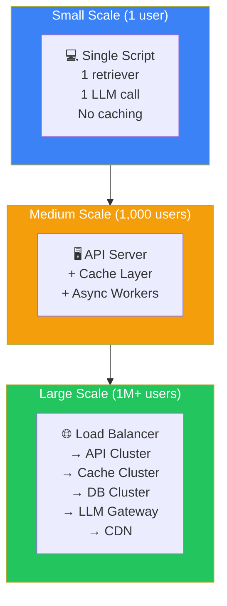
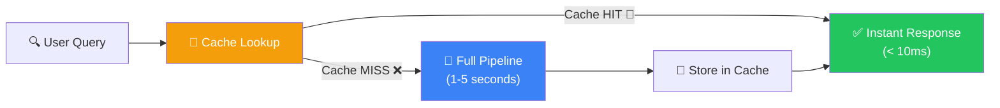
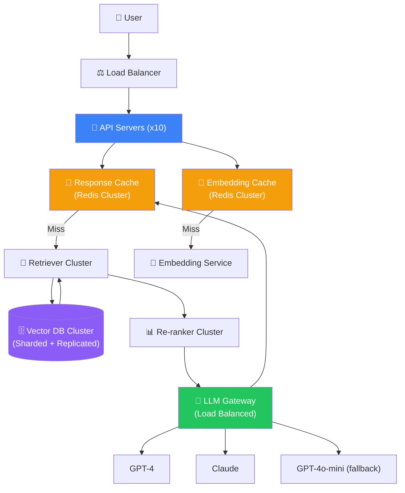
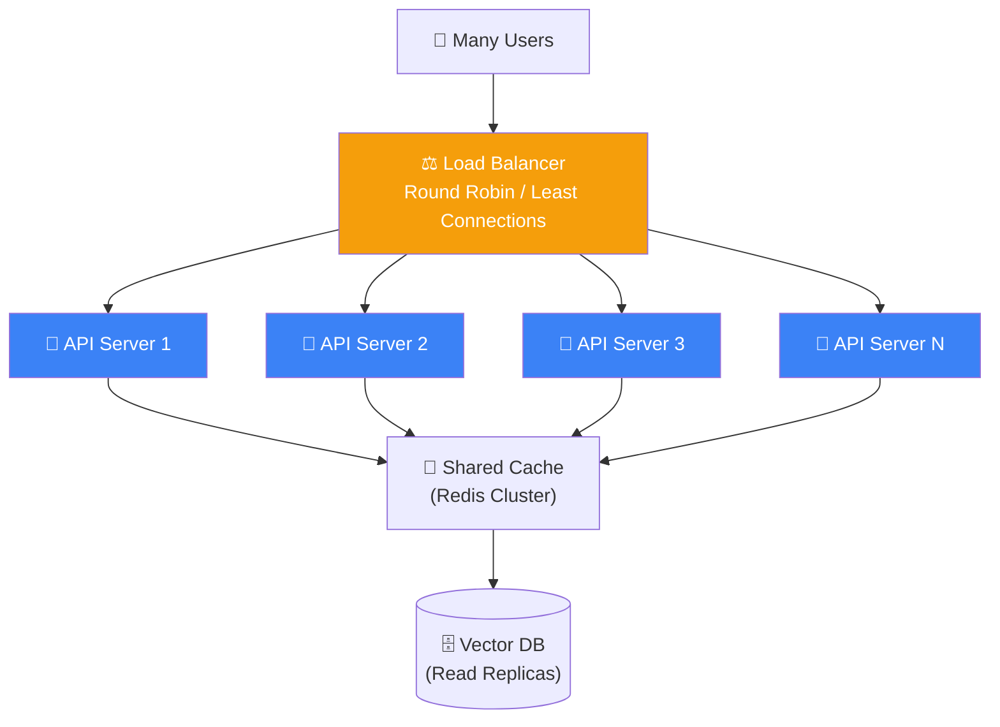
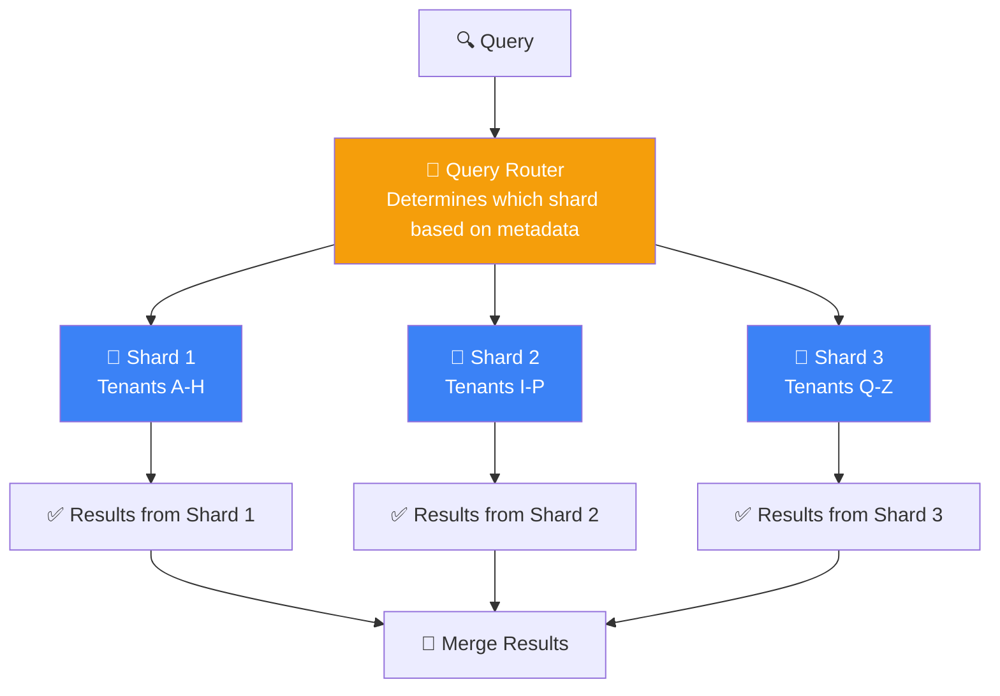
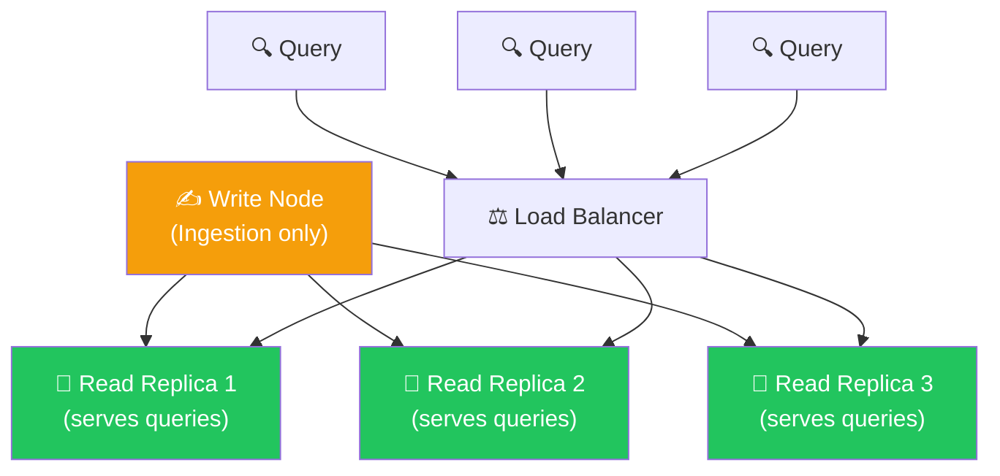
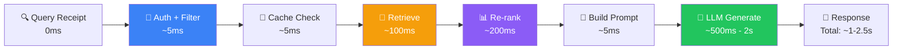
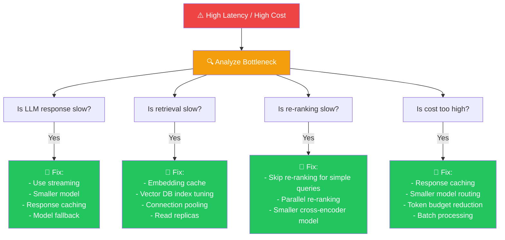

## Introduction

> **Scaling a RAG system is not about making one component faster — it's about distributing work across replicated, cached, and optimized services that collectively handle millions of queries with sub-second latency.**

Performance and scaling transform a working prototype into a production system that serves thousands of concurrent users without breaking.



---

## Why This Exists

### The Problem: Slow + Expensive + Brittle

A basic RAG pipeline on your laptop:

- One LLM call per query: **1–5 seconds**
- One embedding computation: **200–500ms** (every time)
- One vector DB search: **50–100ms** (on small dataset)
- No caching: **every query pays full cost**

At 1 user, this is fine. At 1,000 concurrent users:
- Queue builds up
- Response times balloon to 10+ seconds
- API costs skyrocket
- Users abandon the application

### What Performance & Scaling Solve

| Problem | Solution | Impact |
|---------|----------|--------|
| **Slow retrieval** | Caching, indexing, parallel search | 10–100x faster |
| **High cost** | Response caching, embedding reuse, batch processing | 50–90% cost reduction |
| **Concurrent users** | Load balancing, horizontal scaling, connection pooling | Handle 1000x more users |
| **LLM bottlenecks** | Fallback models, streaming, request batching | Reliable performance |
| **Data growth** | Sharding, partitioning, tiered storage | Scale to billions of vectors |

---

## Real-World Analogy

### The Restaurant Kitchen

Imagine a restaurant that suddenly gets 100x more customers.

Without scaling:
- One chef tries to cook everything
- Orders pile up
- Food takes 45 minutes
- Customers leave

With scaling:
- **Multiple chefs** (horizontal scaling) — each handles different orders
- **Pre-prepped ingredients** (caching) — sauces and dough prepared in advance
- **Specialized stations** (microservices) — grill station, salad station, dessert station
- **Order prioritization** (queues) — simple orders served fast, complex ones take longer
- **Menu optimization** (cost management) — focus on high-margin, fast-to-prepare dishes

This is exactly how we scale RAG systems.

---

## Caching Strategies

Caching is the single most effective optimization for RAG systems.



### 1. Embedding Cache

Cache the embedding vectors for frequently asked questions.

| Aspect | Detail |
|--------|--------|
| **What it caches** | Query text → embedding vector mapping |
| **Cache key** | Hash of query text (normalized: lowercase, stripped) |
| **TTL** | 24–48 hours (embeddings don't change often) |
| **Hit Rate** | 30–60% for applications with common queries |
| **Storage** | Redis / Memcached |
| **Savings** | Saves 200–500ms per cached query |

### 2. Response Cache

Cache the complete LLM response for identical questions.

| Aspect | Detail |
|--------|--------|
| **What it caches** | (Query + context hash) → response mapping |
| **Cache key** | Hash of query + retrieved chunk IDs |
| **TTL** | 1–24 hours depending on data freshness needs |
| **Hit Rate** | 20–40% for knowledge-base style applications |
| **Storage** | Redis cluster with persistence |
| **Savings** | Saves 1–5 seconds per cached query + LLM cost |

### 3. Retriever Cache

Cache the top-K retrieved documents for common queries.

| Aspect | Detail |
|--------|--------|
| **What it caches** | Query embedding → top document IDs mapping |
| **Cache key** | Hash of query embedding vector |
| **TTL** | 1–6 hours (documents may change) |
| **Hit Rate** | 40–60% for FAQ-style knowledge bases |
| **Storage** | Redis / in-memory |
| **Savings** | Saves vector DB query time (50–200ms) |

### 4. CDN Cache

Cache static responses at the edge.

| Aspect | Detail |
|--------|--------|
| **What it caches** | Responses for public, non-personalized queries |
| **Location** | Edge servers (Cloudflare, Akamai) |
| **TTL** | 5–60 minutes |
| **Best for** | Public documentation Q&A, help center articles |

---

## Caching Architecture



---

## Scaling Strategies

### Horizontal Scaling



**Strategy:** Add more copies of stateless services (API servers, retrievers, re-rankers) behind a load balancer.

**Best for:** API servers, retriever instances, re-ranker instances

### Sharding



**Strategy:** Partition data across multiple database instances based on a shard key (e.g., tenant_id, document hash).

**Best for:** Vector databases that exceed a single node's capacity

### Replication



**Strategy:** Create read replicas of the vector database. All ingestion goes to the write node; all queries are distributed across read replicas.

**Best for:** Read-heavy workloads (common in RAG — many queries, fewer document updates)

---

## Latency Optimization

### End-to-End Latency Budget



### Optimization Techniques

| Technique | Savings | Implementation |
|-----------|---------|----------------|
| **Embedding cache** | 200–500ms | Cache query embeddings in Redis |
| **Response cache** | 1–5s | Cache full responses for common queries |
| **Streaming** | 300ms–1s to first token | Stream LLM response instead of waiting for complete |
| **Smaller models** | 200–500ms per call | Use GPT-4o-mini for simple queries, GPT-4 for complex |
| **Connection pooling** | 50–100ms | Reuse connections to DB and LLM API |
| **Batch retrieval** | 30–50% reduction | Batch multiple queries into one DB call |
| **Approximate search** | 50–80% faster | Use HNSW instead of exact search |
| **Pre-compute** | 100% at query time | Pre-compute embeddings during ingestion |

---

## Cost Optimization

| Strategy | Savings | Trade-off |
|----------|---------|-----------|
| **Response caching** | 50–90% on LLM costs | Stale responses for dynamic content |
| **Smaller LLM for simple queries** | 40–60% on LLM costs | Lower quality on complex queries |
| **Batch embedding** | 30–50% on embedding costs | Higher initial latency for batch processing |
| **Token budgeting** | 20–40% on LLM costs | Need to balance context vs. quality |
| **Result count reduction** | 10–20% on LLM costs | Fewer retrieved chunks → potentially lower quality |
| **Model distillation** | Up to 90% | Need to train and maintain distilled model |

### Cost Breakdown (Typical)

```
Per-Query Cost Distribution:

                   Embedding API
                 ┌──────────────────┐
                 │    5-10%         │
                 └──────────────────┘
                 ┌──────────────────┐
  Vector DB      │    10-15%       │
                 └──────────────────┘
                 ┌──────────────────────────────────────┐
  LLM (GPT-4o)   │             70-80%                   │
                 └──────────────────────────────────────┘
                 ┌──────────────────┐
  Infrastructure │    5-10%         │
                 └──────────────────┘
```

---

## Bottleneck Detection



---

## Real Production Examples

### Perplexity

| Aspect | Implementation |
|--------|---------------|
| **Scaling** | Horizontal scaling with Kubernetes. Multiple retriever instances behind load balancer. |
| **Caching** | Aggressive response caching for common queries (news, trending topics). Embedding cache for repeated queries. |
| **LLM Strategy** | Routes simple queries to faster models, complex queries to stronger models. Streaming by default. |

### Microsoft Copilot

| Aspect | Implementation |
|--------|---------------|
| **Scaling** | Azure infrastructure with global distribution. Data replicated across regions for low latency. |
| **Caching** | Multi-layer caching: edge cache (CDN) → application cache → database cache. |
| **LLM Strategy** | Optimized models with batching and prompt caching for efficiency. |

### Amazon Bedrock Knowledge Bases

| Aspect | Implementation |
|--------|---------------|
| **Scaling** | AWS-managed auto-scaling. Vector database (Aurora or Pinecone) with read replicas. |
| **Caching** | Bedrock's managed caching layer. Response caching at the API Gateway level. |
| **LLM Strategy** | Multi-model support with automatic fallback. Provisioned throughput for predictable workloads. |

---

## Common Mistakes

| Mistake | Why It's Wrong | Fix |
|---------|---------------|-----|
| **Premature optimization** | Optimizing before measuring actual bottlenecks | Profile first, optimize the actual bottleneck |
| **Ignoring cold start** | Cache hit rates are low initially, causing slow startup | Pre-warm caches with historical queries |
| **No connection pooling** | Every request opens a new connection → TCP overhead | Use persistent connection pools |
| **Over-relying on caching** | Cached responses may be stale for dynamic data | Use appropriate TTLs and include data freshness metadata |
| **Single AZ deployment** | Entire system goes down if the availability zone fails | Deploy across multiple AZs/regions |
| **No rate limiting** | One aggressive user can overwhelm the system | Implement per-user and global rate limits |

---

## Best Practices

1. **Measure first, optimize second** — Profile your system to find the actual bottleneck before investing in optimizations.

2. **Cache aggressively, invalidate carefully** — Caching is the highest-impact optimization. But ensure cache invalidation is correct for your use case.

3. **Design for failure** — Every component should have a fallback. If GPT-4 is down, fall back to Claude. If the vector DB is slow, fall back to keyword search.

4. **Scale stateless services easily** — API servers, retrievers, and re-rankers should be stateless so they can be scaled horizontally without complexity.

5. **Use connection pooling** — Opening new connections to databases and LLM APIs is expensive. Always use connection pools.

6. **Implement graceful degradation** — When the system is under load, prioritize quality for paying users and provide degraded service (longer timeout, smaller model) for free tier.

7. **Monitor and auto-scale** — Set up auto-scaling based on queue depth, CPU, and request latency. Scale up before problems occur.

---

## Interview Questions

### Beginner

**Q: Why is caching important for RAG systems?**

> Caching stores the results of previous computations so they can be reused. In RAG systems, caching can save embedding computations (200–500ms) and LLM calls (1–5 seconds). For common queries, caching can reduce latency by 10–100x and reduce costs by 50–90%. The three main cache types are embedding cache, response cache, and retriever cache.

**Q: What is the difference between horizontal and vertical scaling?**

> Horizontal scaling means adding more machines (e.g., 10 servers instead of 1). Vertical scaling means making a single machine more powerful (e.g., more RAM, faster CPU, better GPU). Horizontal scaling is preferred for RAG systems because it provides fault tolerance, unlimited scalability, and can be automated with load balancers.

### Intermediate

**Q: How would you design a cache invalidation strategy for a RAG system?**

> **Time-based invalidation:** Set TTLs based on data freshness needs — 1 hour for news, 24 hours for documentation, 7 days for reference materials.
>
> **Event-based invalidation:** When documents are added, updated, or deleted, invalidate related cache entries. Store document IDs with each cached response so you can selectively invalidate.
>
> **Version-based invalidation:** Include the embedding model version and document index version in the cache key. When either changes, all old cache entries are automatically invalidated.
>
> **Lazy invalidation:** Don't actively invalidate. Set short TTLs and let cache misses handle freshness. Simpler but wastes some compute on unnecessary recomputation.

**Q: How would you reduce LLM costs in a RAG system without significantly reducing quality?**

> 1. **Response caching** — Cache identical questions. Highest impact with no quality loss.
> 2. **Query classification** — Route simple queries (e.g., "What's your name?") to cheaper models like GPT-4o-mini, complex queries to GPT-4.
> 3. **Token budgeting** — Limit the number of retrieved chunks sent to the LLM. Top-3 instead of Top-5 if quality doesn't degrade.
> 4. **Prompt compression** — Use shorter system prompts and instructions. Remove redundant examples.
> 5. **Batch processing** — Combine multiple queries into a single LLM call where possible.

### Senior

**Q: Design a caching strategy for a multi-tenant RAG system that handles both shared and tenant-specific documents.**

> **Cache Architecture:**
>
> **Layer 1 — Global Cache (shared):** Caches responses for queries that are common across all tenants. Cache key: `query_hash`. Used for public documentation queries. TTL: 1 hour.
>
> **Layer 2 — Tenant Cache (isolated):** Caches responses specific to each tenant. Cache key: `tenant_id + query_hash + document_version`. Must never leak between tenants. TTL: 6 hours.
>
> **Layer 3 — User Cache (personalized):** Caches responses that include user-specific context. Cache key: `user_id + tenant_id + query_hash`. TTL: 30 minutes.
>
> **Invalidation Strategy:**
> - Document updates → invalidate all cache entries containing that document
> - Tenant index rebuild → invalidate entire tenant cache
> - User permission change → invalidate user cache
>
> **Security:** Cache keys must include tenant_id and user_id to prevent cross-tenant cache poisoning. Never store PII in cache values.

### Staff Engineer

**Q: Design a globally distributed RAG system that serves users across North America, Europe, and Asia with P95 latency < 1 second.**

> **Architecture:**
>
> **Regional Deployment:** Deploy full stack in 3 AWS regions: us-east-1 (NA), eu-west-1 (EU), ap-southeast-1 (Asia). Each region has independent API servers, cache clusters, and retriever instances.
>
> **Vector DB Strategy:** Active-active with multi-region replication. Write to local region, async replication to others. Read from local region's replica. Conflict resolution via timestamp-based last-writer-wins.
>
> **Global Load Balancer:** Route users to nearest region based on latency (using Route53 latency-based routing).
>
> **Caching:** Regional cache clusters (Redis in each region). Global cache for shared content (Global Datastore for Redis). Cross-region cache invalidation via SQS.
>
> **LLM Strategy:** Deploy local LLM endpoints in each region (together.ai, fireworks.ai, or self-hosted). Fallback to API-based models.
>
> **Ingestion:** Write to primary region (us-east-1), async replicate to all regions. Replication lag: < 5 seconds.
>
> **Latency Budget:** Auth (5ms) + Cache check (5ms) + Retrieval (100ms) + Re-ranking (200ms) + LLM first token (500ms) = ~810ms P95.

### System Design

**Q: Design a RAG system that can handle 10,000 QPS (queries per second) with a knowledge base of 1 billion documents.**

> **Architecture:**
>
> **Ingestion Pipeline:**
> - Kafka for queueing document processing
> - Spark cluster for parallel chunking + embedding generation
> - Documents partitioned by hash → distributed embedding workers
> - Vectors written to S3 (parquet) → loaded into vector DB via bulk import
>
> **Vector Database:**
> - 100 nodes, each with 10M vectors (HNSW index)
> - Sharded by document hash across nodes
> - 2x replication for fault tolerance
> - GPU-accelerated search for low latency
>
> **Query Pipeline:**
> - 500 API servers behind NLB
> - Embedding cache in Redis Cluster (50 nodes)
> - Query router distributes to all 100 vector DB nodes in parallel
> - Each node returns top-10 → merge → re-rank (top-5)
> - LLM gateway with request batching + streaming
>
> **Caching:**
> - L1: Application-level LRU cache per API server (10K entries, 1 second)
> - L2: Redis cluster (10M entries, 1 hour)
> - L3: CDN for public queries (1M entries, 5 minutes)
>
> **Estimated Resources:**
> - 500 API servers (c5.xlarge)
> - 100 vector DB nodes (c6i.4xlarge with GPU)
> - 50 Redis nodes (r6g.large)
> - 20 LLM endpoints (A100-80GB)
> - Auto-scaling based on queue depth and CPU

---

## Summary

| Concept | Key Point |
|---------|-----------|
| **Caching** | 10–100x latency improvement, 50–90% cost reduction |
| **Horizontal scaling** | Add more servers behind load balancer |
| **Sharding** | Partition data across multiple DB instances |
| **Replication** | Read replicas for query scalability |
| **Latency optimization** | Cache, stream, connection pool, smaller models |
| **Cost optimization** | Cache, model routing, token budgeting, batch processing |
| **Auto-scaling** | Scale based on demand, not manual intervention |
| **Graceful degradation** | Fall back to cheaper/slower options under load |

---

**Previous:** [18 — RAG Evaluation & Observability](/ai/phase-05-retrieval-systems/18-rag-evaluation-and-observability)

**Next:** [20 — Production Best Practices](/ai/phase-05-retrieval-systems/20-production-best-practices)

**Related Topics:**
- [Production RAG Architecture](/ai/phase-05-retrieval-systems/16-production-rag-architecture)
- [Re-ranking](/ai/phase-05-retrieval-systems/12-re-ranking)
- [Hybrid Search](/ai/phase-05-retrieval-systems/11-hybrid-search)
