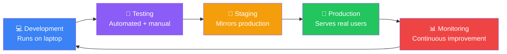
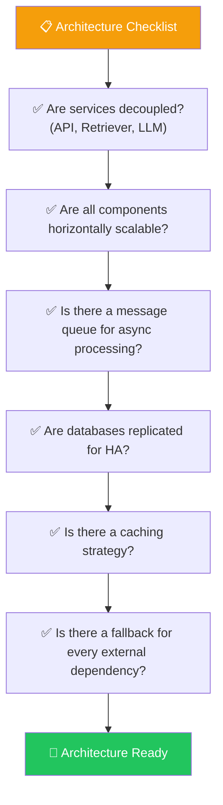
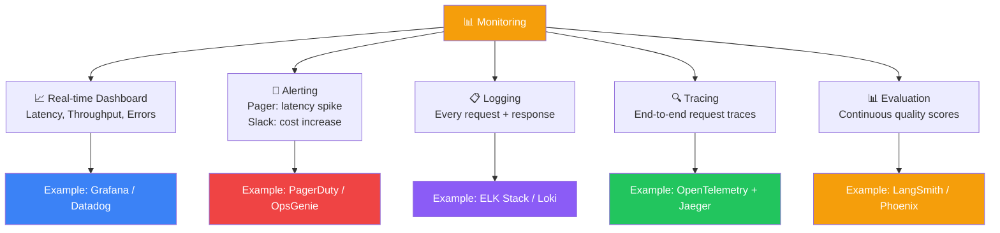
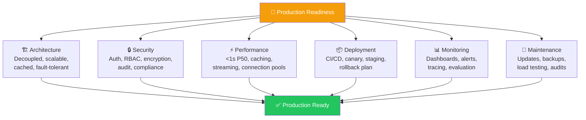

## Introduction

> **Production best practices are not optional — they are the difference between a demo that impresses and a system that enterprises trust.**

After learning about architecture, security, evaluation, and scaling, this document consolidates everything into actionable checklists and battle-tested patterns for running RAG systems in production.

---

## Why This Exists

### The Problem: Demos Don't Scale

Every RAG system works on a laptop with 10 documents. Production is where systems fail:

- The demo works, but production is **slow**
- The demo is accurate, but production has **security vulnerabilities**
- The demo costs nothing, but production costs **thousands per month**
- The demo was built in a day, but production needs to **run for years**

### What Best Practices Solve

| Problem | Without Best Practices | With Best Practices |
|---------|----------------------|-------------------|
| **Deployment** | Manual, error-prone | Automated CI/CD |
| **Security** | Found after breach | Built in from day one |
| **Performance** | Degrades over time | Monitored and optimized |
| **Reliability** | Pager at 2 AM | Graceful degradation |
| **Cost** | Invoice shock | Budgeted and controlled |
| **Maintenance** | Bumpy upgrade process | Versioned, backward-compatible |

---

## Real-World Analogy

### The Airline Pre-Flight Checklist

Pilots don't rely on memory. They use a **checklist** — every time, without exception.

The checklist covers:
- **Before start:** Fuel, controls, instruments (development)
- **Before takeoff:** Engines, flaps, trim (testing)
- **In-flight:** Navigation, communication, weather (monitoring)
- **After landing:** Parking brake, engine shutdown (maintenance)

Production RAG systems need the same discipline. Memory and intuition are not enough. You need a systematic, repeatable process that catches problems before they reach users.

---

## Production Readiness Checklists

### 1. Architecture Checklist

| Item | Why It Matters | Status |
|------|---------------|--------|
| **Services are decoupled** | Independent deployment, scaling, and failure isolation | ☐ |
| **Horizontal scalability** | Add capacity by adding instances, not upgrading hardware | ☐ |
| **Async message queue** | Decouple ingestion from retrieval, handle bursts | ☐ |
| **Database replication** | Survive node failures without downtime | ☐ |
| **Caching strategy** | Reduce latency and cost for repeated queries | ☐ |
| **Fallback mechanisms** | System degrades gracefully, doesn't crash | ☐ |
| **Circuit breakers** | Prevent cascading failures between services | ☐ |
| **Health check endpoints** | Load balancers detect unhealthy instances | ☐ |

### 2. Security Checklist

| Item | Why It Matters | Status |
|------|---------------|--------|
| **Authentication (SSO/OAuth)** | Only authorized users access the system | ☐ |
| **Authorization (RBAC/ABAC)** | Users only see their permitted documents | ☐ |
| **Encryption in transit (TLS 1.3)** | Data cannot be intercepted | ☐ |
| **Encryption at rest (AES-256)** | Data cannot be read if storage is compromised | ☐ |
| **Metadata filtering** | Enforce document permissions at query time | ☐ |
| **Input sanitization** | Prevent prompt injection attacks | ☐ |
| **Rate limiting** | Prevent abuse and resource exhaustion | ☐ |
| **Audit logging** | Trace every action to a user | ☐ |
| **Secrets management** | API keys in vault, not in code | ☐ |
| **PII masking** | Don't leak personal information in responses | ☐ |
| **Data retention policies** | Auto-delete documents after retention period | ☐ |
| **Penetration testing** | Verify security controls work | ☐ |

### 3. Performance Checklist

```mermaid
flowchart LR
    subgraph TARGETS["Performance Targets"]
        P1["🎯 P50 Latency: < 1s"]
        P2["🎯 P95 Latency: < 3s"]
        P3["🎯 P99 Latency: < 10s"]
        P4["🎯 Error Rate: < 0.1%"]
        P5["🎯 Availability: 99.9%+"]
    end

    subgraph OPTIMIZATIONS["Key Optimizations"]
        O1["💾 Embedding Cache"]
        O2["💾 Response Cache"]
        O3["⚡ Connection Pools"]
        O4["📡 Query Streaming"]
        O5["🔀 Load Balancing"]
    end

    TARGETS --> OPTIMIZATIONS

    style TARGETS fill:#3b82f6,color:#fff
    style OPTIMIZATIONS fill:#22c55e,color:#fff
```

| Item | Target | Status |
|------|--------|--------|
| **P50 latency** | < 1 second | ☐ |
| **P95 latency** | < 3 seconds | ☐ |
| **P99 latency** | < 10 seconds | ☐ |
| **Error rate** | < 0.1% | ☐ |
| **Availability SLA** | 99.9%+ | ☐ |
| **Throughput capacity** | 2x peak expected load | ☐ |
| **Cache hit rate** | > 30% | ☐ |
| **Auto-scaling configured** | Scale based on demand | ☐ |
| **Load testing completed** | Validate targets under load | ☐ |
| **Cold start tested** | First request after deploy is fast enough | ☐ |

### 4. Deployment Checklist

| Item | Why It Matters | Status |
|------|---------------|--------|
| **CI/CD pipeline** | Automated testing and deployment | ☐ |
| **Staging environment** | Test changes before production | ☐ |
| **Canary deployments** | Roll out to 10% of users first | ☐ |
| **Rollback plan** | Revert to previous version in < 5 minutes | ☐ |
| **Database migration plan** | No downtime for index rebuilds | ☐ |
| **Infrastructure as code** | Reproducible environments (Terraform, Pulumi) | ☐ |
| **Environment parity** | Dev, staging, production are as similar as possible | ☐ |
| **Feature flags** | Toggle features without deployment | ☐ |

### 5. Monitoring Checklist

| Item | Implementation | Status |
|------|---------------|--------|
| **Latency dashboard** | P50/P95/P99 latency over time | ☐ |
| **Error rate monitoring** | Track 4xx, 5xx, LLM errors | ☐ |
| **Cost tracking** | Cost per query, cost per tenant | ☐ |
| **User feedback collection** | Thumbs up/down, star ratings | ☐ |
| **Alert on anomaly** | Latency spike, error rate increase | ☐ |
| **Quality metrics dashboard** | Recall, faithfulness, relevance trends | ☐ |
| **Audit log** | Immutable record of all access | ☐ |

### 6. Maintenance Checklist

| Item | Frequency | Status |
|------|-----------|--------|
| **Embedding model updates** | Quarterly | ☐ |
| **LLM model updates** | As released | ☐ |
| **Prompt template review** | Monthly | ☐ |
| **Index rebuild** | After embedding model change | ☐ |
| **Cache flush** | After index rebuild | ☐ |
| **Dependency updates** | Monthly (security patches) | ☐ |
| **Load testing** | Quarterly | ☐ |
| **Security audit** | Annually | ☐ |
| **Disaster recovery drill** | Quarterly | ☐ |
| **Cost review** | Monthly | ☐ |

---

## Deployment Pipeline

```mermaid
flowchart LR
    CODE["📝 Code Change"] --> BUILD["🔨 Build\nTypeScript, tests, lint"]
    BUILD --> TEST_EVAL["🧪 Test + Evaluate\nUnit tests + Golden dataset\nRecall must not drop > 2%"]
    TEST_EVAL --> STAGING_DEPLOY["🔄 Deploy to Staging\nFull environment"]
    STAGING_DEPLOY --> SMOKE["🚬 Smoke Tests\nHealth check + 10 test queries"]
    SMOKE --> CANARY["🐤 Canary (10%)\nMonitor metrics for 5 min"]
    CANARY --> PROD_DEPLOY["🚀 Deploy to Production\nRolling update"]
    PROD_DEPLOY --> MONITOR["📊 Monitor\nWatch metrics for 30 min"]

    style TEST_EVAL fill:#f59e0b,color:#fff
    style CANARY fill:#8b5cf6,color:#fff
    style PROD_DEPLOY fill:#22c55e,color:#fff
    style MONITOR fill:#3b82f6,color:#fff
```

---

## Comparison Tables

### Development vs Production

| Aspect | Development | Production |
|--------|-------------|------------|
| **Documents** | 10–100 | Millions |
| **Users** | 1 developer | Thousands concurrent |
| **Latency** | Doesn't matter | < 2 seconds |
| **Security** | None | RBAC, encryption, audit |
| **Reliability** | Manual restart | 99.9% uptime |
| **Caching** | None | Multi-layer caching |
| **Monitoring** | Print statements | Dashboards, alerts |
| **Deployment** | `python app.py` | CI/CD pipeline |
| **Cost** | Negligible | Budgeted and tracked |
| **Team size** | 1 developer | Cross-functional team |

### Single User vs Multi-Tenant

| Aspect | Single User | Multi-Tenant |
|--------|-------------|--------------|
| **Metadata** | None needed | tenant_id, role, permissions |
| **Filtering** | No filtering | Pre-filtering mandatory |
| **Data isolation** | None | Logical or physical isolation |
| **Rate limiting** | Not needed | Per-tenant limits |
| **Cost tracking** | Not needed | Per-tenant billing |
| **Caching** | Simple | Tenant-scoped cache keys |

### No Cache vs Caching

| Aspect | No Cache | With Caching |
|--------|----------|--------------|
| **P50 Latency** | 2–5 seconds | 50–500ms |
| **LLM Cost** | Full price per query | 50–90% reduction |
| **Throughput** | Limited by LLM API rate limits | 10x higher |
| **Complexity** | Simple | Cache invalidation logic |
| **Freshness** | Always fresh | Possible stale responses |

### Simple RAG vs Enterprise RAG

| Aspect | Simple RAG | Enterprise RAG |
|--------|------------|----------------|
| **Retrieval** | Vector search only | Hybrid + re-ranking + compression |
| **Security** | None | SSO, RBAC, document-level permissions |
| **Ingestion** | Upload via UI | Automated connectors, scheduled syncs |
| **Monitoring** | None | Full observability stack |
| **Scaling** | Single server | Distributed, auto-scaling |
| **Compliance** | None | GDPR, HIPAA, SOC 2 |
| **Cost control** | None | Budgets, alerts, optimization |

### Basic Search vs Production Search

| Aspect | Basic Search | Production Search |
|--------|-------------|-------------------|
| **Query types** | Simple questions | Multi-part, ambiguous, follow-up |
| **Results** | Top-5 vectors | Hybrid + re-ranked + filtered + compressed |
| **Edge cases** | Not handled | Detected and handled gracefully |
| **Fallback** | None | Keyword search, FAQ matching |
| **Feedback** | None | User feedback collected and analyzed |

---

## Real Production Examples

### ChatGPT Enterprise

| Practice | Implementation |
|----------|---------------|
| **Deployment** | Gradual rollout across workspaces. Changes visible to internal testers first. |
| **Security** | Enterprise SSO, document-level permissions, SOC 2 compliance, data retention controls. |
| **Monitoring** | Per-workspace dashboards. Anomaly detection for unusual usage patterns. |
| **Maintenance** | Weekly model updates. Monthly index rebuilds. Quarterly security audits. |

### Slack AI

| Practice | Implementation |
|----------|---------------|
| **Deployment** | Canary releases to 5% of workspaces. Automatic rollback on error rate increase. |
| **Security** | Inherits Slack workspace permissions. No cross-workspace data access. |
| **Monitoring** | Per-workspace quality metrics. User feedback (thumbs up/down) for every answer. |
| **Maintenance** | Continuous index updates as new messages arrive. Weekly model evaluation. |

### Notion AI

| Practice | Implementation |
|----------|---------------|
| **Deployment** | Feature flags for every AI feature. A/B testing on prompt templates. |
| **Security** | Workspace-level isolation. Document-level permissions via existing Notion permissions. |
| **Monitoring** | Answer quality evaluation on sampled queries. Cost tracking per workspace. |
| **Maintenance** | Weekly prompt template updates. Monthly embedding model evaluation. |

---

## Common Mistakes

| Mistake | Why It's Wrong | Fix |
|---------|---------------|-----|
| **Skipping staging environment** | Production bugs caught by users | Always deploy to staging first |
| **No rollback plan** | Bad deployment becomes permanent | Keep previous version deployable |
| **Hardcoded configuration** | Changing settings requires redeployment | Use environment variables or config service |
| **Ignoring cold start** | First request after deploy is extremely slow | Pre-warm caches, keep connections alive |
| **No rate limiting** | One user can exhaust your LLM budget | Implement per-user and per-tenant limits |
| **Not monitoring cost** | Invoice arrives as a surprise | Set up cost tracking and alerts from day one |
| **No data retention policy** | Legal/compliance risk | Define and enforce data retention policies |
| **Manual deployment** | Human error causes downtime | Automate everything |

---

## Best Practices Summary

1. **Start simple, measure everything** — Deploy the simplest version that works, but instrument everything from day one.

2. **Automate everything** — Deployments, testing, scaling, and rollback should be automated. Manual processes fail at 3 AM.

3. **Design for failure** — Assume every dependency will fail. Have fallbacks, circuit breakers, and graceful degradation.

4. **Security is not optional** — Build security into the architecture. Retro-fitting security is expensive and error-prone.

5. **Cache aggressively** — Caching is the highest-impact optimization for both latency and cost. But plan for cache invalidation.

6. **Monitor in production** — What you don't measure, you can't improve. Track latency, quality, cost, and user satisfaction.

7. **Version everything** — Prompts, embedding models, chunking strategies, and retrieval configurations should all be versioned.

8. **Test with production data** — Golden datasets should reflect real user queries, not just the easy cases.

9. **Plan for model updates** — Embedding models and LLMs improve frequently. Your system should support easy model swapping.

10. **Document your architecture** — When something breaks, someone (possibly future you) will need to understand how everything fits together.

---

## Interview Questions

### Beginner

**Q: What is the most important thing to get right in a production RAG system?**

> **Caching.** It provides the highest return on investment — reducing latency by 10–100x and cost by 50–90%. Without caching, every query pays the full price of embedding computation, vector search, and LLM generation. With caching, common queries are served in milliseconds for pennies.

**Q: Why should you have a staging environment that mirrors production?**

> A staging environment catches deployment issues, configuration errors, and performance regressions before they reach users. If staging is different from production, you'll miss issues that only appear in production — like data volume, concurrency problems, or dependency version mismatches.

### Intermediate

**Q: What metrics would you track to determine if a RAG system is production-ready?**

> **Quality metrics:** Retrieval recall, precision, MRR, answer faithfulness, answer relevance (measured against a golden dataset).
> **Performance metrics:** P50/P95/P99 latency, throughput, error rate.
> **Operational metrics:** Cache hit rate, cost per query, token usage per query, availability percentage.
> **User metrics:** User satisfaction score, retention rate, query completion rate, follow-up question rate.
>
> Minimum thresholds: P95 < 3s, error rate < 0.1%, recall > 0.8, faithfulness > 0.9.

**Q: How would you handle the case where an embedding model is deprecated and you need to migrate to a new one?**

> 1. **Dual-write** — Ingest new documents with both old and new embedding models simultaneously
> 2. **Background rebuild** — Re-embed all existing documents with the new model in a background job
> 3. **Dual-index** — Keep both the old and new indexes accessible during migration
> 4. **A/B test** — Route 10% of queries to the new index, compare quality metrics
> 5. **Cutover** — Once quality is verified, route 100% to the new model
> 6. **Cleanup** — Delete the old index after a 1-week rollback window

### Senior

**Q: Design a deployment strategy for a RAG system that requires zero downtime and can roll back within 2 minutes.**

> **Blue-Green Deployment:**
>
> Maintain two identical production environments (Blue and Green). Blue is active, Green is idle.
>
> **Deploy:** Deploy new version to Green → Run smoke tests → Shift load balancer to Green (instant cutover) → Monitor Green for 30 minutes → Keep Blue as rollback target.
>
> **Rollback:** If issues detected, shift load balancer back to Blue (instant, < 1 second).
>
> **Key requirements:** Both environments connected to the same database (backward-compatible schema). Caches pre-warmed in Green before cutover. Feature flags for disabling problematic features without full rollback.

### Staff Engineer

**Q: How would you build a RAG system that can operate without any external API dependencies (e.g., no OpenAI, no Pinecone) for critical infrastructure?**

> **LLM:** Deploy open-source models (Llama 3 70B, Mistral Large) on self-hosted GPU infrastructure (RunPod, Together.ai, or AWS SageMaker). Use vLLM or TensorRT-LLM for inference optimization.
>
> **Embeddings:** Self-host embedding models (BGE-large, E5-mistral) on the same GPU infrastructure. Cache embeddings aggressively.
>
> **Vector Database:** Self-host Qdrant or Weaviate on Kubernetes. Use SSD-backed storage for performance.
>
> **Orchestration:** Kubernetes with horizontal pod autoscaling. Prometheus for monitoring, Grafana for dashboards.
>
> **Fallback strategy:** If primary servers fail, have a warm standby in another region. If both fail, serve cached responses from CDN.
>
> **Cost trade-off:** Self-hosting is cheaper at scale (> 1M queries/day) but requires more operational expertise.

### System Design

**Q: Design a complete production RAG platform that can be deployed by a 3-person team and serve 100 enterprise customers.**

> **Architecture Overview:**
>
> **Infrastructure:** AWS / GCP with Terraform. EKS (Kubernetes) for API services, RDS for relational data, ElastiCache for Redis, S3 for document storage.
>
> **Services:**
> - **Ingestion API:** FastAPI application. Accepts document uploads, publishes to SQS.
> - **Chunker + Embedder:** Python workers consuming from SQS. Output stored in Pinecone + PostgreSQL.
> - **Retrieval API:** FastAPI. Handles auth, caching, retrieval, re-ranking, and LLM calls.
> - **Admin API:** FastAPI. Configuration, monitoring, user management.
>
> **Security:**
> - Auth0 for SSO and JWT management
> - Pre-filtering on tenant_id in Pinecone
> - Document-level permissions via metadata
> - Vault for secrets management
>
> **Observability:**
> - OpenTelemetry for distributed tracing
> - Grafana Cloud for dashboards
> - PagerDuty for alerts
> - LangSmith for LLM evaluation
>
> **CI/CD:**
> - GitHub Actions for testing and deployment
> - Staging environment on cheaper infrastructure
> - Canary deployments (10% traffic for 5 minutes)
> - Automated rollback on error rate increase
>
> **Operational Runbook:**
> - Daily: Review error logs and quality metrics
> - Weekly: Evaluate golden dataset, review cost
> - Monthly: Dependency updates, prompt template review
> - Quarterly: Load testing, security audit, disaster recovery drill

---

## Summary

| Area | Checklist Summary |
|------|------------------|
| **Architecture** | Decoupled, scalable, cached, fault-tolerant |
| **Security** | Auth, RBAC, encryption, audit, compliance |
| **Performance** | P50 < 1s, caching, streaming, connection pools |
| **Deployment** | CI/CD, canary, staging, rollback, IaC |
| **Monitoring** | Dashboards, alerts, tracing, evaluation |
| **Maintenance** | Updates, backups, load testing, security audits |

> **The goal is not perfection on day one. The goal is a system that you can measure, improve, and operate reliably — while maintaining the ability to roll back, recover, and learn from every incident.**

---

**Previous:** [19 — Performance & Scaling](/ai/phase-05-retrieval-systems/19-performance-and-scaling)

**Next:** Coming soon — Chunk 5: Enterprise RAG Projects & Best Practices

**Related Topics:**
- [Production RAG Architecture](/ai/phase-05-retrieval-systems/16-production-rag-architecture)
- [RAG Evaluation & Observability](/ai/phase-05-retrieval-systems/18-rag-evaluation-and-observability)
- [Performance & Scaling](/ai/phase-05-retrieval-systems/19-performance-and-scaling)
