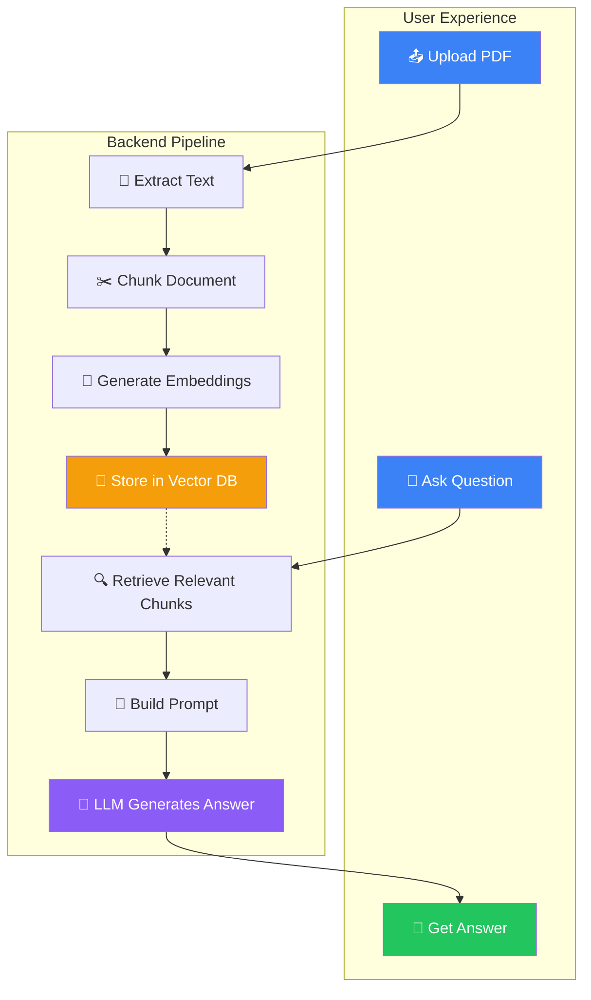
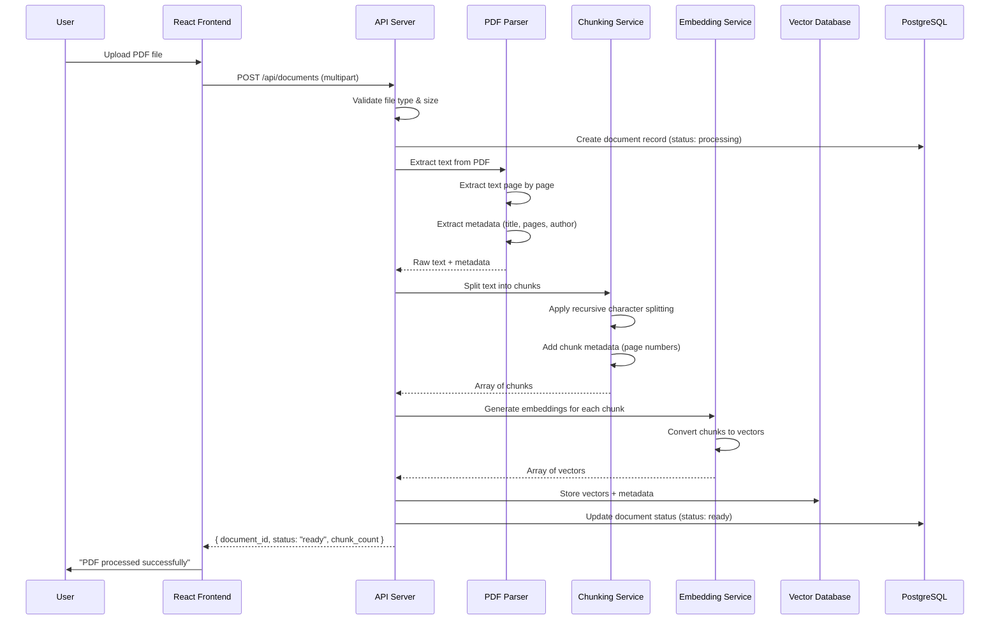
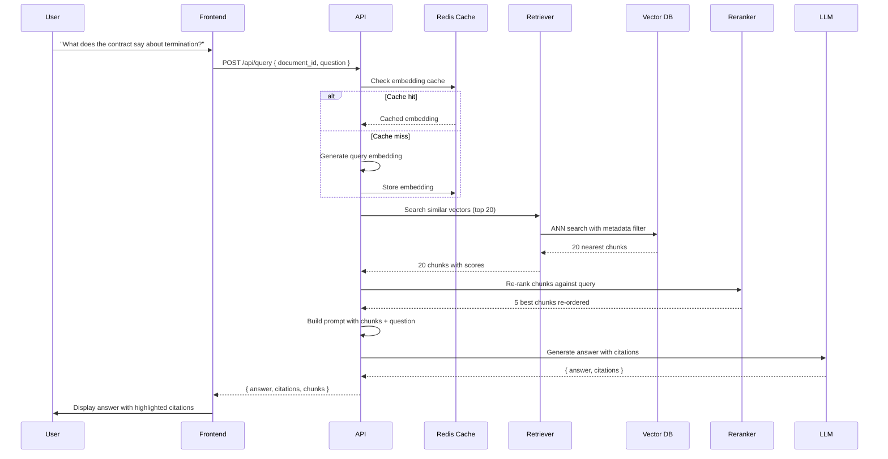
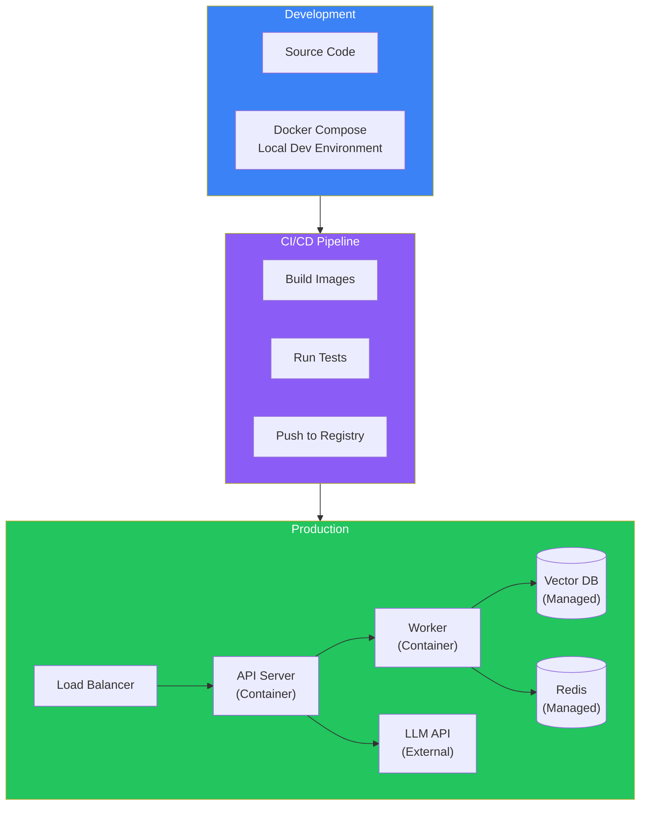
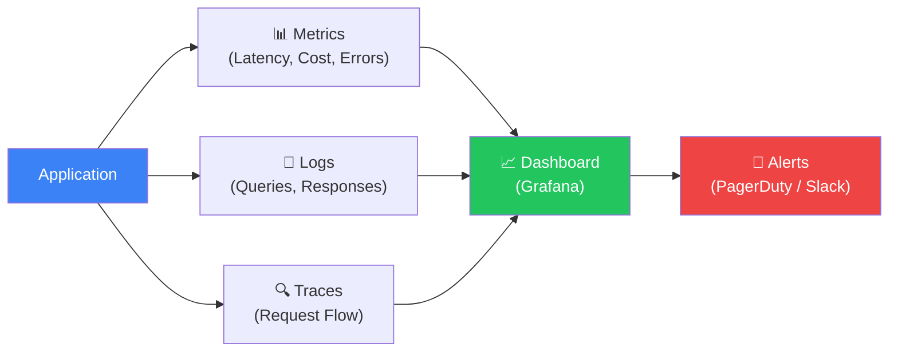

## Introduction

> **Build a complete Chat with PDF application — the same architecture used by ChatPDF, NotebookLM, and Claude's document upload feature.**

This is your first end-to-end RAG project. You will take everything you learned in Chunks 1–4 — embeddings, vector databases, chunking, retrieval, re-ranking, and production architecture — and build a real application that users can upload PDFs to and ask questions about.



---

## Problem Statement

**The Problem:** Users have important information locked inside PDFs — research papers, legal contracts, financial reports, medical records, HR policies. Reading through hundreds of pages to find one answer is slow and inefficient.

**The Solution:** A Chat with PDF system that:
1. Ingests PDFs and converts them into a searchable vector index
2. Accepts natural language questions
3. Retrieves the most relevant passages from the PDF
4. Generates accurate answers with citations to the source

**Real-World Use Cases:**
- **Researchers** — Querying scientific papers without reading them fully
- **Legal teams** — Finding clauses in hundreds of pages of contracts
- **Students** — Studying from textbooks by asking questions
- **Business analysts** — Extracting insights from financial reports
- **HR departments** — Answering policy questions from employee handbooks

---

## System Architecture

```mermaid
flowchart LR
    subgraph FRONTEND["Frontend (React)"]
        UI["PDF Upload UI"]
        CHAT["Chat Interface"]
        CIT["Citation Display"]
    end

    subgraph API["API Layer (FastAPI / Node.js)"]
        INGEST["📥 Ingestion Endpoint\nPOST /api/documents"]
        QUERY["🔍 Query Endpoint\nPOST /api/query"]
    end

    subgraph WORKERS["Background Workers"]
        PARSER["📄 PDF Parser\nPyMuPDF / pdf.js"]
        CHUNKER["✂️ Chunker\nRecursiveCharacterTextSplitter"]
        EMBEDDER["🔢 Embedding Service\nOpenAI / Voyage / BGE"]
    end

    subgraph STORAGE["Storage Layer"]
        VDB[("🗄️ Vector Database\nQdrant / Pinecone / Chroma")]
        CACHE[("⚡ Cache\nRedis")]
        DB[("📦 Metadata Store\nPostgreSQL")]
    end

    subgraph AI["AI Layer"]
        LLM["🤖 LLM\nGPT-4o / Claude / Gemini"]
        RERANK["📊 Re-ranker\nCross-Encoder"]
    end

    FRONTEND --> API
    API --> WORKERS
    WORKERS --> STORAGE
    API --> AI
    AI --> FRONTEND

    style FRONTEND fill:#3b82f6,color:#fff
    style API fill:#8b5cf6,color:#fff
    style WORKERS fill:#f59e0b,color:#fff
    style STORAGE fill:#22c55e,color:#fff
    style AI fill:#ef4444,color:#fff
```



---

## Data Flow: Ingestion Pipeline



---

## Technology Stack

| Layer | Technology | Why |
|-------|-----------|-----|
| **Frontend** | React + Tailwind CSS | Fast UI development, component reuse |
| **Backend** | FastAPI (Python) or Node.js | Async support, excellent for AI workflows |
| **PDF Parsing** | PyMuPDF (Python) / pdf.js (Node) | Fast, reliable, handles complex PDFs |
| **Chunking** | LangChain Text Splitters | Production-tested chunking strategies |
| **Embeddings** | OpenAI `text-embedding-3-small` | 1536 dimensions, cost-effective |
| **Vector DB** | Qdrant (self-hosted) or Pinecone | High performance, metadata filtering |
| **Cache** | Redis | Embedding cache, response cache |
| **Metadata** | PostgreSQL | Reliable, supports complex queries |
| **LLM** | GPT-4o / Claude 3.5 Sonnet | Best quality for document Q&A |
| **Re-ranker** | Cohere Rerank / BGE Cross-Encoder | Improves retrieval quality 10-20% |
| **Deployment** | Docker + Docker Compose | Portable, reproducible |

---

## Backend Architecture

### Folder Structure

```
chat-with-pdf/
├── backend/
│   ├── app/
│   │   ├── main.py              # FastAPI entry point
│   │   ├── config.py            # Environment configuration
│   │   ├── api/
│   │   │   ├── documents.py     # Document upload endpoints
│   │   │   └── query.py         # Query endpoints
│   │   ├── core/
│   │   │   ├── parser.py        # PDF text extraction
│   │   │   ├── chunker.py       # Text chunking
│   │   │   ├── embeddings.py    # Embedding generation
│   │   │   └── retriever.py     # Retrieval logic
│   │   ├── models/
│   │   │   ├── document.py      # Document schema
│   │   │   └── query.py         # Query schema
│   │   └── services/
│   │       ├── ingestion.py     # Ingestion pipeline
│   │       └── qa_service.py    # Q&A pipeline
│   ├── requirements.txt
│   └── Dockerfile
├── frontend/
│   ├── src/
│   │   ├── components/
│   │   │   ├── Uploader.jsx     # PDF upload component
│   │   │   ├── Chat.jsx         # Chat interface
│   │   │   └── Citation.jsx     # Citation display
│   │   └── App.jsx
│   └── package.json
├── docker-compose.yml
└── README.md
```

### API Endpoints

| Endpoint | Method | Description |
|----------|--------|-------------|
| `/api/documents` | POST | Upload a PDF file |
| `/api/documents/{id}` | GET | Get document status and metadata |
| `/api/documents` | GET | List all uploaded documents |
| `/api/query` | POST | Ask a question about a document |
| `/api/query/{id}` | GET | Get query history and answers |

### Query Pipeline



---

## Frontend Architecture

### Key Components

```
┌─────────────────────────────────────┐
│  Header (App Name + Settings)       │
├─────────────────────────────────────┤
│                                     │
│  ┌─────────────────────────────┐    │
│  │  PDF Upload Area            │    │
│  │  ┌───────────────────────┐  │    │
│  │  │  Drag & Drop or Click │  │    │
│  │  └───────────────────────┘  │    │
│  │  Progress: ████████░░ 80%   │    │
│  └─────────────────────────────┘    │
│                                     │
│  ┌─────────────────────────────┐    │
│  │  Chat Messages              │    │
│  │  ┌───────────────────────┐  │    │
│  │  │ User: What is this    │  │    │
│  │  │       about?          │  │    │
│  │  ├───────────────────────┤  │    │
│  │  │ AI: This document...  │  │    │
│  │  │ ┌─────────────────┐   │  │    │
│  │  │ │ 📄 Page 3, Para 2│   │  │    │
│  │  │ └─────────────────┘   │  │    │
│  │  └───────────────────────┘  │    │
│  │                             │    │
│  │  ┌───────────────────────┐  │    │
│  │  │ [Type your question]  │  │    │
│  │  └───────────────────────┘  │    │
│  └─────────────────────────────┘    │
│                                     │
└─────────────────────────────────────┘
```

### Key Features

1. **Drag-and-drop PDF upload** with progress indicator
2. **Real-time streaming** of LLM responses using Server-Sent Events
3. **Citation highlighting** — click a citation to scroll to the source chunk
4. **Document list** — sidebar showing all uploaded PDFs
5. **Conversation history** — per-document chat history

---

## Deployment



### Deployment Options

| Option | Cost | Complexity | Best For |
|--------|------|------------|----------|
| **Docker Compose** | Free | Low | Development, small teams |
| **Railway / Render** | $10-50/mo | Low | MVPs, small user bases |
| **AWS ECS + RDS** | $100-500/mo | Medium | Production, mid-scale |
| **Kubernetes** | $500+/mo | High | Enterprise, large scale |

---

## Security

| Concern | Mitigation |
|---------|-----------|
| **PDF upload size** | Limit to 50MB, validate file type server-side |
| **PII in documents** | PII masking before embedding storage |
| **Prompt injection** | Input sanitization, system prompt hardening |
| **API key exposure** | Environment variables, secret manager |
| **Data encryption** | Encrypt at rest (AES-256) and in transit (TLS) |
| **Access control** | User-scoped document access via metadata filtering |
| **Rate limiting** | Token bucket per user, 100 req/min |
| **Audit logging** | Log all queries with timestamps and user IDs |

---

## Monitoring



### Key Metrics to Track

| Metric | Target | Why |
|--------|--------|-----|
| **Ingestion latency** | < 10s per 100 pages | User experience |
| **Query latency** | < 3s p95 | Real-time feel |
| **Retrieval precision@5** | > 85% | Answer quality |
| **LLM cost per query** | < $0.01 | Budget control |
| **Uptime** | > 99.9% | Reliability |
| **Cache hit rate** | > 60% | Cost optimization |

---

## Best Practices

1. **Always store source metadata** — page numbers, chunk positions, document title. Users need to verify answers.
2. **Use streaming responses** — Users prefer seeing the answer appear word-by-word rather than waiting for the full response.
3. **Implement embedding caching** — Identical or similar queries shouldn't re-embed. Use Redis with a TTL-based cache.
4. **Re-rank before LLM** — Retrieving 20 and re-ranking to 3–5 gives much better quality than retrieving 5 directly.
5. **Show citations clearly** — Every answer should reference specific page numbers and chunk positions. This builds trust.
6. **Handle large PDFs** — PDFs over 100 pages should be processed asynchronously with progress updates.
7. **Version your embeddings** — When you change embedding models, old embeddings become stale. Version them and support re-indexing.
8. **Monitor hallucination rate** — Use LLM-as-judge to evaluate whether answers are grounded in retrieved chunks.

---

## Common Mistakes

| Mistake | Why It's Bad | Fix |
|---------|-------------|-----|
| **No chunk overlap** | Splits sentences/ideas across chunks | Use 10-20% overlap |
| **Ignoring PDF structure** | Tables, headers, footers become noise | Parse with structure awareness |
| **Sending entire PDF to LLM** | Exceeds context window, expensive | Retrieve only relevant chunks |
| **No metadata filtering** | Mixes answers from different documents | Always filter by document_id |
| **No user authentication** | Anyone can read any document | Implement auth + RBAC |
| **No rate limiting** | One user can exhaust your API budget | Implement per-user rate limits |

---

## Exercises

### Easy

1. Implement a basic PDF text extractor using PyMuPDF (Python) or pdf.js (Node.js)
2. Set up a Qdrant vector database in Docker and create a collection with 1536 dimensions
3. Create a simple retrieval function that takes a query and returns the top 5 chunks

### Intermediate

4. Build the complete ingestion pipeline: PDF → text → chunks → embeddings → vector DB
5. Implement the query pipeline: question → embedding → retrieval → prompt → LLM → answer
6. Add metadata filtering so each user only queries their own documents
7. Implement a cross-encoder re-ranker that improves retrieval quality

### Advanced

8. Add streaming responses using Server-Sent Events
9. Implement embedding caching with Redis and a similarity threshold
10. Build an evaluation pipeline: create a test dataset of query-answer pairs and measure precision/recall
11. Deploy the application using Docker Compose with all services

### Architecture

12. Design a multi-tenant version where companies can upload documents and employees can only see their company's documents
13. Design a versioned document system where users can upload new versions of a PDF and the system handles re-indexing
14. Design a cost optimization strategy for a system processing 10,000 queries per day

---

## Interview Questions

### System Design

**Q: Design a Chat with PDF system that supports 1000 users and 10,000 PDFs.**

> **Storage:** Use a vector database (Qdrant/Pinecone) for embeddings and PostgreSQL for metadata. Shard vector DB by tenant_id. **Ingestion:** Async pipeline with message queue (RabbitMQ/SQS). PDF parser workers scale independently. **Query:** Stateless API servers behind load balancer. Embedding cache in Redis. Re-ranker as a separate service. **LLM:** API-based (no GPU needed). Cache frequent queries. **Cost:** $500-2000/mo for 1000 active users. Cache reduces LLM calls by 40-60%.

### Architecture

**Q: Why separate the ingestion pipeline from the query pipeline?**

> Ingestion is write-heavy and can tolerate latency (seconds to minutes). Query needs low latency (< 3s). Separating them allows independent scaling — you can run 50 ingestion workers during a batch upload and just 5 query servers during low traffic. It also isolates failures: a failing PDF parser doesn't block queries.

### Senior Engineer

**Q: How would you handle a user uploading a 500-page scanned PDF (no selectable text)?**

> Scanned PDFs require OCR before text extraction. I'd add an OCR service (Tesseract, AWS Textract, or Azure Document Intelligence) as a preprocessing step. The pipeline becomes: upload → OCR → extract text → chunk → embed. OCR is slow and expensive, so this should be async with webhook notification. Cost per scanned page is ~$0.0015 with AWS Textract.

### Staff Engineer

**Q: How do you evaluate whether your ChatPDF system is actually answering correctly?**

> Build an evaluation dataset: 200+ question-answer pairs with ground truth chunks. Measure: (1) **Retrieval recall@5** — is the correct chunk in the top 5? (2) **Answer faithfulness** — does the answer only use information from retrieved chunks? (3) **Answer relevance** — does the answer actually address the question? Use LLM-as-judge (GPT-4o evaluating GPT-4o-mini) for automated scoring. Run this evaluation after every deployment.

### Principal Engineer

**Q: Design a strategy to reduce LLM costs by 80% without reducing quality.**

> 1. **Caching** — Cache embeddings (60% of embedding API calls). Cache full responses for identical queries (40% of queries are repeated). 2. **Query rewriting** — Use a small, cheap model (GPT-4o-mini) to rewrite queries before retrieval. 3. **Routing** — Route simple queries (summarization, fact lookups) to GPT-4o-mini and complex queries (analysis, comparison) to GPT-4o. 4. **Chunk optimization** — Use smaller chunks with more focused retrieval. 5. **Prompt compression** — Use LLMLingua or similar to compress retrieved chunks by 50-70% before sending to LLM. Combined: 80% cost reduction with < 5% quality degradation.

---

## Summary

| Concept | Key Takeaway |
|---------|-------------|
| **Architecture** | Two pipelines: ingestion (async, batch) and query (real-time, low latency) |
| **PDF parsing** | Extract text with structure awareness (pages, headers, tables) |
| **Chunking** | Recursive character splitting with 10-20% overlap |
| **Retrieval** | Retrieve 20, re-rank to 3-5, then send to LLM |
| **Citations** | Always cite source page numbers and chunk positions |
| **Security** | User-scoped metadata filtering, encryption, audit logs |
| **Cost** | Cache aggressively, route queries to appropriate models |

---

## Navigation

**Previous:** [20 — Production Best Practices](/ai/phase-05-retrieval-systems/20-production-best-practices)

**Next:** [22 — Company Knowledge Assistant](/ai/phase-05-retrieval-systems/22-company-knowledge-assistant)
