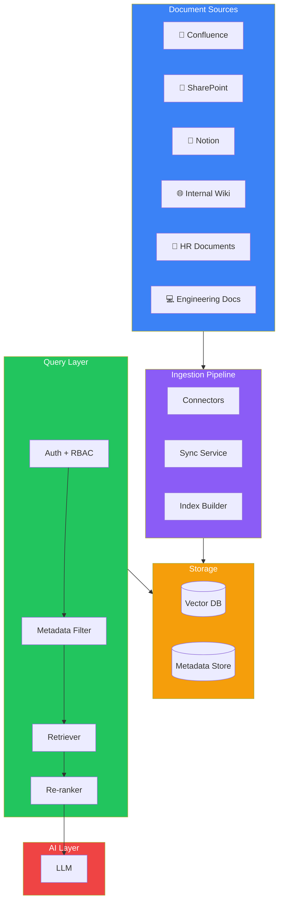
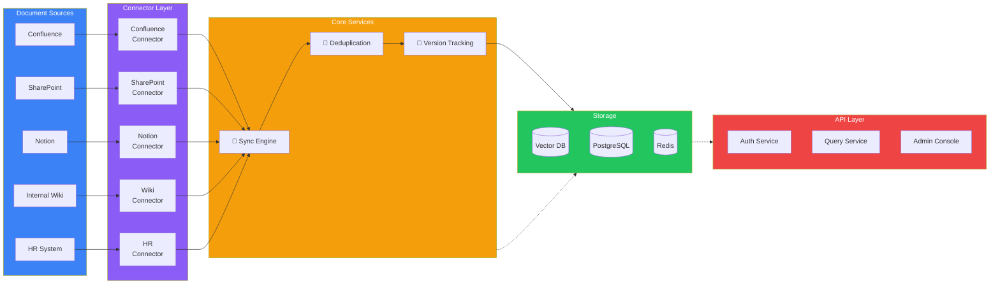
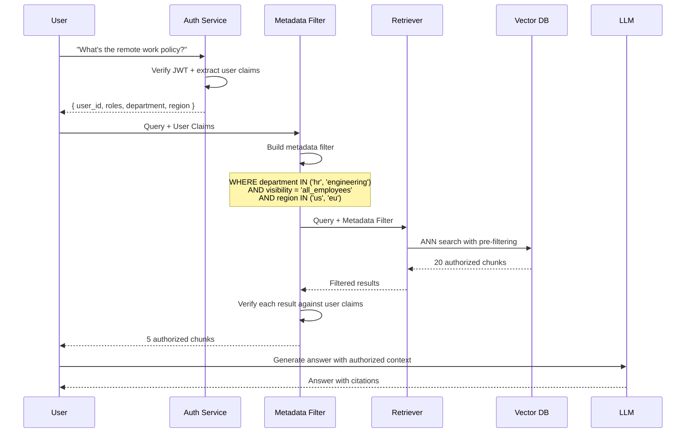
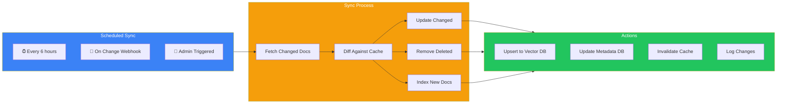
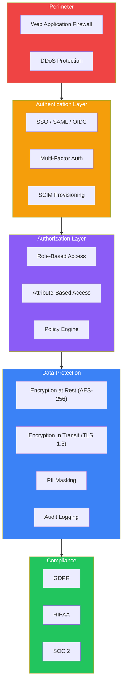

## Introduction

> **Build an enterprise AI knowledge assistant — the same architecture used by Notion AI, Slack AI, Microsoft Copilot, and Atlassian Intelligence.**

Your ChatPDF project from Project 1 worked for individual documents. Now scale that to an entire organization. A Company Knowledge Assistant ingests documents from multiple sources (Confluence, SharePoint, Notion, wikis, HR docs, engineering docs) and makes them searchable with proper access controls.



---

## Problem Statement

**The Problem:** Enterprise knowledge is scattered across dozens of tools — Confluence for documentation, SharePoint for policies, Notion for team wikis, HR systems for employee handbooks, GitHub for engineering docs. Employees waste 20-30% of their time searching for information they know exists somewhere.

**The Solution:** A unified knowledge assistant that:
1. Connects to all internal knowledge sources
2. Synchronizes documents and maintains freshness
3. Enforces access controls so users only see what they're authorized to see
4. Answers natural language questions with citations

**Real-World Use Cases:**
- **New employees** — "What's the company policy on remote work?" → searches HR docs
- **Engineers** — "How do I set up the local development environment?" → searches engineering wiki
- **Managers** — "What's the process for quarterly reviews?" → searches HR policies
- **Sales** — "What's our pricing for enterprise customers?" → searches sales enablement docs

---

## System Architecture



---

## Access Control & Metadata Security

This is the most critical part of an enterprise knowledge assistant. Every document has metadata that determines who can see it.

### Metadata Schema

```json
{
  "document_id": "doc_12345",
  "title": "Remote Work Policy 2025",
  "source": "confluence",
  "source_url": "https://company.atlassian.net/wiki/...",
  "department": "hr",
  "owner": "hr-team",
  "visibility": "all_employees",
  "roles": ["employee", "manager", "admin"],
  "regions": ["us", "eu"],
  "confidentiality": "internal",
  "version": 3,
  "last_synced": "2025-06-15T10:30:00Z"
}
```

### Access Control Architecture



### Pre-Filtering vs Post-Filtering

| Approach | How It Works | Pros | Cons |
|----------|-------------|------|------|
| **Pre-filtering** | Filter metadata before vector search | Fast, efficient, scales well | Requires metadata index |
| **Post-filtering** | Search all, filter results after | Simpler to implement | Wasted search on unauthorized docs |

> **Enterprise recommendation:** Use pre-filtering for RBAC-based access (department, role) and post-filtering for per-document permissions. Most vector databases support pre-filtering natively.

---

## Technology Stack

| Layer | Technology | Why |
|-------|-----------|-----|
| **Frontend** | React + Tailwind + Slack/Teams integration | Multi-surface deployment |
| **Backend** | FastAPI or Node.js | Async, high throughput |
| **Connectors** | Custom + Unstructured.io | Handles 20+ document formats |
| **Sync Engine** | Celery / BullMQ | Scheduled + webhook-based sync |
| **Auth** | Auth0 / Okta + JWT | Enterprise SSO, SCIM |
| **Vector DB** | Qdrant with payload indexing | Built-in metadata filtering |
| **PostgreSQL** | Document metadata + user permissions | ACID compliance |
| **Cache** | Redis | Session cache, embedding cache |
| **LLM** | GPT-4o / Claude 3 | High-quality answers |
| **Monitoring** | Grafana + Prometheus | Observability |

---

## Data Flow: Sync & Ingestion



---

## Security Architecture



---

## Deployment

| Component | Scaling Strategy | Min Instances | Max Instances |
|-----------|-----------------|---------------|---------------|
| **API Server** | Horizontal (CPU) | 2 | 20 |
| **Sync Workers** | Horizontal (queue depth) | 2 | 50 |
| **Vector DB** | Sharded by tenant | 3 nodes | 20 nodes |
| **PostgreSQL** | Read replicas | 1 primary + 2 replicas | 1 + 10 replicas |
| **Redis** | Cluster mode | 3 nodes | 10 nodes |
| **LLM** | API-based, no GPU needed | N/A | N/A |

---

## Best Practices

1. **Sync incrementally** — Never re-index everything. Use change detection (webhooks or periodic diff) to sync only changed documents.
2. **Version your indexes** — When a document is updated, keep the old version for a rollback window (usually 7 days).
3. **Implement rate limits per source** — Confluence API limits: 100 req/min. Respect source API limits or you'll get blocked.
4. **Use tenant isolation** — For multi-company deployments, use separate vector DB collections or metadata-based isolation.
5. **Audit everything** — Every query, every access, every document view should be logged with user ID, timestamp, and action.
6. **Provide confidence scores** — Users should know when the AI is confident vs unsure. Show retrieval scores alongside answers.

---

## Common Mistakes

| Mistake | Impact | Fix |
|---------|--------|-----|
| **No deduplication** | Same content from Confluence + Notion → duplicate chunks | Hash-based dedup on content |
| **Ignoring permissions** | Users see unauthorized documents | Always enforce metadata filtering |
| **No stale document handling** | Outdated policies referenced | Track last-synced, flag old docs |
| **Over-syncing** | API rate limits exceeded, connector banned | Respect rate limits, backoff on errors |
| **No PII protection** | Employee SSNs in HR docs leaked | PII scanning before indexing |

---

## Exercises

### Easy

1. Set up a connector that pulls documents from a Notion workspace via API
2. Create a metadata schema for documents with department, role, and region fields
3. Implement a pre-filtering query using Qdrant's payload filter

### Intermediate

4. Build a sync engine that polls Confluence every 6 hours and updates changed documents
5. Implement RBAC where users with role "manager" see manager-level documents
6. Create an audit log that records every query with user ID and timestamp

### Advanced

7. Build a multi-tenant version where Company A and Company B have completely isolated document stores
8. Implement incremental sync with diff detection (only re-embed changed documents)
9. Create an admin dashboard showing sync status, document counts, and query metrics

### Architecture

10. Design a connector for a new internal tool (e.g., Google Docs) — what API endpoints, sync strategy, and metadata mapping would you use?
11. Design a document versioning system that supports rollback to previous versions

---

## Interview Questions

### System Design

**Q: Design an enterprise knowledge assistant for a 5000-employee company with 10+ knowledge sources.**

> **Architecture:** Connector layer (10+ source-specific adapters) → Ingestion pipeline (async with queue) → Unified storage (Vector DB + PostgreSQL for metadata) → Query pipeline with auth pre-filtering. **Scaling:** 50k docs → 500k chunks → 50M queries/month. Cost: $3k-10k/mo. **Key challenge:** Permissions. Each source has different access models. Map all to a unified RBAC+ABAC system using metadata filtering.

### Architecture

**Q: Why use metadata pre-filtering instead of post-filtering for enterprise RAG?**

> Pre-filtering reduces the search space before the ANN search, making it faster (O(log n) instead of O(n)). More importantly, post-filtering can return 0 results if the top-k vectors are all unauthorized — the user gets no answer despite relevant documents existing. Pre-filtering guarantees that all search results are authorized, so the user always sees the best available answer they're allowed to see.

### Senior Engineer

**Q: How do you handle document conflicts when the same topic is covered in Confluence, Notion, and an internal wiki with slightly different information?**

> Implement a **source priority system**: each source has a trust score (e.g., HR system > Confluence > Wiki > Notion). When retrieving, deduplicate chunks by content hash (cosine similarity > 0.95) and keep the highest-priority source. Also track source staleness — if Confluence doc was updated 2 days ago and wiki doc 6 months ago, prefer the fresher source.

### Staff Engineer

**Q: Design a system to handle 200 simultaneous document uploads from different sources without overwhelming the vector database.**

> Use a **message queue** (RabbitMQ/SQS) as a buffer. The sync workers produce messages; the ingestion workers consume them. Implement backpressure: if the queue grows beyond 10k messages, ingestion workers increase by 2x; if it's below 100, decrease by half. Batch vector DB writes (upsert 100 chunks at once). Use a circuit breaker for the vector DB — if it returns errors, pause all ingestion for 30s and retry.

### Principal Engineer

**Q: How do you evaluate search quality in an enterprise context where you don't have ground-truth labels?**

> Use **implicit feedback signals**: (1) Click-through rate on citations — do users click on the cited documents? (2) Follow-up question rate — do users ask clarifying questions? (3) Answer rating — thumbs up/down on each answer (requires UI). Use these to compute an automated quality score per document source, per department, per query type. Source quality declining? Alert the connector maintainer. Use **LLM-as-judge** with GPT-4o evaluating system answers for faithfulness, relevance, and completeness against the retrieved chunks.

---

## Summary

| Concept | Key Takeaway |
|---------|-------------|
| **Multiple sources** | Connector pattern — one adapter per source with unified output format |
| **Access control** | Pre-filter metadata by role/department BEFORE vector search |
| **Sync strategy** | Incremental sync with change detection, never full re-index |
| **Permissions** | Map each source's permission model to a unified RBAC/ABAC system |
| **Audit** | Every query logged with user, timestamp, and retrieved documents |
| **Multi-tenancy** | Use metadata-based isolation or separate collections per tenant |

---

## Navigation

**Previous:** [21 — Chat with PDF](/ai/phase-05-retrieval-systems/21-chat-with-pdf)

**Next:** [23 — Documentation Chatbot](/ai/phase-05-retrieval-systems/23-documentation-chatbot)
