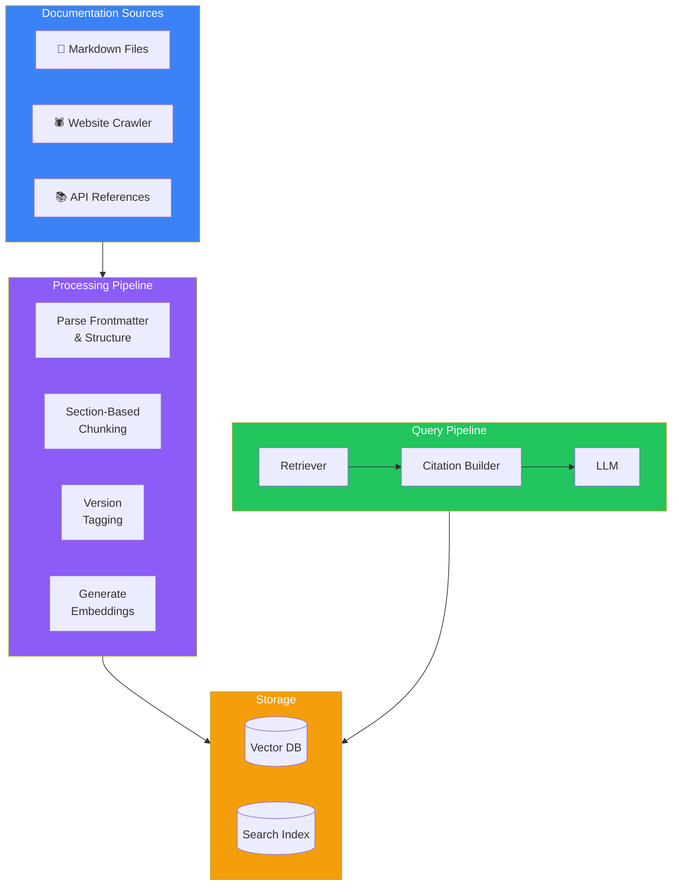
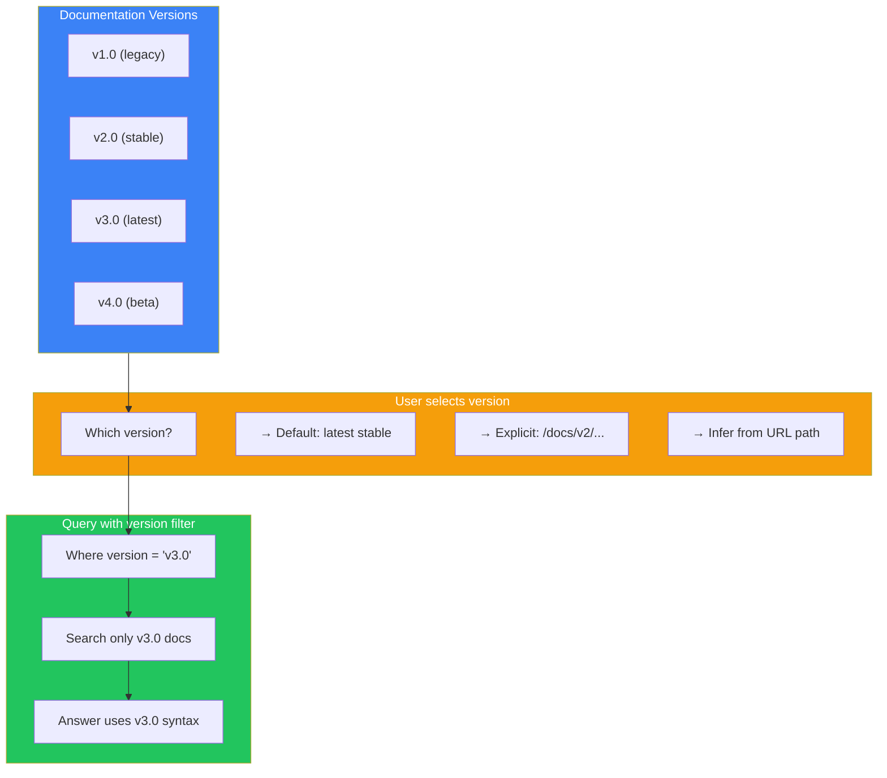
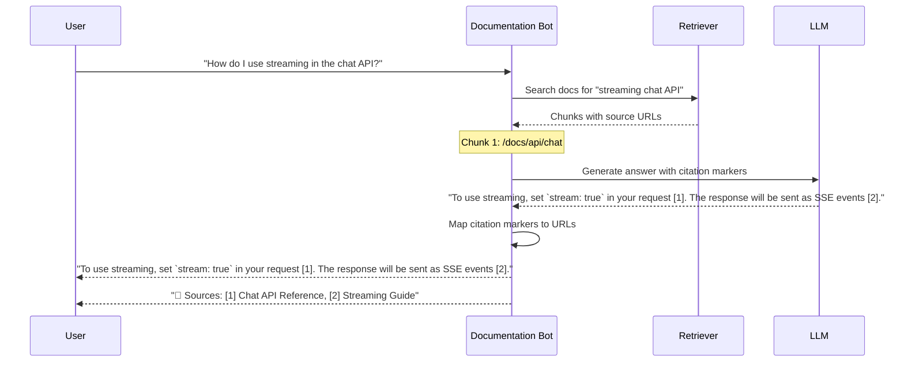

## Introduction

> **Build a documentation chatbot — the same architecture used by OpenAI's docs search, Stripe's docs AI, Vercel's documentation assistant, and Next.js documentation search.**

Documentation sites have a unique challenge: they have structured markdown content, multiple versions, and users who need precise answers with source attribution. This project teaches you how to build a documentation-specific RAG system.



---

## Problem Statement

**The Problem:** Documentation sites have hundreds of pages across multiple versions. Users struggle to find the exact information they need. Traditional site search matches keywords but doesn't understand intent or context.

**The Solution:** A documentation chatbot that:
1. Ingests markdown files, website content, and API references
2. Understands documentation structure (headings, code blocks, tables, notes)
3. Supports multiple documentation versions simultaneously
4. Provides answers with direct source links and citations
5. Handles API-specific questions (parameters, return types, examples)

**Real-World Use Cases:**
- **OpenAI Docs** — "How do I use streaming with the chat completions API?"
- **Stripe Docs** — "What's the difference between PaymentIntent and SetupIntent?"
- **Next.js Docs** — "How do I use the App Router with dynamic routes?"
- **React Docs** — "What's the difference between useEffect and useLayoutEffect?"

---

## Documentation Chunking Strategy

Documentation requires a different chunking approach than general PDFs. Documentation has clear hierarchical structure that should be preserved.

```mermaid
flowchart LR
    subgraph PAGE["Documentation Page"]
        TITLE["# Title (H1)"]
        SEC1["## Section 1 (H2)"]
        SUB1["### Sub-section (H3)"]
        CODE["```code block```"]
        SEC2["## Section 2 (H2)"]
        NOTE["> Note / Tip"]
    end

    subgraph CHUNKS["Intelligent Chunks"]
        C1["Chunk: Title + Intro\n(H1 + first paragraph)"]
        C2["Chunk: Section 1\n(H2 + content)"]
        C3["Chunk: Code Example\n(Code + surrounding text)"]
        C4["Chunk: Sub-section\n(H3 + content)"]
        C5["Chunk: Section 2\n(H2 + content + note)"]
    end

    PAGE --> CHUNKS

    style PAGE fill:#3b82f6,color:#fff
    style CHUNKS fill:#22c55e,color:#fff
```

### Chunking Rules for Documentation

| Strategy | When to Use | Chunk Size |
|----------|-------------|------------|
| **Section-based** | Default for most docs | 200-500 tokens |
| **Code-aware** | API reference docs | Keep code + explanation together |
| **List-aware** | Step-by-step guides | Keep numbered lists intact |
| **Table-aware** | Configuration tables | Keep table rows together |
| **Note-aware** | Tips, warnings, cautions | Attach note to preceding section |

---

## System Architecture

```mermaid
flowchart LR
    subgraph SYNC["Documentation Sync"]
        GIT["Git Repository\n(markdown files)"]
        WEB["Web Crawler\n(html → markdown)"]
        API_SCHEMA["API Schema\n(OpenAPI / GraphQL)"]
    end

    subgraph BUILD["Build Pipeline"]
        PARSE["📖 Parse Frontmatter\n& Metadata"]
        VER["🏷️ Version Detection"]
        CHUNK["✂️ Section Chunking"]
        EMBED["🔢 Embedding"]
        INDEX["📑 Build Index"]
    end

    subgraph STORE["Storage"]
        VDB[("Vector DB")]
        MAP[("Sitemap")]
    end

    subgraph SERVE["Query Service"]
        SEARCH["🔍 Search"]
        CIT["📎 Citation Builder"]
        VER_FILTER["🔢 Version Filter"]
        LLM["🤖 LLM"]
    end

    SYNC --> BUILD --> STORE --> SERVE

    style SYNC fill:#3b82f6,color:#fff
    style BUILD fill:#8b5cf6,color:#fff
    style STORE fill:#f59e0b,color:#fff
    style SERVE fill:#22c55e,color:#fff
```



---

## Versioned Documentation

One of the most important features of documentation chatbots is handling multiple versions.



### Version Handling Strategy

| Concern | Solution |
|---------|----------|
| **Storage** | Each version stored with a `version` metadata field |
| **Default** | User without version preference → latest stable |
| **Breadcrumbs** | Show version in answer: "This is based on v3.0 docs" |
| **Migration** | If no answer in v2.0, fall back to v3.0 with notice |
| **Deprecation** | Flag deprecated docs, prefer current version |

---

## Citation Architecture

Documentation chatbots must provide clear, clickable source citations.



---

## Technology Stack

| Layer | Technology | Why |
|-------|-----------|-----|
| **Framework** | Next.js / Astro | Documentation sites are often built with these |
| **Markdown** | Remark + Rehype | Parse MDX, code blocks, frontmatter |
| **Chunking** | Custom section-based | Preserves doc structure over generic chunking |
| **Embeddings** | OpenAI `text-embedding-3-small` | 1536 dims, good for technical content |
| **Vector DB** | Qdrant or Chroma | Metadata filtering by version |
| **Search** | Hybrid (BM25 + Vector) | Works for code snippets and keywords |
| **LLM** | GPT-4o / Claude 3 | Technical accuracy required |
| **Crawler** | Playwright / Puppeteer | For docs served as HTML |
| **Cache** | Redis + CDN | Fast response for common queries |

---

## Data Flow: Sync & Deployment

```mermaid
flowchart LR
    subgraph BUILD_TIME["Build Time"]
        GIT_REPO["Git Push to Docs Repo"]
        CI_CD["CI/CD Pipeline"]
        BUILD_INDEX["Build Vector Index"]
        UPLOAD["Upload to Vector DB"]
    end

    subgraph RUNTIME["Runtime"]
        CDN["CDN Caching"]
        API_LB["API Load Balancer"]
        API_SERVERS["API Servers"]
        VDB_QUERY["Vector DB Query"]
        LLM_CALL["LLM API Call"]
    end

    subgraph USER_EXP["User Experience"]
        SEARCH_UI["Search UI"]
        CHAT_UI["Chat Interface"]
        DOCS_UI["Documentation Page"]
    end

    BUILD_TIME --> RUNTIME
    RUNTIME --> USER_EXP

    style BUILD_TIME fill:#3b82f6,color:#fff
    style RUNTIME fill:#f59e0b,color:#fff
    style USER_EXP fill:#22c55e,color:#fff
```



---

## Best Practices

1. **Section-based chunking over recursive splitting** — Documentation has natural section boundaries. Don't split across headings.
2. **Always include the heading hierarchy in chunks** — Each chunk should know its H1 → H2 → H3 path for context.
3. **Keep code examples intact** — Don't split a code block from its explanation. They're semantically linked.
4. **Version-tag everything** — Every chunk should know which docs version it belongs to.
5. **Prioritize official docs** — If the same concept appears in a tutorial and the API reference, the API reference should rank higher.
6. **Provide "no answer" responses** — If retrieval confidence is low, say "I couldn't find this in the docs" rather than hallucinating.
7. **Cache aggressively** — Most documentation questions are similar. Cache answers for 24 hours.

---

## Common Mistakes

| Mistake | Impact | Fix |
|---------|--------|-----|
| **Naive chunking** | Splits code blocks from explanations | Use section-aware chunking |
| **No version tracking** | User gets v1.0 answer for v3.0 API | Always filter by version |
| **Missing citations** | User can't verify the answer | Every answer must have source URLs |
| **Outdated index** | New docs not searchable | Rebuild index on deploy |
| **No fallback** | Zero results → confusing empty state | Show "Did you mean?" or related docs |
| **Removing code fences** | Code formatting lost | Preserve markdown code formatting |

---

## Exercises

### Easy

1. Set up a documentation crawler that converts a docs site to markdown
2. Implement section-based chunking that preserves heading hierarchy
3. Create a version-tagging system where chunks know their docs version

### Intermediate

4. Build the citation system that maps answer references to source URLs
5. Implement hybrid search (BM25 + vector) optimized for documentation
6. Create a "related docs" feature that suggests 3-5 relevant pages for each answer

### Advanced

7. Build a version comparison tool that shows how an answer differs between v2.0 and v3.0
8. Implement doc-to-embedding refresh on every git push using GitHub Actions
9. Create a documentation coverage analyzer that finds topics with low retrieval quality

### Architecture

10. Design a system that handles 10,000+ documentation pages across 5 versions with < 500ms query latency
11. Design a deprecation strategy — how do you handle docs for versions that are 3+ years old?

---

## Interview Questions

### System Design

**Q: Design a documentation chatbot for a framework with 2000 pages of docs across 5 major versions.**

> **Storage:** Vector DB with version, section, and topic metadata. Separate index per version or unified with version filter. **Chunking:** Section-based by H2/H3 headings. **Query:** Detect version from user context (URL, selection, or ask). Pre-filter by version. Hybrid search (keyword for API names + semantic for concepts). **Citations:** Every answer includes doc URL, section heading, and snippet. **Sync:** Rebuild index on every merge to main branch. Cost: $200-500/mo for 50k queries/day.

### Architecture

**Q: How do you handle the case where the same concept is documented in two different versions with different syntax?**

> Store version tag in metadata. When querying, require the version filter. If the user doesn't specify a version, default to latest stable and add a note: "This is based on v3.0 docs. Click here for v2.0 version." For cross-version answers, use an LLM to highlight differences: "In v2.0 you'd use `getServerSideProps`, but in v3.0+ you'd use server components."

### Senior Engineer

**Q: Design a strategy for keeping the documentation index fresh when the docs are updated every day.**

> Implement a CI/CD pipeline: on every merge to main → trigger index rebuild. Use incremental indexing: detect changed files via git diff, only re-embed changed pages. Total rebuild takes 5 mins for 2000 pages. Incremental takes 30 seconds. Use GitHub Actions with a workflow that: (1) checks out the repo, (2) runs diff against the previous build, (3) re-embeds only changed pages, (4) upserts changed vectors to DB, (5) updates the sitemap.

### Staff Engineer

**Q: How do you evaluate whether the documentation chatbot is actually helping users find answers faster?**

> A/B test in production: 50% of users get the chatbot, 50% get traditional search. Measure: (1) **Time to answer** — how long until user finds what they need? (2) **Bounce rate** — do users leave immediately after seeing the answer? (3) **Follow-up searches** — do users refine their query? (4) **Feedback score** — thumbs up/down on each answer. A good chatbot should reduce time-to-answer by 40%+ and reduce support tickets by 20%+.

### Principal Engineer

**Q: Design a system that provides documentation answers with zero hallucination risk.**

> Use **constrained decoding**: don't let the LLM generate text that isn't grounded in retrieved chunks. Implement a two-stage approach: (1) Retriever finds relevant chunks, (2) Extractive QA (using a model like BERT or a cross-encoder) extracts the exact answer span from the chunks. The LLM only rephrases the extracted span. If no extracted span has high confidence (> 0.9), return "I couldn't find this in the documentation" with a link to the closest matching page. This guarantees that all answers are extracted directly from the docs.

---

## Summary

| Concept | Key Takeaway |
|---------|-------------|
| **Chunking** | Section-based by H2/H3 — never split across headings |
| **Versions** | Every chunk has a version tag; filter by version during query |
| **Citations** | Every answer must include source URL and section name |
| **Code blocks** | Keep code and explanation together in the same chunk |
| **Hybrid search** | BM25 for API names + vector for semantic concepts |
| **Freshness** | Rebuild index on every docs deploy |

---

## Navigation

**Previous:** [22 — Company Knowledge Assistant](/ai/phase-05-retrieval-systems/22-company-knowledge-assistant)

**Next:** [24 — GitHub Code Assistant](/ai/phase-05-retrieval-systems/24-github-code-assistant)
