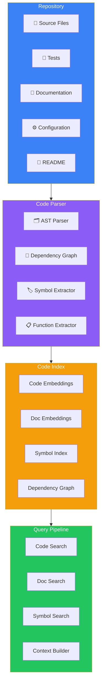
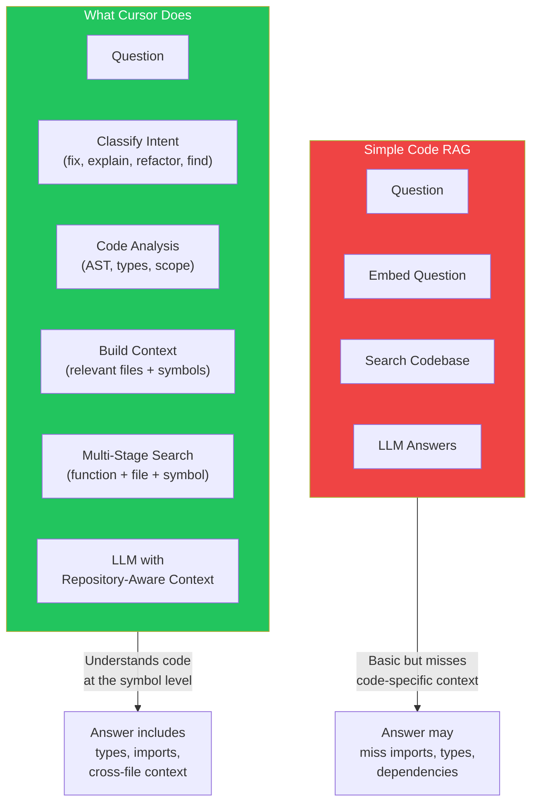
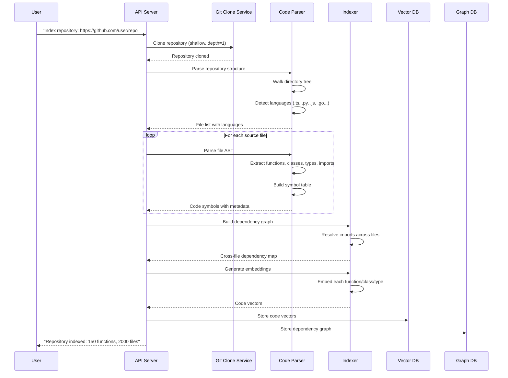
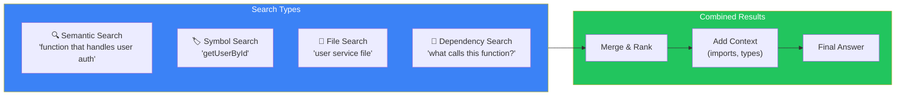

## Introduction

> **Build a GitHub repository AI assistant — the same architecture used by Cursor, GitHub Copilot Chat, and Sourcegraph Cody.**

Code RAG is fundamentally different from document RAG. Code has syntax, semantics, imports, dependencies, and scope. A code assistant needs to understand not just what a function does, but how it connects to other parts of the codebase.

---

## Problem Statement

**The Problem:** Developers spend 40% of their time understanding existing code before writing new code. Navigating large repositories, finding function definitions, understanding imports, and tracing data flow is slow and manual.

**The Solution:** A code-aware AI assistant that:
1. Parses entire repositories into a searchable code index
2. Understands code structure at the function, class, and module level
3. Tracks dependencies between symbols across files
4. Answers questions with file-level context and line-number citations
5. Handles multi-file reasoning (e.g., "How does authentication flow from the frontend to the database?")

**Real-World Use Cases:**
- **Understanding new repos** — "What does this repository do? Explain the architecture."
- **Code review** — "Find all places where this function is called."
- **Bug fixing** — "Why is this component not re-rendering when the state changes?"
- **Onboarding** — "How do I add a new API endpoint? Show me the pattern used by existing endpoints."

---

## Code Chunking Strategy

Code requires fundamentally different chunking than text. You can't just split by character count — you'd split in the middle of a function.

```mermaid
flowchart LR
    subgraph FILE["Source File: server.ts"]
        IMPS["import { auth } from './auth'\nimport { db } from './db'"]
        FUNC1["function handleLogin(req, res) {\n  const user = auth.verify(req.token)\n  ...\n}"]
        TYPE1["type User = {\n  id: string\n  role: Role\n}"]
        FUNC2["async function getUser(id: string) {\n  return db.query('SELECT * FROM users WHERE id = $1', [id])\n}"]
    end

    subgraph CHUNKS["Code Chunks"]
        C1["Chunk: Imports + Module-level docs"]
        C2["Chunk: function handleLogin\n+ JSDoc + body"]
        C3["Chunk: type User definition"]
        C4["Chunk: async function getUser\n+ JSDoc + body"]
    end

    subgraph META["Chunk Metadata"]
        M1["{ symbol: 'handleLogin',\n  type: 'function',\n  file: 'server.ts',\n  lines: 5-25,\n  deps: ['auth.verify'] }"]
        M2["{ symbol: 'User',\n  type: 'type',\n  file: 'server.ts',\n  lines: 27-30 }"]
        M3["{ symbol: 'getUser',\n  type: 'function',\n  file: 'server.ts',\n  lines: 32-36,\n  deps: ['db.query'] }"]
    end

    FILE --> CHUNKS --> META

    style FILE fill:#3b82f6,color:#fff
    style CHUNKS fill:#22c55e,color:#fff
    style META fill:#f59e0b,color:#fff
```

### Code Chunking Rules

| Element | Chunk Strategy | Metadata |
|---------|---------------|----------|
| **Function/method** | One chunk per function | Name, params, return type, line numbers, file path |
| **Class** | One chunk per class + methods | Class name, extends, implements, file path |
| **Type/interface** | One chunk per type | Name, properties, file path |
| **Import block** | Separate chunk | Source file, exported names |
| **Module-level docs** | Attached to first chunk | Always include module comments |
| **Test file** | Separate collection | Test function names, what they test |

---

## System Architecture

---

## How Cursor Is Different from Simple Code RAG

### Key Differences

| Feature | Simple Code RAG | Cursor-Style |
|---------|----------------|--------------|
| **Chunking** | By character count | By function/class/type |
| **Search** | Semantic only | Semantic + symbol + file + dependency |
| **Context** | Top-K chunks | Relevant files + imports + type definitions |
| **Understanding** | Text patterns | AST + type system + scope analysis |
| **Dependencies** | None | Full import/dependency graph |
| **Editing** | None | Can suggest edits with exact line numbers |

---

## Data Flow: Repository Ingestion

---

## Technology Stack

| Layer | Technology | Why |
|-------|-----------|-----|
| **AST Parser** | Tree-sitter | Multi-language, fast, incremental parsing |
| **Dependency Resolver** | Custom import resolver | Handles aliases, barrel files, monorepos |
| **Embeddings** | Voyage Code / OpenAI `text-embedding-3` | Optimized for code |
| **Vector DB** | Qdrant with payload | Metadata filtering by file, language, symbol type |
| **Graph DB** | Neo4j or in-memory | Dependency traversal |
| **LLM** | Claude 3.5 / GPT-4o | Strong code understanding |
| **Git Integration** | libgit2 / isomorphic-git | Repository cloning and diffing |
| **File Watcher** | Chokidar | Real-time file change detection |
| **Frontend** | Monaco Editor + React | Code display with syntax highlighting |

---

## Search Strategies

### Query Examples

| User Question | Search Strategy | Context Assembled |
|--------------|----------------|-------------------|
| "Find the authentication middleware" | Semantic + Symbol | File: middleware/auth.ts, imports, usage examples |
| "How does getUserById work?" | Symbol + Dependency | Function definition + callers + dependencies |
| "Show me all API routes" | File + Semantic | Route files + OpenAPI schema |
| "Explain this repository's architecture" | File + Dependency + Semantic | README + directory structure + dependency graph |

---

## Best Practices

1. **AST-based chunking is non-negotiable** — Don't chunk code by character count. You'll break functions, lose scope, and miss type information.
2. **Include import context** — A function chunk without its imports is missing critical information. Always include imports with each function chunk.
3. **Build a symbol index** — Users often search by function/class name. A symbol index (not just vector search) is essential for precise lookups.
4. **Understand the dependency graph** — When explaining a function, show not just the function but also its callers and callees.
5. **Support multiple languages** — A JavaScript-only assistant is useless for polyglot repos. Use Tree-sitter for multi-language support.
6. **Handle monorepos** — Monorepos need special handling: track which package each symbol belongs to and scope searches by package.

---

## Common Mistakes

| Mistake | Impact | Fix |
|---------|--------|-----|
| **Character-based chunking** | Functions split across chunks → useless | Use AST-based function-level chunking |
| **No import resolution** | Answer misses type definitions | Include resolved imports with each chunk |
| **Ignoring file structure** | Can't explain architecture | Index directory structure + module boundaries |
| **No test awareness** | Can't find test coverage | Index test files with their tested functions |
| **Single-language parser** | Fails on mixed-language repos | Use Tree-sitter for multi-language support |
| **No dependency tracking** | Can't trace data flow | Build and query the dependency graph |

---

## Exercises

### Easy

1. Set up Tree-sitter to parse a TypeScript file and extract all function names and line numbers
2. Create a symbol index that maps function names to their file paths
3. Implement a semantic search that finds code by natural language description

### Intermediate

4. Build an import resolver that tracks dependencies across files
5. Implement a context assembler that, given a function name, returns the function + its imports + its type definitions
6. Create a file-level search that understands directory structure and module boundaries

### Advanced

7. Build a dependency graph query that answers "Show me every function that calls `authenticate()`"
8. Implement repository-aware editing: take a user's edit request and suggest exact line-number changes
9. Create a diff-aware search that only searches files changed in a pull request

### Architecture

10. Design a system that indexes a monorepo with 50 packages and 10,000 files
11. Design a system that can answer "What is the architecture of this codebase?" with a dependency diagram

---

## Interview Questions

### System Design

**Q: Design a code assistant that indexes a monorepo with 50 packages and 10,000 files.**

> **Parsing:** Tree-sitter for multi-language AST parsing. Process files in parallel (50 workers). **Chunking:** Function-level + file-level + package-level. Each chunk knows its package. **Storage:** Vector DB for code embeddings + graph DB for dependencies. **Query:** Symbol index for exact lookups + semantic for natural language. Pre-filter by package if user specifies one. **Context building:** For any symbol, include: (1) its definition, (2) its imports, (3) all callers within the same package, (4) type definitions it references. **Cost:** $500-2000/mo for 1000 users.

### Architecture

**Q: How is code RAG different from document RAG? Why can't you use the same architecture?**

> Code has **structure** (functions, classes, imports) that document RAG ignores. Document RAG chunks by character count — this breaks function bodies, loses import context, and misses type information. Code RAG needs AST-aware chunking, symbol-level indexing, and dependency graph traversal. Documents are linear; code is a graph of interconnected symbols. A code assistant that can't resolve imports will give wrong answers about type usage and function signatures.

### Senior Engineer

**Q: How do you handle the case where a function calls another function that's defined in a different file?**

> Build a dependency graph during indexing. For each function, resolve its imports and track which external symbols it references. During query, when explaining function A, traverse the dependency graph and include: (1) A's definition, (2) imports A uses, (3) definitions of functions A calls (one level deep). This gives the LLM enough context to reason about cross-file execution. Use tree-shaking to avoid including irrelevant imports.

### Staff Engineer

**Q: Design a system that can answer "What changes does this PR actually introduce?" across a diff of 200 files.**

> The naive approach: give the entire diff to an LLM — context window exceeded. Better approach: (1) Parse the diff to extract changed functions, not changed files. (2) For each changed function, retrieve the function's definition + what it looked like before (git show). (3) Classify changes into categories: new feature, bug fix, refactor, rename, test. (4) Build a summary: "This PR touches 15 functions across 8 files. 3 new features, 5 bug fixes, 7 refactors." (5) For each category, show the most significant changes with before/after diffs.

### Principal Engineer

**Q: How would you build Cursor's repository understanding from scratch? What would you prioritize?**

> **Phase 1 (Essential):** AST parser + function-level chunking + symbol search + file search. This gives basic "find this function" and "explain this code" capabilities. **Phase 2 (Differentiator):** Dependency graph + cross-file context. Now the assistant can trace data flow and understand architecture. **Phase 3 (Advanced):** Real-time file watching + edit suggestions with diff preview. Now the assistant can help write code, not just explain it. **Phase 4 (Delight):** Repository-aware code generation — generate new files that follow the repo's existing patterns, conventions, and type system. Each phase builds on the previous, and you can launch after Phase 2 with a useful product.

---

## Summary

| Concept | Key Takeaway |
|---------|-------------|
| **Chunking** | AST-based, function/class/type level — never by character count |
| **Search** | Semantic + symbol + file + dependency — four parallel search strategies |
| **Context** | Include imports, types, and dependency information with every chunk |
| **Dependency graph** | Essential for tracing data flow and understanding architecture |
| **Multi-language** | Use Tree-sitter for polyglot repository support |
| **Symbol index** | Precision lookup for when users know the function name |

---

## Navigation

**Previous:** [23 — Documentation Chatbot](/ai/phase-05-retrieval-systems/23-documentation-chatbot)

**Next:** [25 — Phase Summary & Project Roadmap](/ai/phase-05-retrieval-systems/25-phase-summary-project-roadmap)
