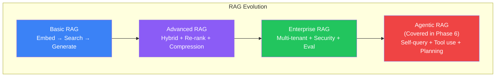
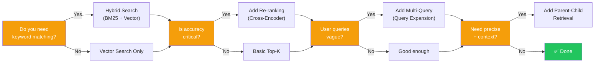
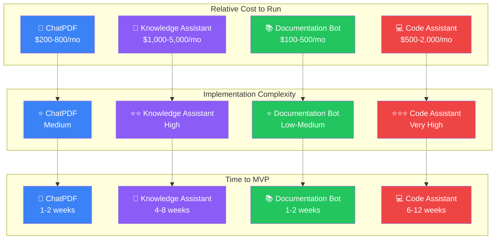

## Introduction

> **Welcome to the end of Phase 5. You've built ChatPDF, a Company Knowledge Assistant, a Documentation Chatbot, and a GitHub Code Assistant. Now it's time to review everything, compare approaches, and chart your path forward.**

This summary page consolidates everything you've learned across 24 documents and 5 chunks. Use it as a reference, a decision guide, and a roadmap to further mastery.

---

## The Complete RAG Architecture

```mermaid
flowchart TD
    subgraph DOCUMENTS["Document Sources"]
        PDF["📄 PDFs"]
        WEB["🌐 Websites"]
        REPO["💻 Code Repos"]
        WIKI["📝 Internal Wikis"]
        DB["🗄️ Databases"]
    end

    subgraph INGESTION["Ingestion Pipeline"]
        PARSE["Parse & Extract"]
        CHUNK["Chunk Documents"]
        EMBED["Generate Embeddings"]
        STORE["Store in Vector DB"]
    end

    subgraph RETRIEVAL["Retrieval Strategies"]
        SIMPLE["Basic Vector Search"]
        HYBRID["Hybrid Search\n(BM25 + Vector)"]
        MQ["Multi-Query\n(Query Expansion)"]
        PC["Parent-Child\n(Chunk Expansion)"]
        RERANK["Re-ranking\n(Cross-Encoder)"]
    end

    subgraph GEN["Generation"]
        PROMPT["Prompt Builder"]
        COMPRESS["Context Compression"]
        LLM["LLM Generation"]
        CITATION["Citation Builder"]
    end

    subgraph PROD["Production"]
        CACHE["Caching Layer"]
        AUTH["Auth & RBAC"]
        MONITOR["Monitoring & Evaluation"]
        SCALE["Scaling & Load Balancing"]
    end

    DOCUMENTS --> INGESTION --> RETRIEVAL --> GEN --> PROD

    style DOCUMENTS fill:#3b82f6,color:#fff
    style INGESTION fill:#8b5cf6,color:#fff
    style RETRIEVAL fill:#f59e0b,color:#fff
    style GEN fill:#22c55e,color:#fff
    style PROD fill:#ef4444,color:#fff
```

---

## RAG Approach Comparison

### Comparison Table

| Dimension | Basic RAG | Advanced RAG | Enterprise RAG |
|-----------|-----------|-------------|----------------|
| **Search** | Vector only | Hybrid (vector + keyword) | Hybrid + multi-query + parent-child |
| **Ranking** | Vector similarity | + Cross-encoder re-ranking | + Score normalization + thresholding |
| **Context** | Raw chunks | + Compression + deduplication | + Summarization + citation building |
| **Security** | None | None | RBAC, metadata filtering, audit logs |
| **Multi-tenancy** | None | None | Tenant isolation, per-tenant indexes |
| **Evaluation** | Manual | LLM-as-judge | Automated eval pipeline + dashboards |
| **Caching** | None | Embedding cache | Embedding + response + semantic cache |
| **Monitoring** | None | Basic metrics | Full observability (traces, logs, alerts) |
| **Latency** | 2-5s | 2-5s | < 2s with caching |
| **Cost** | $ | $$ | $$$ |
| **Best for** | Prototypes, MVPs | Production apps | Enterprise systems |

---

## Technology Decision Guide

### When to Use Each Retrieval Strategy

### When NOT to Use RAG

| Scenario | Better Approach |
|----------|----------------|
| **You need the model to learn new facts permanently** | Fine-tuning |
| **You have < 20 documents and the LLM context window fits them all** | Just put them in the prompt |
| **You need the model to follow a specific output format** | Fine-tuning or structured output |
| **Your documents change every minute** | Streaming data pipeline rather than batch RAG |
| **You need 100% factual accuracy with no hallucination risk** | Constrained extraction (no generation) |
| **Your users need real-time data from APIs** | Function calling / tool use (Phase 6) |

---

## Production Checklist

### Architecture Checklist

- [ ] Separate ingestion and query pipelines
- [ ] Asynchronous ingestion with message queue
- [ ] Stateless query servers behind load balancer
- [ ] Embedding cache (Redis) with TTL
- [ ] Response cache for frequent queries
- [ ] Metadata filtering before vector search
- [ ] Re-ranker between retriever and LLM

### Security Checklist

- [ ] Authentication (JWT / SSO)
- [ ] Authorization (RBAC with metadata filtering)
- [ ] PII masking before indexing
- [ ] Encryption at rest (AES-256)
- [ ] Encryption in transit (TLS 1.3)
- [ ] Rate limiting per user/API key
- [ ] Audit logging for all queries
- [ ] Secrets management (not in code)

### Performance Checklist

- [ ] Query latency < 3s p95
- [ ] Embedding cache hit rate > 60%
- [ ] Batch vector DB writes (100+ per batch)
- [ ] Connection pooling for all databases
- [ ] Streaming responses for LLM output
- [ ] CDN for static assets and cached responses
- [ ] Horizontal scaling for stateless services

### Monitoring Checklist

- [ ] Latency metrics per service (p50, p95, p99)
- [ ] Cost tracking per query per user
- [ ] Retrieval precision/recall dashboard
- [ ] LLM hallucination rate monitoring
- [ ] Cache hit/miss ratio
- [ ] Error rate alerts
- [ ] Vector DB usage metrics

---

## Comparison Tables

### Search Methods

| Feature | Keyword Search | Semantic Search | Hybrid Search |
|---------|---------------|----------------|---------------|
| **Method** | BM25 / TF-IDF | Vector similarity | BM25 + Vector fusion |
| **Match** | Exact words | Meaning | Both |
| **Handles typos** | No | Yes | Yes |
| **Handles synonyms** | No | Yes | Yes |
| **Handles code** | Good (exact API names) | Poor | Good |
| **Latency** | < 50ms | < 100ms | < 200ms |
| **Best for** | Code, exact terms | General text, concepts | Production systems |

### Development vs Production

| Aspect | Development | Production |
|--------|-------------|------------|
| **Vector DB** | Local (Chroma, FAISS) | Managed (Qdrant, Pinecone) |
| **LLM** | GPT-4o-mini | GPT-4o / Claude 3 |
| **Caching** | None | Embedding + Response + Semantic |
| **Monitoring** | Console logs | Grafana + Prometheus + Alerts |
| **Security** | None | Auth + RBAC + Encryption + Audit |
| **Scaling** | Single process | Horizontal, auto-scaling |
| **Uptime** | 99% | 99.9%+ |
| **Cost** | < $100/mo | $500-$5000/mo |

### Chunking Strategies

| Strategy | Best For | Chunk Size | Overlap |
|----------|----------|------------|---------|
| **Fixed size** | Simple documents | 256-512 tokens | 10-20% |
| **Recursive** | General purpose | 512 tokens | 10-20% |
| **Semantic** | Well-structured text | Variable | None needed |
| **Section-based** | Documentation | Per section | None needed |
| **Function-level** | Code | Per function | Imports as context |
| **Parent-Child** | Precision + context | Small child (128), large parent (1024) | Hierarchical |

---

## Roadmap to Mastery

---

## Key Takeaways from Each Project

| Project | Key Lesson | Architecture Pattern |
|---------|-----------|---------------------|
| **ChatPDF** | Document ingestion pipeline + Query pipeline | Two-pipeline architecture |
| **Knowledge Assistant** | Access control via metadata filtering | Pre-filter before search |
| **Documentation Bot** | Section-based chunking + version management | Citation system + version tags |
| **Code Assistant** | AST-based chunking + dependency graph | Symbol index + multi-search |

### Project Cost & Complexity Comparison

---

## What to Learn Next

### Phase 6: AI Agents & Agentic Systems

You've mastered retrieval — giving LLMs access to knowledge. Now learn how to give LLMs access to **tools, actions, and autonomy**:

1. **Agent Architecture** — How agents think: perceive → reason → act → observe
2. **Tool Use** — How agents call APIs, run code, and interact with the world
3. **Agent Memory** — Short-term, long-term, and episodic memory for agents
4. **Planning** — How agents break down complex tasks into steps
5. **Multi-Agent Systems** — How agents collaborate, delegate, and debate
6. **Agent Safety** — Guardrails, human-in-the-loop, and failure handling

### Further Reading

- [LangChain RAG Documentation](https://python.langchain.com/docs/use_cases/question_answering/)
- [OpenAI RAG Guide](https://help.openai.com/en/articles/8868588-retrieval-augmented-generation-rag-at-openai)
- [Pinecone Learning Center](https://www.pinecone.io/learn/)
- [Qdrant RAG Patterns](https://qdrant.tech/documentation/tutorials/rag/)
- [Anthropic Contextual Retrieval](https://www.anthropic.com/news/contextual-retrieval)
- [Microsoft RAG Patterns](https://learn.microsoft.com/en-us/azure/search/retrieval-augmented-generation-overview)

---

## Summary

| Chunk | Topics | Documents |
|-------|--------|:---------:|
| **Chunk 1: Embeddings & Vector Search** | Why retrieval, embeddings, vector space, similarity search, vector DBs | 01-05 |
| **Chunk 2: Building Your First RAG Pipeline** | What is RAG, chunking, ingestion pipeline, retrievers, complete pipeline | 06-10 |
| **Chunk 3: Advanced Retrieval Techniques** | Hybrid search, re-ranking, context compression, parent-child, multi-query | 11-15 |
| **Chunk 4: Production RAG Systems** | Architecture, metadata filtering, evaluation, scaling, best practices | 16-20 |
| **Chunk 5: Enterprise RAG Projects** | ChatPDF, Knowledge Assistant, Documentation Bot, Code Assistant, Summary | 21-25 |

---

## Navigation

**Previous:** [24 — GitHub Code Assistant](/ai/phase-05-retrieval-systems/24-github-code-assistant)

**Next:** Phase 6 — AI Agents & Agentic Systems (Coming Soon)

**🎉 Congratulations on completing Phase 5: Retrieval Systems & RAG!**
