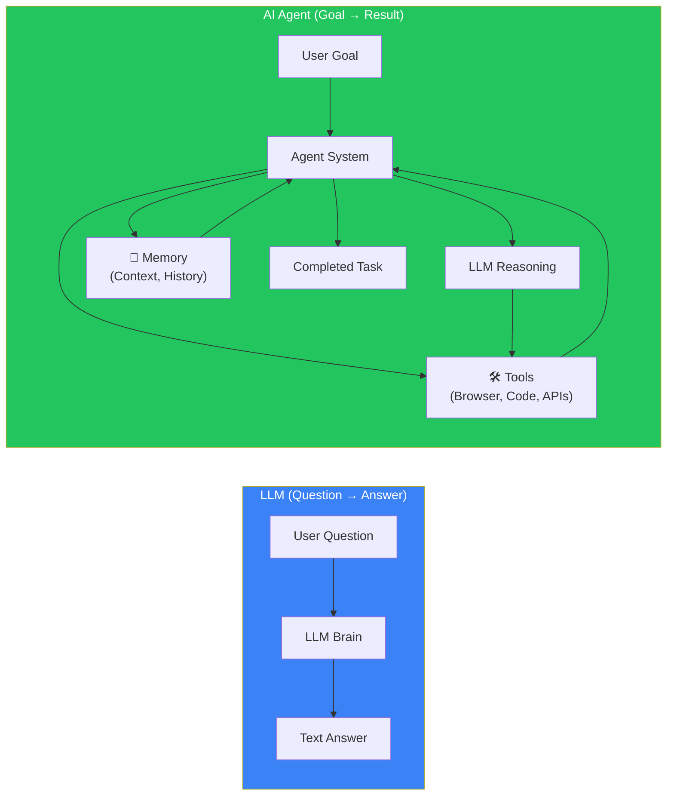
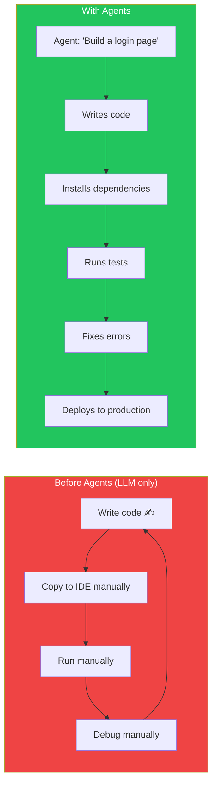
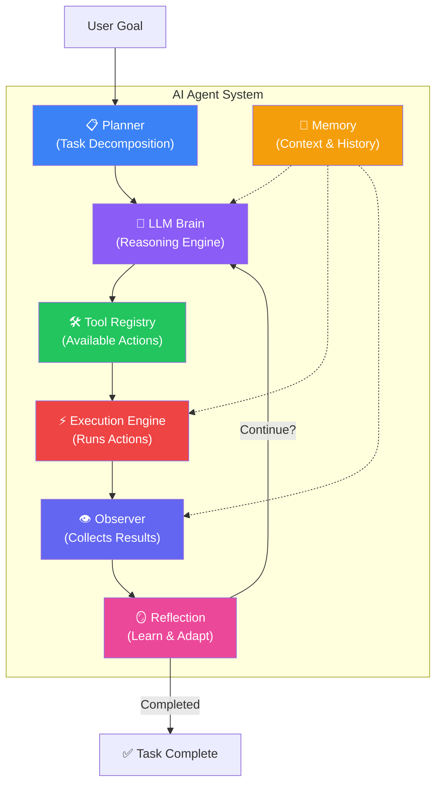
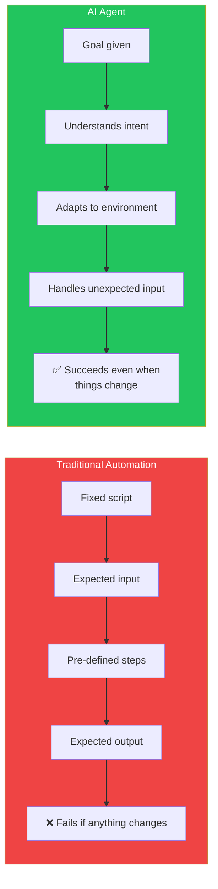
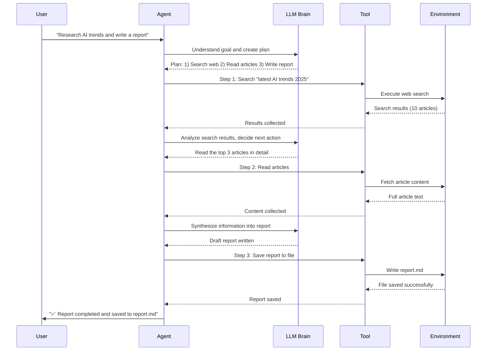

## Introduction

> **An AI Agent is an LLM-powered system that can perceive its environment, reason about goals, use tools, take actions, and learn from the results — all autonomously.**

You've mastered how LLMs answer questions. Now learn how they **do things**. An LLM alone is like a brilliant brain trapped in a dark room — it can think but can't act. An AI Agent gives that brain hands, eyes, and the ability to get work done.

---

## Why This Exists

### The Problem: LLMs Can Think But Not Act

ChatGPT can write you a perfect email. But it cannot **send** it. It can explain how to deploy your app, but it cannot **run** the deployment commands. It can plan your vacation, but it cannot **book** the flights.

This is the fundamental limitation of LLMs — they are thought engines, not action engines.

### What Agents Solved

AI Agents bridge the gap between **knowing** and **doing**:

1. **Action** — Agents can execute code, call APIs, control browsers, and manipulate files
2. **Autonomy** — Agents work toward goals without step-by-step human instruction
3. **Memory** — Agents remember past actions and learn from results
4. **Tool use** — Agents can use any software tool a human can use
5. **Persistence** — Agents keep working until a goal is achieved or failure is certain

---

## Real-World Analogy

### The Chef and the Cookbook

An **LLM** is like a world-class chef who has memorized every recipe ever written. Ask the chef "How do I make a croissant?" and they will give you a perfect explanation. But the chef is **paralyzed** — they cannot touch ingredients, cannot use the oven, cannot move around the kitchen.

An **AI Agent** is that same chef, but now with:
- **Hands** → Tools (browser, code, APIs)
- **A notepad** → Memory (tracking what's been done)
- **The ability to move** → Action execution
- **A goal** → A task to complete, not just a question to answer

The chef reads the recipe (LLM), decides what to do first (planning), reaches for ingredients (tool use), mixes the dough (action), checks if it looks right (observation), and adjusts if something went wrong (reflection).

---

## Core Components of an AI Agent

### Component Breakdown

| Component | Role | Example |
|-----------|------|---------|
| **LLM Brain** | Reasoning, decision-making, generating plans | GPT-4o, Claude, Gemini |
| **Planner** | Breaks goals into actionable steps | "Book a flight" → Search → Compare → Book → Confirm |
| **Memory** | Stores context, history, and learned information | Conversation history, vector DB, task state |
| **Tool Registry** | Catalog of available tools the agent can use | Browser, calculator, file system, API calls |
| **Execution Engine** | Runs the chosen actions in the environment | Executes Python code, sends HTTP requests |
| **Observer** | Collects results from actions | Reads API response, captures screenshot, checks file output |
| **Reflection** | Evaluates results and decides next steps | "The API returned an error — should I retry with different parameters?" |

---

## Agent vs Traditional Automation

A common question is: how is an AI Agent different from traditional automation scripts or RPA (Robotic Process Automation)?

Traditional automation follows a fixed script. If the website layout changes, the scraper breaks. If the input format changes, the parser fails. An AI Agent, powered by an LLM, understands the **goal** and can adapt to unexpected situations — it reads the webpage, figures out the new layout, and adjusts its approach.

---

## How an Agent Works: The Agent Loop

---

## Real Production Examples

| Product | What It Does | How It's an Agent |
|---------|-------------|-------------------|
| **Cursor** | AI code editor | Writes code, runs terminal commands, reads files, fixes errors autonomously |
| **GitHub Copilot Chat** | AI pair programmer | Understands repo context, suggests code, explains errors, proposes fixes |
| **Claude Desktop** | AI computer use agent | Controls mouse/keyboard, reads screen, uses apps, browses web |
| **OpenAI Operator** | Web task automation | Books restaurants, fills forms, shops online, manages browser |
| **Devin** | AI software engineer | Writes code, runs tests, deploys apps, creates PRs |
| **Manus** | General-purpose agent | Researches, analyzes data, builds apps, completes complex workflows |
| **Microsoft Copilot** | Enterprise assistant | Writes emails, creates documents, analyzes data, schedules meetings |
| **Perplexity Assistant** | Research agent | Searches web, reads sources, synthesizes information, cites references |

---

## Best Practices

1. **Start simple, add complexity later** — A single-agent with basic tools is better than a broken multi-agent system
2. **Design clear stopping conditions** — Agents should know when to stop: task completed, max iterations reached, or human intervention needed
3. **Implement human-in-the-loop for critical actions** — Before sending emails, making purchases, or modifying production systems, ask for confirmation
4. **Log everything** — Every thought, action, and observation should be logged for debugging and auditing
5. **Give agents limited permissions** — Don't give an agent access to production databases or deployment credentials unless absolutely necessary

---

## Common Mistakes

| Mistake | Impact | Fix |
|---------|--------|-----|
| **Giving too many tools** | Agent gets confused, picks wrong tool | Start with 3-5 tools, add more as needed |
| **No iteration limits** | Agent runs forever or costs explode | Set max 10-25 iterations per task |
| **No validation** | Agent uses tool wrong, bad results | Validate tool outputs before feeding back to LLM |
| **No human oversight** | Agent makes destructive decisions | Add approval steps for destructive actions |
| **Over-promising autonomy** | Agent fails silently | Send status updates, ask for help when stuck |

---

## Interview Questions

### Easy

**Q: What is an AI Agent in simple terms?**

> An AI Agent is an LLM that can use tools, remember context, and take actions to accomplish a goal. Instead of just answering questions, an agent can browse the web, run code, send emails, and keep working until a task is done.

**Q: What's the difference between an LLM and an AI Agent?**

> An LLM only generates text based on input. An AI Agent uses an LLM as its brain but also has tools, memory, planning, and the ability to take actions. An LLM answers questions; an agent completes tasks.

### Intermediate

**Q: What are the core components of an AI Agent?**

> 1. **LLM Brain** — The reasoning engine that makes decisions. 2. **Planner** — Breaks goals into steps. 3. **Memory** — Stores context (short-term) and knowledge (long-term). 4. **Tool Registry** — Available actions the agent can take. 5. **Execution Engine** — Runs actions in the environment. 6. **Observer** — Collects results from actions. 7. **Reflection** — Evaluates results and adjusts the plan.

### Senior

**Q: How would you design an agent that can handle unexpected failures?**

> Build a three-layer recovery system: (1) **Retry** — If a tool call fails, retry with exponential backoff (up to 3 times). (2) **Re-plan** — If retries fail, the agent re-evaluates the plan and tries a different approach. (3) **Human handoff** — If re-planning fails twice, the agent asks a human for help. Log all failures for debugging. This prevents agents from getting stuck in infinite loops while still maintaining autonomy for common failures.

### Staff Engineer

**Q: How do you evaluate whether an agent system is working well?**

> Use four categories: (1) **Task success rate** — What % of tasks complete successfully? (2) **Efficiency** — How many steps/iterations does the agent need? (3) **Cost** — How many tokens and tool calls per task? (4) **Safety** — How many actions required human approval? Track these per task type. A good agent should have > 80% success rate, < 15 steps per task, and < 20% of tasks requiring human intervention.

### Architecture

**Q: Design an agent system that can research a topic, write a report, and email it to a team.**

> **Components:** Planner → Web Search tool → Content Reader tool → LLM synthesizer → File Writer tool → Email tool. **Flow:** (1) Planner breaks down: Search → Read → Synthesize → Write → Email. (2) Agent searches web for latest information. (3) Reads top 5 articles. (4) LLM synthesizes into a report. (5) Saves to file. (6) Emails the team with the report attached. **Safety:** Email step requires human approval. **Fallback:** If web search fails, use cached data.

---

## Summary

| Concept | Key Point |
|---------|-----------|
| **AI Agent** | An LLM-powered system that uses tools, memory, and planning to accomplish goals autonomously |
| **LLM vs Agent** | LLM thinks, agent acts |
| **Core components** | Brain, planner, memory, tools, execution engine, observer, reflection |
| **Agent loop** | Think → Plan → Act → Observe → Reflect → Repeat |
| **Key difference** | LLMs answer questions; agents complete tasks |
| **Real examples** | Cursor, Devin, Claude Desktop, OpenAI Operator |

---

## Navigation

**Previous:** [25 — Phase Summary & Roadmap](/ai/phase-05-retrieval-systems/25-phase-summary-project-roadmap)

**Next:** [02 — AI Agent vs Large Language Model](/ai/phase-06-ai-agents/02-agent-vs-llm)
