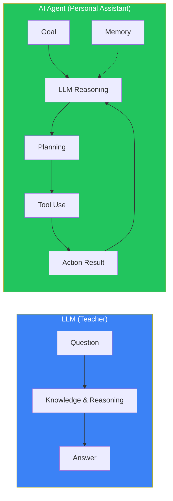
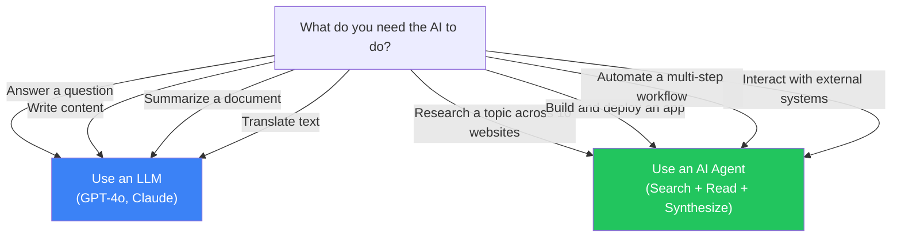
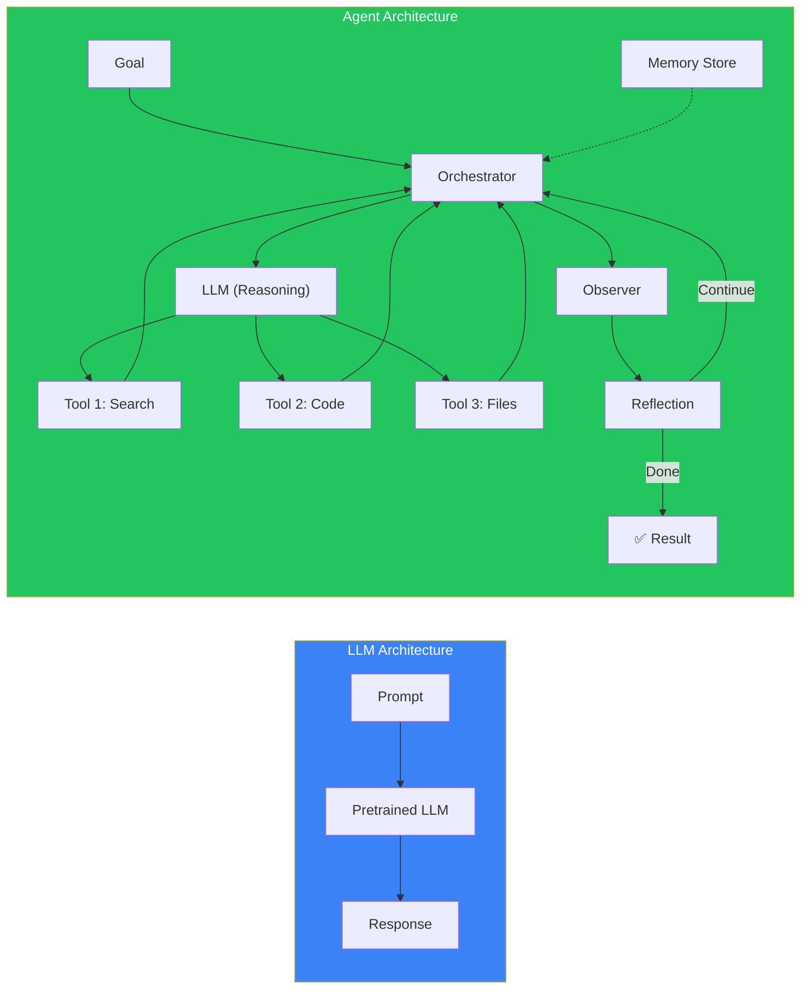
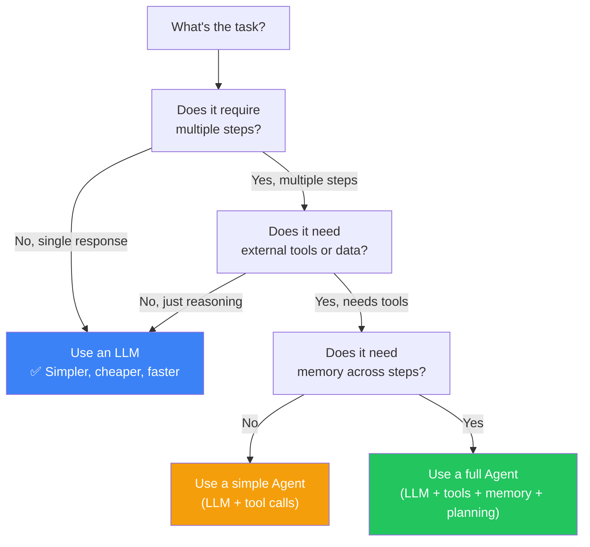
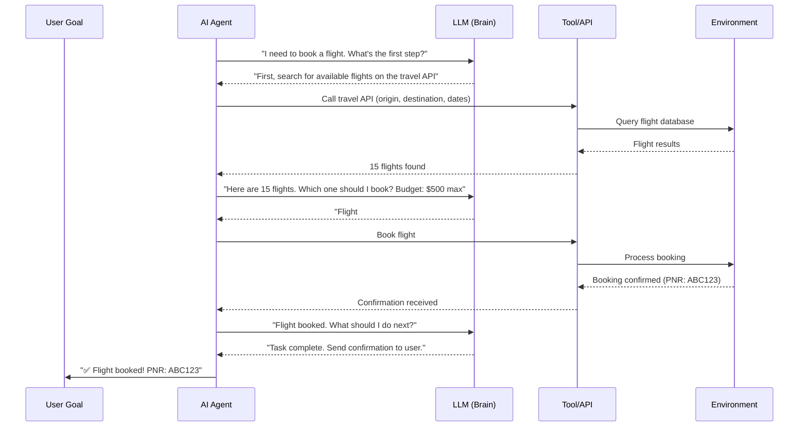

## Introduction

> **An LLM is a reasoning engine. An AI Agent is an autonomous worker. The LLM thinks; the Agent acts.**

This is one of the most important distinctions in modern AI. Many people say "ChatGPT is an agent" or "Claude is an agent" — but they're not. LLMs and Agents are fundamentally different, and understanding the difference is essential for building effective AI systems.

---

## Why This Distinction Matters

### The Problem: Confusing LLMs with Agents

When you ask ChatGPT to "book a flight," it happily writes a step-by-step guide. But it doesn't actually book the flight. The user is left with instructions, not results.

This confusion leads to:
- **Wrong architecture decisions** — Building agent systems when simple LLM calls would suffice
- **Over-engineering** — Adding tools, memory, and planning when a single prompt is enough
- **Under-engineering** — Expecting an LLM to act like an agent without the infrastructure

### The Solution: Understand the Differences

LLMs and Agents exist on a spectrum. Simple tasks need LLMs. Complex tasks need Agents.

---

## Real-World Analogy

### The Teacher vs The Personal Assistant

An **LLM is a teacher**. You ask a question, they give you an answer. They're incredibly knowledgeable, but they don't do anything beyond answering. They don't search the internet, they don't run experiments, they don't call anyone on your behalf.

An **AI Agent is a personal assistant**. You give them a goal: "Plan my team's offsite." They:
1. Check everyone's calendar (tool: calendar API)
2. Search for venues (tool: web browser)
3. Compare prices (tool: calculator/spreadsheet)
4. Send emails to shortlisted venues (tool: email)
5. Draft an itinerary (tool: document editor)
6. Present the completed plan to you

The teacher (LLM) tells you how to plan an offsite. The assistant (Agent) actually plans it.

---

## Comparison Table

| Dimension | Large Language Model (LLM) | AI Agent |
|-----------|---------------------------|----------|
| **Core ability** | Text generation | Task completion |
| **Input** | Prompt / Question | Goal / Objective |
| **Output** | Text / Code | Actions + Results |
| **Planning** | None (single response) | Multi-step planning |
| **Memory** | Context window only | Short-term + long-term memory |
| **Tool use** | Cannot use tools | Can use any tool available |
| **Autonomy** | None (responds once) | Autonomous (works until done) |
| **State** | Stateless (each call is new) | Stateful (tracks progress) |
| **Environment interaction** | None | Reads/writes to environment |
| **Error recovery** | None | Can retry, re-plan, adapt |
| **Cost per task** | Low (one API call) | Higher (multiple calls + tools) |
| **Complexity** | Simple (one model call) | Complex (orchestration needed) |
| **Best for** | Q&A, content generation, summarization | Automation, research, software development |

---

## Architecture Comparison

---

## When to Use Which

---

## How They Work Together

The most important insight: **Agents don't replace LLMs — they use them.**

The LLM provides **reasoning** at each step. The Agent provides the **orchestration, tool access, and persistence**.

---

## Common Mistakes

| Mistake | Impact | Fix |
|---------|--------|-----|
| **Calling ChatGPT an agent** | Mises expectations, wrong architecture | Agents need tools, memory, and planning — ChatGPT has none of these natively |
| **Using an agent for a simple Q&A task** | 10x cost, slower response, unnecessary complexity | Use a simple LLM call for single-response tasks |
| **Using a plain LLM for a multi-step task** | User gets instructions instead of results | Wrap the LLM in an agent with tool access |
| **Not using the LLM for reasoning** | Agent acts without thinking | Always route decisions through the LLM |
| **Giving the agent too much autonomy** | Agent makes bad decisions without oversight | Add human-in-the-loop for critical actions |

---

## Interview Questions

### Easy

**Q: Is ChatGPT an AI Agent? Why or why not?**

> No. ChatGPT is a Large Language Model, not an AI Agent. ChatGPT can answer questions and generate text, but it cannot use tools, take actions in the world, maintain persistent memory, or work autonomously toward a goal. It processes one prompt at a time and then stops.

**Q: Can an LLM exist without an Agent?**

> Yes! An LLM is a standalone model that generates text. Many applications use LLMs directly — such as chatbots, content generators, and translators. An Agent is an optional layer on top of an LLM.

### Intermediate

**Q: Explain how an LLM and an Agent work together in a production system.**

> The Agent is the orchestrator, and the LLM is the reasoning engine. The Agent receives a goal, asks the LLM for a plan, executes the plan using tools, collects results, asks the LLM to evaluate the results, and repeats until the goal is achieved. The LLM never directly interacts with tools or the environment — that's the Agent's job.

### Senior

**Q: Design an architecture where the same LLM powers both a simple chatbot and a complex research agent. How would you structure this?**

> Use a **router** pattern. Single LLM endpoint, but two orchestration layers above it: (1) **Simple path** — User query goes directly to LLM, response returned immediately. Cheap and fast. (2) **Agent path** — User query goes to an agent orchestrator that uses the same LLM for reasoning, planning, tool selection, and reflection. The router decides which path based on query complexity (simple questions → direct, multi-step research → agent). This gives you the best of both worlds.

### Staff Engineer

**Q: How would you measure the value added by turning an LLM into an Agent?**

> Measure three metrics before and after: (1) **Task completion rate** — What % of tasks get fully completed? (2) **User time saved** — How much manual work does the agent eliminate? (3) **Cost per completed task** — Total tokens + API calls + tool costs. A good agent should increase task completion by 3x+, save users 80%+ of their time, while keeping cost under $0.50 per task. If the agent doesn't improve these metrics, the LLM alone was sufficient.

### Architecture

**Q: Design a system that uses both LLM and Agent patterns for a customer support platform.**

> **Tier 1 (LLM)** — Simple FAQs: "What's your return policy?" → Direct LLM response. No agent needed. **Tier 2 (Simple Agent)** — Order status: Agent calls order lookup API, LLM interprets results, responds to customer. **Tier 3 (Full Agent)** — Complex issues: Agent researches customer history, checks multiple systems, drafts resolution, gets human approval, executes. Each tier handles its complexity level. Routing based on query intent classification.

---

## Summary

| Concept | Key Point |
|---------|-----------|
| **LLM** | Text generation model — answers questions, generates content |
| **AI Agent** | Autonomous system — uses LLMs + tools + memory to complete goals |
| **Relationship** | Agents use LLMs as their reasoning engine |
| **When to use LLM** | Single-response tasks, Q&A, content generation |
| **When to use Agent** | Multi-step tasks, tool interaction, automation |
| **Key difference** | LLM tells you how; Agent does it for you |

---

## Navigation

**Previous:** [01 — What is an AI Agent?](/ai/phase-06-ai-agents/01-what-is-an-ai-agent)

**Next:** [03 — Agent Lifecycle](/ai/phase-06-ai-agents/03-agent-lifecycle)
