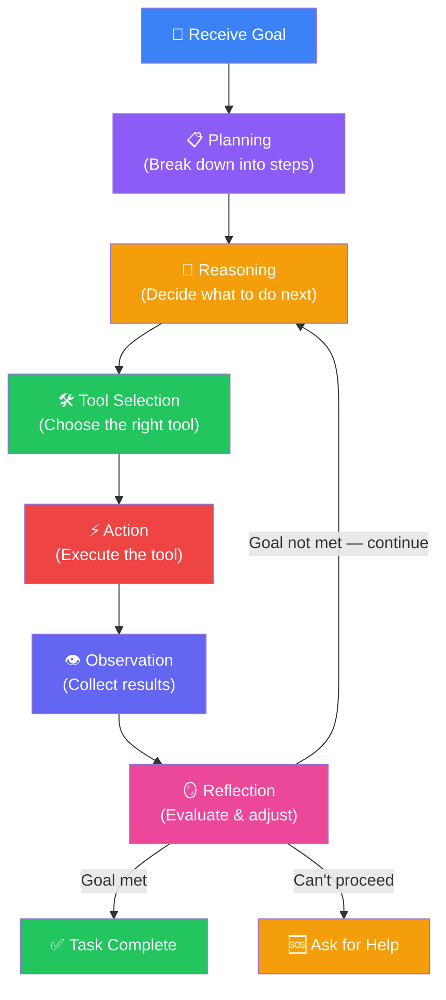
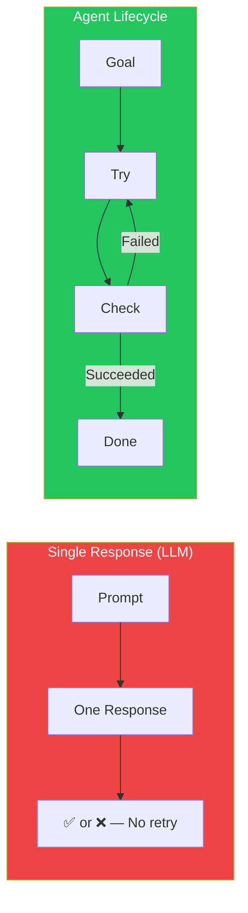
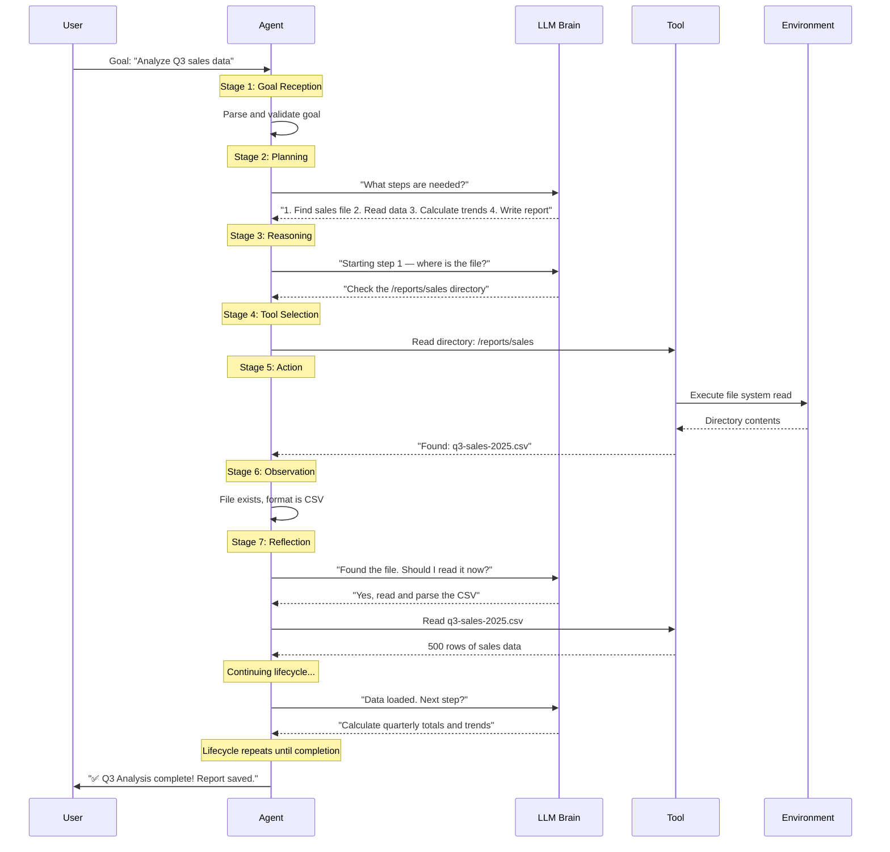
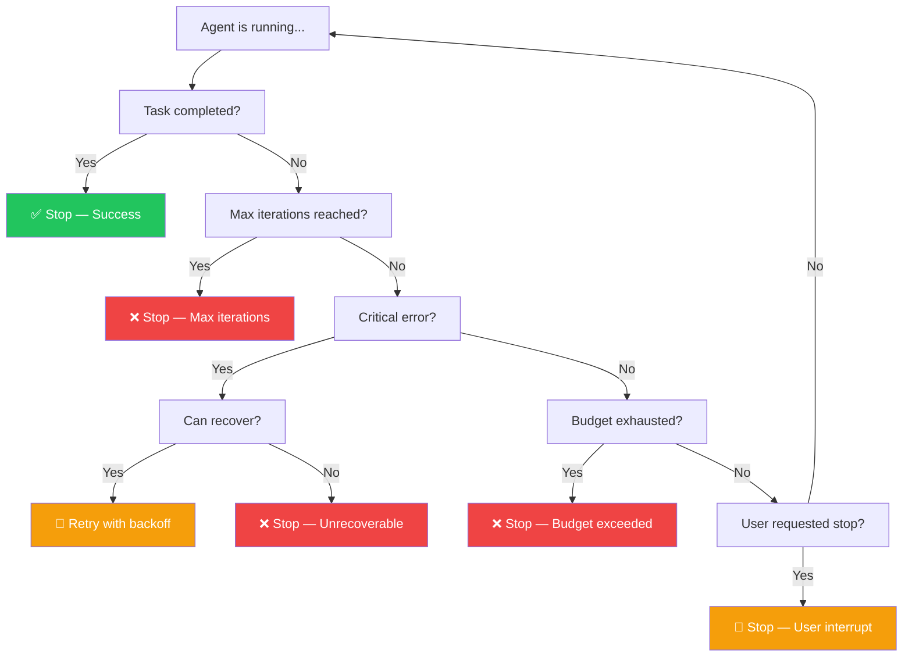

## Introduction

> **An AI Agent doesn't just respond once — it lives through a lifecycle: perceive, plan, act, observe, reflect, and repeat until the goal is achieved.**

The Agent Lifecycle is the fundamental execution model that powers every AI Agent, from simple research assistants to complex autonomous coding systems. Understanding this lifecycle is essential for building, debugging, and improving agent systems.

---

## Why This Exists

### The Problem: Single Responses Are Not Enough

An LLM generates one response and stops. If the first response is wrong, the LLM doesn't know, doesn't care, and doesn't try again. For complex tasks, a single attempt almost never succeeds — especially when interacting with external systems.

### What the Lifecycle Enables

1. **Iterative improvement** — Agents try, fail, learn, and try again with better information
2. **Error recovery** — If a tool call fails, the agent can retry or choose a different approach
3. **Long-running tasks** — Agents can work for minutes, hours, or days on complex goals
4. **Adaptability** — If the environment changes mid-task, the agent adapts its plan

---

## Real-World Analogy

### The Software Developer's Day

A software developer doesn't write an entire app in one shot. They:

1. **Plan** — Understand the requirements, break them into tasks
2. **Code** — Write the first function
3. **Test** — Run the code, see if it works
4. **Debug** — If it fails, fix the issue
5. **Repeat** — Move to the next function
6. **Deploy** — When everything works, ship it

The Agent Lifecycle is exactly this pattern, automated. The agent plans, acts, checks results, adjusts, and repeats — just like a human developer working through a task.

---

## The 7 Stages of the Agent Lifecycle

---

## Stage Details

```mermaid
flowchart LR
    subgraph S1["Stage 1: Goal Reception"]
        G1["User gives goal"]
        G2["Parse requirements"]
        G3["Validate feasibility"]
    end

    subgraph S2["Stage 2: Planning"]
        P1["Decompose into steps"]
        P2["Order steps"]
        P3["Identify dependencies"]
    end

    subgraph S3["Stage 3: Reasoning"]
        R1["Analyze current state"]
        R2["Decide next action"]
        R3["Select strategy"]
    end

    subgraph S4["Stage 4: Tool Selection"]
        T1["Choose tool"]
        T2["Set parameters"]
        T3["Validate input"]
    end

    subgraph S5["Stage 5: Action"]
        A1["Execute tool"]
        A2["Wait for result"]
        A3["Handle timeout"]
    end

    subgraph S6["Stage 6: Observation"]
        O1["Collect output"]
        O2["Parse result"]
        O3["Check for errors"]
    end

    subgraph S7["Stage 7: Reflection"]
        F1["Evaluate outcome"]
        F2["Decide next: continue / retry / ask help"]
        F3["Update state & memory"]
    end

    S1 --> S2 --> S3 --> S4 --> S5 --> S6 --> S7
    S7 -->|"Continue"| S3
    S7 -->|"Done"| DONE["✅ Complete"]

    style S1 fill:#3b82f6,color:#fff
    style S2 fill:#8b5cf6,color:#fff
    style S3 fill:#f59e0b,color:#fff
    style S4 fill:#22c55e,color:#fff
    style S5 fill:#ef4444,color:#fff
    style S6 fill:#6366f1,color:#fff
    style S7 fill:#ec4899,color:#fff
```

---

## Lifecycle in Practice: Booking a Flight

| Stage | What Happens |
|-------|-------------|
| **Goal** | "Book a round-trip flight from New York to London, June 15-22, under $800" |
| **Plan** | 1. Search flights → 2. Compare options → 3. Select best → 4. Book → 5. Confirm |
| **Reason** | "Start with step 1. Use the flight search API." |
| **Tool** | Select `flight_search_tool` with params: origin=JFK, destination=LHR, dates=June 15-22 |
| **Action** | API call to flight search service |
| **Observe** | Returned 25 flights, prices ranging $450-$1200 |
| **Reflect** | "Good results. Filter by under $800. Proceed to step 2: compare." |
| **Repeat** | ... until ticket is booked and confirmed |

---

## Stopping Conditions

Not every lifecycle runs to completion. Agents need clear rules for when to stop:

---

## Best Practices

1. **Always set max iterations** — Start with 10, increase if tasks are more complex. Never let an agent run indefinitely.
2. **Log every stage** — Record each plan step, tool call, observation, and reflection for debugging.
3. **Implement timeouts per stage** — A tool call should timeout after 30 seconds, not block the entire agent.
4. **Save intermediate state** — If the agent crashes mid-task, it should be able to resume from the last checkpoint.
5. **Design for human interruption** — Users should be able to pause, modify, or cancel tasks at any stage.

---

## Common Mistakes

| Mistake | Impact | Fix |
|---------|--------|-----|
| **No iteration limit** | Agent runs forever, costs explode | Always set max 10-25 iterations |
| **Skipping reflection** | Agent repeats the same failed action | Add reflection step after every action |
| **No error recovery** | One failed tool call kills the whole task | Add retry logic with exponential backoff |
| **Ignoring intermediate state** | Agent loses progress on crash | Persist state after each action |
| **Planning too rigidly** | Agent can't adapt to unexpected results | Re-plan every 3-5 iterations |

---

## Interview Questions

### Easy

**Q: What is the Agent Lifecycle?**

> The Agent Lifecycle is the process an AI Agent follows to complete a task: receive a goal, plan the steps, reason about what to do next, select and execute a tool, observe the results, reflect on whether the goal is achieved, and repeat until done.

**Q: Why can't an LLM use the Agent Lifecycle?**

> An LLM generates one response and stops. It has no built-in loop, no ability to execute tools, no mechanism to observe results, and no way to reflect and retry. The Agent Lifecycle requires orchestration infrastructure that an LLM alone doesn't have.

### Intermediate

**Q: Explain the difference between planning and reflection in the agent lifecycle.**

> **Planning** happens at the beginning — the agent breaks the goal into high-level steps. **Reflection** happens after each action — the agent evaluates the result and decides whether to continue, retry, or change approach. Planning is "what should I do?" Reflection is "how did that go, and what should I do differently?"

### Senior

**Q: How would you handle an agent that gets stuck in a loop during the lifecycle?**

> Implement three safeguards: (1) **Loop detection** — If the same action produces the same result 3 times, break the loop. (2) **Plan diversity** — If step 1 fails, the reflection step should force a different approach, not retry the same thing. (3) **Escalation** — After 3 loop break attempts, ask a human for help. Log the loop pattern for debugging.

### Staff Engineer

**Q: Design a lifecycle system that can handle 10,000 concurrent agent tasks.**

> Use a **queue-based architecture**: Each task is a message in a task queue (RabbitMQ/SQS). Worker processes pick up tasks, execute one lifecycle iteration, persist the state, and put the task back in the queue if not complete. This allows horizontal scaling of workers. Use a separate timing queue (Redis sorted set) for tasks waiting on time-based conditions. This way, 10K concurrent tasks use ~100 workers with efficient resource utilization.

### Architecture

**Q: Design an agent lifecycle for a financial trading agent that must be ultra-reliable and auditable.**

> **Pre-action**: Every action requires LLM approval + rule check (doesn't violate trading rules). **Immutable log**: Every lifecycle stage is logged to an append-only database. **Checkpoints**: State saved after every action. **Circuit breaker**: If 3 consecutive trades lose money, pause the agent and alert a human. **Audit**: Full lifecycle trace available for every trade: goal → plan → reason → action → observation → reflection. **Rollback**: If a trade is identified as erroneous, the agent can reverse it within 5 seconds.

---

## Summary

| Stage | Purpose | Key Question |
|-------|---------|-------------|
| **Goal** | Define what to accomplish | "What needs to be done?" |
| **Plan** | Break into steps | "How do I achieve this?" |
| **Reason** | Decide next action | "What should I do now?" |
| **Tool** | Select the right tool | "Which tool should I use?" |
| **Act** | Execute the action | "Run the tool" |
| **Observe** | Collect results | "What happened?" |
| **Reflect** | Evaluate & adjust | "Did it work? What next?" |

---

## Navigation

**Previous:** [02 — AI Agent vs Large Language Model](/ai/phase-06-ai-agents/02-agent-vs-llm)

**Next:** [04 — Planning & Reasoning](/ai/phase-06-ai-agents/04-planning-and-reasoning)
