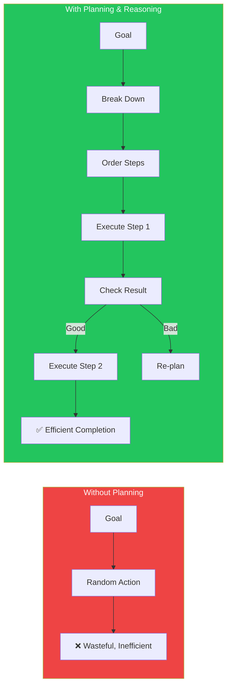
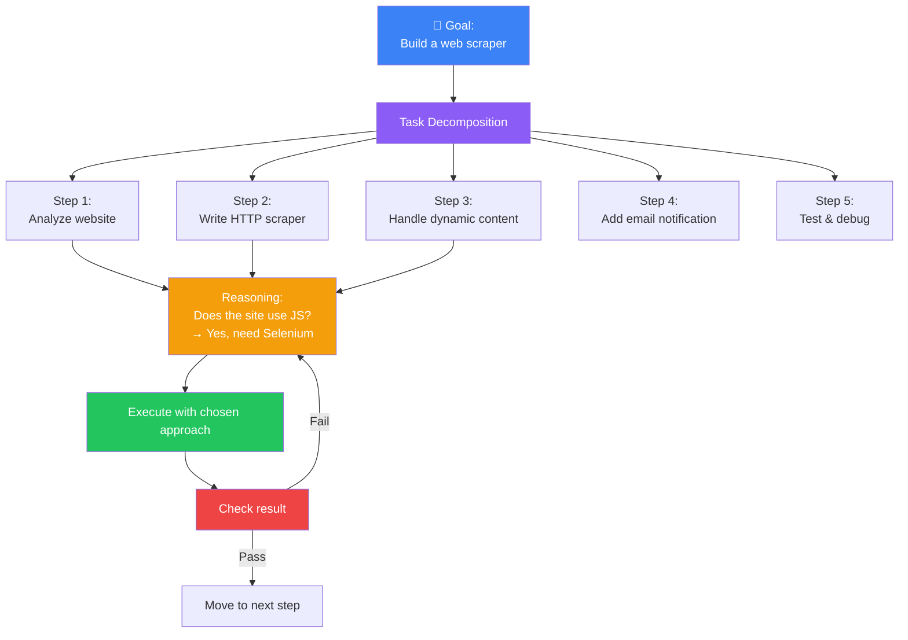
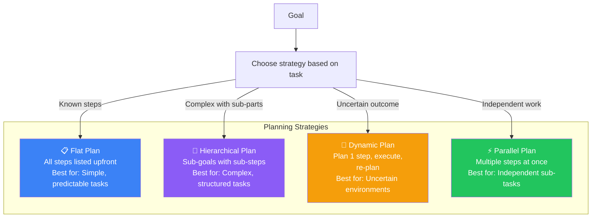
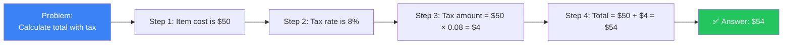
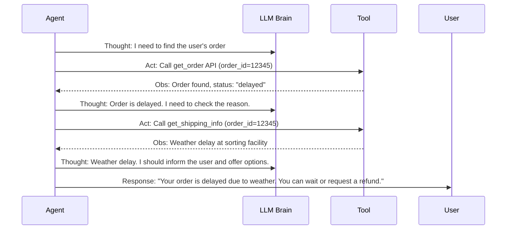
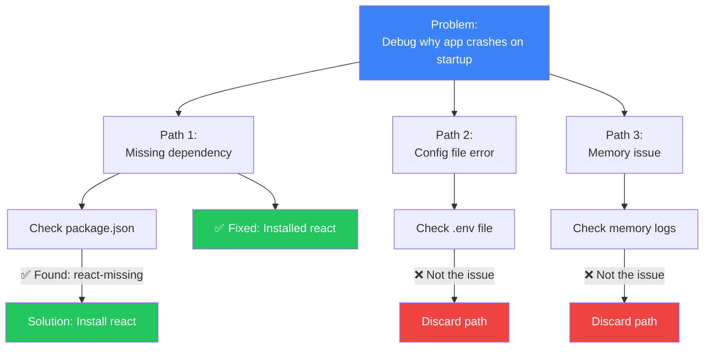
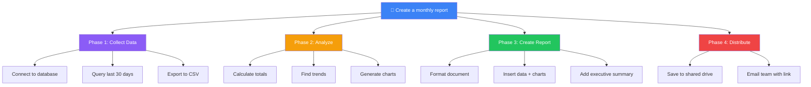

## Introduction

> **Planning gives an agent direction. Reasoning gives an agent intelligence. Together, they transform a raw goal into a structured, executable sequence of actions.**

An agent without planning is reactive — it responds to immediate stimuli without considering the bigger picture. An agent without reasoning is mechanical — it follows steps blindly without understanding why. This document teaches you how agents think ahead and adapt their thinking as they work.

---

## Why This Exists

### The Problem: LLMs Don't Plan

When you ask an LLM "Write a Python script to scrape a website and email me the results," it will generate the code in one shot. But the code will likely have bugs, missing imports, wrong API endpoints, or logic errors. The LLM doesn't check its work, doesn't test the code, and doesn't iterate.

An Agent with planning and reasoning:
1. **Decomposes** "Write a scraping script" into sub-tasks: research website structure, write scraper, add email logic, test, fix bugs
2. **Reasons** about each step: "The site uses JavaScript rendering, so I need Selenium, not requests"
3. **Adapts** when things go wrong: "The selector I tried returned empty — let me try a different CSS selector"

---

## Real-World Analogy

### The Architect and the Builder

Imagine building a house. An **architect** creates the blueprint (planning). The **builder** follows the blueprint but makes decisions when unexpected issues arise (reasoning).

- **Planning** is the architect: "First, pour the foundation. Then frame the walls. Then install electrical. Then drywall. Then paint."
- **Reasoning** is the builder: "The electrical wire gauge specified is out of stock. The 14-gauge wire I have is rated for 15 amps, which exceeds the 12-amp requirement. I'll use it, and notify the architect."

An AI Agent combines both roles: it creates the blueprint (plan) and adapts when reality doesn't match the plan (reasoning).

---

## Planning Strategies

| Strategy | Description | When to Use |
|----------|-------------|-------------|
| **Flat Plan** | All steps listed upfront in order | Simple tasks with known steps (e.g., "Send an email") |
| **Hierarchical** | Top-level goals broken into sub-steps | Complex tasks with dependencies (e.g., "Build a web app") |
| **Dynamic** | Plan one step at a time | Uncertain environments (e.g., "Research a new topic") |
| **Parallel** | Execute independent steps simultaneously | Independent sub-tasks (e.g., "Search 5 websites") |

---

## Reasoning Patterns

### Chain of Thought (CoT)

The agent explains its reasoning step-by-step before acting.

### ReAct Pattern (Reasoning + Acting)

The most popular agent reasoning pattern. The agent interleaves reasoning and acting.

### Tree of Thoughts (ToT)

The agent explores multiple reasoning paths simultaneously.

---

## Task Decomposition

The most critical planning skill for agents is breaking a complex goal into manageable steps.

---

## Production Examples

| Product | Planning Strategy | Reasoning Pattern |
|---------|-----------------|-------------------|
| **Cursor** | Dynamic (re-plans per file edit) | ReAct (think → edit → check → repeat) |
| **Devin** | Hierarchical (epics → tasks → sub-tasks) | Chain of Thought + ToT for debugging |
| **Claude Desktop** | Dynamic (reacts to screen state) | ReAct (see → think → click → check) |
| **OpenAI Operator** | Dynamic (reacts to browser state) | ReAct (observe → reason → act) |
| **GitHub Copilot** | Flat (autocomplete next token) | None (pattern matching, not planning) |

---

## Best Practices

1. **Start with a high-level plan** — Decompose the goal into 3-7 major steps before executing anything
2. **Re-plan every 3-5 steps** — Don't rigidly follow the initial plan; adapt as new information arrives
3. **Use ReAct by default** — The interleaved reasoning + acting pattern works well for most agent tasks
4. **Limit decision branches** — Tree of Thoughts is powerful but expensive; limit to 2-3 branches
5. **Log the reasoning chain** — Save every thought for debugging and auditing agent behavior

---

## Common Mistakes

| Mistake | Impact | Fix |
|---------|--------|-----|
| **No planning** | Agent flails randomly, wastes tool calls | Always plan before executing |
| **Too much planning** | Agent spends minutes planning, never acting | Set a planning time budget (30 seconds max) |
| **No re-planning** | Agent follows an obsolete plan | Re-plan every time a step fails |
| **Over-thinking** | Agent reasons for too long without acting | Limit reasoning to 2-3 sentences per step |
| **Ignoring context** | Agent plans without considering past failures | Include failure history in the reasoning prompt |

---

## Interview Questions

### Easy

**Q: Why do Agents need planning?**

> Without planning, an agent would act randomly or only react to immediate inputs. Planning gives the agent direction, helps it avoid dead ends, and ensures all necessary steps are completed. It's the difference between wandering and navigating.

**Q: What is the ReAct pattern?**

> ReAct stands for Reasoning + Acting. The agent alternates between thinking about what to do (reasoning) and doing it (acting). It says "I think I need to check the database" → then checks the database → then "I see the data, now I need to analyze it" → then runs the analysis.

### Intermediate

**Q: Compare Chain of Thought and Tree of Thoughts.**

> Chain of Thought reasons in a single linear path: step 1 → step 2 → step 3. If step 2 is wrong, the entire chain is wrong. Tree of Thoughts explores multiple reasoning paths simultaneously: if path A fails, path B is already being explored. ToT is more robust but 3-5x more expensive in tokens. Use CoT for simple logic tasks, ToT for complex problem-solving where mistakes are costly.

### Senior

**Q: How would you design an agent that knows when to stop planning and start acting?**

> Set a **planning budget**: max 30 seconds or 3 LLM calls for planning, whichever comes first. The agent should produce a minimal viable plan (3-5 high-level steps) and start executing. After each step, the agent re-evaluates: "Do I need more planning now, or can I continue?" This is a dynamic trade-off — you want enough planning to avoid dead ends, but not so much that the agent never takes action.

### Staff Engineer

**Q: Design a planning system that degrades gracefully when the LLM can't produce a good plan.**

> **Tier 1** — LLM produces a full plan with 3+ steps. Execute normally. **Tier 2** — LLM produces a vague or incomplete plan (< 3 steps). Use a template-based plan: try the default approach for this task type from a plan library. **Tier 3** — LLM can't plan at all. Fall back to a simple reflex agent: try a single tool call, observe, repeat. **Escalation** — Report planning quality metrics so you can detect and fix systematic planning failures.

### Architecture

**Q: Design a planning system for an agent that manages cloud infrastructure (provisioning, deployments, scaling).**

> Use a **hierarchical planning** system with a **plan library**: (1) **Strategic planner** — High-level: "Deploy v2.0 to production." Creates a plan: Build → Test → Stage → Deploy → Monitor. (2) **Tactical planner** — Per phase: "Deploy phase" breaks into: Deploy database migration → Deploy backend → Deploy frontend → Verify health. (3) **Operational executor** — Per step: Executes individual commands, checks output, reports back. Each level has rollback plans pre-computed. If any step fails, the tactical planner decides: retry, rollback, or escalate.

---

## Summary

| Concept | Key Point |
|---------|-----------|
| **Planning** | Breaking a goal into ordered, executable steps |
| **Reasoning** | Thinking about what to do and why before acting |
| **ReAct** | Interleaved reasoning + acting — the standard agent pattern |
| **Chain of Thought** | Linear step-by-step reasoning |
| **Tree of Thoughts** | Parallel exploration of multiple reasoning paths |
| **Task Decomposition** | Breaking complex goals into manageable sub-tasks |
| **Dynamic Re-planning** | Adapting the plan as new information arrives |

---

## Navigation

**Previous:** [03 — Agent Lifecycle](/ai/phase-06-ai-agents/03-agent-lifecycle)

**Next:** [05 — Memory in AI Agents](/ai/phase-06-ai-agents/05-memory-in-ai-agents)
