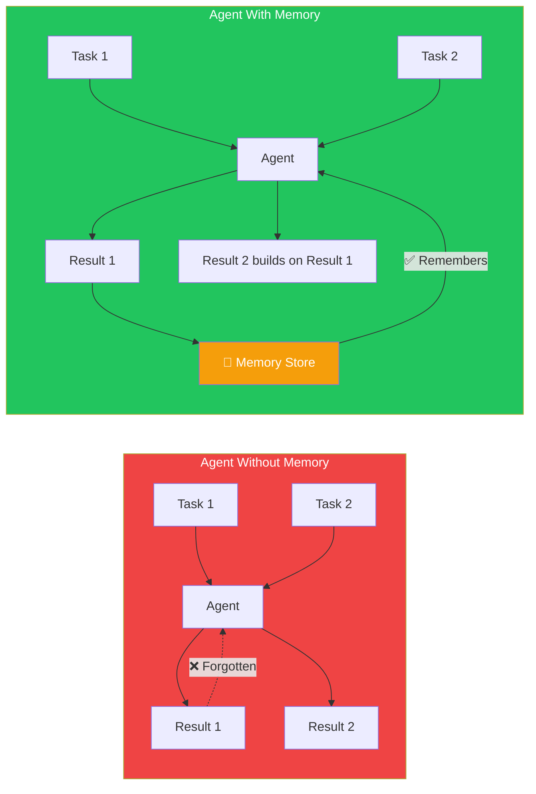
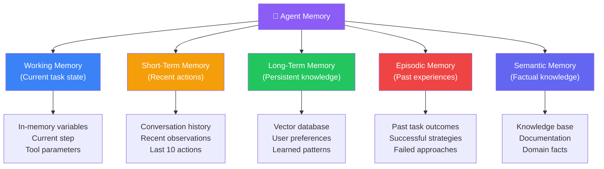
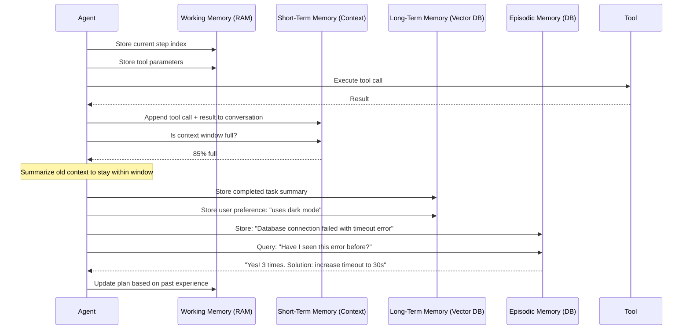
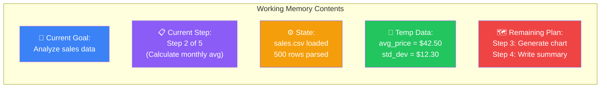
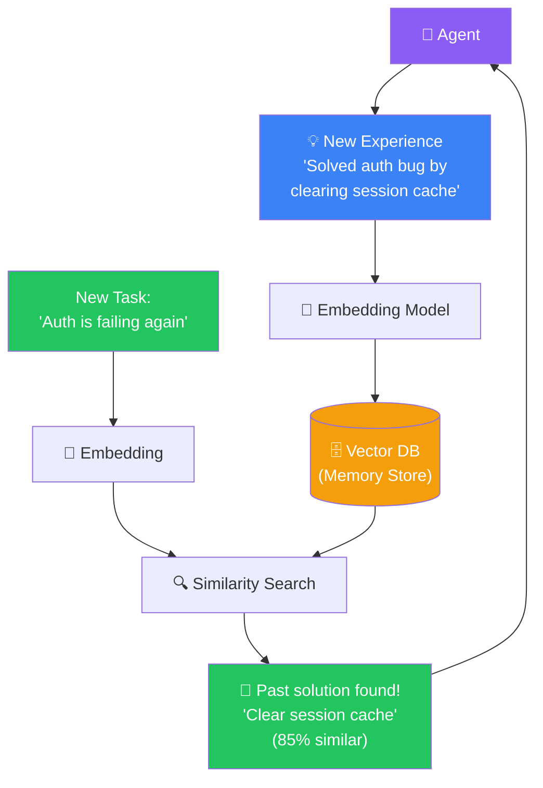

## Introduction

> **Memory is what separates a smart agent from an effective agent. Without memory, an agent repeats mistakes, forgets context, and cannot learn from experience.**

An LLM's context window is not memory. It's a scratch pad that resets completely after each conversation. Real agent memory persists across interactions, grows over time, and allows the agent to build on previous work.

---

## Why This Exists

### The Problem: LLMs Have No Persistent Memory

Every LLM call is stateless. You ask a question, the LLM answers, then the LLM forgets everything. The context window provides temporary memory for a single conversation, but once the conversation ends, the knowledge is gone.

For an AI Agent that works on complex, multi-step tasks:
- It needs to remember what it already tried
- It needs to remember results from previous tool calls
- It needs to recall information from hours, days, or weeks ago
- It needs to learn from past mistakes

### What Agent Memory Enables

1. **Continuity** — Agents can work on tasks that span hours or days
2. **Learning** — Agents improve over time by remembering what worked
3. **Efficiency** — Agents don't repeat failed approaches or re-fetch known information
4. **Personalization** — Agents can remember user preferences and adapt behavior

---

## Real-World Analogy

### The Project Manager's Notebook

A good project manager doesn't rely on memory alone. They keep:
- **A sticky note** (working memory) — What am I doing right now?
- **A daily log** (short-term memory) — What happened today?
- **A project archive** (long-term memory) — How did we solve this problem last time?
- **A team directory** (knowledge memory) — Who knows what?

An AI Agent needs the same types of memory. Each serves a different purpose and uses different storage mechanisms.

---

## Types of Agent Memory

### Memory Type Comparison

| Memory Type | Duration | Storage | Capacity | Example |
|-------------|----------|---------|----------|---------|
| **Working Memory** | Seconds to minutes | In-memory (RAM) | Very small (current 3-5 items) | Current file being edited |
| **Short-Term Memory** | Minutes to hours | Conversation context | LLM context window (~200K tokens) | Last 10 tool calls and results |
| **Long-Term Memory** | Days to permanent | Vector database | Millions of documents | All completed tasks |
| **Episodic Memory** | Permanent | Database with embeddings | Thousands of episodes | "The last time this error occurred..." |
| **Semantic Memory** | Permanent | Knowledge base | Structured facts | "The API rate limit is 100 req/min" |

---

## Agent Memory Architecture

---

## Working Memory

The agent's immediate consciousness — what it's doing right now.

**Implementation:** Working memory is simply the agent's current state — stored in program variables (agent.state.current_step, agent.state.last_result). It's lost if the agent process crashes, but it's fast and requires no database.

---

## Long-Term Memory with Vector Databases

The most important type of memory for sophisticated agents. The agent stores experiences, solutions, and knowledge in a vector database for future retrieval.

---

## Production Examples

| Product | Memory Type | How It Works |
|---------|-------------|-------------|
| **Cursor** | Short-term + working | Remembers files you've opened, code you've edited, errors in current session |
| **Claude Desktop** | Working + short-term | Remembers current task context, screen state, recent actions |
| **GitHub Copilot Chat** | Working | Only sees current file and recent conversation |
| **ChatGPT** | Short-term (per session) | Conversation history, resets per chat |
| **Devin** | Long-term (project-level) | Remembers entire project structure, past decisions, task history |

---

## Best Practices

1. **Use working memory for immediate state** — Store current step, parameters, and temporary results in RAM
2. **Use short-term memory for conversation context** — Keep the last N tool calls and observations in the LLM context window
3. **Use long-term memory for cross-session knowledge** — Store solutions, preferences, and learnings in a vector database
4. **Summarize old context** — When the context window fills up, summarize old messages instead of dropping them
5. **Index memory for fast retrieval** — Every memory entry should have tags or embeddings for efficient search

---

## Common Mistakes

| Mistake | Impact | Fix |
|---------|--------|-----|
| **Relying only on context window** | Memory lost when context fills or session ends | Use vector DB for persistent memory |
| **Storing everything** | Memory becomes noisy, retrieval quality drops | Only store important facts, not every tool call |
| **No memory consolidation** | Same fact stored 50 times with slight variations | Deduplicate and merge related memories |
| **Not pruning old memories** | Memory store grows unbounded | Implement TTL and archive old entries |
| **No memory retrieval strategy** | Agent can't find relevant past experience | Use semantic search + recency boost |

---

## Interview Questions

### Easy

**Q: Why does an LLM need Agent memory? Isn't the context window enough?**

> The context window is temporary and limited. It resets when the session ends. Agent memory persists across sessions, grows over time, and allows the agent to learn from past experiences. The context window is like a whiteboard; agent memory is like a filing cabinet.

**Q: What's the difference between short-term and long-term memory in agents?**

> Short-term memory is the current conversation — recent tool calls, observations, and reasoning steps. It's stored in the LLM context window. Long-term memory is persistent knowledge stored in a database — past solutions, user preferences, and learned patterns that survive across sessions.

### Intermediate

**Q: How would you implement memory for an agent that manages a user's calendar?**

> **Working memory**: Current event being created, parameters being collected. **Short-term**: Last 5 commands and results (for correcting mistakes). **Long-term**: User's preferences (meeting duration, working hours, time zone), past scheduling patterns, blocked times. Store long-term memory in a vector DB with tags like "preference", "schedule", "recurring-event" for fast retrieval.

### Senior

**Q: Design a memory system that doesn't exceed the LLM's context window while preserving important information.**

> Use a **sliding window with summarization**: Keep the last 5 tool calls and observations in full detail. Everything older than that is summarized into a condensed format: "Previously: searched for flights, found 3 options under $500, attempted to book but payment API returned error." When the summary gets too long, summarize the summary. This ensures the agent always has detailed recent context and condensed historical context.

### Staff Engineer

**Q: How do you handle conflicting memories? E.g., the agent learned "use API v2" yesterday but "use API v3" today.**

> Implement a **recency-weighted confidence score**: New memories start with confidence 1.0, decaying by 0.1 per day. When retrieving, sort by (similarity × 0.7 + confidence × 0.3). If a memory older than 30 days conflicts with a newer one, the newer one wins. If two memories from the same day conflict, ask the agent to reconcile: "You remember both X and Y. Which is correct based on current evidence?"

### Architecture

**Q: Design a memory architecture for an agent that handles 1000+ concurrent users with personalized preferences.**

> **Per-user vector DB collection** — Each user gets their own collection in Qdrant/Pinecone. **Memory types** — Working (Redis): current task state per user. Short-term (Redis list): last 20 interactions per user. Long-term (Vector DB): user preferences, past tasks, learned patterns. **TTL** — Working memory: 1 hour. Short-term: 24 hours. Long-term: permanent with archival after 90 days. **Scaling** — Redis cluster for working/short-term. Sharded vector DB for long-term. Each shard handles 250 users.

---

## Summary

| Memory Type | Duration | Storage | Best For |
|-------------|----------|---------|----------|
| **Working** | Seconds | RAM | Current task state |
| **Short-term** | Minutes/hours | Context window | Recent tools calls |
| **Long-term** | Days/permanent | Vector DB | Persistent knowledge |
| **Episodic** | Permanent | DB + embeddings | Past experiences |
| **Semantic** | Permanent | Knowledge base | Facts and rules |

---

## Navigation

**Previous:** [04 — Planning & Reasoning](/ai/phase-06-ai-agents/04-planning-and-reasoning)

**Next:** [06 — Tool Usage](/ai/phase-06-ai-agents/06-tool-usage)
