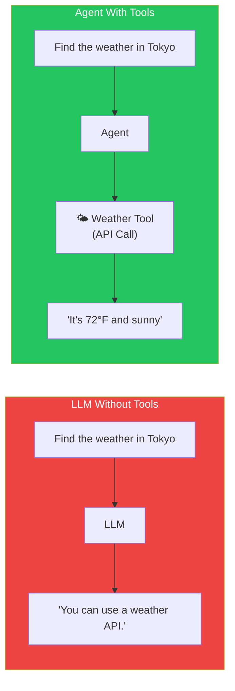
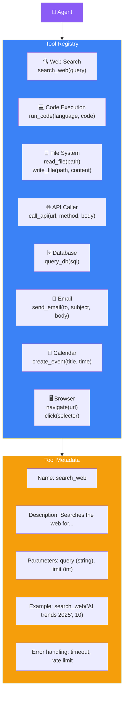
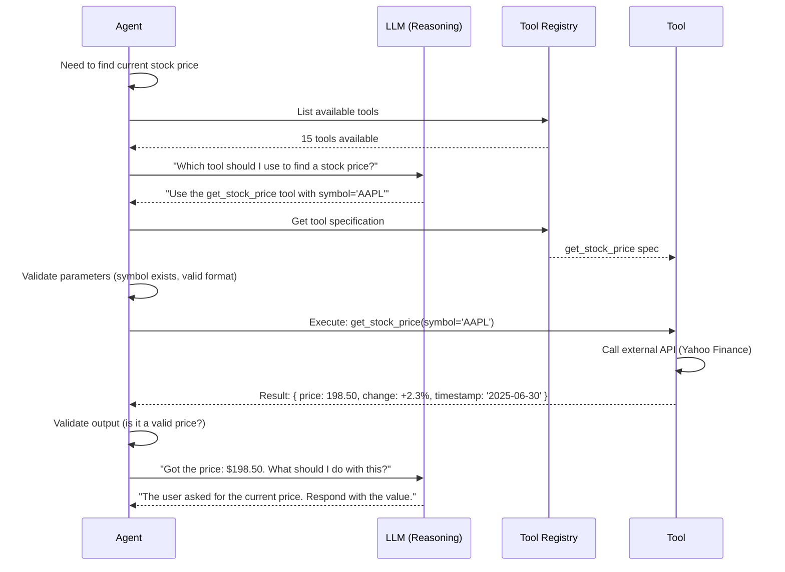
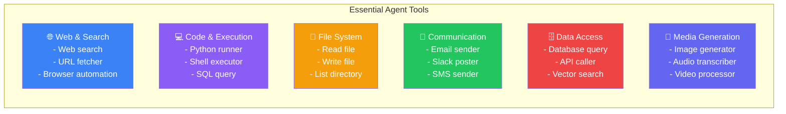
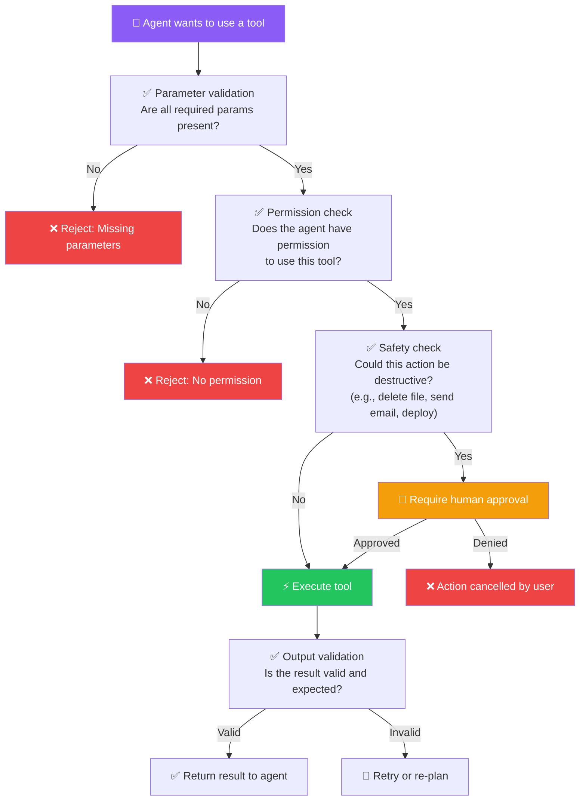

## Introduction

> **Tools are what transform an AI from a thinker into a doer. Without tools, an agent can only generate text. With tools, an agent can change the world.**

An LLM can write Python code. An agent with a Python tool can **run** that code. An LLM can describe a website. An agent with a browser tool can **navigate** to that website. Tools bridge the gap between intelligence and action.



---

## Why This Exists

### The Problem: LLMs Cannot Interact with the World

LLMs are trained on text. They can describe how to do things, but they cannot actually **do** things. They cannot:
- Read files from your computer
- Make API calls to external services
- Execute code and see if it works
- Search the web for current information
- Send emails or messages
- Control a web browser

### What Tool Usage Enables

1. **Real-world interaction** — Agents can read, write, create, and modify things in the real world
2. **Current information** — Agents can search the web, query databases, and check APIs for up-to-date data
3. **Action execution** — Agents can run code, deploy applications, and control systems
4. **Verification** — Agents can test their own work by running code and checking results

---

## Real-World Analogy

### The Surgeon's Instruments

A surgeon without tools is just a knowledgeable person. They know exactly what needs to be done, but they can't do it. Give them a scalpel, forceps, and a retractor — now they can perform surgery.

An LLM is the surgeon's knowledge. Tools are the surgeon's instruments. The agent is the surgeon's hands, choosing the right instrument for each step of the procedure.

- **Scalpel** → Code execution (precise, sharp, cuts to the core)
- **Forceps** → Web search (grasps information from the web)
- **Retractor** → File reader (holds things open for examination)
- **Needle driver** → API caller (connects things together)

---

## Tool Registry Architecture



### Tool Definition Example

Every tool in the registry needs clear documentation so the LLM can choose the right one:

```json
{
  "name": "search_web",
  "description": "Search the web for information. Returns a list of results with titles, snippets, and URLs.",
  "parameters": {
    "query": {
      "type": "string",
      "description": "The search query"
    },
    "max_results": {
      "type": "integer",
      "description": "Maximum results to return (1-20)",
      "default": 5
    }
  },
  "example": "search_web('latest AI research papers', 10)",
  "error_handling": "Rate limited: wait 1s and retry. Timeout: return partial results."
}
```

---

## Tool Selection Process



---

## Common Tools for AI Agents



---

## Production Examples

| Product | Key Tools | How Tools Are Used |
|---------|-----------|-------------------|
| **Cursor** | Code execution, terminal, file system, git | Writes code, runs it, checks errors, fixes them |
| **Claude Desktop** | Browser, file system, mouse/keyboard, terminal | Controls the computer like a human would |
| **OpenAI Operator** | Browser, form filling, payment | Completes web-based tasks like booking, shopping |
| **Devin** | Code execution, terminal, file system, browser, git, deployment | Writes, tests, deploys, and debugs entire applications |
| **GitHub Copilot** | Code completion, file system | Suggests code completions based on file context |

---

## Tool Safety & Validation



---

## Best Practices

1. **Keep tool descriptions clear** — The LLM chooses tools based on descriptions. Vague descriptions lead to wrong tool selection.
2. **Start with 5-8 tools** — Too many tools overwhelm the LLM's ability to choose correctly. Add more as needed.
3. **Validate before executing** — Check parameter types, ranges, and required fields before calling external APIs.
4. **Handle errors gracefully** — Every tool call should have timeout, retry, and fallback logic.
5. **Log every tool call** — Record tool name, parameters, result, and duration for debugging and cost tracking.

---

## Common Mistakes

| Mistake | Impact | Fix |
|---------|--------|-----|
| **Too many tools** | LLM chooses wrong tool, wastes calls | Start with 5-8, expand gradually |
| **Poor tool descriptions** | LLM doesn't understand when to use a tool | Write clear, test tool selection with prompts |
| **No timeout** | Tool hangs, agent blocks forever | Set 30s timeout on all tool calls |
| **No input validation** | Agent sends garbage params → API errors | Validate before every tool execution |
| **No output validation** | Agent trusts bad tool output | Parse and validate tool results |
| **Unlimited destructive tools** | Agent deletes files, sends emails by accident | Require human approval for destructive actions |

---

## Interview Questions

### Easy

**Q: Why do Agents need tools?**

> LLMs can only generate text. Tools allow agents to interact with the real world — read files, execute code, search the web, call APIs, and send messages. Without tools, an agent is just an LLM with a fancy name.

**Q: What's the difference between tool calling and function calling?**

> Tool calling and function calling are essentially the same concept. The LLM outputs a structured JSON specifying which tool/function to call and what parameters to use. The agent then executes that function and returns the result to the LLM.

### Intermediate

**Q: How does an LLM know which tool to use?**

> Every tool in the registry has a name, description, and parameter schema. When the agent sends a prompt to the LLM, it includes all tool definitions. The LLM reasons about the task and selects the most appropriate tool. The tool descriptions are crucial — vague descriptions lead to wrong choices.

### Senior

**Q: Design a tool validation system for a code execution tool that prevents security vulnerabilities.**

> **Static checks**: Scan code for dangerous imports (os.system, subprocess, eval, exec), file system access outside allowed directories, network calls to unauthorized domains. **Runtime sandboxing**: Execute in a Docker container with no network access, limited memory (512MB), limited CPU (1 core), and a 30-second timeout. **Output filtering**: Strip any sensitive information from stdout/stderr. **Rate limiting**: Max 10 executions per minute per user. **Audit log**: Log every code execution with user, code hash, and result.

### Staff Engineer

**Q: How would you design a tool-caching system to reduce costs? Some tool results are deterministic (e.g., reading the same file).**

> **Deterministic tools** (read_file, get_weather): Cache results with a TTL based on how often data changes. read_file: cache for 60 seconds. get_weather: cache for 5 minutes. **Idempotent tools** (search, query): Cache results with query hash as key. TTL: 1 hour. **Non-cacheable tools** (send_email, create_record): Never cache. **Cache strategy**: Redis with LRU eviction. Max 10,000 entries. Invalidate on file writes. This can reduce tool call costs by 40-60%.

### Architecture

**Q: Design a tool registry for an agent that needs 50+ tools. How do you prevent the LLM from getting overwhelmed?**

> **Hierarchical tool registry**: Group tools into categories (Web, Code, Data, Communication). The agent first selects a category, then the LLM sees only the tools in that category (5-8 tools at a time). **Auto-discovery**: Tools have usage statistics. Rarely used tools are hidden by default. **Dynamic prompting**: Only include tools relevant to the current task. If the task is "send an email", show email + calendar tools, not code execution tools. This keeps the prompt small and the LLM's choices focused.

---

## Summary

| Concept | Key Point |
|---------|-----------|
| **Tool Registry** | Catalog of all available tools with names, descriptions, and parameter schemas |
| **Tool Selection** | LLM chooses the right tool based on task and tool descriptions |
| **Execution** | Agent validates params, calls the tool, checks output |
| **Safety** | Validate inputs, require approval for destructive actions, log everything |
| **Caching** | Cache deterministic tool results to reduce costs |
| **Organization** | Group tools hierarchically to avoid overwhelming the LLM |

---

## Navigation

**Previous:** [05 — Memory in AI Agents](/ai/phase-06-ai-agents/05-memory-in-ai-agents)

**Next:** [07 — Agent Loop](/ai/phase-06-ai-agents/07-agent-loop)
