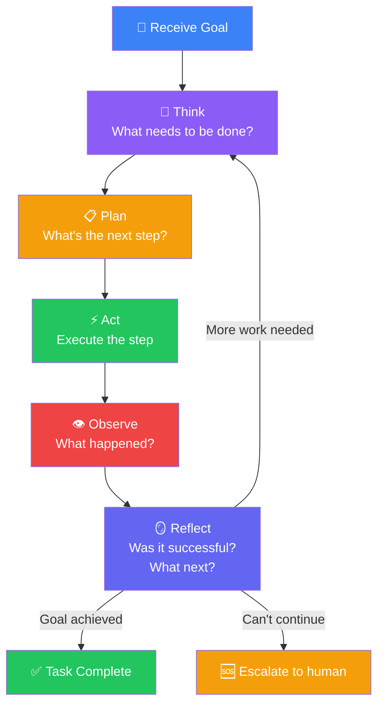
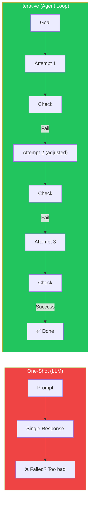
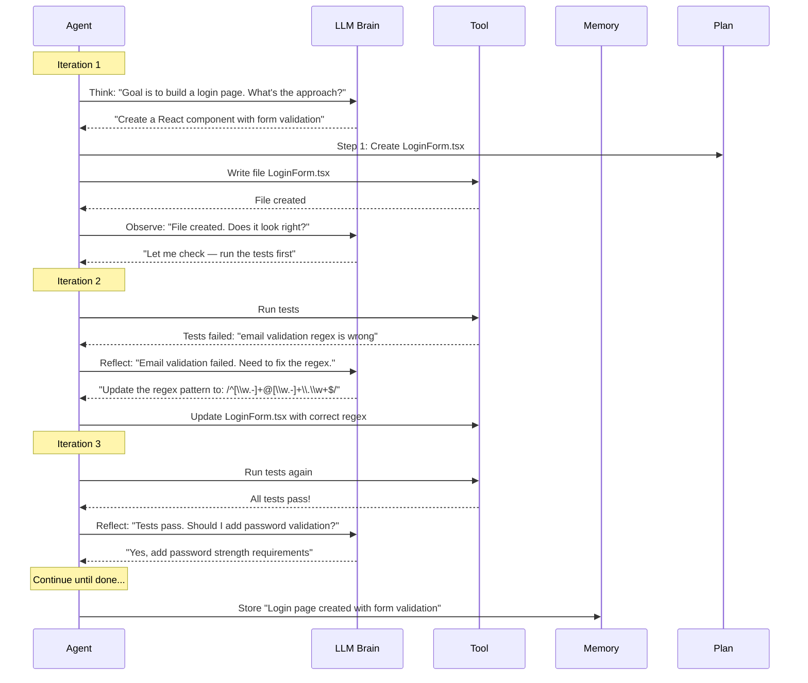
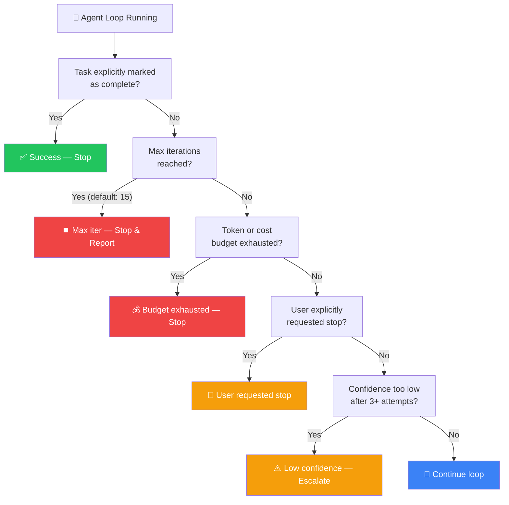
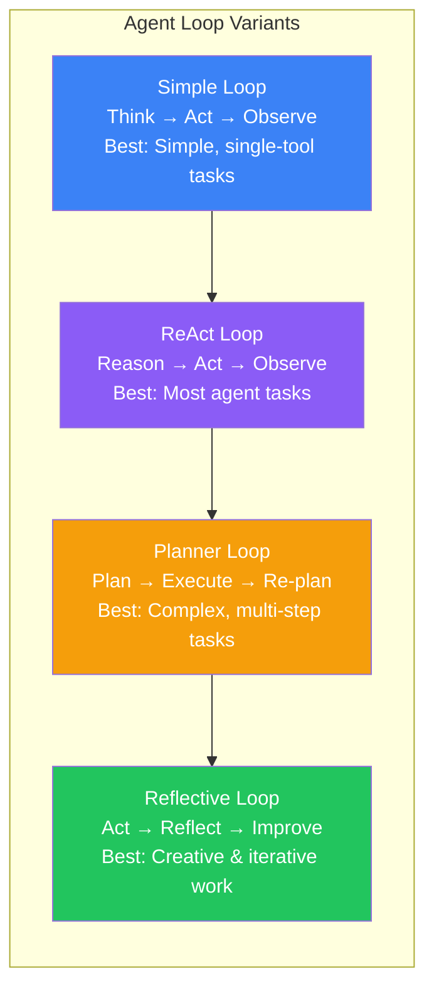

## Introduction

> **The Agent Loop is the heartbeat of every AI Agent. It's the cycle that turns a goal into action, action into observation, and observation into the next, better action.**

Everything you've learned so far — planning, reasoning, memory, tools — comes together in the Agent Loop. This is the runtime that orchestrates the agent's behavior, iteration after iteration, until the goal is achieved.



---

## Why This Exists

### The Problem: One-Shot Execution Rarely Works

In the real world, the first attempt at a task almost never succeeds perfectly. Code has bugs. APIs return errors. Search results don't contain what you expected. Plans based on incomplete information need revision.

The Agent Loop solves this by making iteration a first-class concept. Instead of trying to do everything perfectly in one shot, the agent tries, checks, adjusts, and tries again.



---

## Real-World Analogy

### The Scientist's Method

A scientist doesn't run one experiment and publish the result. They:

1. **Hypothesize** — "I think increasing temperature will speed up the reaction"
2. **Experiment** — Run the reaction at higher temperature
3. **Observe** — Measure the result
4. **Analyze** — "The reaction sped up by 20%, but produced unwanted byproducts"
5. **Refine** — "Let me try increasing temperature by half as much"
6. **Repeat** — Run the next experiment

The Agent Loop is the scientific method applied to task completion. Each iteration is an experiment. Each reflection is analysis. Each new attempt is a refined hypothesis.

---

## The Complete Agent Loop Cycle



---

## Loop Termination Conditions

The Agent Loop needs clear rules for when to stop. An agent that never stops will burn through your API budget and never deliver results.



---

## Implementing the Agent Loop

```python
# Simplified Agent Loop implementation

class AgentLoop:
    def __init__(self, llm, tool_registry, memory, max_iterations=15):
        self.llm = llm
        self.tools = tool_registry
        self.memory = memory
        self.max_iterations = max_iterations
        self.iteration = 0
        self.state = {"status": "initialized", "steps": []}

    async def run(self, goal: str):
        """Execute the agent loop until completion."""
        self.state["goal"] = goal
        
        while self.iteration < self.max_iterations:
            self.iteration += 1
            
            # 1. THINK — Understand current state and decide what to do
            thought = await self.llm.think(
                goal=goal,
                state=self.state,
                memory=self.memory.get_recent()
            )
            
            # Check if agent believes task is complete
            if thought.get("complete"):
                return {"status": "success", "result": thought.get("result")}
            
            # 2. PLAN — Determine the next action
            plan = await self.llm.plan(thought)
            
            # 3. ACT — Execute the chosen tool
            tool = self.tools.get(plan["tool"])
            if not tool:
                continue  # Invalid tool, try again
            
            result = await tool.execute(**plan["parameters"])
            
            # 4. OBSERVE — Collect results
            self.state["steps"].append({
                "iteration": self.iteration,
                "thought": thought,
                "action": plan,
                "result": result
            })
            
            # 5. REFLECT — Evaluate and decide next
            reflection = await self.llm.reflect(
                goal=goal,
                action_result=result,
                state=self.state
            )
            
            # Store in memory
            await self.memory.store(reflection)
            
            # Check stopping conditions
            if reflection.get("confidence") < 0.2 and self.iteration > 3:
                return {"status": "stuck", "message": "Confidence too low"}
        
        return {"status": "max_iterations", "message": f"Reached {self.max_iterations} iterations"}
```

---

## Loop Variants



| Variant | Pattern | Best For | Example |
|---------|---------|----------|---------|
| **Simple Loop** | Think → Act → Observe | Simple, single-tool tasks | "Translate this file to Spanish" |
| **ReAct Loop** | Reason → Act → Observe | Most agent tasks | "Research topic and write summary" |
| **Planner Loop** | Plan → Execute → Re-plan | Complex multi-step tasks | "Build a web application" |
| **Reflective Loop** | Act → Reflect → Improve | Creative, iterative work | "Design a logo, get feedback, refine" |

---

## Production Examples

| Product | Loop Type | Iterations per Task |
|---------|-----------|-------------------|
| **Cursor** | ReAct Loop | 5-20 (per file edit) |
| **Claude Desktop** | ReAct Loop | 10-50 (per computer use session) |
| **OpenAI Operator** | ReAct Loop | 10-30 (per web task) |
| **Devin** | Planner Loop | 50-500 (per software project) |
| **Manus** | Planner Loop | 20-100 (per complex workflow) |

---

## Best Practices

1. **Log every iteration** — Record thought, plan, action, observation, and reflection for every loop cycle
2. **Set a reasonable iteration limit** — 10-25 for most tasks, higher only for complex projects
3. **Implement backoff** — If the same action produces the same error, increase delay or change approach
4. **Allow human-in-the-loop** — Let users inspect the loop and modify plans mid-execution
5. **Save progress** — Store completed iterations so the agent can resume if interrupted

---

## Common Mistakes

| Mistake | Impact | Fix |
|---------|--------|-----|
| **No iteration limit** | Agent runs forever, costs explode | Always set max iterations |
| **No progress tracking** | Agent repeats the same failed action | Track which steps are done, detect loops |
| **Slow reflection** | Agent spends more time reflecting than acting | Limit reflection to 1-2 sentences |
| **No timeout** | One action blocks the entire loop | Set 30s timeout per tool call |
| **Losing state on error** | Agent restarts from scratch after crash | Persist state every iteration |

---

## Interview Questions

### Easy

**Q: What is the Agent Loop?**

> The Agent Loop is the cycle that an AI Agent follows to complete a task: Think about what needs to be done, Plan the next step, Act by executing a tool, Observe the result, Reflect on whether the goal is achieved, and Repeat until done.

**Q: Why is iteration important for AI Agents?**

> In the real world, the first attempt rarely succeeds perfectly. Code has bugs, APIs return errors, and plans based on incomplete information need revision. Iteration allows the agent to try, fail, learn from the failure, and try a better approach.

### Intermediate

**Q: How do you prevent an agent from getting stuck in an infinite loop?**

> Three safeguards: (1) **Hard limit** — Max 15-25 iterations, enforced at the loop level. (2) **Loop detection** — If the same tool with the same parameters produces the same result 3 times, break the loop. (3) **Variance tracking** — If the confidence or progress score hasn't improved in 5 iterations, escalate to a human.

### Senior

**Q: Design an Agent Loop that can handle tasks taking 30+ minutes.**

> Use a **persistent loop** with checkpointing. After every iteration, serialize the full state (current plan, completed steps, results, memory) to a database. If the agent crashes or is restarted, it deserializes the last checkpoint and resumes from there. Use a heartbeat mechanism: the agent sends a "still running" signal every 60 seconds. If no heartbeat for 5 minutes, alert the user. Store intermediate results so the user sees progress even for long-running tasks.

### Staff Engineer

**Q: How would you optimize the Agent Loop for cost? A single task currently costs $2.00 in API calls.**

> **Caching**: Cache deterministic tool calls (read_file, search with same query). Save 20%. **Batching**: Combine multiple small tool calls into one LLM prompt. Save 15%. **Model selection**: Use GPT-4o-mini for routine iterations (80% of loop), only use GPT-4o for complex reasoning (20% of loop). Save 40%. **Early stopping**: If the agent has > 90% confidence after 5 iterations, consider it done instead of running all 15. Save 25%. **Reflection compression**: Instead of storing full reflections, store 2-sentence summaries. Combined savings: 60-70%.

### Architecture

**Q: Design an Agent Loop system that supports 100,000 concurrent agent runs.**

> **Queue-based architecture**: Each agent run is a job in a persistent queue (RabbitMQ/Kafka). **Worker pool**: 500 worker processes pull jobs from the queue, execute one iteration, persist state, and either return the job to the queue (if not done) or push to results queue. **State store**: Redis cluster for active states, PostgreSQL for completed states. **Priority queue**: Simple tasks get higher priority, complex tasks lower priority. **Scaling**: Auto-scale workers based on queue depth. Target: queue depth < 10,000. **Monitoring**: Track iterations/sec, average task completion time, error rate per worker.

---

## Summary

| Stage | Purpose | Duration |
|-------|---------|----------|
| **Think** | Understand current state, decide next step | 1-2 seconds (LLM call) |
| **Plan** | Determine which tool and parameters to use | Included in Think |
| **Act** | Execute the tool call | 0.5-30 seconds |
| **Observe** | Collect and parse the result | < 100ms |
| **Reflect** | Evaluate success, decide next action | 1-2 seconds (LLM call) |
| **Repeat** | Continue until completion | 5-50 iterations typical |

---

## Navigation

**Previous:** [06 — Tool Usage](/ai/phase-06-ai-agents/06-tool-usage)

**Next:** [08 — Single Agent vs Multi-Agent Systems](/ai/phase-06-ai-agents/08-single-vs-multi-agent)
