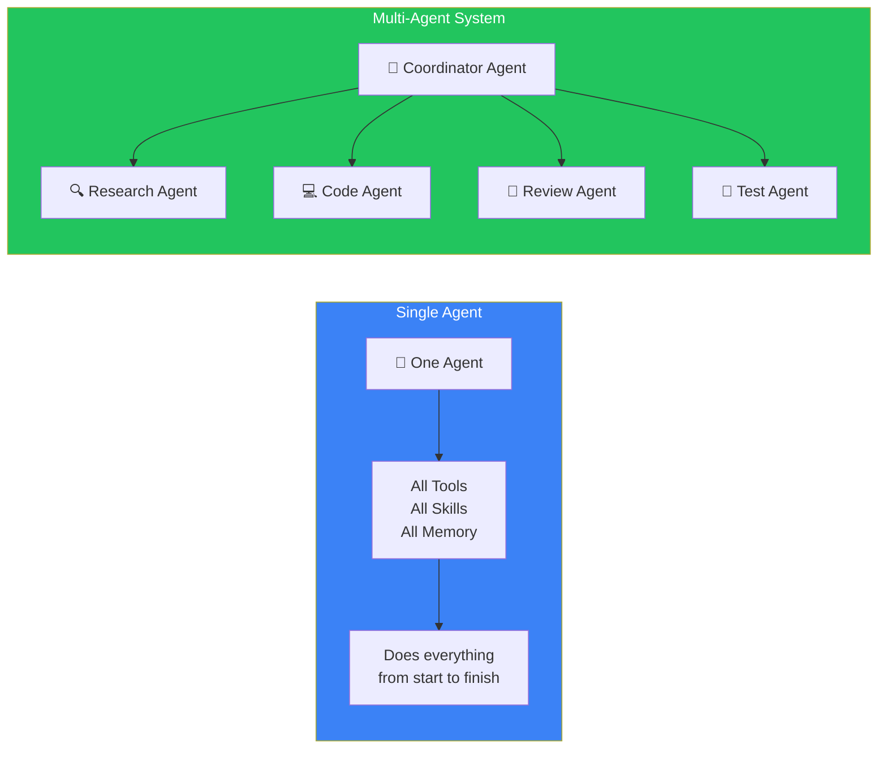
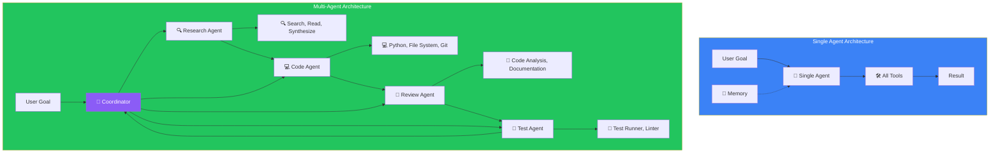
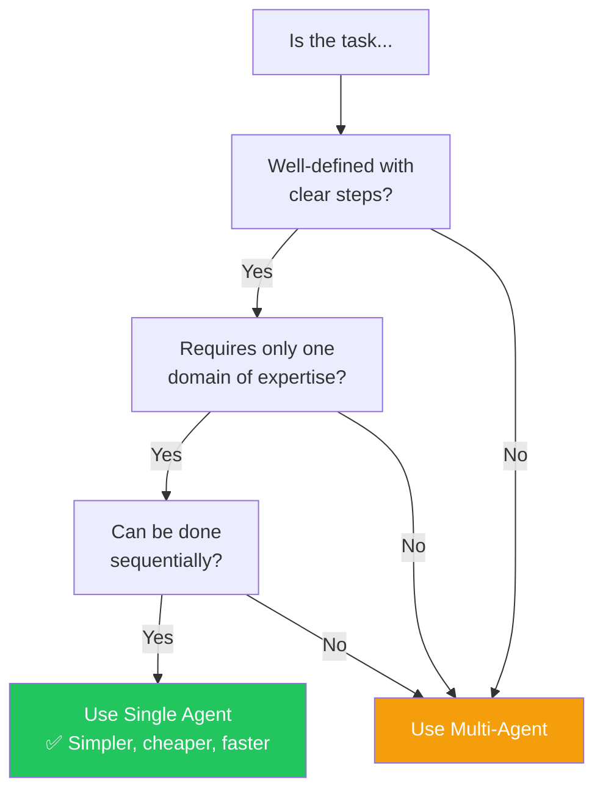
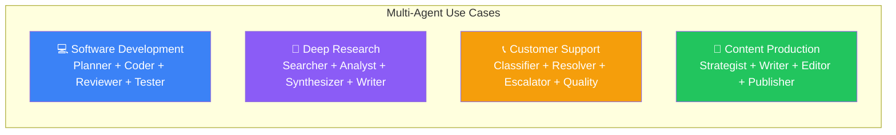
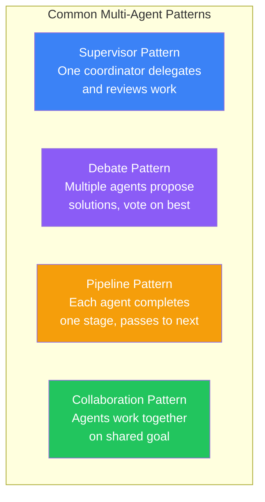
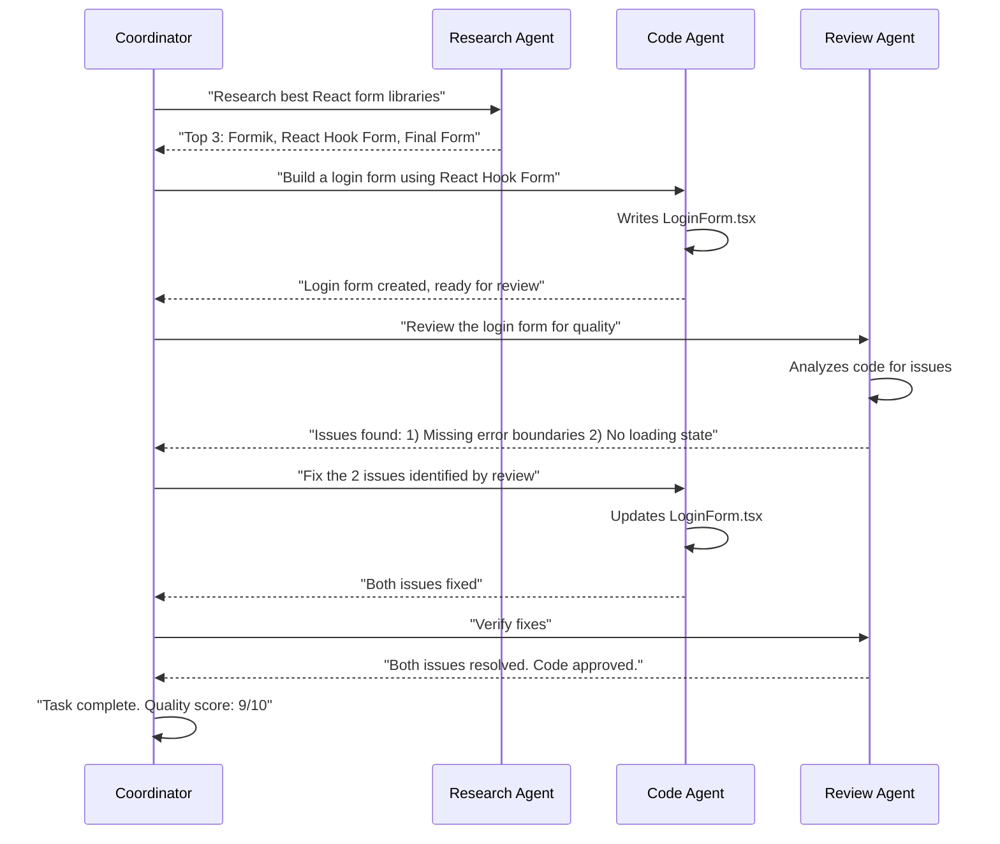

## Introduction

> **A single agent is a specialist. A multi-agent system is a team. The right choice depends on the complexity of the task and the diversity of skills needed.**

Should you build one agent that can do everything? Or multiple agents, each specialized in one area? This is one of the most important architectural decisions in agent design.

---

## Why This Choice Matters

### The Problem: One Agent vs Many

Building a single agent is simpler but has limits:
- **Context window contention** — One agent handles planning, research, coding, and debugging in the same context
- **Tool overload** — Too many tools in one registry confuse the agent
- **No specialization** — The same agent writes code and reviews code, reducing quality

Building multiple agents adds complexity but unlocks:
- **Specialization** — Each agent masters one domain
- **Parallel work** — Multiple agents work simultaneously
- **Quality control** — One agent writes, another reviews

---

## Real-World Analogy

### The Solo Developer vs A Development Team

A **solo developer** (single agent) works alone. They handle everything: requirements, design, coding, testing, deployment. This works for small projects but doesn't scale. The developer gets context-switched, makes mistakes because they review their own work, and can only do one thing at a time.

A **development team** (multi-agent) has specialists:
- **Product Manager** — Defines requirements (Planner agent)
- **Frontend Developer** — Builds the UI (Frontend agent)
- **Backend Developer** — Builds the API (Backend agent)
- **QA Engineer** — Tests everything (Reviewer agent)
- **DevOps Engineer** — Deploys (Operations agent)

The team completes complex projects faster and with higher quality because each member focuses on what they do best.

---

## Architecture Comparison

---

## Comparison Table

| Dimension | Single Agent | Multi-Agent System |
|-----------|-------------|-------------------|
| **Complexity** | Low — one agent, one context | High — coordination, communication overhead |
| **Cost** | Lower — one LLM per task | Higher — multiple LLM calls per task |
| **Speed** | Sequential — one thing at a time | Parallel — agents can work simultaneously |
| **Quality** | Limited by one perspective | Higher — review and validation by different agents |
| **Specialization** | Generalist — does everything | Specialist — each agent excels at one domain |
| **Scalability** | Limited by one agent's context | High — add more agents for more work |
| **Debugging** | Simple — trace one agent's decisions | Complex — trace inter-agent communication |
| **Best for** | Simple, well-defined tasks | Complex, multi-domain projects |

---

## When to Use Single Agent

### Good for Single Agent

- **Research and summarize** a topic
- **Translate** a document
- **Generate** a report from structured data
- **Format** and clean data
- **Send** an email or message
- **Answer** questions from a knowledge base

---

## When to Use Multi-Agent

### Good for Multi-Agent

### Multi-Agent Patterns

---

## Communication Between Agents

Multi-agent systems need protocols for agents to communicate.

---

## Production Examples

| Product | Architecture | Why Multiple Agents? |
|---------|-------------|---------------------|
| **Devin** | Multi-agent (Planner + Coder + Reviewer + Tester) | Software development needs specialized skills |
| **Microsoft Copilot** | Multi-agent (Orchestrator + multiple specialized agents) | Enterprise tasks span many domains |
| **ChatGPT Canvas** | Single agent (one model, one context) | Simple editing tasks |
| **OpenAI Operator** | Single agent (one model + browser tools) | Sequential web tasks |
| **Claude Desktop** | Single agent (one model + computer tools) | Direct computer interaction |

---

## Best Practices

1. **Start with a single agent** — Most tasks don't need multiple agents. Add complexity only when needed.
2. **Clear handoff protocols** — When agent A passes work to agent B, the handoff should include full context.
3. **Shared memory** — All agents should have access to a shared memory store so they don't duplicate work.
4. **Guard against infinite delegation** — Agent A asks Agent B, who asks Agent C, who asks Agent A... Set max delegation depth (3 levels).
5. **Log all inter-agent communication** — For debugging, you need to trace the full chain of communication.

---

## Common Mistakes

| Mistake | Impact | Fix |
|---------|--------|-----|
| **Over-engineering** | 5 agents for a simple Q&A task | Start with 1, add agents only when needed |
| **Poor handoff** | Agent B doesn't know what Agent A did | Include full context in each handoff |
| **No shared context** | Agents work with stale information | Use a shared memory store |
| **Delegation loops** | Infinite cycle of agent A → B → A | Set max 3 levels of delegation |
| **Redundant work** | Two agents research the same topic | Track progress in shared state |

---

## Interview Questions

### Easy

**Q: What's the difference between a single agent and a multi-agent system?**

> A single agent does everything itself — planning, research, coding, reviewing. A multi-agent system has multiple specialized agents — a researcher searches, a coder writes code, a reviewer checks quality — coordinated by a supervisor agent.

**Q: When would you choose a single agent over multiple agents?**

> For simple, well-defined tasks that require one domain of expertise and can be done sequentially. For example: "Translate this document to Spanish" is perfect for a single agent.

### Intermediate

**Q: How do agents in a multi-agent system communicate?**

> Through a shared message bus or coordinator. Agent A sends a message to the coordinator: "Task done, result: X." The coordinator forwards the result to Agent B with a new instruction: "Now use result X to do Y." Communication can be synchronous (wait for response) or asynchronous (queue-based). For complex systems, use a shared board where agents write results and read others' results.

### Senior

**Q: Design a multi-agent system that builds a web application from a user's description. How do you prevent conflicting code changes?**

> Use a **git workflow**: (1) **Planner Agent** creates a plan and branches. (2) **Frontend Agent** works on the UI branch. (3) **Backend Agent** works on API branch. (4) Each agent commits changes with descriptive messages. (5) **Integration Agent** merges branches, runs tests, resolves conflicts. (6) **Review Agent** verifies the merged code. If conflicts occur, the integration agent asks the conflicting agents to resolve them. This prevents overwrites and maintains code quality.

### Staff Engineer

**Q: How do you evaluate whether a multi-agent system is actually better than a single agent for a given task?**

> A/B test both architectures on the same task set. Measure: (1) **Task completion rate** — % of tasks fully completed. (2) **Quality score** — LLM-as-judge rating. (3) **Cost per task** — total API costs. (4) **Latency** — time to completion. (5) **Error rate** — % of tasks needing human intervention. If multi-agent doesn't improve completion rate by > 15% and quality by > 20%, the overhead isn't worth it. Most tasks see diminishing returns past 3 agents.

### Architecture

**Q: Design a multi-agent system for enterprise customer support with 100,000 tickets per day.**

> **Tiered architecture**: (1) **Classifier Agent** — Routes tickets to the right queue (billing, technical, account). One LLM call, < 1 second. (2) **Resolver Agents** — 5-10 specialized agents per domain. Each agent has domain-specific tools and knowledge base. Handles 80% of tickets autonomously. (3) **Escalation Agents** — For complex tickets, an escalation agent researches and prepares a summary for human agents. (4) **Quality Agent** — Samples 5% of resolved tickets and scores quality. **Scaling**: Auto-scale resolver agents based on queue depth. Target: 95% of tickets resolved within 5 minutes.

---

## Summary

| Concept | Key Point |
|---------|-----------|
| **Single Agent** | One agent does everything — simple, cheap, good for focused tasks |
| **Multi-Agent** | Multiple specialized agents — complex, expensive, good for multi-domain tasks |
| **When single** | Simple, sequential, one-domain tasks |
| **When multi** | Complex, parallel, multi-domain tasks needing quality review |
| **Patterns** | Supervisor, Debate, Pipeline, Collaboration |
| **Start small** | Always start with a single agent; add agents as needed |

---

## Navigation

**Previous:** [07 — Agent Loop](/ai/phase-06-ai-agents/07-agent-loop)

**Next:** [09 — Agent Design Patterns](/ai/phase-06-ai-agents/09-agent-design-patterns)
