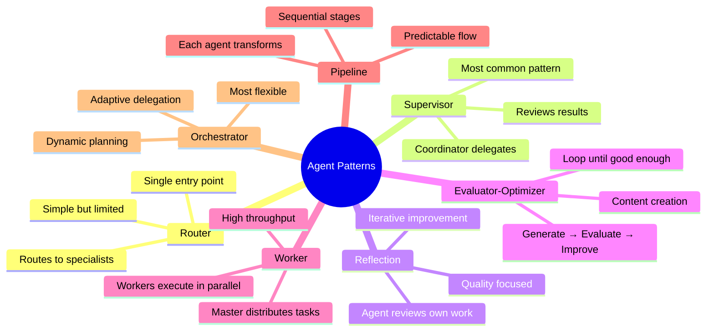
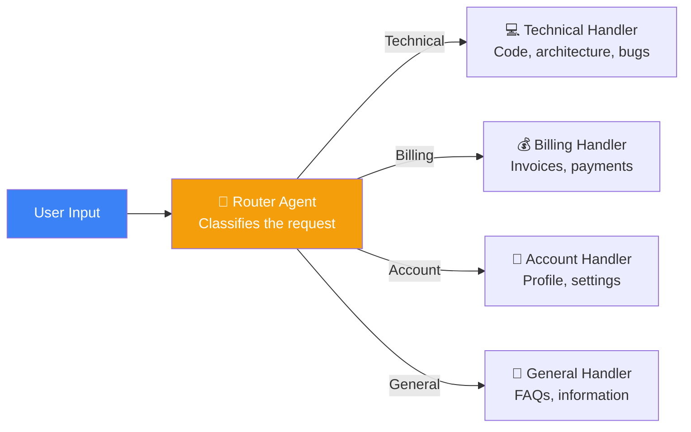
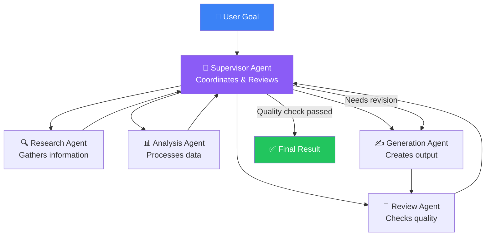
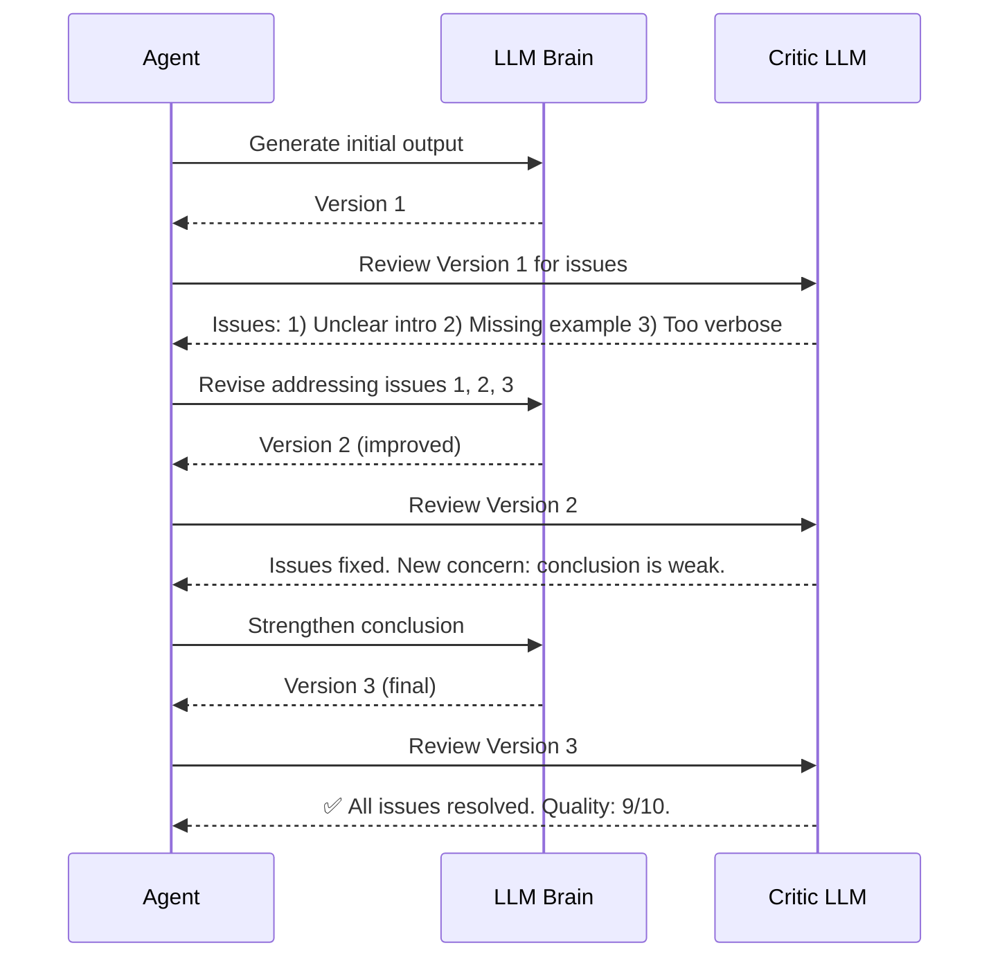
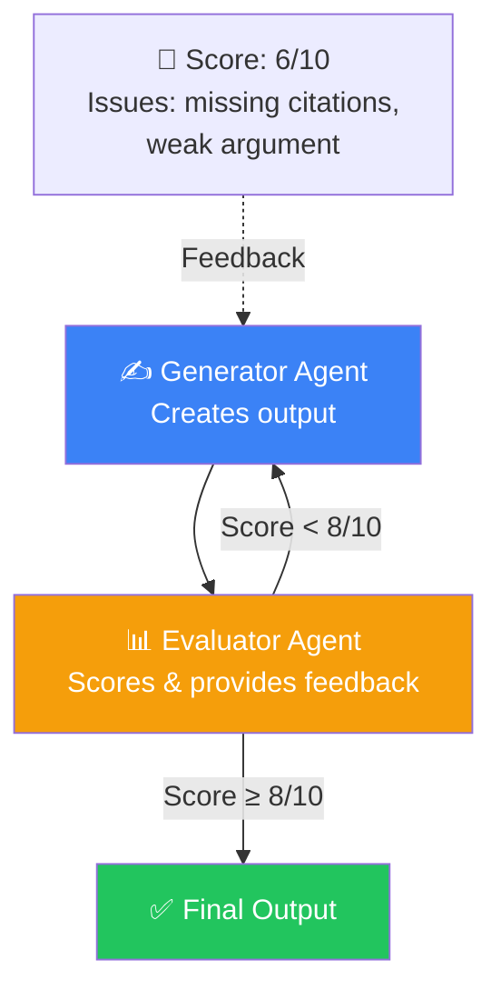
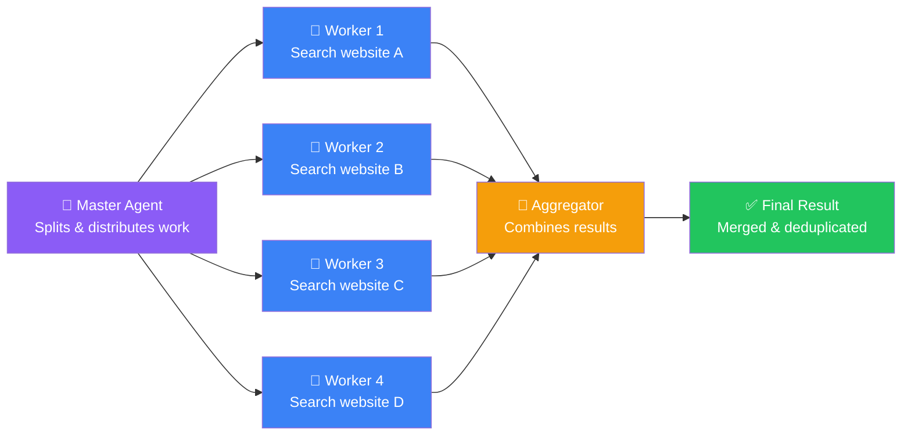
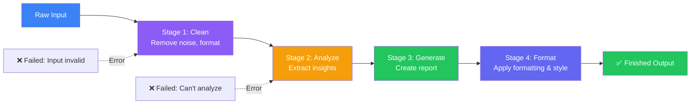
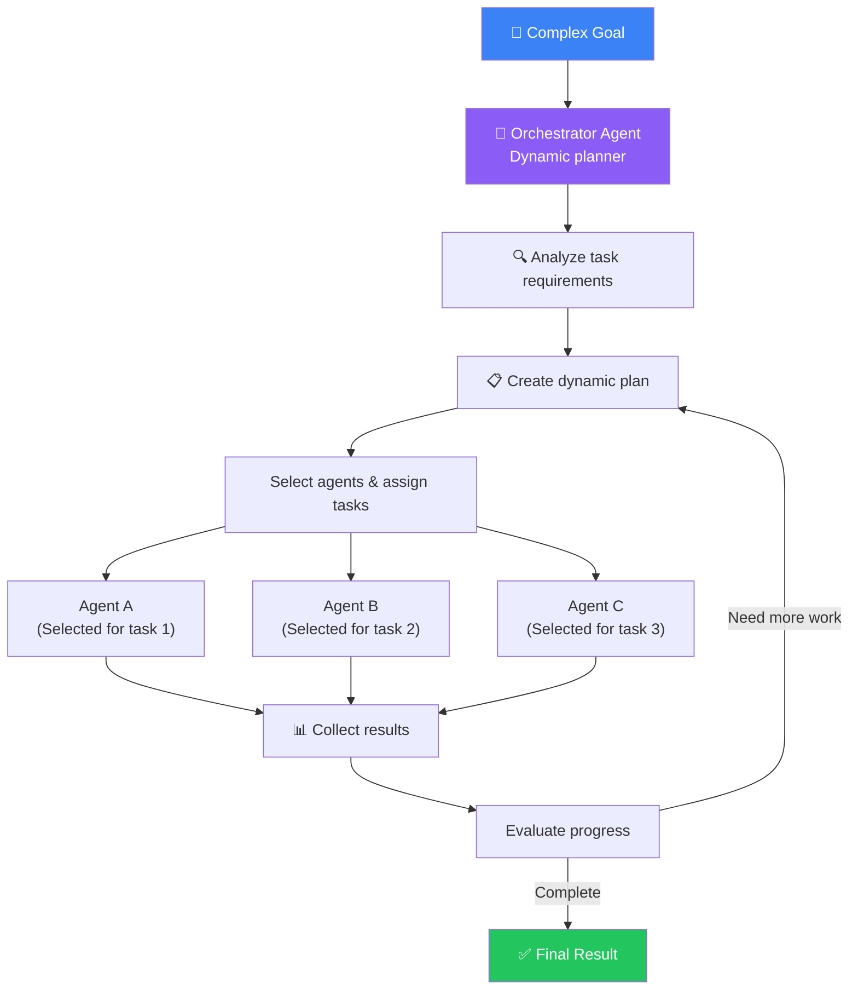
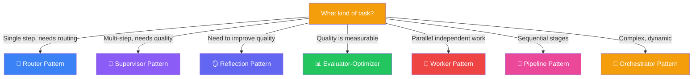

## Introduction

> **Agent Design Patterns are reusable architectural templates for building reliable, scalable, and maintainable AI Agent systems.**

Just as software engineering has design patterns (Singleton, Factory, Observer), AI Agent engineering has its own patterns. These patterns solve common challenges: delegation, quality control, parallel execution, and error recovery.

---

## Why Patterns Exist

### The Problem: Every Agent Project Starts from Scratch

Without patterns, every agent project invents its own architecture. Some use one giant agent. Some use dozens with no clear communication protocol. Some have no error recovery. Some have no quality control.

Agent Design Patterns provide proven solutions:

1. **Reusable architectures** — Don't reinvent coordination, delegation, and error handling
2. **Common vocabulary** — "Let's use a Supervisor pattern" is clearer than "Let's have one agent that delegates to others"
3. **Known trade-offs** — Each pattern has known strengths and weaknesses

---

## Real-World Analogy

### Restaurant Kitchen Patterns

A restaurant kitchen has well-known organizational patterns:

- **Router Pattern** — The host seats guests at the right table
- **Supervisor Pattern** — The head chef assigns stations, reviews plates before they go out
- **Pipeline Pattern** — Ingredients go through prep → cooking → plating → serving
- **Worker Pattern** — During a rush, multiple line cooks prepare different dishes simultaneously

Each pattern is optimized for different situations. A small café uses a single chef (single agent). A fine dining restaurant uses a full brigade system (multi-agent supervisor pattern).

---

## Pattern 1: Router Pattern

A single agent classifies the input and routes it to the appropriate handler.

| Aspect | Detail |
|--------|--------|
| **Best for** | Customer support, multi-domain assistants |
| **Pros** | Simple, fast, easy to add new routes |
| **Cons** | Router becomes a bottleneck; limited to single-step routing |
| **Example** | Customer support AI that routes to billing, technical, or account agents |

---

## Pattern 2: Supervisor Pattern

A coordinator agent delegates tasks to specialized agents and reviews the results.

| Aspect | Detail |
|--------|--------|
| **Best for** | Complex multi-step tasks needing quality control |
| **Pros** | Clear ownership, review step catches errors, easy to add/remove specialists |
| **Cons** | Supervisor can become bottleneck; higher latency due to review step |
| **Example** | Devin's architecture — Planner delegates to Coder, Reviewer, Tester agents |

---

## Pattern 3: Reflection Pattern

The agent generates output, then reviews and improves its own work in iterative cycles.

| Aspect | Detail |
|--------|--------|
| **Best for** | Content creation, code generation, any task needing quality iteration |
| **Pros** | Significant quality improvement, no extra agents needed |
| **Cons** | 2-3x cost due to multiple LLM calls; can over-optimize |
| **Example** | Writing a blog post: agent writes, reviews, revises, reviews again |

---

## Pattern 4: Evaluator-Optimizer Pattern

One agent generates, another evaluates and provides feedback, the generator optimizes based on feedback.

| Aspect | Detail |
|--------|--------|
| **Best for** | Tasks where quality is measurable (code that compiles, content that meets criteria) |
| **Pros** | Clear stopping condition (score threshold), measurable quality improvement |
| **Cons** | Requires a good evaluation rubric; can get stuck if score never reaches threshold |
| **Example** | Code generation: coder writes code, evaluator runs tests, coder fixes failing tests |

---

## Pattern 5: Worker Pattern

A master agent distributes independent tasks to worker agents running in parallel.

| Aspect | Detail |
|--------|--------|
| **Best for** | Parallelizable research, data collection, testing multiple approaches |
| **Pros** | Dramatic speedup (4 workers = 4x faster), independent failures don't cascade |
| **Cons** | Only works for independent tasks; aggregator must handle merge conflicts |
| **Example** | Research agent searching 10 websites simultaneously, then aggregating results |

---

## Pattern 6: Pipeline Pattern

Agents arranged in sequential stages, each performing one transformation.

| Aspect | Detail |
|--------|--------|
| **Best for** | Data processing pipelines, content workflows with clear stages |
| **Pros** | Predictable, easy to debug (check output of each stage), easy to retry individual stages |
| **Cons** | Slowest stage is the bottleneck; no parallel execution |
| **Example** | Content pipeline: Research → Draft → Edit → Format → Publish |

---

## Pattern 7: Orchestrator Pattern

The most flexible pattern — an orchestrator agent dynamically plans and delegates based on the task.

| Aspect | Detail |
|--------|--------|
| **Best for** | Complex, unpredictable tasks where the plan must be dynamic |
| **Pros** | Most flexible, adapts to changing requirements, can handle novel tasks |
| **Cons** | Most complex to build and debug; hard to predict cost |
| **Example** | Enterprise AI assistants that handle any type of employee request |

---

## Pattern Selection Guide

---

## Production Examples

| Product | Primary Pattern | Why This Pattern |
|---------|---------------|-----------------|
| **Devin** | Supervisor | Planner delegates to Coder + Reviewer + Tester |
| **ChatGPT** | Router | Routes to Browse, DALL-E, Code Interpreter based on intent |
| **Cursor** | Reflection | Writes code, checks for errors, fixes them iteratively |
| **Claude Desktop** | Orchestrator | Dynamically decides next action based on screen state |
| **GitHub Copilot Chat** | Router | Routes to code explanation, code generation, or debugging |

---

## Best Practices

1. **Start with Router or Reflection** — These are the simplest patterns that work for most tasks
2. **Add Supervisor for quality** — When a single agent's output isn't good enough, add a review step
3. **Use Worker for speed** — When tasks are independent, parallelize with the Worker pattern
4. **Combine patterns** — A Router can feed into a Pipeline, which uses Workers at each stage
5. **Measure before optimizing** — Track latency, cost, and quality before switching patterns

---

## Common Mistakes

| Mistake | Impact | Fix |
|---------|--------|-----|
| **Using Supervisor for simple tasks** | 3x cost, 2x latency | Use Router or Reflection instead |
| **No feedback loop in Evaluator** | Agent ignores feedback | Make feedback specific and actionable |
| **Pipeline bottleneck** | One slow stage blocks everything | Use Worker pattern for slow stages |
| **Over-orchestrating** | More coordination work than actual work | Simplify: can a single agent handle this? |
| **Wrong pattern for the task** | Agent fails or is inefficient | Use the selection guide above |

---

## Interview Questions

### Easy

**Q: What are Agent Design Patterns?**

> They are reusable architectural templates for building AI Agent systems. Just like software design patterns (MVC, Observer), agent patterns provide proven solutions for common problems like delegation, quality control, and parallel execution.

**Q: What's the difference between Router and Supervisor patterns?**

> Router classifies input and sends it to one handler — it's a single step. Supervisor delegates tasks to multiple agents and reviews their work — it's multi-step with quality control.

### Intermediate

**Q: When would you use the Worker pattern versus the Pipeline pattern?**

> Worker: when tasks are independent and can run in parallel (search 10 websites simultaneously). Pipeline: when tasks depend on each other and must run sequentially (clean → analyze → format). Worker is faster but only works for independent tasks. Pipeline is slower but handles dependencies.

### Senior

**Q: Design a hybrid pattern that combines Supervisor and Worker for a research system.**

> Supervisor agent receives the research question and breaks it into sub-questions. It then uses the Worker pattern to research each sub-question in parallel (10 workers searching different sources). Workers report results back to the Supervisor. Supervisor synthesizes the results and passes to a Reflection agent for quality review. If quality is low, Supervisor sends workers back for more research. This combines the parallel speed of Workers with the quality control of Supervisor.

### Staff Engineer

**Q: How do you choose between Reflection and Evaluator-Optimizer patterns?**

> Reflection: Same agent generates and reviews (one LLM, two prompts). Cheaper but less objective — the agent might miss its own mistakes. Evaluator-Optimizer: Different agents for generation and evaluation. More expensive (two separate agent systems) but more objective. Use Reflection for cost-sensitive tasks where "good enough" is acceptable. Use Evaluator-Optimizer for high-stakes tasks where quality is critical (legal documents, medical advice, financial reports).

### Architecture

**Q: Design an agent system using all 7 patterns together for an enterprise content platform.**

> **Router** — User request comes in, classified as: write, edit, research, or publish. **Supervisor** — For "write" tasks, Supervisor delegates to: Research Agent (Worker pattern: searches 3 sources in parallel), Writer Agent, Editor Agent. **Pipeline** — Content flows through: Outline → Draft → Edit → Format → Review. **Reflection** — At each pipeline stage, the agent reviews its own work before passing to next stage. **Evaluator-Optimizer** — At the final quality gate, content is scored against criteria. If score < 8/10, loop back to writer. **Orchestrator** — For complex content (reports, whitepapers), an orchestrator dynamically creates the workflow. This combines all patterns for maximum flexibility and quality.

---

## Summary

| Pattern | Key Idea | Best For |
|---------|----------|----------|
| **Router** | Classify and route to handler | Support, multi-domain assistants |
| **Supervisor** | Delegate and review | Complex tasks needing quality |
| **Reflection** | Self-review and improve | Content creation, code generation |
| **Evaluator-Optimizer** | Score and iterate | Tasks with measurable quality |
| **Worker** | Parallel execution | Independent sub-tasks |
| **Pipeline** | Sequential stages | Ordered transformations |
| **Orchestrator** | Dynamic planning | Complex, unpredictable tasks |

---

## Navigation

**Previous:** [08 — Single Agent vs Multi-Agent Systems](/ai/phase-06-ai-agents/08-single-vs-multi-agent)

**Next:** [10 — AI Agent Architectures](/ai/phase-06-ai-agents/10-agent-architectures)
