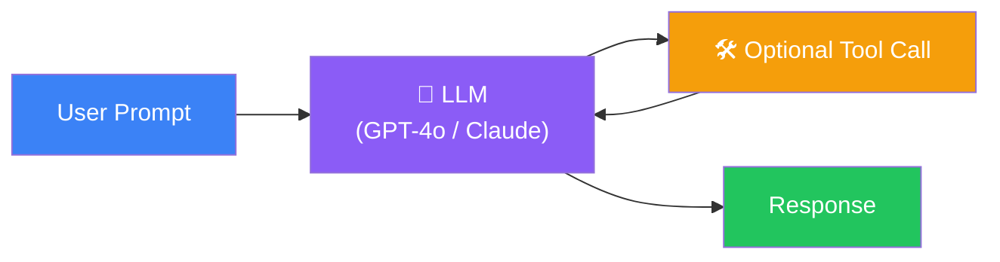
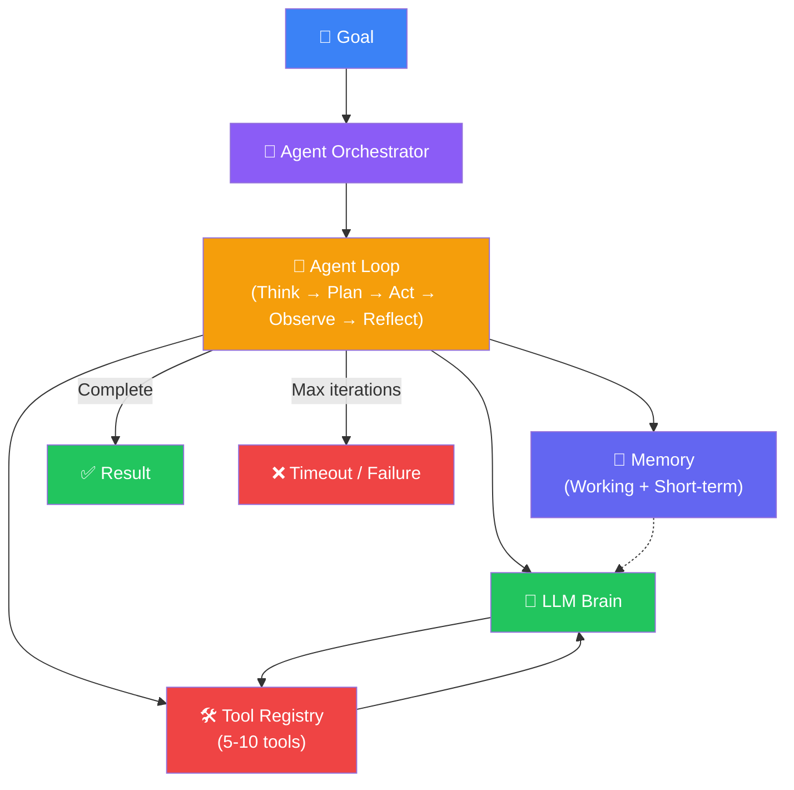
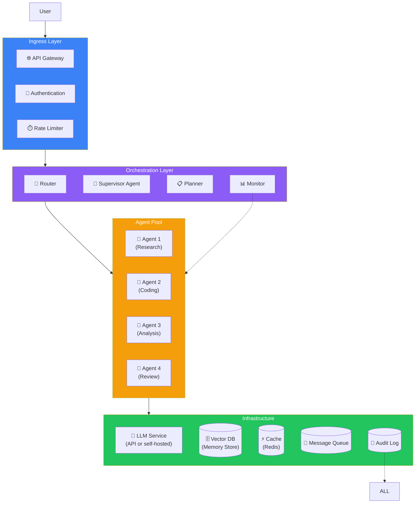
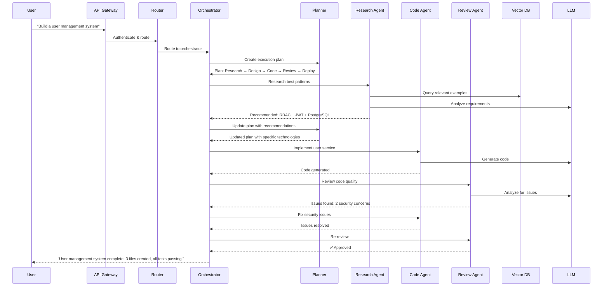
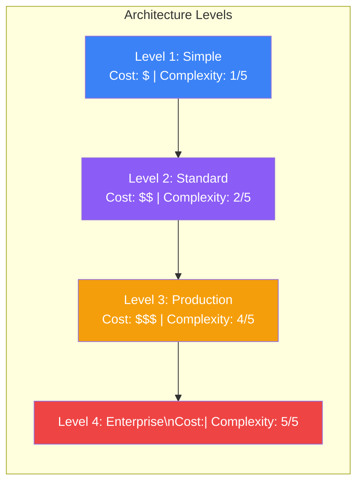
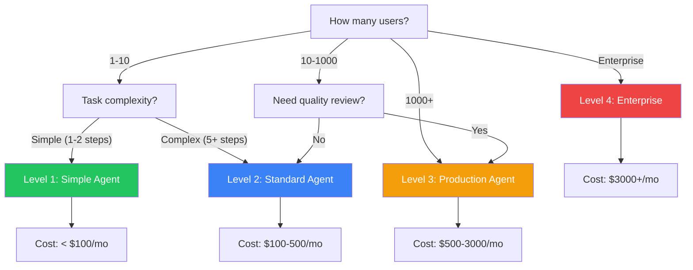
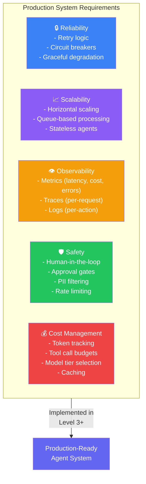

## Introduction

> **An AI Agent architecture is the blueprint that brings together all the components — planning, reasoning, memory, tools, execution, observation, and reflection — into a cohesive, production-ready system.**

This document is the culmination of everything you've learned in Chunk 1. It presents the complete reference architectures for building AI Agents, from simple designs suitable for prototypes to enterprise-grade systems capable of handling complex, multi-step tasks reliably.

```mermaid
flowchart TD
    GOAL["🎯 User Goal"] --> PLAN["📋 Planner\nTask Decomposition"]
    PLAN --> LLM["🧠 LLM Brain\nReasoning Engine"]
    LLM --> MEM["💾 Memory\nWorking + Long-Term"]
    LLM --> TOOLS["🛠️ Tool Registry\nAvailable Actions"]
    TOOLS --> EXEC["⚡ Execution Engine\nRuns Actions"]
    EXEC --> OBS["👁️ Observer\nCollects Results"]
    OBS --> REFLECT["🪞 Reflection\nEvaluates Outcome"]
    REFLECT -->|"Continue"| PLAN
    REFLECT -->|"Complete"| RESULT["✅ Task Complete"]
    MEM -.-> PLAN
    MEM -.-> LLM
    MEM -.-> OBS

    style GOAL fill:#3b82f6,color:#fff
    style PLAN fill:#8b5cf6,color:#fff
    style LLM fill:#f59e0b,color:#fff
    style MEM fill:#22c55e,color:#fff
    style TOOLS fill:#ef4444,color:#fff
    style EXEC fill:#6366f1,color:#fff
    style OBS fill:#ec4899,color:#fff
    style REFLECT fill:#f59e0b,color:#fff
    style RESULT fill:#22c55e,color:#fff
```

---

## Why This Exists

### The Problem: Components Without Architecture

You've learned about planning, reasoning, memory, tools, the agent loop, design patterns, and multi-agent systems. But knowing the components isn't enough — you need to know how to **assemble** them into a working system.

A good architecture:
1. **Defines component boundaries** — What does each component own?
2. **Specifies data flow** — How does information move between components?
3. **Establishes protocols** — How do components communicate?
4. **Enables scaling** — How does the system grow with load?
5. **Provides failure modes** — What happens when components fail?

---

## Real-World Analogy

### The Control Tower

An airport control tower doesn't have a single person doing everything. It has multiple specialized roles working together through established protocols:

- **Flight Planner** — Creates the flight plan (Planner)
- **Air Traffic Controller** — Makes real-time decisions (LLM Brain)
- **Log Book** — Records all flights and incidents (Memory)
- **Radar & Radio** — Tools for communication and tracking (Tool Registry)
- **Runway Controller** — Executes takeoffs and landings (Execution Engine)
- **Weather Station** — Monitors conditions (Observer)
- **Post-Flight Review** — Analyzes what went well and what didn't (Reflection)

Each component has a clear role. Information flows through defined channels. When something fails, there are backup procedures. This is exactly how a good Agent architecture should work.

---

## Architecture Level 1: Simple Agent

Best for: Single-step tasks, prototypes, personal use

**Components:** LLM + 1-3 tools
**Memory:** Context window only
**Planning:** None (single response)
**Iteration:** None (single pass)
**Cost:** Very low
**Example:** A chatbot that can search the web or check the weather

---

## Architecture Level 2: Standard Agent

Best for: Multi-step tasks, research, content creation

**Components:** Agent orchestrator + LLM + 5-10 tools + working/short-term memory
**Memory:** Working memory (RAM) + short-term (context window)
**Planning:** Dynamic planning per iteration
**Iteration:** Up to 15-25 iterations with reflection
**Cost:** Low to moderate
**Example:** Research assistant that searches, reads, synthesizes, and writes reports

---

## Architecture Level 3: Production Agent

Best for: Enterprise automation, customer support, data processing

**Components:** Full stack with API gateway, auth, routing, supervisor, agent pool, message queue, caching, monitoring, audit logging
**Memory:** Working (RAM) + short-term (context) + long-term (vector DB)
**Planning:** Multi-level (strategic → tactical → operational)
**Iteration:** Up to 50 iterations with sophisticated reflection and error recovery
**Cost:** Moderate to high
**Example:** Enterprise customer support system handling thousands of tickets per day

---

## Architecture Level 4: Enterprise Multi-Agent

Best for: Complex enterprise workflows, software development, research platforms

**Components:** Full multi-agent with orchestrator, planner, specialized agents, review agents, vector DB, caching, monitoring, audit
**Memory:** Full memory stack (working + short-term + long-term + episodic + semantic)
**Planning:** Hierarchical dynamic planning with re-planning and rollback
**Iteration:** Up to 500 iterations
**Cost:** High
**Example:** Devin, Manus, advanced enterprise automation platforms

---

## Architecture Component Comparison

| Component | Level 1 | Level 2 | Level 3 | Level 4 |
|-----------|:-------:|:-------:|:-------:|:-------:|
| **LLM** | ✅ | ✅ | ✅ | ✅ |
| **Tools** | 1-3 | 5-10 | 10-20 | 20+ |
| **Working Memory** | ❌ | ✅ (RAM) | ✅ (RAM) | ✅ (RAM) |
| **Short-Term Memory** | ✅ (context) | ✅ (context) | ✅ (context) | ✅ (context) |
| **Long-Term Memory** | ❌ | ❌ | ✅ (vector DB) | ✅ (vector DB) |
| **Planning** | ❌ | ✅ (dynamic) | ✅ (multi-level) | ✅ (hierarchical) |
| **Reflection** | ❌ | ✅ (basic) | ✅ (advanced) | ✅ (multi-agent) |
| **Multi-Agent** | ❌ | ❌ | ✅ (basic) | ✅ (full) |
| **Caching** | ❌ | ❌ | ✅ (Redis) | ✅ (Redis + semantic) |
| **Auth & Rate Limiting** | ❌ | ❌ | ✅ | ✅ |
| **Monitoring** | ❌ | ❌ | ✅ (logs) | ✅ (full observability) |
| **Audit Trail** | ❌ | ❌ | ✅ | ✅ (immutable) |
| **Error Recovery** | ❌ | ✅ (retry) | ✅ (circuit breaker) | ✅ (rollback + fallback) |
| **Human-in-the-Loop** | ❌ | ❌ | ✅ (critical actions) | ✅ (configurable) |

---

## Choosing the Right Architecture

---

## Production Considerations

---

## Best Practices

1. **Start at Level 1, evolve up** — Build a simple working agent first, then add complexity only as needed
2. **Design for failure** — Every component should have a fallback. LLM API down → use cached response. Tool fails → retry with different parameters
3. **Log everything** — Every thought, action, observation, and reflection should be logged with timestamps
4. **Set budgets** — Token limit per task, cost limit per user, iteration limit per run
5. **Test with real tasks** — Use the tasks your users will actually perform, not synthetic benchmarks
6. **Monitor in production** — Track latency per component, cost per task, completion rate, error rate
7. **Iterate on prompts** — The LLM prompts for planning, reasoning, and reflection need continuous refinement

---

## Common Mistakes

| Mistake | Impact | Fix |
|---------|--------|-----|
| **Starting with Level 4** | Overwhelming complexity, never ships | Start at Level 1, evolve |
| **No failure handling** | Agent crashes on first error | Add retry, fallback, and circuit breakers |
| **No cost tracking** | Unexpected $10,000 bill | Set budgets, monitor costs per task |
| **Ignoring latency** | Users wait minutes for responses | Use streaming, caching, faster models for simple steps |
| **No human oversight** | Agent makes destructive decision | Add human approval for destructive actions |

---

## Interview Questions

### Easy

**Q: What are the four levels of Agent architecture?**

> Level 1: Simple Agent (LLM + few tools). Level 2: Standard Agent (agent loop + planning + reflection). Level 3: Production Agent (multi-agent + memory + caching + monitoring). Level 4: Enterprise Multi-Agent (full system with hierarchical planning, audit, human-in-the-loop).

**Q: What's the most important component of an agent architecture?**

> The Agent Loop. Without the loop, you just have an LLM with tools — no iteration, no reflection, no improvement. The loop is what makes an agent an agent.

### Intermediate

**Q: When should you add long-term memory (vector DB) to your agent architecture?**

> When agents need to remember information across sessions or learn from past experiences. For single-session tasks, working memory (RAM) + short-term memory (context window) is sufficient. Add vector DB when: (1) users run tasks daily and expect the agent to remember preferences, (2) the agent should learn from past mistakes, (3) you need to store knowledge gained from previous tasks.

### Senior

**Q: Design an architecture that supports both synchronous (real-time chat) and asynchronous (long-running research) agent tasks.**

> **Synchronous path**: Direct agent execution with streaming. User sends message → agent processes → streams response in real-time. Timeout: 30 seconds. **Asynchronous path**: Queue-based execution. User submits task → task goes to queue → agent processes in background → user receives notification when done. **Router**: Classifies tasks as sync or async based on expected duration. Tasks expected to take < 30s → sync. Tasks > 30s → async. **State store**: Both paths persist intermediate state for recovery. **Benefits**: Users get fast responses for simple tasks while complex tasks run in background without blocking.

### Staff Engineer

**Q: How do you handle an LLM API outage in a production agent system?**

> **Immediate failover**: Route to a secondary LLM provider (OpenAI → Anthropic → Gemini). **Graceful degradation**: If all LLM APIs are down, switch to a cached-response mode: serve answers from the vector DB of past successful completions. **Queuing**: Queue incoming requests for processing when APIs recover. **User communication**: Inform users of degraded service and expected recovery time. **Testing**: Run chaos engineering tests monthly — simulate LLM API failure and verify the system handles it correctly. The goal is never show an error to the user, even during an outage.

### Architecture

**Q: Design an agent architecture for a healthcare application that requires HIPAA compliance, audit trails, and zero data leakage between patients.**

> **Per-patient isolation**: Each patient gets a separate agent session with dedicated memory store. No data sharing between sessions. **Audit trail**: Every action logged with patient ID, agent ID, timestamp, action type, full input/output. Logs are append-only and immutable. **LLM hosting**: Self-hosted LLM or HIPAA-compliant API (Azure OpenAI, AWS Bedrock) — no data sent to non-compliant providers. **Access control**: Agents can only access the current patient's records via metadata-filtered vector search. **Human review**: All generated medical advice requires a healthcare professional's approval before delivery to patient. **Data retention**: Automatic deletion of patient data after 30 days unless retention is explicitly required.

---

## Summary

| Level | Name | Components | Best For | Cost |
|:-----:|------|------------|----------|:----:|
| **1** | Simple Agent | LLM + 1-3 tools | Prototypes, single-step tasks | $ |
| **2** | Standard Agent | Loop + LLM + 5-10 tools + planning | Multi-step tasks, research | $$ |
| **3** | Production Agent | Multi-agent + memory + cache + monitoring | Enterprise automation | $$$ |
| **4** | Enterprise Multi-Agent | Full stack + orchestration + audit + HITL | Complex workflows | $$$$ |

---

## Navigation

**Previous:** [09 — Agent Design Patterns](/ai/phase-06-ai-agents/09-agent-design-patterns)

**Next:** Chunk 2 — Building Production AI Agents (Coming Soon)

**🎉 Congratulations on completing Phase 6, Chunk 1: AI Agent Fundamentals & Architectures!**
