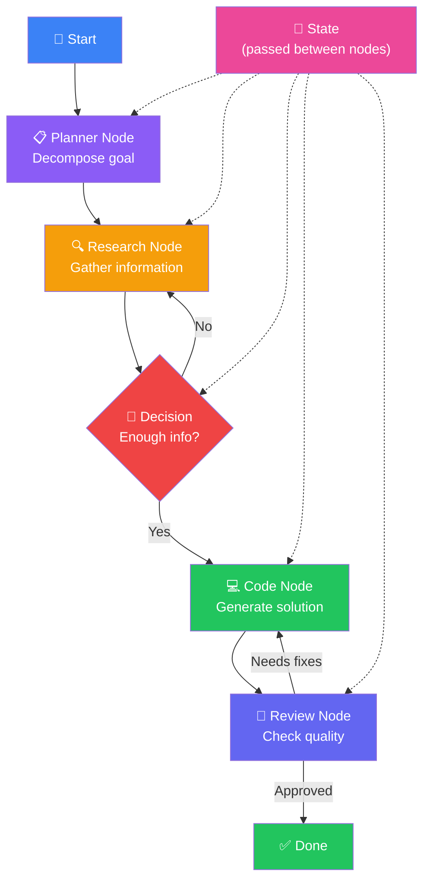
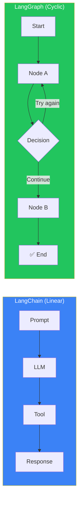
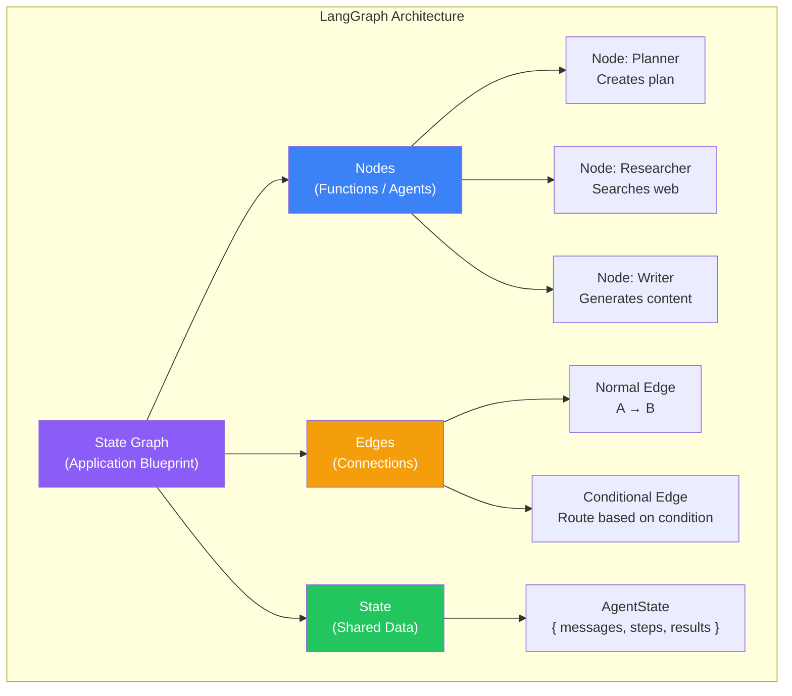
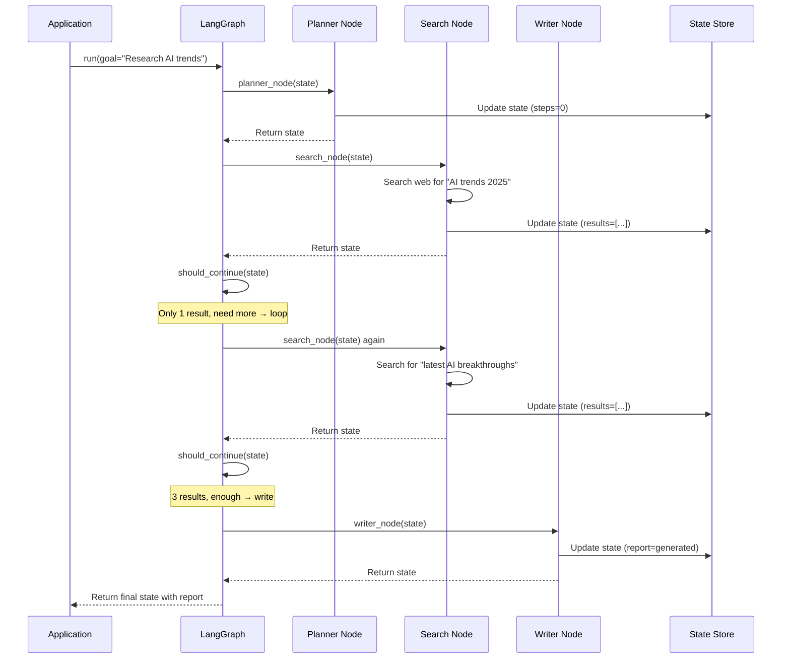
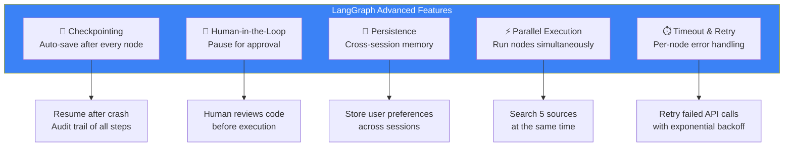

## Introduction

> **LangGraph is a framework for building stateful, multi-actor AI agent applications. It extends LangChain by adding cycles, state management, persistence, and human-in-the-loop support — essential for production agent systems.**

LangChain was great for linear chains (LLM call → tool → response), but real-world agents aren't linear. They loop, branch, pause, resume, and retry. LangGraph was built specifically for these non-linear, stateful agent workflows.



---

## Why This Exists

### The Problem: LangChain Couldn't Handle Loops

LangChain was designed for DAGs (Directed Acyclic Graphs) — data flows in one direction, no cycles. But AI agents need:

- **Loops** — Keep searching until you find the answer
- **Branching** — Choose different paths based on results
- **Pausing** — Wait for human input mid-task
- **Persistence** — Save state and resume after crashes

LangGraph solves all of these with a **state graph** architecture.



---

## Real-World Analogy

### The GPS Navigation System

Think of LangChain as a simple GPS that says "Turn left, then turn right, then you've arrived." If you miss a turn, it can't help — it was designed for perfect execution.

LangGraph is like a modern GPS that:
- **Recalculates** when you miss a turn (loops)
- **Asks** "Do you want to avoid tolls?" (human-in-the-loop)
- **Remembers** your route preferences (persistent state)
- **Pauses** navigation when you stop for gas (interrupt/resume)

The **state graph** is the map. **Nodes** are the turns. **Edges** are the roads connecting them. **Conditional edges** are "if traffic, take alternate route."

---

## Core Concepts



| Concept | Description | Example |
|---------|-------------|---------|
| **StateGraph** | The overall application graph | ResearchAgentGraph |
| **Node** | A function that processes state | `planner_node(state)`, `search_node(state)` |
| **Edge** | Connects nodes (A → B) | planner → search |
| **Conditional Edge** | Routes based on conditions | If `state.has_results` → write, else → search |
| **State** | Shared data passed between nodes | `AgentState` with messages, steps, results |
| **Checkpointer** | Persists state for recovery | Save to SQLite/PostgreSQL after each step |
| **Interrupt** | Pause execution for human input | `interrupt_before=["review_node"]` |

---

## Building a Graph: Simple Research Agent

```python
from typing import TypedDict, Literal
from langgraph.graph import StateGraph, END

# 1. Define the state
class AgentState(TypedDict):
    messages: list
    research_results: list
    report: str
    steps_complete: int

# 2. Define node functions
def planner_node(state: AgentState) -> AgentState:
    """Create a research plan."""
    state["steps_complete"] = 0
    state["research_results"] = []
    return state

def search_node(state: AgentState) -> AgentState:
    """Search the web for information."""
    query = state["messages"][-1]  # Last user query
    results = search_web(query)    # Tool call
    state["research_results"] = results
    state["steps_complete"] += 1
    return state

def writer_node(state: AgentState) -> AgentState:
    """Write the final report."""
    state["report"] = generate_report(state["research_results"])
    state["steps_complete"] += 1
    return state

def should_continue(state: AgentState) -> Literal["search", "writer"]:
    """Conditional edge: decide next step."""
    if len(state["research_results"]) < 3:
        return "search"  # Need more research — loop back
    return "writer"      # Enough info — write report

# 3. Build the graph
builder = StateGraph(AgentState)

builder.add_node("planner", planner_node)
builder.add_node("search", search_node)
builder.add_node("writer", writer_node)

builder.set_entry_point("planner")
builder.add_edge("planner", "search")
builder.add_conditional_edges("search", should_continue)
builder.add_edge("writer", END)

# 4. Compile the graph
graph = builder.compile()
```

---

## Graph Execution Flow



---

## Advanced Features



### Checkpointing Example

```python
from langgraph.checkpoint import SqliteSaver

# Add checkpointing for persistence and recovery
memory = SqliteSaver.from_conn_string("checkpoints.db")
graph = builder.compile(checkpointer=memory)

# Run with a thread ID for session tracking
config = {"configurable": {"thread_id": "user_session_123"}}
result = graph.invoke({"messages": ["Research quantum computing"]}, config)

# Resume after interruption
result = graph.invoke(None, config)  # Continues from last checkpoint
```

---

## Comparison: LangGraph vs LangChain

| Feature | LangChain | LangGraph |
|---------|-----------|-----------|
| **Graph type** | DAG (linear) | State graph (cyclic) |
| **Loops** | ❌ Not supported | ✅ First-class support |
| **State management** | Simple key-value | Typed state, full persistence |
| **Human-in-the-loop** | ❌ Not supported | ✅ Interrupt/resume |
| **Checkpointing** | ❌ None | ✅ Built-in checkpointer |
| **Parallel nodes** | ✅ Simple | ✅ With state merging |
| **Conditional routing** | ❌ Limited | ✅ Full conditional edges |
| **Best for** | Simple chains, RAG | Complex agents, production |

---

## Real Production Examples

| Company | Use Case | Why LangGraph |
|---------|----------|---------------|
| **Research assistant** | Multi-step research with validation | Loops for follow-up searches, human review checkpoint |
| **Customer support** | Ticket resolution with escalation | Conditional routing to specialized agents |
| **Code review bot** | Review, fix, re-review cycle | Loop between coder and reviewer nodes |
| **Medical diagnosis** | Symptom analysis with verification | Interrupt for doctor approval before diagnosis |

---

## Best Practices

1. **Keep nodes focused** — Each node should do one thing: plan, search, write, review
2. **Design state carefully** — The state shape determines everything. Include messages, intermediate results, and metadata
3. **Use checkpointing from day one** — Even in development, it helps with debugging
4. **Add human-in-the-loop for destructive actions** — Always pause before write/delete/deploy operations
5. **Set per-node timeouts** — A stuck API call shouldn't block the entire graph

---

## Common Mistakes

| Mistake | Impact | Fix |
|---------|--------|-----|
| **Too much state** | Slow performance, memory issues | Keep state minimal, only what nodes need |
| **No error handling in nodes** | One node failure crashes the graph | Wrap each node in try/except |
| **Infinite loops** | Graph runs forever | Add max iteration limit in conditional edges |
| **Ignoring checkpointing** | Lost progress on crash | Use checkpointer from the start |
| **Complex state updates** | Hard to debug, race conditions | Keep state updates simple and atomic |

---

## Interview Questions

### Easy

**Q: What is LangGraph and why was it created?**

> LangGraph is a framework for building stateful AI agents with cycles, loops, and human-in-the-loop support. It was created because LangChain could only handle linear chains, but real-world agents need non-linear workflows with loops, branching, and persistence.

**Q: What's the difference between a Node and an Edge in LangGraph?**

> A Node is a function that processes the state (like "search the web" or "generate a report"). An Edge connects nodes — it defines the flow from one node to the next. Conditional edges can route to different nodes based on the current state.

### Intermediate

**Q: How does state flow through a LangGraph application?**

> State is a TypedDict that flows through every node. Each node receives the full state, modifies it, and returns the updated state. The graph manager passes the returned state to the next node. Checkpointing saves the state after every node execution, enabling recovery and audit trails.

### Senior

**Q: Design a LangGraph for an e-commerce customer service agent that can handle returns, refunds, and technical support.**

> **Nodes:** Classifier (routes to return/refund/tech support), Order Lookup, Return Processor, Refund Processor, Tech Support. **Edges:** Classifier → conditional routing. Return → Order Lookup → Human Approval → Return Processor. Refund → Order Lookup → Refund Processor. Tech Support → Troubleshoot → loop or escalate. **State:** messages, order_id, issue_type, resolution. **Human-in-the-loop:** Before processing refunds over $100.

### Staff Engineer

**Q: How would you handle state conflicts in a LangGraph with parallel nodes? E.g., two nodes trying to update the same field.**

> Use **state reducers**. Define how conflicting updates should be merged: `{"field": {"reducer": "concat"}}` for lists, `{"field": {"reducer": "max"}}` for counters, or custom reducer functions. For critical sections, use sequential execution instead of parallel. For truly independent work, ensure each parallel node writes to different state fields.

### System Design

**Q: Design a LangGraph system that can handle 10,000 concurrent agent runs.**

> **Stateless nodes** — Each node is a pure function of state → new state. **Checkpointer** — Use PostgreSQL for checkpoint storage. Shard by thread_id. **Queue** — Each graph run is a job in a task queue. **Workers** — 100 worker processes pull jobs, execute one node, save checkpoint, and return job to queue. **Scaling** — Auto-scale workers based on queue depth. **Timeout** — Per-node timeout of 30 seconds. If exceeded, mark node as failed and route to error handler.

### Architecture

**Q: Compare LangGraph and LangChain architectures. When would you choose one over the other?**

> **LangChain**: Simple, linear, good for chatbots and RAG. Choose when your flow is predictable and doesn't need loops. **LangGraph**: Stateful, cyclic, supports interrupts. Choose when you need multi-step agents, human approval, loops, or complex state management. In practice, most production agent systems should use LangGraph because real-world tasks rarely follow a perfect linear path.

---

## Summary

| Concept | Key Point |
|---------|-----------|
| **LangGraph** | Stateful graph framework for building production AI agents |
| **StateGraph** | Application blueprint with nodes, edges, and state |
| **Nodes** | Functions that process and update state |
| **Edges** | Connections — normal or conditional (routed by logic) |
| **Checkpointing** | Auto-save state after each node for recovery |
| **Human-in-the-loop** | Pause execution for human approval |
| **vs LangChain** | LangChain is linear; LangGraph supports cycles and state |

---

## Navigation

**Previous:** [10 — AI Agent Architectures](/ai/phase-06-ai-agents/10-agent-architectures)

**Next:** [12 — CrewAI](/ai/phase-06-ai-agents/12-crewai)
