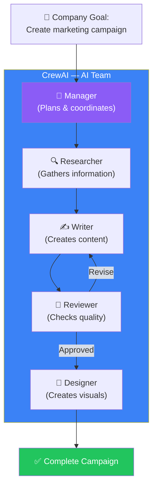
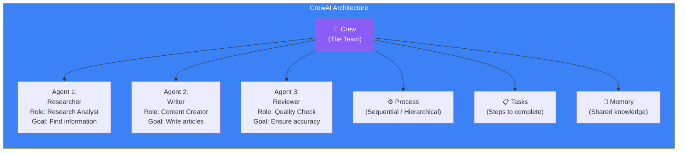
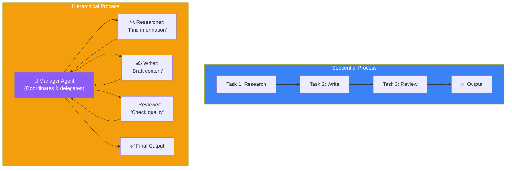
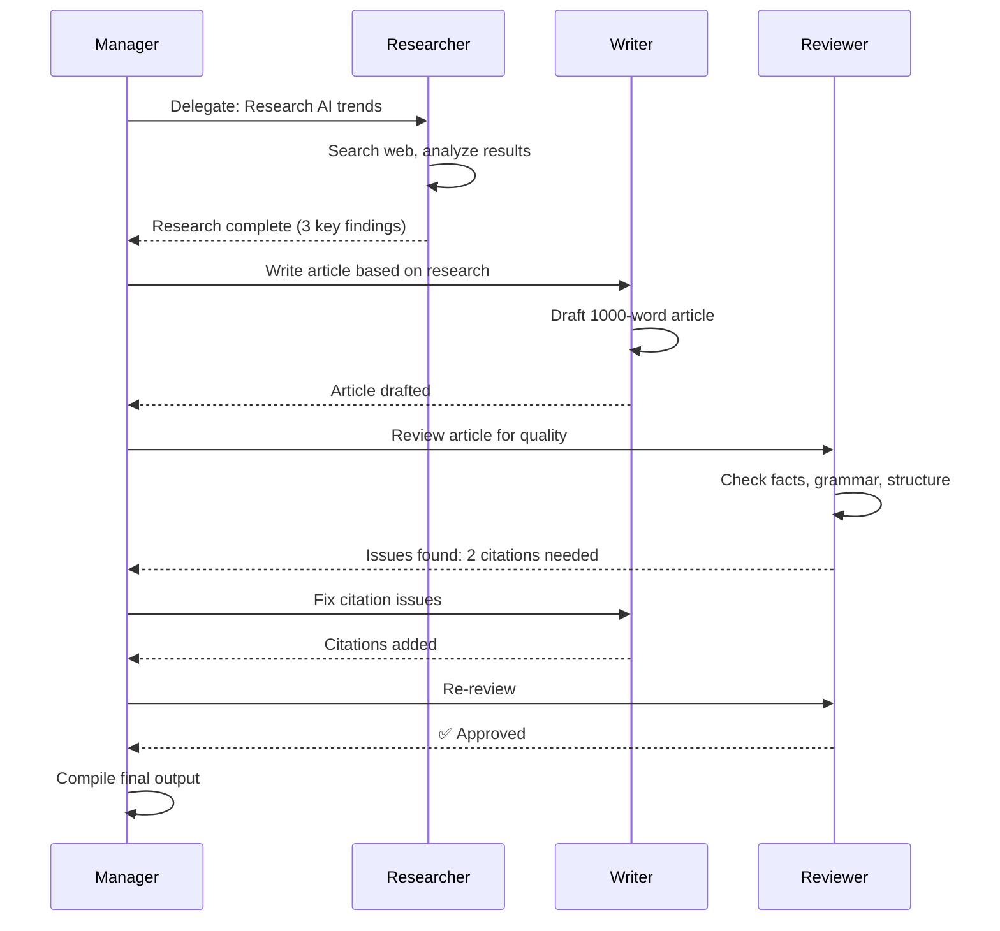
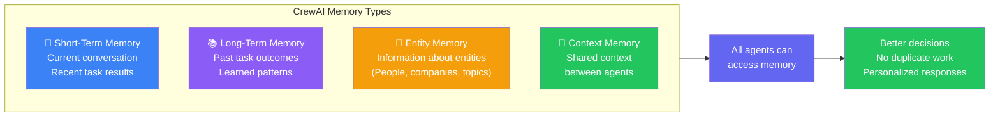

## Introduction

> **CrewAI is a framework for orchestrating collaborative, role-based AI agents. Instead of one agent doing everything, you create a team of specialized agents that work together like a company.**

Think of LangGraph as building a custom graph where you control every connection. CrewAI is higher-level — you define roles, goals, and processes, and CrewAI handles the orchestration. It's perfect for scenarios where multiple AI agents need to collaborate like a human team.



---

## Why This Exists

### The Problem: One Agent Can't Do Everything Well

A single agent might be good at research but bad at writing. Or good at coding but bad at reviewing its own code. In a human team, you have specialists who each focus on their strengths.

CrewAI lets you build AI teams where:
- Each agent has one clear role and expertise
- Agents delegate tasks to each other
- Workflows are sequential or hierarchical
- The team can tackle complex, multi-domain projects

---

## Real-World Analogy

### A Film Production Crew

A movie isn't made by one person. It takes a **crew**:
- **Director** — Sets the vision and coordinates (Manager)
- **Screenwriter** — Writes the script (Writer agent)
- **Cinematographer** — Shoots the footage (Researcher agent)
- **Editor** — Cuts and polishes (Reviewer agent)
- **Sound designer** — Adds audio (Designer agent)

Each person has a clear role. They pass work to each other. The director ensures everything stays on track. CrewAI works the same way — each agent has a role, goal, and backstory that defines how they behave.

---

## Core Concepts



| Concept | Description | Example |
|---------|-------------|---------|
| **Crew** | The team of agents working together | MarketingCrew, ResearchCrew |
| **Agent** | A single AI worker with role, goal, and tools | Researcher(role="analyst", goal="find data") |
| **Task** | A specific assignment for an agent | task = Task(description="Search for Q3 trends") |
| **Process** | How tasks are executed | Sequential (one by one) or Hierarchical (manager delegates) |
| **Memory** | Shared context across agents | Short-term, long-term, entity memory |

---

## Building a Crew: Research Team

```python
from crewai import Agent, Task, Crew, Process

# 1. Define agents with roles and goals
researcher = Agent(
    role="Senior Research Analyst",
    goal="Find the most accurate and recent information on the topic",
    backstory="You're an experienced analyst with 15 years in tech research",
    tools=[search_tool, web_scraper_tool],
    verbose=True,
    allow_delegation=False
)

writer = Agent(
    role="Technical Writer",
    goal="Create clear, engaging content from research findings",
    backstory="You're a published author specializing in AI topics",
    tools=[writing_tool],
    verbose=True,
    allow_delegation=False
)

reviewer = Agent(
    role="Quality Editor",
    goal="Ensure accuracy, clarity, and proper citations",
    backstory="You're a meticulous editor with an eye for detail",
    tools=[fact_check_tool],
    verbose=True,
    allow_delegation=False
)

# 2. Define tasks
research_task = Task(
    description="Research the latest trends in AI agents for 2025",
    expected_output="A detailed research brief with 5 key findings",
    agent=researcher
)

writing_task = Task(
    description="Write a 1000-word article based on the research",
    expected_output="A well-structured article with citations",
    agent=writer,
    context=[research_task]  # Writer gets research results
)

review_task = Task(
    description="Review the article for accuracy and quality",
    expected_output="Approved article with editorial notes",
    agent=reviewer,
    context=[research_task, writing_task]
)

# 3. Create the crew
crew = Crew(
    agents=[researcher, writer, reviewer],
    tasks=[research_task, writing_task, review_task],
    process=Process.sequential,  # One task at a time
    verbose=True,
    memory=True  # Enable shared memory
)

# 4. Run the crew
result = crew.kickoff(inputs={"topic": "AI Agents in 2025"})
print(result)
```

---

## Sequential vs Hierarchical Process



| Feature | Sequential | Hierarchical |
|---------|-----------|-------------|
| **Flow** | One task after another | Manager delegates and reviews |
| **Best for** | Linear workflows (research → write → review) | Complex projects needing coordination |
| **Control** | Simple, predictable | Flexible, dynamic |
| **Overhead** | Low | Higher (manager LLM calls) |
| **Example** | Write a report | Build a software project |

---

## Agent Communication & Delegation



---

## Memory in CrewAI



---

## Comparison: CrewAI vs LangGraph

| Feature | CrewAI | LangGraph |
|---------|--------|-----------|
| **Abstraction level** | High — teams of agents | Low — graph of nodes |
| **Best for** | Role-based multi-agent teams | Custom agent workflows |
| **Learning curve** | Low — 4 core concepts | Medium — state graphs |
| **Control** | Pre-defined processes | Full graph control |
| **Memory** | Built-in (STM, LTM, entity) | Build your own |
| **Human-in-the-loop** | Limited | Full support |
| **When to use** | Teams of specialists | Complex, stateful workflows |

---

## Real Production Examples

| Use Case | Crew Setup | Why CrewAI |
|----------|------------|------------|
| **Marketing team** | Strategist + Writer + Designer + Reviewer | Role-based collaboration suits marketing workflows |
| **Research team** | Analyst + Searcher + Synthesizer | Sequential process works well for research |
| **HR assistant** | Policy expert + Benefits specialist + Onboarding agent | Each agent has distinct domain expertise |
| **Customer support** | Classifier + Resolver + Escalation manager | Hierarchical process for ticket routing |

---

## Best Practices

1. **Give agents clear, specific roles** — "Senior Research Analyst" is better than "Helper"
2. **Use backstories** — Backstories define behavior. A "meticulous editor" will be more critical
3. **Start with sequential process** — Simpler to debug, then switch to hierarchical if needed
4. **Enable memory** — Agents remember past interactions, reducing repeated work
5. **Limit delegation for simple tasks** — Not every task needs a manager; sequential is faster

---

## Common Mistakes

| Mistake | Impact | Fix |
|---------|--------|-----|
| **Vague agent roles** | Agents behave inconsistently | Give specific roles with clear backstories |
| **Too many agents** | Coordination overhead > productivity | Start with 2-3 agents, add more only if needed |
| **No task context** | Agents work in isolation | Pass previous task results as context |
| **Sequential for complex projects** | Slow, no parallel execution | Use hierarchical for complex projects |
| **Ignoring memory** | Agents repeat questions | Enable short-term and entity memory |

---

## Interview Questions

### Easy

**Q: What is CrewAI and what problem does it solve?**

> CrewAI is a framework for building multi-agent AI teams. It solves the problem that one agent can't do everything well. Instead, you create specialized agents (researcher, writer, reviewer) that work together like a company, each with their own role and expertise.

**Q: What's the difference between Sequential and Hierarchical processes in CrewAI?**

> Sequential runs tasks one after another — Task 1 → Task 2 → Task 3. Hierarchical has a manager agent that delegates tasks to other agents and reviews their work. Sequential is simpler; hierarchical is more flexible.

### Intermediate

**Q: How does CrewAI handle information sharing between agents?**

> Through task context and memory. When you define a task, you can pass previous tasks as context so the agent has access to earlier results. Memory (short-term, long-term, entity) allows agents to share information across the entire crew session.

### Senior

**Q: Design a CrewAI system for a 24/7 customer support team with escalation.**

> **Crew:** Classifier Agent (identifies issue type), Support Agent (resolves common issues), Escalation Manager (routes complex issues to humans). **Process:** Hierarchical. Classifier → conditional routing. If confidence > 90%, route to Support Agent. If < 90%, route to Escalation Manager. **Memory:** Entity memory remembers customer context across sessions. **Human handoff:** Escalation Manager prepares summary for human agent.

### Staff Engineer

**Q: How would you handle conflicting information between agents in a CrewAI system?**

> Add a **Verification Agent** that cross-checks facts. If the Researcher says "X is true" and the Writer writes "Y is true," the Reviewer agent should flag the conflict. Use entity memory to track facts and their sources. If conflicts persist, escalate to a human or add a "confidence score" to each fact — only use facts with confidence > 0.8.

### System Design

**Q: Design a multi-agent content production system that produces 100 articles per day.**

> **Crew:** 5 Research Agents (parallel), 5 Writer Agents (parallel), 2 Reviewer Agents. **Process:** Sequential within each article, parallel across articles. Use a task queue: each article is a job. Research Agent picks up job → Writer Agent → Reviewer Agent. **Scaling:** Add more agents based on queue depth. **Quality control:** Reviewer Agent samples 20% of articles for deep review. **Memory:** Shared entity memory across all crews to avoid duplicate research.

### Architecture

**Q: Compare CrewAI and LangGraph for building a research agent. Which would you choose and why?**

> For a **research agent**, I'd choose **CrewAI** if: the research workflow is well-defined (research → write → review), the team has 3-5 clear roles, and I need built-in memory. I'd choose **LangGraph** if: the research needs loops (keep searching until enough data), conditional branching (if financial topic, use different sources), or human-in-the-loop checkpoints. In practice, many production systems combine both — CrewAI for the high-level team structure, LangGraph for complex internal agent workflows.

---

## Summary

| Concept | Key Point |
|---------|-----------|
| **CrewAI** | Framework for role-based multi-agent collaboration |
| **Agent** | A worker with a specific role, goal, and tools |
| **Task** | An assignment for an agent with expected output |
| **Crew** | The team — collection of agents and tasks |
| **Process** | Sequential (linear) or Hierarchical (manager-led) |
| **Memory** | Shared context (short-term, long-term, entity) |
| **vs LangGraph** | CrewAI is higher-level; LangGraph is more flexible |

---

## Navigation

**Previous:** [11 — LangGraph](/ai/phase-06-ai-agents/11-langgraph)

**Next:** [13 — AutoGen & OpenAI Agents SDK](/ai/phase-06-ai-agents/13-autogen-openai-agents-sdk)
