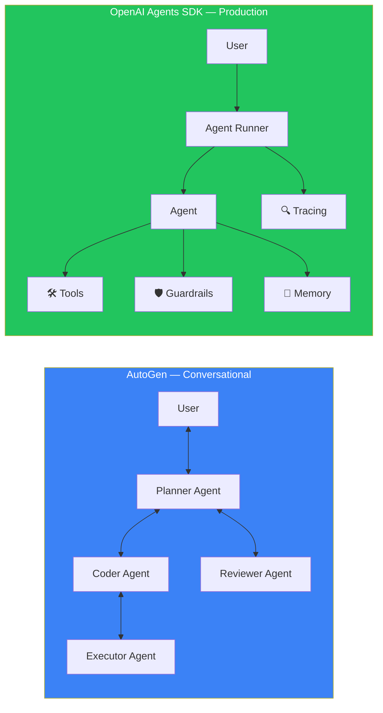
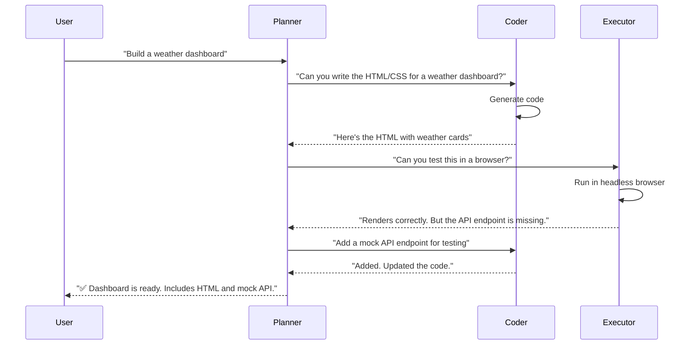
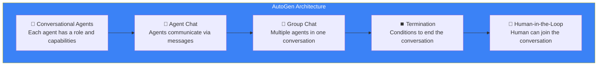
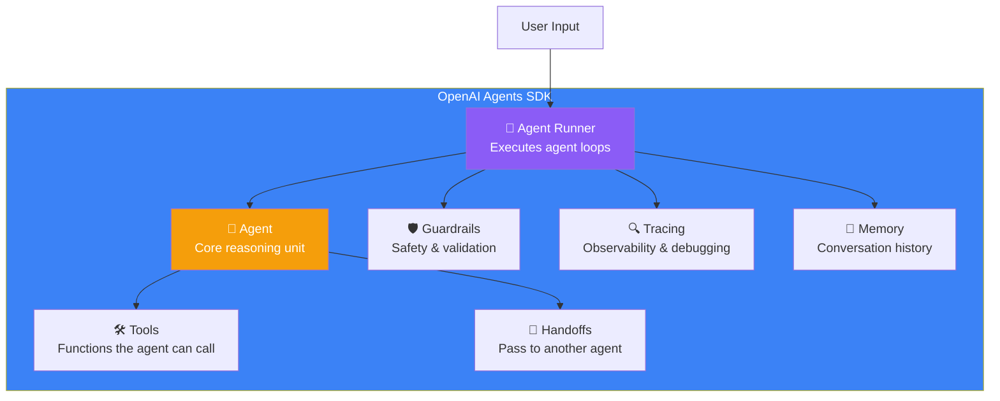
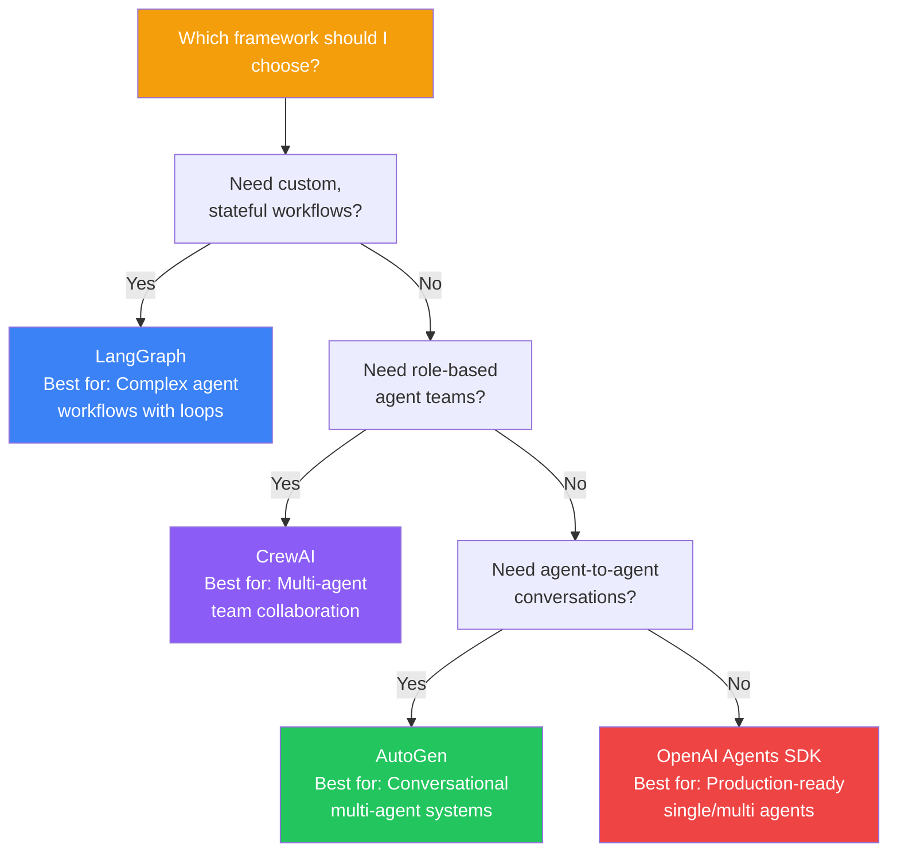

## Introduction

> **AutoGen enables conversational multi-agent systems where agents talk to each other. OpenAI Agents SDK is a production-ready framework for building secure, observable, and scalable agents. Together, they represent two different approaches to agent development.**

This document covers two major frameworks and then compares all four frameworks (LangGraph, CrewAI, AutoGen, OpenAI Agents SDK) to help you choose the right one for your use case.



---

## Part 1: AutoGen

### Why This Exists

AutoGen (by Microsoft) was built on a simple insight: **agents should talk to each other naturally**. Instead of a rigid graph or predefined processes, AutoGen agents have conversations. They can ask each other questions, delegate tasks, and reach consensus through dialogue.



### Core Concepts



| Concept | Description | Example |
|---------|-------------|---------|
| **Conversational Agent** | An agent that can send/receive messages | AssistantAgent(name="coder") |
| **UserProxy Agent** | Represents a human user | UserProxyAgent(name="user") |
| **Group Chat** | Multiple agents in one conversation | GroupChat(agents=[planner, coder, tester]) |
| **Manager** | Orchestrates group chat | GroupChatManager |
| **Termination** | What ends the conversation | Max turns, task complete signal |

### Building an AutoGen System

```python
from autogen import AssistantAgent, UserProxyAgent, GroupChat, GroupChatManager

# 1. Create agents
planner = AssistantAgent(
    name="Planner",
    system_message="You are a project planner. Break down tasks and coordinate work.",
    llm_config={"config_list": [{"model": "gpt-4", "api_key": "..."}]}
)

coder = AssistantAgent(
    name="Coder",
    system_message="You write Python code. Always include error handling.",
    llm_config={"config_list": [{"model": "gpt-4", "api_key": "..."}]}
)

reviewer = AssistantAgent(
    name="Reviewer",
    system_message="You review code for bugs, security issues, and best practices.",
    llm_config={"config_list": [{"model": "gpt-4", "api_key": "..."}]}
)

# 2. Set up group chat
group_chat = GroupChat(
    agents=[planner, coder, reviewer],
    messages=[],
    max_round=12  # Prevent infinite conversation
)

manager = GroupChatManager(
    groupchat=group_chat,
    llm_config={"config_list": [{"model": "gpt-4", "api_key": "..."}]}
)

# 3. Start the conversation
user_proxy = UserProxyAgent(name="User", human_input_mode="TERMINATE")
user_proxy.initiate_chat(
    manager,
    message="Create a Python script that fetches weather data from an API"
)
```

---

## Part 2: OpenAI Agents SDK

### Why This Exists

The OpenAI Agents SDK was built for **production** — it's the same framework OpenAI uses internally. It focuses on security, observability, and reliability.



### Core Concepts

| Concept | Description | Example |
|---------|-------------|---------|
| **Agent** | The AI with instructions and tools | `Agent(name="Assistant", instructions="...")` |
| **Runner** | Executes the agent loop | `Runner.run(agent, input)` |
| **Tool** | A function the agent can call | `@function_tool def search_web(q: str): ...` |
| **Handoff** | Transfer to another agent | `handoff_to(triage_agent)` |
| **Guardrail** | Input/output validation | Input guardrail checks for prompt injection |
| **Tracing** | Full observability | Trace every step: thought, tool call, result |

### Building with OpenAI Agents SDK

```python
from agents import Agent, Runner, function_tool, Guardrail, InputGuardrail

# 1. Define tools
@function_tool
def search_knowledge_base(query: str) -> str:
    """Search the internal knowledge base for information."""
    return f"Results for '{query}': [relevant documentation...]"

@function_tool
def get_customer_info(customer_id: str) -> dict:
    """Get customer account information."""
    return {"name": "Alice", "plan": "enterprise", "status": "active"}

# 2. Create specialized agents
support_agent = Agent(
    name="Support Agent",
    instructions="You are a helpful support agent. Use tools to help customers.",
    tools=[search_knowledge_base, get_customer_info]
)

billing_agent = Agent(
    name="Billing Agent",
    instructions="Handle billing and payment questions only.",
    tools=[get_invoice, process_refund]
)

# 3. Create router agent with handoffs
triage_agent = Agent(
    name="Triage Agent",
    instructions="Route customers to the right agent. Support questions → Support Agent. "
                 "Billing questions → Billing Agent.",
    handoffs=[support_agent, billing_agent]
)

# 4. Add guardrails
safety_guardrail = InputGuardrail(
    check=lambda msg: "harmful" not in msg.lower()
)

# 5. Run with tracing
result = Runner.run(
    triage_agent,
    input="I need help with my account",
    guardrails=[safety_guardrail],
    tracing=True  # Enables full observability
)

print(result.final_output)
```

---

## Framework Comparison



### Complete Comparison Table

| Feature | LangGraph | CrewAI | AutoGen | OpenAI Agents SDK |
|---------|-----------|--------|---------|-------------------|
| **Approach** | State graph | Role-based teams | Conversational | Production agents |
| **Complexity** | High (graphs) | Low (crew config) | Medium (chat setup) | Medium (agent config) |
| **Loops** | ✅ Full support | Limited | Via conversation | Manual |
| **State management** | ✅ Excellent | Basic | Basic | Basic |
| **Human-in-the-loop** | ✅ Built-in | Limited | ✅ Via UserProxy | Manual |
| **Checkpointing** | ✅ Built-in | ❌ | ❌ | ❌ |
| **Memory** | Build your own | ✅ Built-in | Limited | ✅ Built-in |
| **Tracing** | ✅ LangSmith | ✅ CLI | Limited | ✅ Built-in |
| **Guardrails** | Manual | Manual | Manual | ✅ Built-in |
| **Handoffs** | Via edges | Via delegation | Via conversation | ✅ Built-in |
| **Learning curve** | Medium | Low | Medium | Low |
| **Open source** | ✅ MIT | ✅ MIT | ✅ MIT | ✅ Apache |
| **Best for** | Complex custom agents | Role-based teams | Conversational systems | Production deployments |

---

## Real Production Examples

| Framework | Company | Use Case |
|-----------|---------|----------|
| **LangGraph** | Multiple enterprises | Custom agent workflows with checkpointing |
| **CrewAI** | Marketing agencies | Content creation teams (research → write → review) |
| **AutoGen** | Microsoft research | Multi-agent code generation and debugging |
| **OpenAI Agents SDK** | OpenAI customers | Production customer support agents |

---

## Best Practices

1. **Start with the simplest framework that works** — Try CrewAI or OpenAI Agents SDK first, only use LangGraph when you need custom loops
2. **Use OpenAI Agents SDK for production** — Built-in tracing, guardrails, and handoffs make it production-ready
3. **Use LangGraph for complex state** — If your agent needs sophisticated state management, checkpoints, or custom graphs
4. **Use CrewAI for role-based teams** — When you need agents with distinct personalities and expertise
5. **Use AutoGen for conversational patterns** — When agents need to debate, discuss, and reach consensus

---

## Common Mistakes

| Mistake | Impact | Fix |
|---------|--------|-----|
| **Using AutoGen for simple Q&A** | Over-engineered, expensive | Use a simple LLM call instead |
| **No guardrails in production** | Prompt injection, unsafe outputs | Always add input/output guardrails |
| **Skipping tracing** | Can't debug agent behavior | Enable tracing in all frameworks |
| **Too many agents** | Coordination overhead | Start with 2-3 agents |
| **No termination condition** | Agents talk forever | Set max rounds or completion criteria |

---

## Interview Questions

### Easy

**Q: What's the main difference between AutoGen and OpenAI Agents SDK?**

> AutoGen focuses on conversational agents — agents talk to each other naturally. OpenAI Agents SDK focuses on production readiness — it has built-in tracing, guardrails, and handoffs.

**Q: What is a guardrail in OpenAI Agents SDK?**

> A guardrail is a validation check that runs on input or output. Input guardrails check user messages for safety concerns (like prompt injection). Output guardrails check agent responses for policy violations.

### Intermediate

**Q: Explain the handoff pattern in OpenAI Agents SDK.**

> Handoffs allow one agent to transfer a conversation to another agent. For example, a triage agent receives a customer query, determines it's a billing issue, and hands off to a billing specialist agent. The handoff includes full conversation context so the receiving agent knows everything that happened.

### Senior

**Q: Compare AutoGen's group chat with LangGraph's multi-agent graph. Which is better for debugging?**

> AutoGen's group chat is like a group text message — all messages go to everyone. It's easy to understand but doesn't scale well (each agent sees irrelevant messages). LangGraph's graph is like a direct message system — messages go exactly where needed. For debugging, LangGraph is better because you can checkpoint and replay specific node executions. AutoGen is easier to prototype with but harder to debug in production.

### Staff Engineer

**Q: Design a system that combines LangGraph (for state management) with OpenAI Agents SDK (for production features) for a customer support platform.**

> **Architecture:** LangGraph as the backbone for complex workflows (multi-step issue resolution with loops). OpenAI Agents SDK agents as the production nodes within the graph. **Flow:** User query → OpenAI triage agent (routing) → LangGraph workflow (if complex) or direct OpenAI agent (if simple). **Benefits:** LangGraph handles checkpoints, state, and loops. OpenAI SDK handles guardrails, tracing, and handoffs. **Cost:** More expensive (two frameworks) but best of both worlds for enterprise use.

### System Design

**Q: Compare all four frameworks for building a medical research agent. Which would you choose?**

> **Requirements:** Complex state (patient history across sessions), human-in-the-loop (doctor approval), multi-step research (search → read → analyze → verify), production safety (no hallucinated medical advice). **Best choice:** LangGraph for the backbone (state management, checkpointing, human-in-the-loop) + OpenAI Agents SDK for the production layer (guardrails to check for medical accuracy, tracing for audit). CrewAI and AutoGen are too high-level for this use case.

### Architecture

**Q: Your team needs to choose one agent framework for all projects. Which one and why?**

> **Choice:** LangGraph. **Why:** It's the most flexible — you can build simple agents (one node, no loops) or complex agents (multi-node, cycles, checkpointing). It has the strongest state management and human-in-the-loop support. All other frameworks' patterns can be implemented in LangGraph (role-based teams, conversational patterns) with more control. The trade-off is a steeper learning curve, but the flexibility is worth it for a team that needs to handle diverse agent use cases.

---

## Summary

| Framework | Key Strength | Best For |
|-----------|-------------|----------|
| **LangGraph** | State graphs, loops, checkpointing | Complex custom agent workflows |
| **CrewAI** | Role-based teams, collaboration | Content creation, research teams |
| **AutoGen** | Conversational agents, group chat | Multi-agent discussion, debate |
| **OpenAI Agents SDK** | Production features, guardrails, tracing | Customer-facing production agents |

---

## Navigation

**Previous:** [12 — CrewAI](/ai/phase-06-ai-agents/12-crewai)

**Next:** [14 — Production AI Agent Architecture](/ai/phase-06-ai-agents/14-production-ai-agent-architecture)
