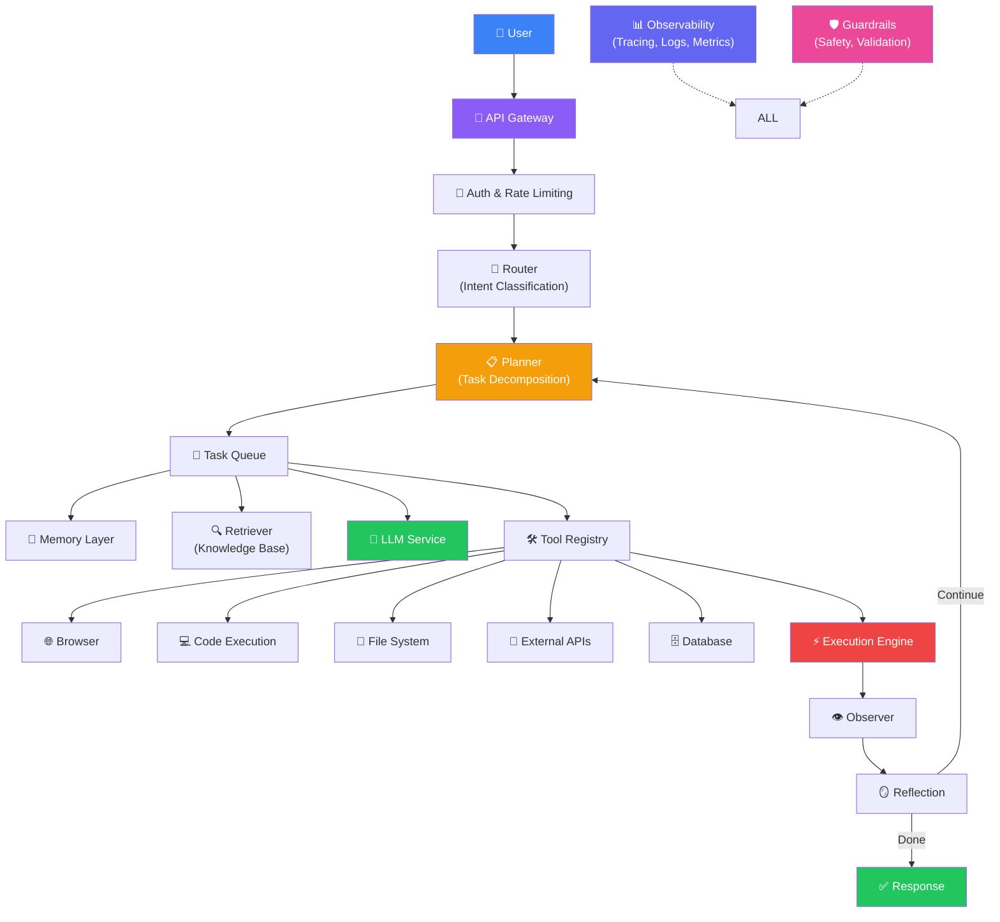
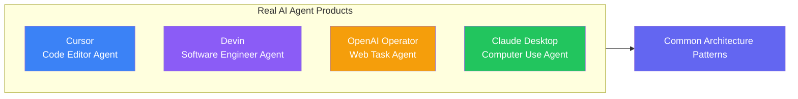
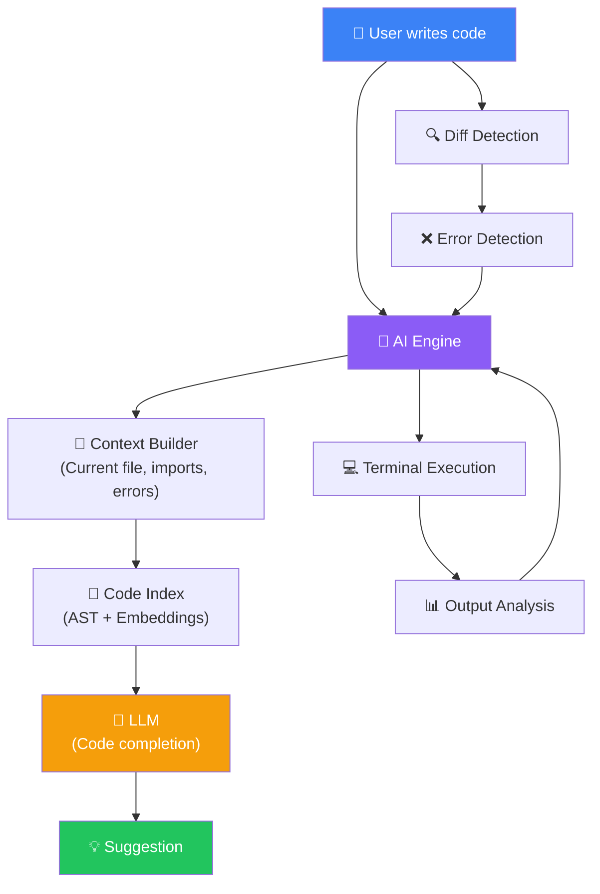
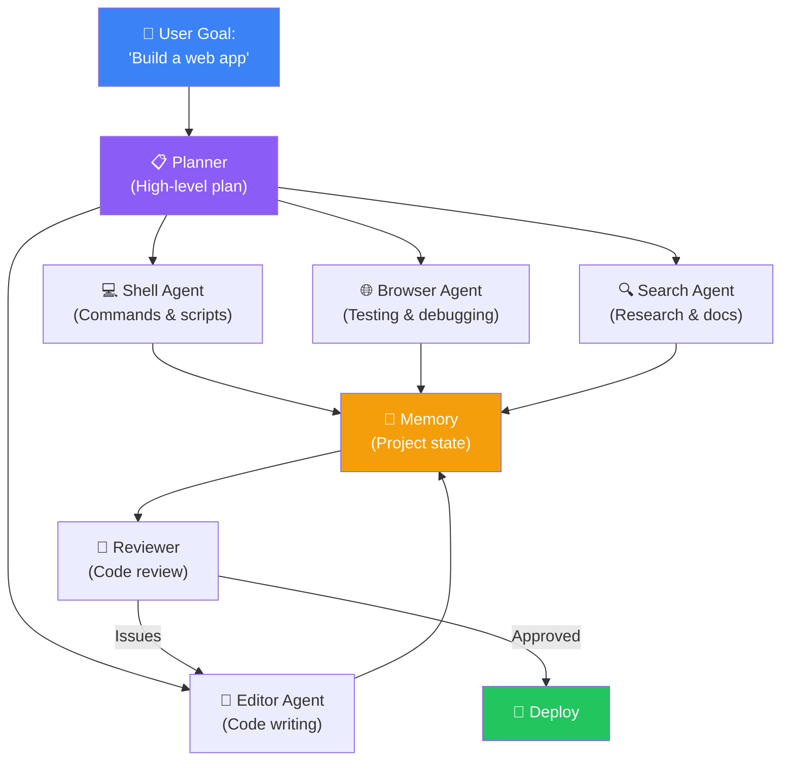
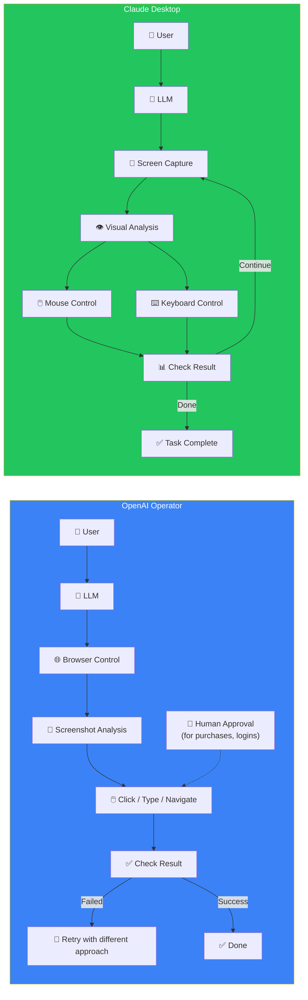
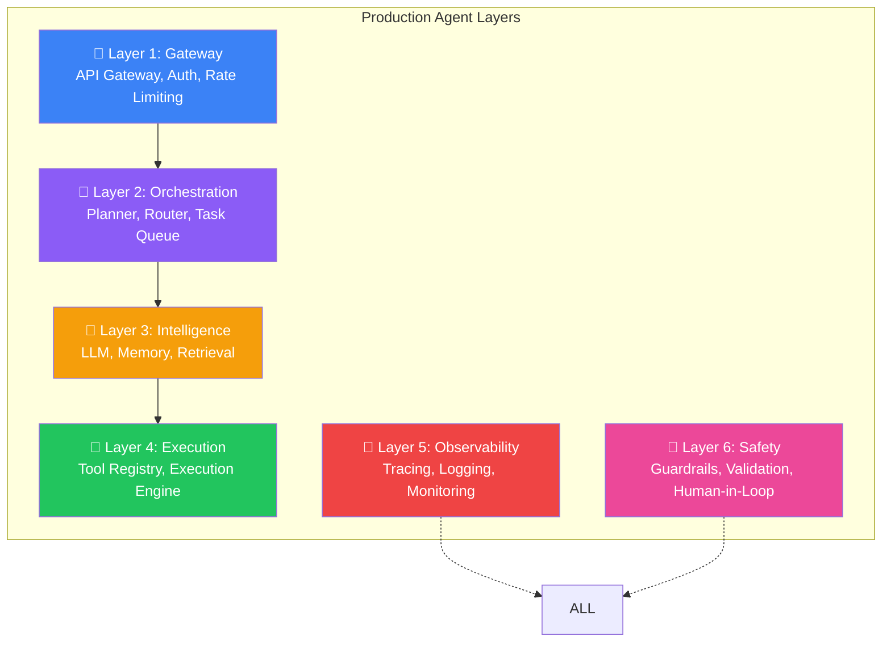
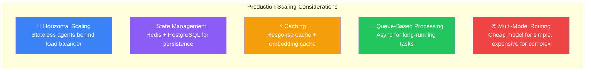
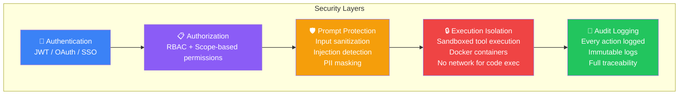

## Introduction

> **Production AI agents are not just LLMs with tool calls. They are distributed systems with planning, memory, retrieval, execution, observability, guardrails, and scaling — all working together to deliver reliable, safe, and fast agent experiences.**

This document shows how real products like Cursor, Devin, OpenAI Operator, and Claude Desktop are architected. These systems cost millions to build and operate — understanding their architecture is essential for building your own production agents.

---

## How Real AI Agent Products Work

### Cursor Architecture

**How Cursor works:**
1. **Context gathering** — Reads current file, open tabs, imports, recent edits, compiler errors
2. **Code indexing** — AST-based code understanding + embeddings for semantic search
3. **AI engine** — LLM generates code suggestions based on full repository context
4. **Terminal integration** — Executes commands, captures output, detects errors
5. **Iterative loop** — Coder → Run → Check output → Fix errors → Repeat

### Devin Architecture

**How Devin works:**
1. **Planner** — Receives a high-level goal, creates a multi-step plan
2. **Specialized agents** — Shell, Editor, Browser, Search agents each have specific tools
3. **Shared memory** — All agents write to a shared project state (files created, commands run, errors)
4. **Reviewer** — Continuously reviews code quality and progress
5. **Iterative** — Loops between coding, testing, and fixing until the task is complete

### OpenAI Operator & Claude Desktop

---

## Production Architecture Components

### Component Details

| Layer | Component | Purpose | Example |
|-------|-----------|---------|---------|
| **Gateway** | API Gateway | Route requests, authenticate | Kong, Envoy |
| **Gateway** | Auth | User identity & permissions | JWT, OAuth, RBAC |
| **Gateway** | Rate Limiting | Prevent abuse | Token bucket, 100 req/min |
| **Orchestration** | Planner | Decompose goals into steps | LLM-based planner |
| **Orchestration** | Router | Route to appropriate agent | Intent classifier |
| **Orchestration** | Task Queue | Async task processing | RabbitMQ, Redis |
| **Intelligence** | LLM Service | Reasoning engine | OpenAI, Anthropic, self-hosted |
| **Intelligence** | Memory | Cross-session context | Vector DB + Redis |
| **Intelligence** | Retriever | Knowledge access | RAG pipeline |
| **Execution** | Tool Registry | Available tools | Plugin system |
| **Execution** | Execution Engine | Run tools safely | Sandboxed Docker |
| **Observability** | Tracing | Per-request flow | OpenTelemetry |
| **Observability** | Logging | Every action recorded | Structured logs |
| **Safety** | Guardrails | Input/output validation | Prompt injection detection |
| **Safety** | Human-in-Loop | Critical action approval | Approval queue |

---

## Scaling AI Agents

### Scaling Strategy

| Strategy | How It Works | Impact |
|----------|-------------|--------|
| **Stateless agents** | Agent state in Redis, not in process | Easy horizontal scaling |
| **Task queues** | Long tasks queued, workers pick up | Handle 10K+ concurrent tasks |
| **Caching** | Cache LLM responses (TTL: 1 hour) | 40-60% cost reduction |
| **Model routing** | GPT-4o-mini for 80% of tasks, GPT-4o for 20% | 60% cost reduction |
| **Parallel execution** | Independent agent steps in parallel | 2-5x speedup |

---

## Security Architecture

---

## Best Practices

1. **Design for failure from day one** — Every component should have a fallback. LLM down → use cache. Tool fails → retry with backoff.
2. **Implement observability before launch** — You need tracing, logging, and metrics before you have users. Debugging blind is impossible.
3. **Use the cheapest model that works** — Route simple tasks to GPT-4o-mini, complex tasks to GPT-4o. Save 60% on API costs.
4. **Always have human-in-the-loop for destructive actions** — Delete, deploy, send email, pay — require human approval.
5. **Set hard limits** — Max iterations (25), max tokens (100K), max cost per task ($1), max execution time (5 min).

---

## Common Mistakes

| Mistake | Impact | Fix |
|---------|--------|-----|
| **No observability** | Can't debug agent failures | Add tracing from day one |
| **No rate limiting** | One user exhausts API budget | 100 req/min per user |
| **No sandboxing** | Code execution vulnerability | Run all code in Docker containers |
| **Single model** | Expensive for simple tasks | Route between cheap and expensive models |
| **No caching** | Same query hits LLM 1000 times | Cache LLM responses with TTL |

---

## Interview Questions

### Easy

**Q: What are the main components of a production AI agent architecture?**

> Gateway (auth, rate limiting), Orchestration (planner, router), Intelligence (LLM, memory, retriever), Execution (tools, sandbox), Observability (tracing, logs), and Safety (guardrails, human-in-the-loop).

**Q: How does Cursor differ from a simple LLM code generator?**

> Cursor has context gathering (reads open files, imports, errors), code indexing (AST + embeddings), terminal integration (runs code, checks output), and an iterative loop (generate → run → fix → repeat). A simple LLM just generates code once.

### Intermediate

**Q: Explain the two-phase architecture used by Devin (planner + specialized agents).**

> Devin uses a **planner agent** that creates a high-level plan: "Build a login page" → "1. Create React component 2. Add form validation 3. Style with CSS 4. Test." Then specialized agents execute each step: Shell Agent runs npm commands, Editor Agent writes code, Browser Agent tests the UI. All agents share a common memory of project state.

### Senior

**Q: Design a caching strategy for a production agent that processes 10,000 queries per day.**

> **Three-tier cache:** (1) **Exact match cache** — Redis, TTL 24h. If the same query was asked before, return cached response. (30% hit rate). (2) **Semantic cache** — Vector DB. If a new query is > 95% similar to a cached one, return adapted cached response. (15% hit rate). (3) **Embedding cache** — Cache query embeddings. If the same query is asked, skip embedding API call. (60% hit rate). **Invalidation:** Clear cache when tools or knowledge base change.

### Staff Engineer

**Q: Design a multi-model routing strategy for an agent that uses GPT-4o, Claude, and a self-hosted Llama model.**

> **Router** — Intent classifier determines task complexity. **Tiers:** (1) Simple (greetings, FAQs) → Llama 70B (self-hosted, $0). (2) Medium (research, writing) → GPT-4o-mini ($0.15/1M tokens). (3) Complex (coding, analysis) → GPT-4o ($2.50/1M tokens). (4) Critical (medical, legal) → Claude 3.5 Opus ($15/1M tokens). **Failover:** If GPT-4o is down → Claude. If Claude is down → GPT-4o. **Cost savings:** 70% of queries hit tiers 1-2, saving 80% vs using GPT-4o for everything.

### System Design

**Q: Design an agent system that can handle 1M users with < 3 second response time for simple queries.**

> **Architecture:** Stateless API servers (auto-scale based on CPU), Redis for session state, PostgreSQL for persistence. **Simple queries** (< 3s): Direct LLM call with cached tools. **Complex queries** (> 3s): Async via task queue, user polls for result. **Caching:** Semantic cache for 80% of queries. **Model routing:** GPT-4o-mini for 95% of queries, GPT-4o for 5%. **Scaling:** 50 API servers handle 1M users. Cost: ~$50K/mo in API costs.

### Architecture

**Q: How would you architect an agent that can research, write, and publish blog posts autonomously?**

> **Crew setup:** Research Agent (searches 5 sources) → Writer Agent (drafts post) → Editor Agent (checks quality) → Publisher Agent (uploads to CMS). **Guardrails:** Fact-check gate before publishing. **Human-in-loop:** Final approval before publishing. **Memory:** Past posts stored for style consistency. **Monitoring:** Track publish success rate, reader engagement. **Scaling:** 5 parallel crews for 20 posts/day.

---

## Summary

| Component | Purpose | Production Consideration |
|-----------|---------|-------------------------|
| **API Gateway** | Auth, routing, rate limiting | Scale horizontally, set limits |
| **Planner** | Goal decomposition | Re-plan every 3-5 steps |
| **LLM Service** | Reasoning engine | Multi-model routing for cost |
| **Tool Registry** | Available actions | Sandbox execution, validate output |
| **Memory** | Cross-session context | Vector DB + Redis |
| **Observability** | Debugging & monitoring | Trace every step from day one |
| **Guardrails** | Safety & validation | Block prompt injection, PII leaks |
| **Human-in-Loop** | Critical action approval | Delete, deploy, pay require approval |

---

## Navigation

**Previous:** [13 — AutoGen & OpenAI Agents SDK](/ai/phase-06-ai-agents/13-autogen-openai-agents-sdk)

**Next:** [15 — AI Agent Projects & Complete Roadmap](/ai/phase-06-ai-agents/15-ai-agent-projects-roadmap)
