## Introduction

> **Theory is important, but building real projects is how you master AI agents. This document presents 8 production-grade AI agent projects you can build, each with architecture, workflow, tech stack, and deployment guidance.**

These projects progress from simple (single-agent with few tools) to complex (multi-agent with memory, retrieval, and human-in-the-loop). Each project is inspired by a real product.

---

## Complete AI Agent Roadmap

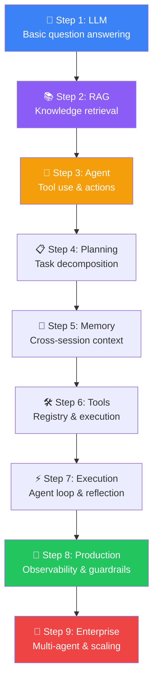

---

## Project 1: AI Coding Assistant (Cursor Clone)

### Problem

Developers spend 40% of their time searching for code and debugging. An AI coding assistant understands context, suggests code, runs commands, and fixes errors.

### Architecture

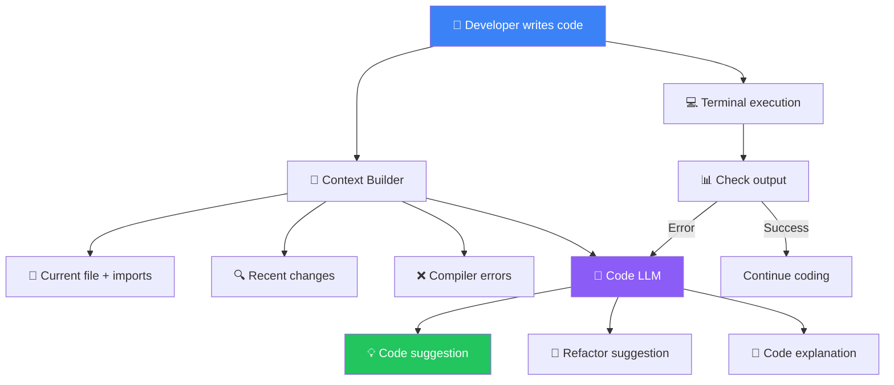

### Tech Stack

| Component | Technology |
|-----------|-----------|
| **Frontend** | VS Code extension / Web UI |
| **Code LLM** | GPT-4o / Claude 3.5 (code-optimized) |
| **Code Index** | Tree-sitter (AST parser) + Voyage Code embeddings |
| **Storage** | SQLite (project index) |
| **Context** | LSP (Language Server Protocol) for real-time analysis |

### Key Features

1. **Context-aware completions** — Understands imports, types, and patterns in the current file
2. **Error fixing** — Detects compiler errors, suggests and applies fixes
3. **Terminal integration** — Runs commands, captures output, detects failures
4. **Code explanation** — Select code, ask "what does this do?"

---

## Project 2: Research Agent (Perplexity Style)

### Problem

Researching a topic requires searching multiple sources, reading articles, extracting key information, and synthesizing findings.

### Architecture

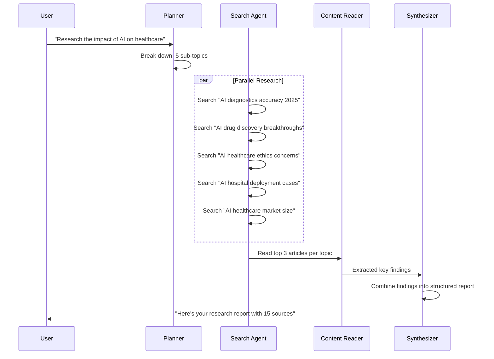

### Tech Stack

| Component | Technology |
|-----------|-----------|
| **Framework** | LangGraph (for loops) or CrewAI (for team) |
| **Search** | Tavily / SerpAPI / Bing Search API |
| **Content** | Firecrawl / Jina Reader |
| **Embeddings** | OpenAI text-embedding-3-small |
| **Storage** | Chroma / Qdrant (for storing research) |

---

## Project 3: Travel Planner Agent

### Problem

Planning a trip involves searching flights, comparing hotels, checking weather, finding activities, and creating an itinerary.

### Architecture

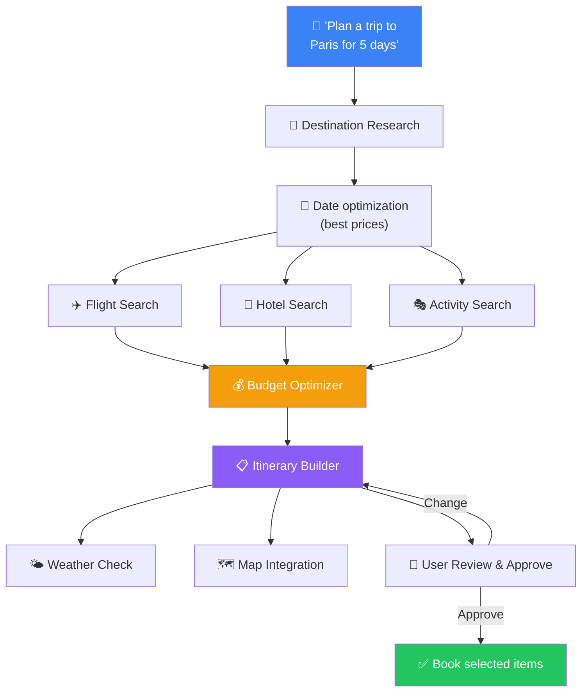

### Tech Stack

| Component | Technology |
|-----------|-----------|
| **Framework** | OpenAI Agents SDK |
| **Flight API** | Amadeus / Skyscanner API |
| **Hotel API** | Booking.com API / Google Hotels |
| **Maps** | Google Maps / Mapbox |
| **Weather** | OpenWeather API |
| **Memory** | Redis (session state) |
| **Safety** | Human approval for all bookings |

---

## Project 4: GitHub Repository Agent

### Problem

Understanding a new codebase is hard. A repository agent can explain architecture, find code, trace dependencies, and suggest improvements.

### Architecture

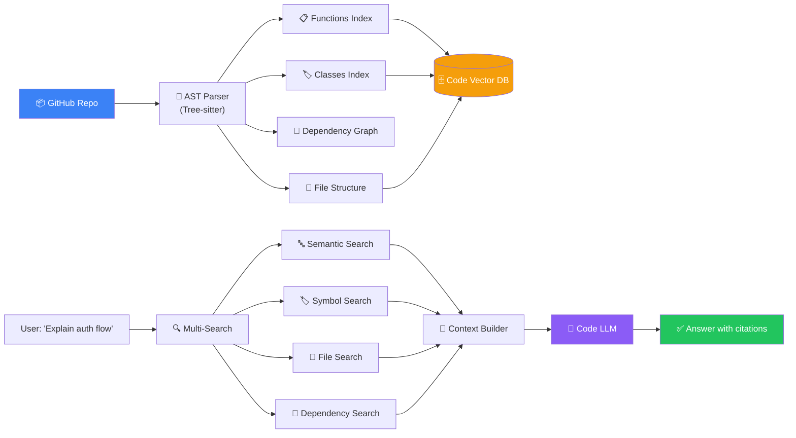

---

## Project 5: Customer Support Agent

### Problem

Customer support teams handle thousands of tickets daily. An agent can classify, resolve common issues, and escalate complex ones.

### Architecture

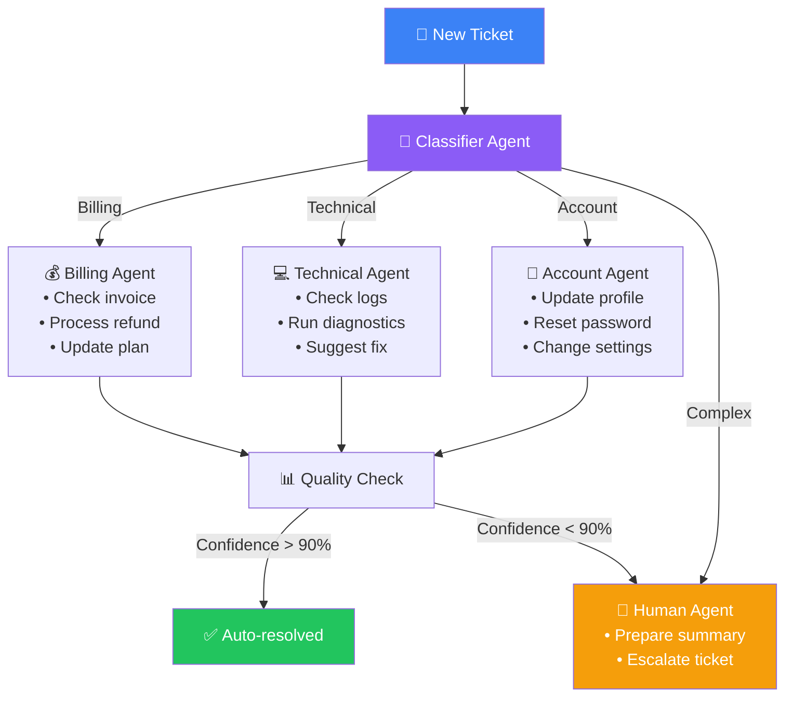

### Tech Stack

| Component | Technology |
|-----------|-----------|
| **Framework** | OpenAI Agents SDK (production-ready) |
| **Classifier** | GPT-4o-mini (cheap, fast) |
| **Knowledge Base** | RAG pipeline with Qdrant |
| **Tracing** | OpenAI Agents SDK tracing |
| **Human-in-loop** | Approval queue for complex tickets |

---

## Project 6: Email & Calendar Assistant

### Problem

Managing emails and calendar is time-consuming. An agent can read, summarize, draft replies, schedule meetings, and manage your inbox.

### Architecture

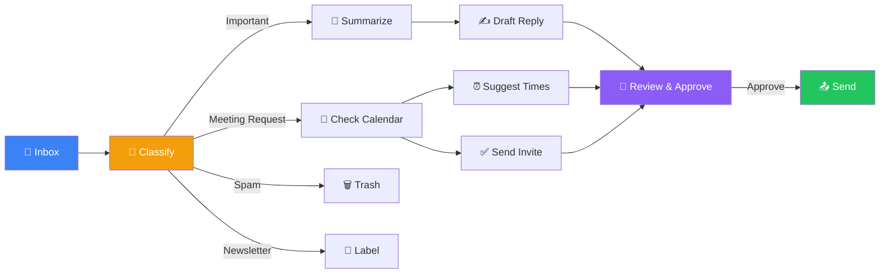

---

## Project 7: DevOps Deployment Agent

### Problem

Deploying applications involves multiple steps: build, test, stage, deploy, monitor. A DevOps agent automates this pipeline with safety checks.

### Architecture

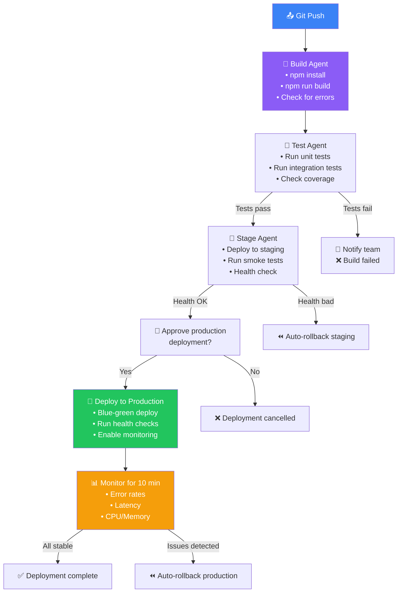

---

## Project 8: Enterprise Knowledge Agent

### Problem

Enterprise knowledge is scattered across wikis, documents, and databases. A knowledge agent answers questions with citations and access control.

### Architecture

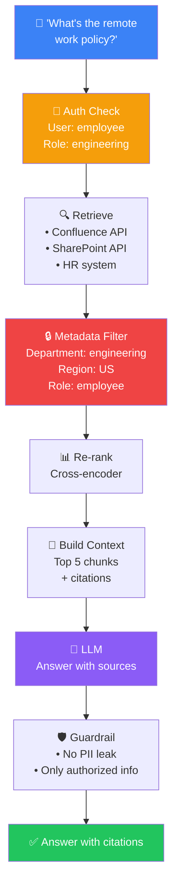

---

## Project Comparison

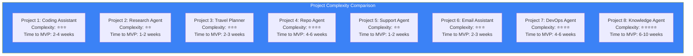

| Project | Framework | LLM | Key Tools | Cost/Month |
|---------|-----------|-----|-----------|------------|
| **Coding Assistant** | LangGraph | GPT-4o | Terminal, File system, LSP | $200-500 |
| **Research Agent** | CrewAI | GPT-4o-mini | Web search, Content reader | $100-300 |
| **Travel Planner** | OpenAI SDK | GPT-4o | Flight/Hotel/Weather APIs | $200-400 |
| **Repo Agent** | LangGraph | GPT-4o | Tree-sitter, Git, File system | $300-800 |
| **Support Agent** | OpenAI SDK | GPT-4o-mini | Knowledge base, CRM API | $100-500 |
| **Email Assistant** | OpenAI SDK | GPT-4o | Gmail API, Calendar API | $100-300 |
| **DevOps Agent** | LangGraph | GPT-4o | Docker, K8s, Cloud APIs | $300-1000 |
| **Knowledge Agent** | LangGraph | GPT-4o | Confluence, SharePoint, RAG | $500-2000 |

---

## Learning Path

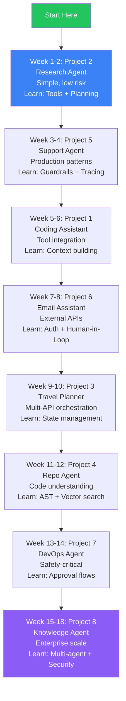

---

## Phase 6 Complete Summary

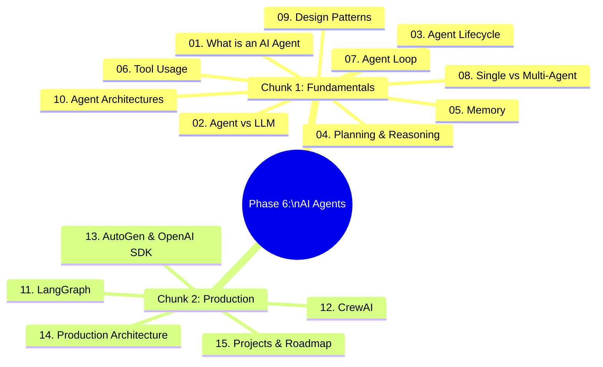

**Next: Phase 7 — Model Context Protocol (MCP)**

You've learned how to build AI agents. Now learn how they securely connect to external systems — databases, APIs, file systems, and services — using the emerging open standard for tools, resources, prompts, and context sharing.

---

## Navigation

**Previous:** [14 — Production AI Agent Architecture](/ai/phase-06-ai-agents/14-production-ai-agent-architecture)

**Next:** Phase 7 — Model Context Protocol (MCP) (Coming Soon)

**🎉 Congratulations on completing Phase 6: AI Agents & Agentic Systems!**
