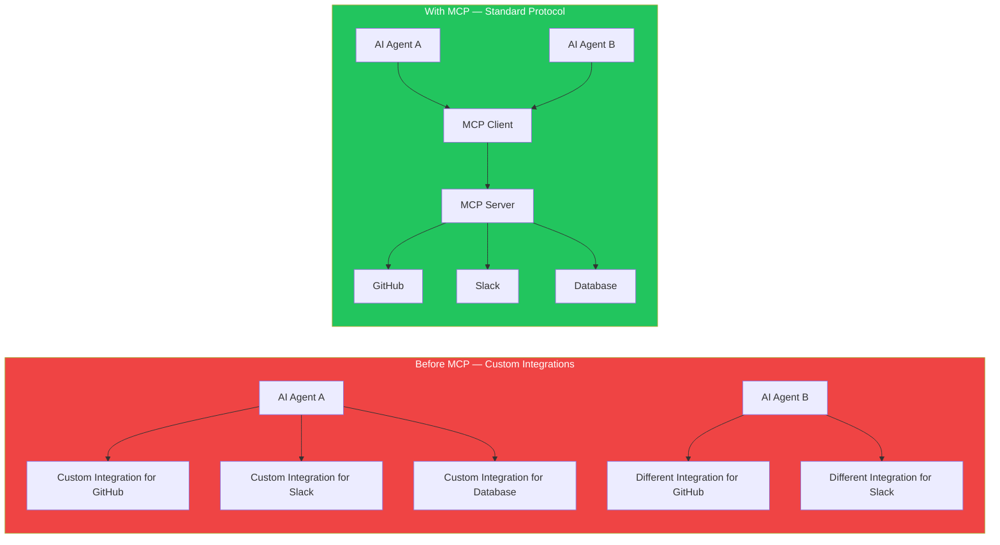
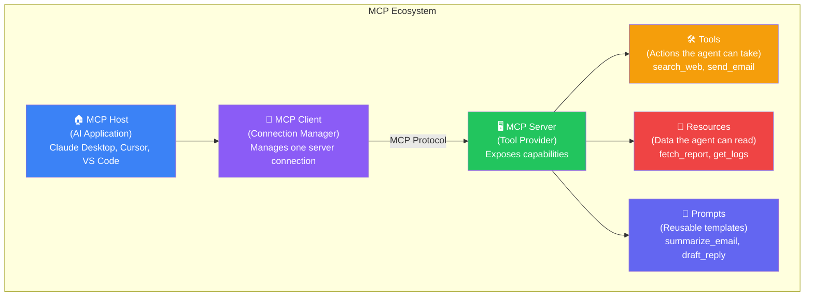
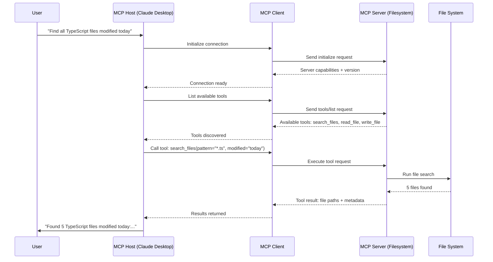
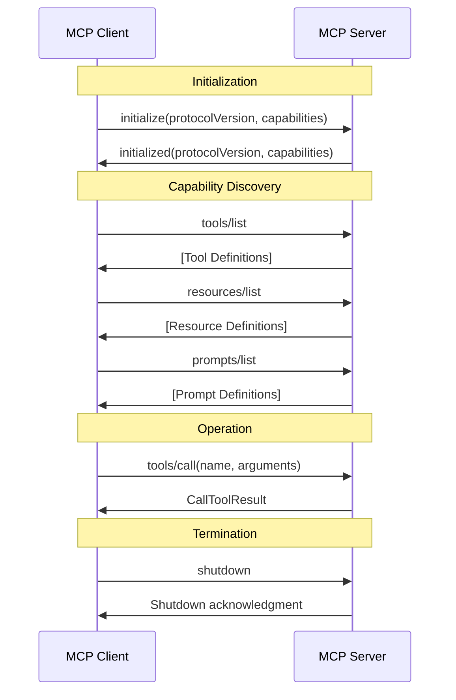

## Introduction

> **Model Context Protocol (MCP) is an open standard that defines how AI applications connect to external tools, data sources, and services. Think of it as USB-C for AI — one universal connector that works with everything.**

AI agents are powerful, but they're only as useful as the tools they can access. Before MCP, every AI application needed custom integrations for every tool — a unique connector for databases, another for APIs, another for file systems. MCP standardizes this, so any MCP-compatible client can work with any MCP-compatible server.

---

## Why This Exists

### The Problem: Every AI Integration Is Custom

Before MCP, connecting an AI agent to a tool meant building a custom integration for every combination:

- Claude needs GitHub access → custom GitHub connector
- Cursor needs Slack access → different Slack connector
- A custom agent needs database access → yet another connector

This is like every phone needing its own charger. MCP solves this by providing a **standard protocol** that any AI client can use to communicate with any tool server.

### What MCP Provides

1. **Standard interface** — One protocol for all tool connections
2. **Plug-and-play** — Any MCP client works with any MCP server
3. **Security** — Built-in authentication, authorization, and access control
4. **Discoverability** — Clients can discover available tools, resources, and prompts dynamically
5. **Interoperability** — Tools built for one agent work with all agents

---

## Real-World Analogy

### USB-C for AI

Think of the world before USB-C. Every device had its own cable:
- Phones used micro-USB
- Laptops used proprietary chargers
- Cameras used mini-USB
- Printers used even different cables

Then USB-C arrived. **One cable, everything works.**

MCP is USB-C for AI:
- **MCP Client** = The USB-C port on your laptop (the AI agent)
- **MCP Server** = The USB-C device you plug in (the tool/service)
- **MCP Protocol** = The USB-C standard (how they communicate)
- **Tools / Resources / Prompts** = The device's capabilities (what it can do)

Plug in any MCP server, and any MCP client immediately knows how to use it.

---

## Core Concepts

| Component | Role | Example |
|-----------|------|---------|
| **MCP Host** | The AI application that needs tools | Claude Desktop, Cursor, VS Code |
| **MCP Client** | Manages connection to one MCP server | Each server gets its own client instance |
| **MCP Server** | Exposes tools, resources, and prompts | Filesystem server, GitHub server, Database server |
| **Tool** | An action the agent can perform | `search_web(query)`, `send_email(to, subject)` |
| **Resource** | Data the agent can read | File contents, database rows, API responses |
| **Prompt** | A reusable prompt template | "Summarize this document" template |

---

## MCP in Action

---

## Key MCP Protocol Flow

## MCP vs Other Approaches

| Approach | Standardization | Security | Discoverability | Adoption |
|----------|:---:|:---:|:---:|:---:|
| **MCP** | ✅ Open standard | ✅ Built-in auth | ✅ Dynamic discovery | Growing |
| **Custom API** | ❌ Per integration | ✅ | ❌ | Widespread |
| **Function Calling** | ❌ LLM-specific | ❌ | ❌ | High (OpenAI) |
| **Plugin Systems** | ❌ Per platform | Varies | Varies | Fragmented |

---

## MCP Ecosystem Growth

```mermaid
flowchart LR
    subgraph 2024["2024: MCP Launch"]
        A1["Anthropic releases MCP"]
        A2["Claude Desktop support"]
        A3["Python & TypeScript SDKs"]
    end
    
    subgraph 2025["2025: Ecosystem Growth"]
        B1["Community MCP servers: 500+"]
        B2["Cursor, VS Code, IDE support"]
        B3["LangGraph, CrewAI integration"]
        B4["OpenAI, Google adopt MCP"]
    end
    
    subgraph 2026["2026: Mainstream Adoption"]
        C1["Enterprise deployments"]
        C2["Thousands of MCP servers"]
        C3["MCP as industry standard"]
    end
    
    2024 --> 2025
    2025 --> 2026
    
    style 2024 fill:#3b82f6,color:#fff
    style 2025 fill:#8b5cf6,color:#fff
    style 2026 fill:#22c55e,color:#fff
```

## Real Production Examples

| Product | MCP Role | What It Enables |
|---------|----------|----------------|
| **Claude Desktop** | MCP Host + Client | Claude can access files, databases, and APIs through MCP servers |
| **Cursor** | MCP Client | Cursor can use any MCP server for code-related tools |
| **VS Code** | MCP Host (via extension) | AI extensions can access external tools through MCP |
| **LangGraph** | MCP Client | LangGraph agents can use MCP servers as tool providers |
| **CrewAI** | MCP Client | CrewAI agent teams can access shared MCP servers |

---

## Best Practices

1. **Start with one MCP server** — Connect to one service first, add more as needed
2. **Use STDIO for local servers** — Fastest transport for same-machine connections
3. **Use HTTP for remote servers** — When the MCP server is on a different machine
4. **Version your MCP servers** — The protocol is evolving; pin versions for stability
5. **Secure your servers** — Never expose MCP servers to the internet without authentication

---

## Common Mistakes

| Mistake | Impact | Fix |
|---------|--------|-----|
| **No authentication** | Anyone can use your MCP server | Add API key or OAuth authentication |
| **Exposing too many tools** | Agent gets confused | Only expose tools relevant to the use case |
| **No error handling** | Agent gets cryptic errors | Return clear error messages from MCP servers |
| **Ignoring MCP version** | Protocol mismatch errors | Specify MCP version in server capabilities |

---

## Interview Questions

### Beginner

**Q: What is MCP in simple terms?**

> MCP is a standard way for AI applications to connect to tools and data. Instead of every AI app building its own custom integration for every tool, MCP provides one universal protocol that any AI app can use to talk to any tool.

**Q: Who created MCP?**

> MCP was created by Anthropic, the company behind Claude. It's an open protocol that anyone can implement.

### Intermediate

**Q: What are the three main capabilities an MCP server can expose?**

> Tools (actions the agent can take), Resources (data the agent can read), and Prompts (reusable prompt templates). A server can expose one, two, or all three capabilities.

### Senior

**Q: How does an MCP client discover what an MCP server can do?**

> Through the initialization handshake. When the client connects, the server sends its capabilities (which features it supports). Then the client can call `tools/list`, `resources/list`, or `prompts/list` to get the full list of available tools, resources, and prompts with their schemas.

### Staff Engineer

**Q: Design an MCP server that provides database access securely. What considerations are needed?**

> Authentication: API key validation. Authorization: Role-based access (read-only vs read-write). Input sanitization: Prevent SQL injection by using parameterized queries. Rate limiting: Max 100 queries per minute. Audit logging: Log every query with user, timestamp, and query hash. Timeout: 30-second query timeout. Schema restriction: Only allow SELECT queries on specified tables.

### Architecture

**Q: Compare MCP with traditional REST APIs. When would you use each?**

> REST APIs are designed for human-built integrations — fixed endpoints, manual documentation, static contracts. MCP is designed for AI consumption — dynamic discovery, self-describing schemas, standard lifecycle. Use REST for traditional backend-to-frontend communication. Use MCP when an AI agent needs to dynamically discover and use tools it wasn't specifically programmed for.

### System Design

**Q: Design an enterprise system with 50 MCP servers serving 10,000 AI agents.**

> **Registry**: Central MCP registry for server discovery. **Gateway**: MCP gateway that routes client requests to the right server. **Authentication**: SSO-based auth at the gateway level. **Rate limiting**: Per-server rate limits. **Monitoring**: Centralized tracing across all MCP interactions. **Caching**: Cache tool results with configurable TTL. **Scaling**: Each MCP server scales independently based on load. **Failover**: If a server is down, route to a replica.

---

## Summary

| Concept | Key Point |
|---------|-----------|
| **MCP** | Open standard for AI-to-tool communication |
| **Analogy** | USB-C for AI — one protocol connects everything |
| **Host** | The AI application (Claude Desktop, Cursor) |
| **Client** | Manages connection to one MCP server |
| **Server** | Exposes tools, resources, and prompts |
| **Tools** | Actions the agent can perform |
| **Resources** | Data the agent can read |
| **Prompts** | Reusable prompt templates |

---

## Navigation

**Previous:** [15 — AI Agent Projects & Roadmap](/ai/phase-06-ai-agents/15-ai-agent-projects-roadmap)

**Next:** [02 — Why MCP Exists](/ai/phase-07-model-context-protocol/02-why-mcp)
