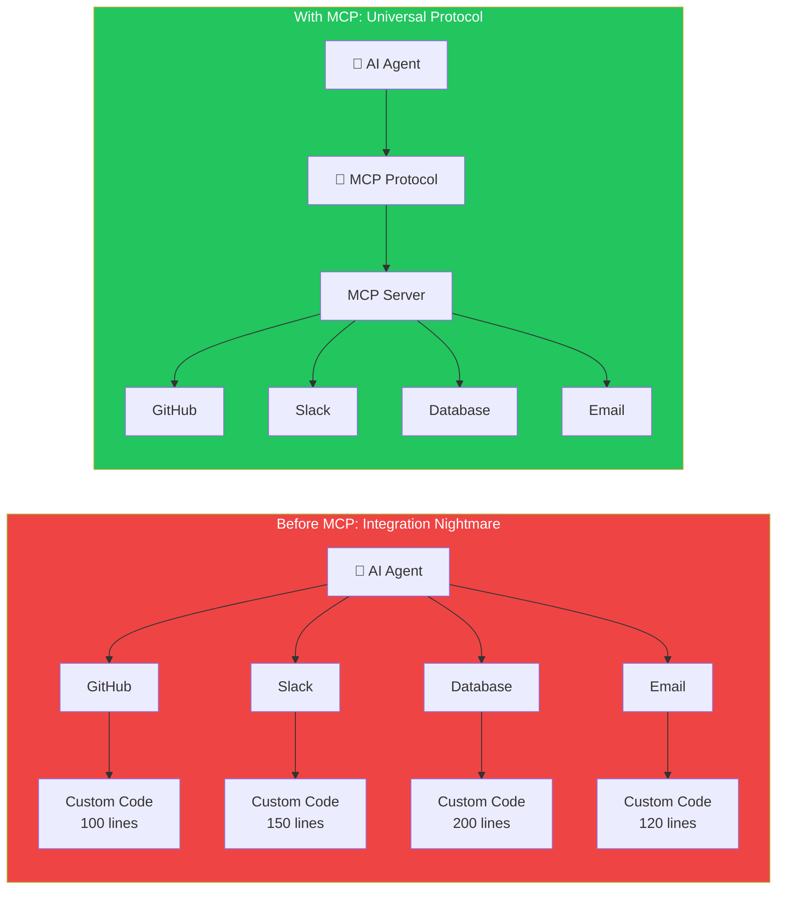
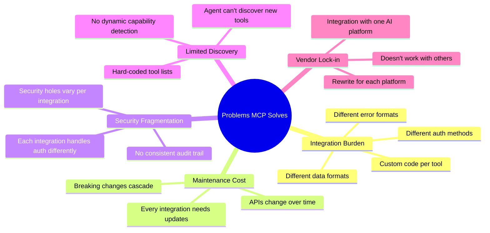
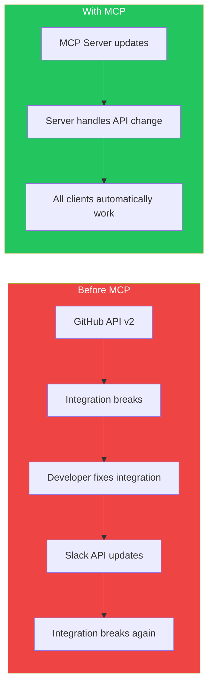
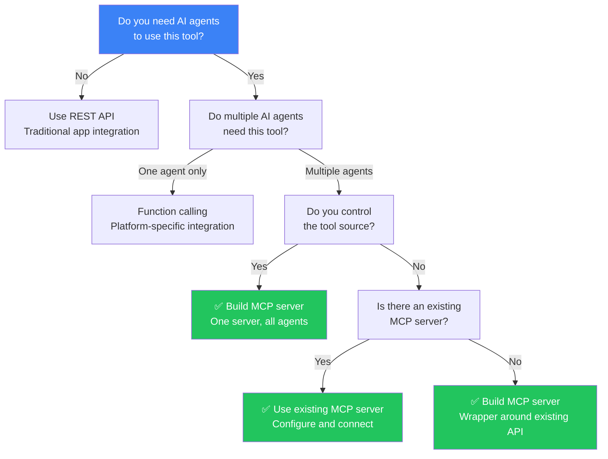
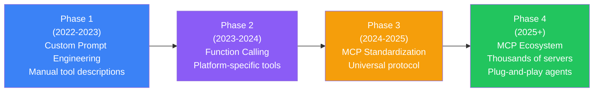

## Introduction

> **MCP exists because the AI industry was heading toward a future where every AI agent needed custom code for every tool — an unsustainable model that limited what agents could do and how quickly they could be deployed.**

Before MCP, connecting an AI agent to a tool meant: reading the tool's API documentation, writing custom integration code, handling authentication, managing errors, and maintaining the code as APIs changed. Every integration was bespoke. Every integration broke independently.

---

## The Problem MCP Solves

---

## Real-World Analogy

### Before and After Standardization

**Before standardization (like MCP):** Every home appliance had a unique plug. Your toaster needed a different outlet than your blender. If you moved to a different country, nothing worked.

**After standardization:** Every appliance uses the same plug. You can buy any appliance and plug it into any outlet. If a new appliance is invented tomorrow, it uses the same plug.

The AI industry was in the "before" phase — every integration was custom. MCP brings the "after" — any AI agent can connect to any MCP-compatible tool.

---

## Problems MCP Solves

### 1. Integration Burden

Before MCP, adding a new tool required:
- Reading API documentation
- Writing ~100-300 lines of integration code
- Handling authentication
- Implementing error handling
- Writing tests
- Maintaining as APIs change

With MCP, adding a tool means:
- Find an MCP server for the tool (or build one)
- Configure the connection
- Done. The tool is available.

### 2. Maintenance Cost

### 3. Security Fragmentation

Without a standard protocol, every integration handles security differently:
- Some use API keys in headers
- Some use OAuth
- Some use basic auth
- Some have no auth at all

MCP provides a **standard security model** with authentication, authorization, and audit logging built into the protocol.

---

## When to Choose MCP vs Custom Integration

## Comparison: Traditional APIs vs MCP

| Aspect | Traditional API Integration | MCP |
|--------|---------------------------|-----|
| **Connecting** | Write custom code | Configure MCP server |
| **Discovery** | Read documentation | Dynamic `tools/list` |
| **Auth** | Implement per API | Standard auth model |
| **Error handling** | Custom per API | Standard error format |
| **Schema** | Read docs or OpenAPI | JSON-RPC with schemas |
| **Versioning** | Track API changelogs | Protocol version negotiation |
| **Testing** | Mock each API | Test with any MCP client |
| **Maintenance** | Update when API changes | Server maintainer handles updates |
| **Portability** | Works with one agent | Works with all MCP clients |

---

## The Evolution of AI Integrations

---

## Real Production Examples

| Company | Before MCP | After MCP |
|---------|-----------|-----------|
| **Claude Desktop** | Could only read files, no external tools | Connects to databases, GitHub, Slack, and more |
| **Cursor** | Built-in code tools only | Can use any MCP code server |
| **Enterprise** | Custom integration per internal tool | One MCP server per tool, reusable across agents |

---

## Best Practices

1. **Adopt MCP early** — The ecosystem is growing fast; early adoption means early leverage
2. **Encourage tool providers to build MCP servers** — If you use a tool, request MCP support
3. **Build MCP servers for internal tools** — One server, reusable across all your AI agents
4. **Version lock in production** — Pin MCP protocol versions to avoid breaking changes

---

## Common Mistakes

| Mistake | Impact | Fix |
|---------|--------|-----|
| **Building custom integrations instead of MCP** | High maintenance, vendor lock-in | Build MCP servers, not custom integrations |
| **Ignoring MCP security model** | Vulnerable integrations | Follow MCP security best practices |
| **Not versioning servers** | Breaking changes affect all clients | Implement version negotiation |

---

## Interview Questions

### Beginner

**Q: What problem did MCP solve that couldn't be solved before?**

> MCP solved the problem of custom integrations. Before MCP, every AI agent needed custom code for every tool it wanted to use. MCP provides a standard protocol so any MCP-compatible agent can work with any MCP-compatible tool without custom code.

**Q: Why was MCP created?**

> MCP was created because the AI industry was becoming fragmented with proprietary integrations. Anthropic created MCP as an open standard to make AI tools interoperable, just like USB-C made devices interoperable.

### Intermediate

**Q: How does MCP reduce maintenance cost compared to custom integrations?**

> When an API changes, the MCP server maintainer updates the server once. All connected clients automatically work with the updated server. With custom integrations, every integration with that API would need to be updated individually.

### Senior

**Q: Design a migration strategy for a company with 50 custom AI integrations to switch to MCP.**

> Phase 1: Identify the 10 most-used integrations. Build MCP servers for each. Phase 2: Replace custom integrations with MCP clients in the AI agent codebase. Phase 3: Build MCP servers for the remaining 40 integrations. Phase 4: Decommission all custom integration code. During migration, run both systems in parallel with feature flags.

### Staff Engineer

**Q: How would you convince a CTO to standardize on MCP for all AI integrations?**

> Present three data points: (1) **Cost** — Building an MCP server costs the same as one custom integration, but is reusable across all agents (5-10x ROI). (2) **Velocity** — Adding a new tool goes from 2 weeks to 1 hour. (3) **Future-proofing** — As the AI ecosystem consolidates around MCP, non-standard integrations will become technical debt. CTOs care about cost, speed, and avoiding debt — MCP addresses all three.

### Architecture

**Q: Compare the evolution of AI integrations from prompt engineering to MCP.**

> **Phase 1 (Prompt Engineering)**: Describe tools in the prompt. Works for simple cases but doesn't scale. **Phase 2 (Function Calling)**: LLM-specific tool format. Works well but locks you into one LLM provider. **Phase 3 (MCP)**: Protocol-level standard. Works across all LLMs and tools. The evolution is from ad-hoc (prompt) → platform-specific (function calling) → universal (MCP).

### System Design

**Q: Design a company-wide MCP adoption strategy for an organization with 500 developers and 100 internal tools.**

> **Step 1: Governance** — MCP server standards team (3 people) defines: naming conventions, security requirements, deployment process. **Step 2: Priority** — Build MCP servers for the top 20 tools (80% of usage). **Step 3: Training** — Workshop for all developers on building MCP servers. **Step 4: Self-service** — Documentation and SDKs so any team can build MCP servers. **Step 5: Registry** — Internal MCP registry where developers discover available servers. **Step 6: Monitoring** — Track MCP server usage, uptime, and error rates.

---

## Summary

| Problem | MCP Solution |
|---------|-------------|
| Custom integrations for every tool | Standard protocol for all tools |
| High maintenance cost | Server-side updates benefit all clients |
| Security fragmentation | Built-in auth, authorization, audit |
| No tool discovery | Dynamic `tools/list` endpoint |
| Vendor lock-in | Works with any MCP-compatible client |

---

## Navigation

**Previous:** [01 — What is MCP?](/ai/phase-07-model-context-protocol/01-what-is-mcp)

**Next:** [03 — MCP Architecture](/ai/phase-07-model-context-protocol/03-mcp-architecture)
