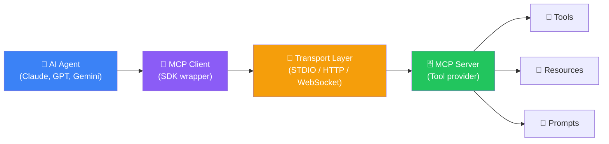
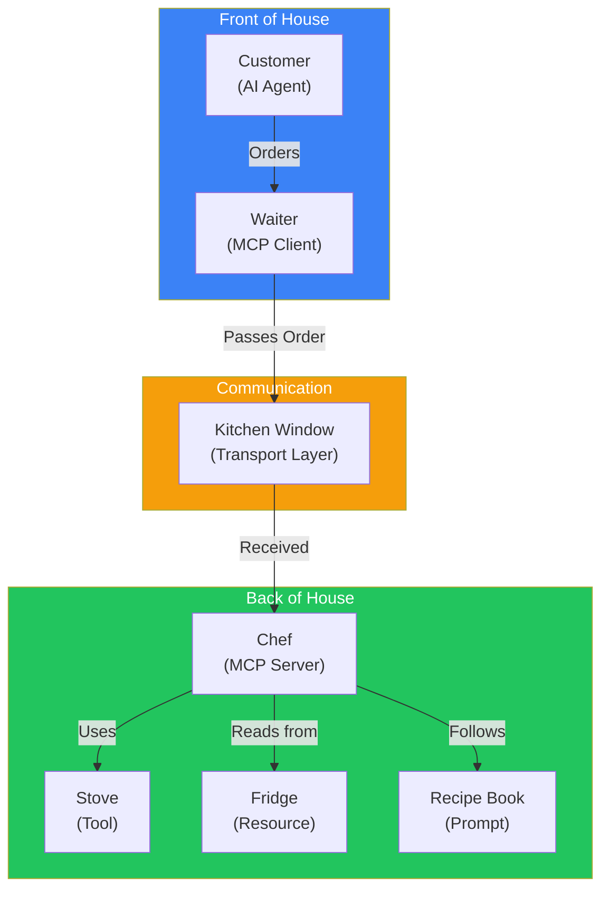
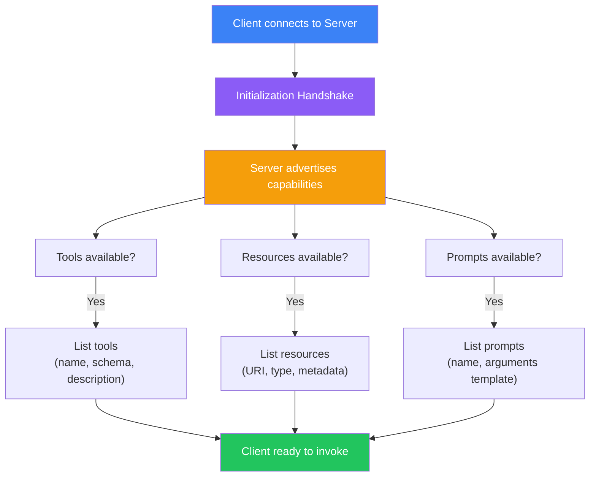
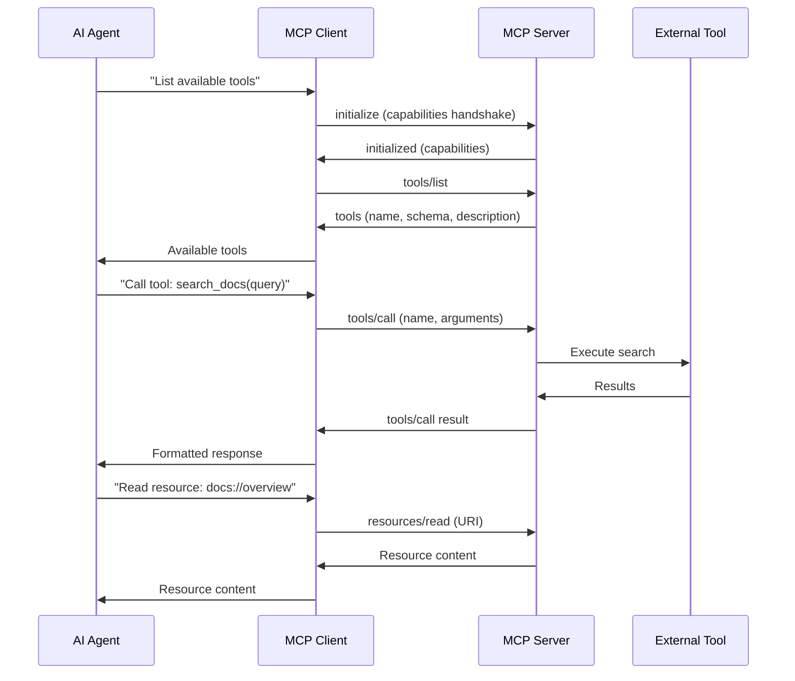
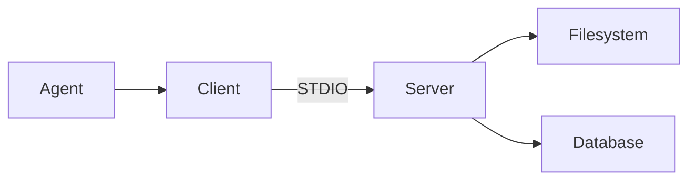
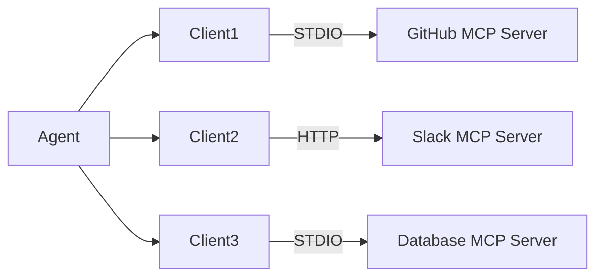
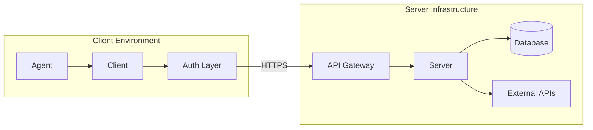
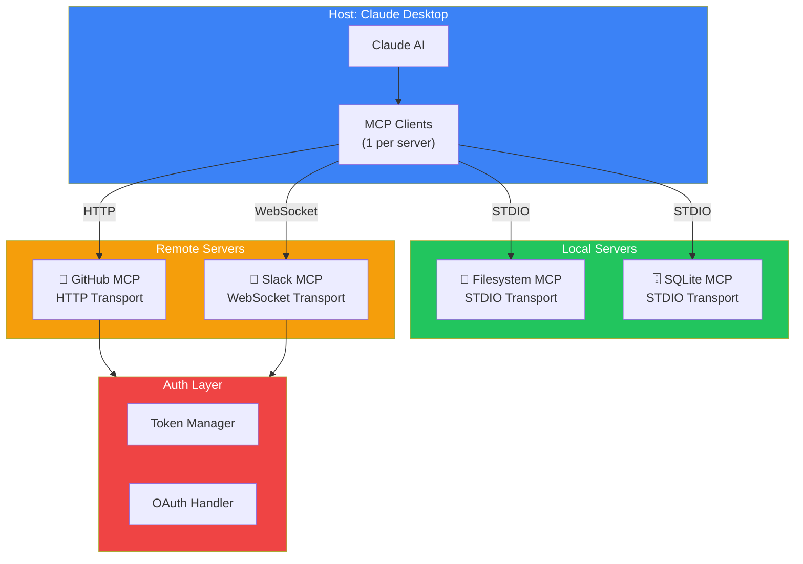

## Introduction

> **MCP Architecture is a client-server system where AI agents communicate with external tools and data sources through a standardized protocol — think of it as USB-C for AI integrations.**

The architecture is intentionally simple: one client connects to one server over a transport layer, the server exposes capabilities (tools, resources, prompts), and the client invokes them on behalf of the AI agent.

---

## Why This Architecture Exists

### The Problem Before MCP

Every AI integration was custom-built. If you wanted Claude to read a file, you wrote a custom API endpoint. If you wanted it to query a database, you built another custom integration. Every company reinvented the wheel.

### The Solution: A Standard Protocol

MCP defines a **standard contract** between AI agents and external systems:

| Component | Responsibility | Analogy |
|-----------|---------------|---------|
| **Host** | The AI application (Claude Desktop, Cursor, VS Code) | The user's computer |
| **Client** | Maintains the connection to the server | USB port |
| **Server** | Exposes tools, resources, and prompts | USB device |
| **Transport** | Handles communication between client and server | USB cable |
| **Capabilities** | What the server can do (tools, resources, prompts) | Device features |

---

## Real-World Analogy

### The Restaurant Kitchen

Imagine a restaurant:

- **The Customer** (AI Agent) wants food
- **The Waiter** (MCP Client) takes the order
- **The Kitchen Window** (Transport) passes the order to the kitchen
- **The Chef** (MCP Server) prepares the food
- **The Stove, Oven, Fridge** (Tools/Resources) are what the chef uses

The customer doesn't need to know how the kitchen works. The waiter translates the customer's request into something the kitchen understands.

---

## Core Architecture Components

### 1. Host

The **Host** is the AI application that needs access to external tools and data:

- **Claude Desktop** — Connects to MCP servers for filesystem, database, and API access
- **Cursor** — Uses MCP for code analysis and repository operations
- **VS Code AI** — Extends AI capabilities through MCP extensions
- **Custom Applications** — Any app that uses an LLM and needs tool access

The host creates and manages MCP client instances.

### 2. Client

The **Client** is a lightweight SDK wrapper that:

- Establishes a connection to the server
- Discovers available capabilities (handshake)
- Invokes tools on behalf of the agent
- Reads resources from the server
- Manages the session lifecycle
- Handles errors and reconnections

**Clients are stateful** — they maintain the connection context, pending requests, and server capabilities.

### 3. Server

The **Server** is the provider of capabilities. It:

- Exposes **Tools** (callable functions)
- Exposes **Resources** (readable data)
- Exposes **Prompts** (reusable templates)
- Validates and executes requests
- Returns results or errors

A server can be a local process (STDIO transport) or a remote service (HTTP/WebSocket transport).

### 4. Transport

The **Transport** layer handles the raw communication:

| Transport | Use Case | Pros | Cons |
|-----------|----------|------|------|
| **STDIO** | Local subprocess | Fast, secure, simple | Process-bound |
| **HTTP** | Remote server | Language-agnostic, scalable | Latency, auth required |
| **WebSocket** | Real-time streaming | Bidirectional, low latency | Complex setup |

---

## Capability Model

Every MCP server exposes capabilities. The client discovers them during the initialization handshake.

---

## Complete Communication Flow

---

## Architecture Patterns

### Pattern 1: Single Server (Local)

The simplest pattern — one agent, one MCP server running locally.

Best for: Development, personal tools, prototyping.

### Pattern 2: Multiple Servers

The agent connects to multiple MCP servers simultaneously.

Best for: Production systems, multi-tool agents.

### Pattern 3: Remote Server Architecture

Servers run remotely and are accessed over HTTP/WebSocket.

Best for: Enterprise deployments, multi-tenant systems.

---

## Production Architecture Example

---

## Best Practices

1. **One server per domain** — Each MCP server should have a single responsibility (filesystem, database, GitHub)
2. **Use STDIO for local, HTTP for remote** — Match transport to deployment context
3. **Cache capability discovery** — The handshake only needs to happen once per session
4. **Handle disconnections gracefully** — Implement reconnection logic with exponential backoff
5. **Version your MCP servers** — Capabilities may change between versions
6. **Log all requests** — Traceability is essential for debugging agent behavior

## Common Mistakes

| Mistake | Why It's Wrong |
|---------|---------------|
| Putting too many tools in one server | Makes discovery slow and tool naming confusing |
| Ignoring the handshake order | Calling tools before initialization fails |
| Using HTTP for local servers | Adds unnecessary latency and complexity |
| Not handling tool errors | Agent receives failures without context |
| Exposing database credentials in tool schemas | Security risk — use environment variables |

---

## Interview Questions

### Beginner

**Q: What are the three core capabilities an MCP server can expose?**

> An MCP server can expose: (1) **Tools** — callable functions that perform actions, (2) **Resources** — readable data sources like files and database records, and (3) **Prompts** — reusable prompt templates with dynamic arguments.

**Q: What transport protocols does MCP support?**

> MCP supports three transport protocols: **STDIO** for local subprocess communication, **HTTP** for remote server communication, and **WebSocket** for real-time bidirectional streaming.

### Intermediate

**Q: How does an MCP client discover server capabilities?**

> During the initialization handshake, the client sends an `initialize` request to the server. The server responds with its capabilities (which of tools, resources, and prompts it supports). The client then uses `tools/list`, `resources/list`, and `prompts/list` to get details about each capability, including schemas, descriptions, and metadata.

**Q: Why would you use multiple MCP servers instead of one?**

> Multiple servers provide separation of concerns — each server manages one domain (filesystem, database, GitHub). This makes it easier to develop, test, deploy, and secure each integration independently. It also allows the agent to connect to different servers as needed without loading all capabilities into a single server.

### Senior

**Q: Design an MCP server architecture for a multi-tenant enterprise application.**

> For multi-tenant enterprise MCP: (1) Use HTTP/WebSocket transport for remote access, (2) Implement authentication at the transport layer (API keys or OAuth), (3) Include tenant context in tool calls (headers or metadata), (4) Use tenant-scoped resources (each tenant sees only their data), (5) Implement rate limiting per tenant, (6) Log all activity with tenant IDs for audit, (7) Deploy behind a gateway that handles auth and routing.

**Q: How would you handle versioning of MCP server capabilities?**

> Versioning strategies: (1) Include API version in the server's capabilities response, (2) Use semantic versioning for the MCP server package, (3) Maintain backward compatibility — add new tools without removing old ones, (4) Deprecate tools gradually with warning messages, (5) Run multiple server versions during migration, (6) Document breaking changes in the server's capability metadata.

### Staff Engineer

**Q: How does MCP's architecture differ from traditional REST API architecture for AI tool access?**

> **REST API**: Each tool has its own API endpoint, authentication, error handling, and documentation. The AI agent needs custom integration code for each tool. No standard discovery mechanism. **MCP**: Standardized protocol where all tools follow the same interface. Automatic capability discovery via handshake. Unified error handling. One client SDK works with any server. Tools are self-documenting through schemas. Transport-agnostic — same server works over STDIO or HTTP.

### Architecture

**Q: Draw the lifecycle of an MCP connection from startup to shutdown. What happens at each step?**

> **Connection lifecycle:** (1) **Transport Setup** — Client establishes the transport channel (spawns subprocess for STDIO, connects via HTTP/WebSocket), (2) **Initialization** — Client sends `initialize` request with its protocol version and capabilities, server responds with its capabilities, (3) **Discovery** — Client queries `tools/list`, `resources/list`, `prompts/list` to learn what's available, (4) **Operation** — Client invokes tools, reads resources, and retrieves prompts as needed by the agent, (5) **Notifications** — Server can send notifications (resource changes, tool status), (6) **Termination** — Client sends `shutdown` or connection is closed, server cleans up resources.

---

## Summary

| Concept | Key Point |
|---------|-----------|
| **Architecture** | Client-server model with standardized protocol |
| **Host** | AI application that needs tool access |
| **Client** | SDK wrapper that manages the connection |
| **Server** | Provider of tools, resources, and prompts |
| **Transport** | Communication layer (STDIO, HTTP, WebSocket) |
| **Handshake** | Capability discovery on connection |
| **Patterns** | Single server, multiple servers, remote server |
| **Key principle** | Separation of concerns — one server per domain |

---

## Navigation

**Previous:** [02 — Why MCP Exists](/ai/phase-07-model-context-protocol/02-why-mcp)

**Next:** [04 — MCP Client](/ai/phase-07-model-context-protocol/04-mcp-client)

**Related Topics:**
- [What is MCP?](/ai/phase-07-model-context-protocol/01-what-is-mcp)
- [MCP Communication](/ai/phase-07-model-context-protocol/09-mcp-communication)
- [Transports](/ai/phase-07-model-context-protocol/10-transports)
