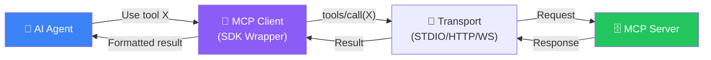
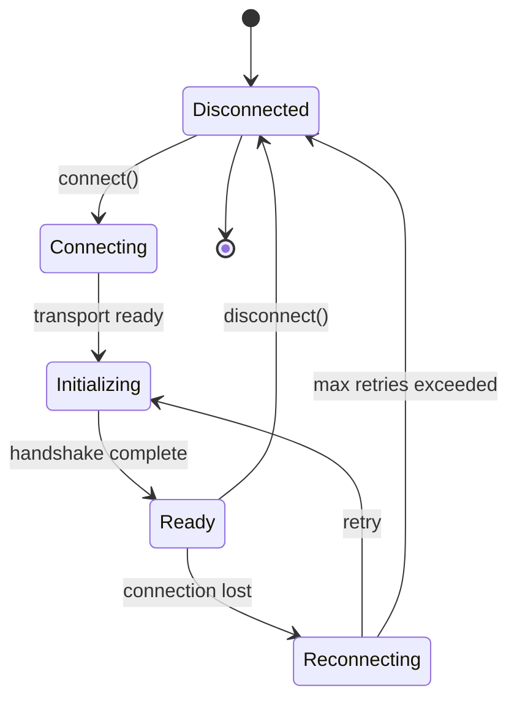
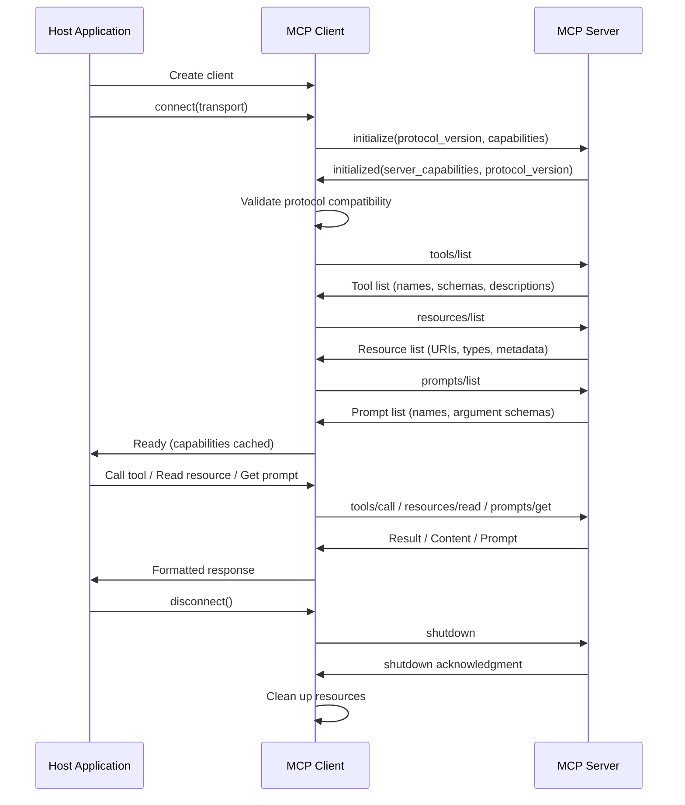
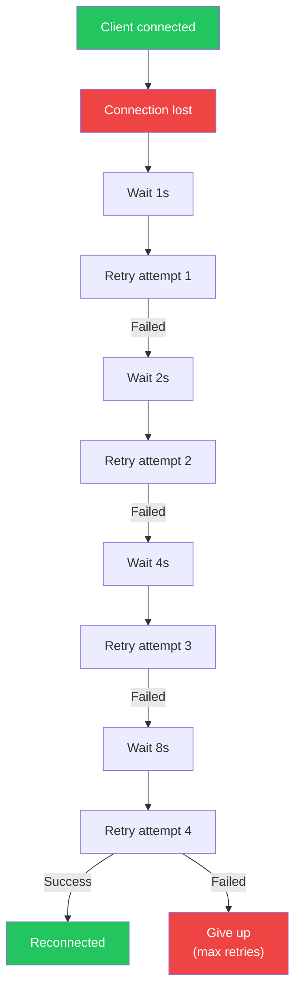
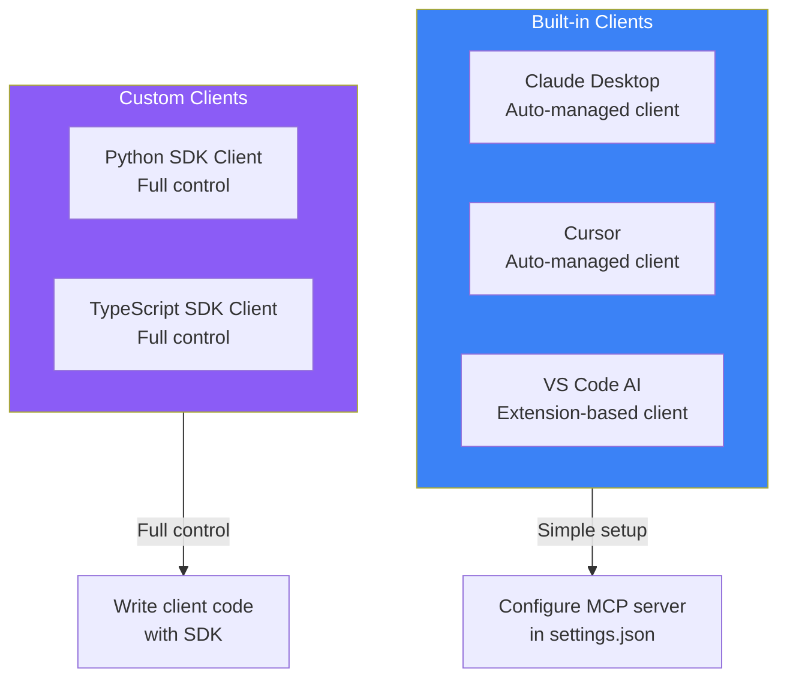

## Introduction

> **The MCP Client is the bridge between an AI agent and an MCP server — it handles connection management, capability discovery, tool invocation, and error handling so the agent can focus on its task.**

Every AI application that wants to use MCP needs a client. Claude Desktop has built-in MCP client support. Cursor uses MCP clients for code operations. If you're building a custom AI application, you'll use the MCP SDK to create your own client.



---

## Why the Client Exists

### The Problem: Agents Can't Talk Directly to Tools

AI agents speak natural language. External tools speak API calls. Without a client, every integration requires custom code to translate between the two.

### The Solution: A Standard Client SDK

The MCP Client abstracts away:

| Concern | Without Client | With Client |
|---------|---------------|-------------|
| **Transport** | Must implement raw I/O | Handled by SDK |
| **Serialization** | Manual JSON parsing | Automatic |
| **Discovery** | Hardcoded endpoints | Auto-discovery via handshake |
| **Error handling** | Manual retry logic | Built-in retries |
| **State management** | Must track connections | Managed lifecycle |

---

## Real-World Analogy

### The Universal Remote Control

Imagine a universal remote control (the MCP Client):

- You press **"Watch Netflix"** (the agent's request)
- The remote discovers your TV, soundbar, and streaming device (capability discovery)
- It sends the right IR signals to each device (tool invocation)
- It detects if something didn't work and retries (error handling)
- It tells you "Netflix is now playing" (formatted response)

Without the universal remote, you'd need three separate remotes and know exactly which buttons to press. The remote (client) handles all the complexity for you.

---

## Client Responsibilities

### 1. Connection Management

The client manages the full lifecycle of the connection to the server:



### 2. Capability Discovery

During initialization, the client exchanges capabilities with the server:

1. Client sends its protocol version and supported features
2. Server responds with its protocol version and capabilities
3. Client queries `tools/list`, `resources/list`, `prompts/list`
4. Client caches the capability information

### 3. Tool Invocation

When the agent wants to use a tool:

1. Agent provides tool name and arguments
2. Client validates arguments against the tool schema
3. Client sends `tools/call` request to the server
4. Client waits for response (or streams it)
5. Client formats the result for the agent
6. Client handles errors transparently

### 4. Resource Access

When the agent needs to read data:

1. Agent requests a resource by URI
2. Client sends `resources/read` to the server
3. Client returns the resource content to the agent
4. Client handles content type (text, binary, structured)

### 5. Prompt Management

When the agent needs a reusable prompt:

1. Agent requests a prompt by name with arguments
2. Client sends `prompts/get` to the server
3. Client returns the rendered prompt template
4. Agent uses the prompt in its conversation

---

## Client Initialization Sequence



---

## Client Configuration

```python
# Example: Configuring an MCP Client in Python
from mcp import ClientSession, StdioServerParameters
from mcp.client.stdio import stdio_client

# Configure the server parameters
server_params = StdioServerParameters(
    command="python",
    args=["-m", "my_mcp_server"],
    env={
        "API_KEY": "sk-...",
        "DATABASE_URL": "postgresql://localhost/mydb"
    }
)

# Create and connect the client
async with stdio_client(server_params) as (read, write):
    async with ClientSession(read, write) as session:
        # Initialize connection
        await session.initialize()

        # Discover capabilities
        tools = await session.list_tools()
        resources = await session.list_resources()
        prompts = await session.list_prompts()

        # Call a tool
        result = await session.call_tool(
            name="search_docs",
            arguments={"query": "MCP architecture"}
        )
        print(result.content)

        # Read a resource
        resource = await session.read_resource(
            uri="docs://overview"
        )
        print(resource.content)
```

---

## Client Features

### Automatic Reconnection



### Request Timeout

Clients should implement configurable timeouts to prevent hanging:

| Operation | Default Timeout | Notes |
|-----------|----------------|-------|
| `initialize` | 10s | Server handshake |
| `tools/list` | 10s | Capability discovery |
| `tools/call` | 60s | Tool execution |
| `resources/read` | 30s | Resource access |
| `prompts/get` | 10s | Prompt rendering |

### Streaming Responses

For long-running tools, clients support streaming:

```python
# Streaming tool results
async for chunk in session.call_tool_streaming(
    name="long_running_task",
    arguments={"input": "large dataset"}
):
    # Process each chunk as it arrives
    print(f"Progress: {chunk.progress}")
    if chunk.type == "final":
        print(f"Result: {chunk.content}")
```

---

## Client Comparison: Built-in vs Custom



---

## Best Practices

1. **Initialize once, reuse** — Perform the handshake once and cache capabilities for the session
2. **Implement timeouts** — Always set timeouts on tool calls to prevent hanging
3. **Handle disconnections** — Implement exponential backoff reconnection
4. **Validate arguments** — Check tool arguments against schemas before sending
5. **Log everything** — Trace all client operations for debugging
6. **Use type hints** — TypeScript and Python SDKs support full type safety
7. **Test with mock servers** — Use the MCP Inspector for testing client behavior

## Common Mistakes

| Mistake | Why It's Wrong |
|---------|---------------|
| Creating a new client for every request | Wastes time on repeated handshakes |
| Not handling initialization failures | Client appears ready but isn't |
| Ignoring server capability changes | Assumes capabilities never change |
| Hardcoding transport parameters | Reduces portability |
| Not cleaning up clients | Resource leaks (file descriptors, connections) |

---

## Interview Questions

### Beginner

**Q: What is the primary responsibility of an MCP Client?**

> The MCP Client manages the connection between an AI agent and an MCP server. It handles initialization, capability discovery, tool invocation, resource access, error handling, and session lifecycle management.

**Q: How does a client discover what capabilities a server offers?**

> The client sends an `initialize` request with its protocol version. The server responds with its capabilities (tools, resources, prompts). The client then queries `tools/list`, `resources/list`, and `prompts/list` to get details about each capability.

### Intermediate

**Q: Explain the initialization handshake between client and server.**

> The client sends an `initialize` request containing its protocol version and supported features. The server responds with its protocol version and capabilities. The client checks protocol compatibility (versions must match a compatible range). If compatible, the client proceeds to discover tools, resources, and prompts. If incompatible, the client should disconnect and report the version mismatch.

**Q: How would you implement retry logic in an MCP client?**

> Implement exponential backoff: wait 1s, 2s, 4s, 8s between retry attempts with a configurable max retry count. Track whether the failure is transient (network issue) or permanent (invalid server). For transient failures, retry. For permanent failures, report the error immediately. Notify the agent about the reconnection status.

### Senior

**Q: Design an MCP client that connects to multiple servers simultaneously.**

> The client would maintain a registry of active sessions, each with its own transport, server capabilities cache, and state machine. When the agent requests a tool, the client would check which server advertises that tool and route the request accordingly. The client would also handle server disconnections independently, reconnecting each server without affecting other connections.

**Q: How would you handle a server that changes its capabilities mid-session?**

> The MCP protocol supports notifications for capability changes. The client would listen for `notifications/capabilities/updated`. On receiving this notification, the client re-queries `tools/list`, `resources/list`, and `prompts/list` to refresh its cache. The agent should be notified of any removed or added capabilities.

### Staff Engineer

**Q: Compare the MCP Client architecture with a traditional API gateway. When would you use each?**

> **MCP Client**: Designed for AI agent communication. Features include capability discovery, tool schema validation, streaming support, and session management. Best for direct agent-to-server communication. **API Gateway**: Designed for microservice architecture. Features include routing, rate limiting, auth aggregation, and request transformation. Best for managing many backend services. **Use case**: Use MCP Client when building AI agents that need tool access. Deploy behind an API Gateway when you need to expose MCP servers to many clients with auth, rate limiting, and monitoring.

### Architecture

**Q: Draw the state machine for an MCP Client and explain each state transition.**

> States: **Disconnected** (initial state) → **Connecting** (transport being established) → **Initializing** (handshake in progress) → **Ready** (capabilities discovered, operational) → **Reconnecting** (connection lost, attempting recovery) → **Disconnected** (intentional shutdown or max retries). Transitions: connect() moves from Disconnected to Connecting. Successful transport moves to Initializing. Handshake success moves to Ready. Connection failure moves to Reconnecting. Shutdown moves to Disconnected. Retry failure moves from Reconnecting to Disconnected.

---

## Summary

| Concept | Key Point |
|---------|-----------|
| **Client role** | Bridge between AI agent and MCP server |
| **Connection lifecycle** | Disconnected → Connecting → Initializing → Ready |
| **Capability discovery** | Automatic via handshake and list queries |
| **Tool invocation** | Validate → Send → Wait → Format |
| **Error handling** | Retry with exponential backoff |
| **Multiple servers** | One client per server, or managed registry |
| **Key SDKs** | Python, TypeScript, Java |

---

## Navigation

**Previous:** [03 — MCP Architecture](/ai/phase-07-model-context-protocol/03-mcp-architecture)

**Next:** [05 — MCP Server](/ai/phase-07-model-context-protocol/05-mcp-server)

**Related Topics:**
- [MCP Architecture](/ai/phase-07-model-context-protocol/03-mcp-architecture)
- [Build Your First MCP Client](/ai/phase-07-model-context-protocol/12-build-your-first-mcp-client)
- [MCP Communication](/ai/phase-07-model-context-protocol/09-mcp-communication)
