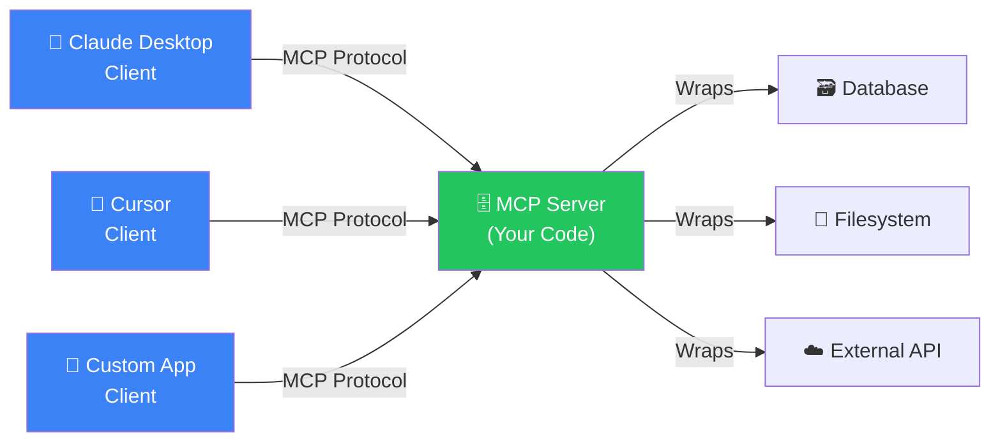
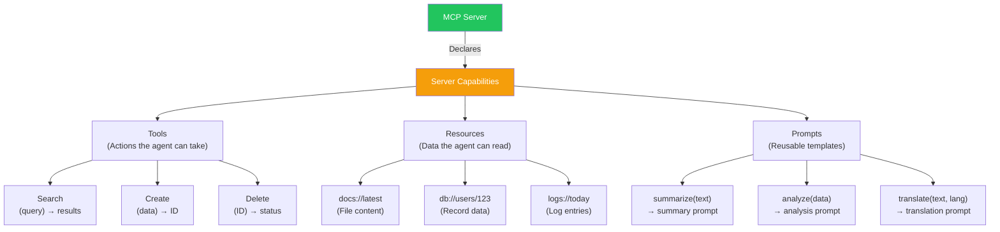
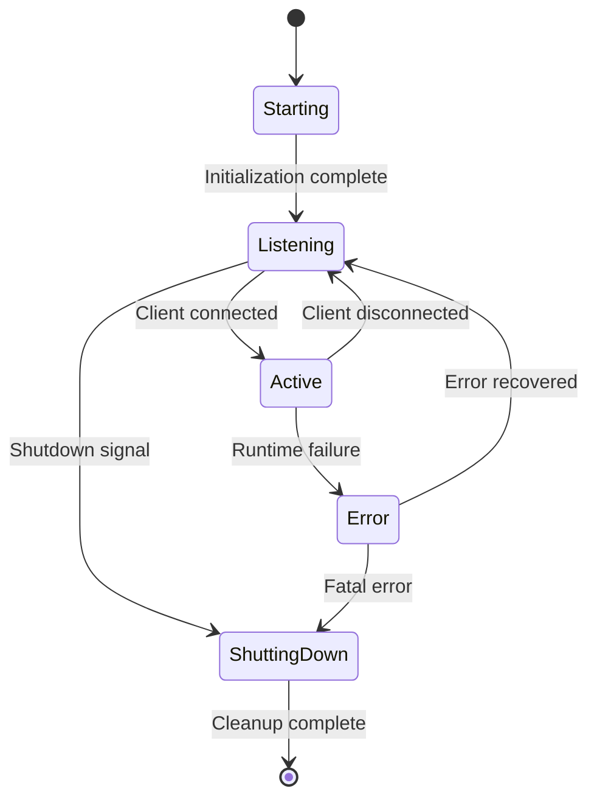
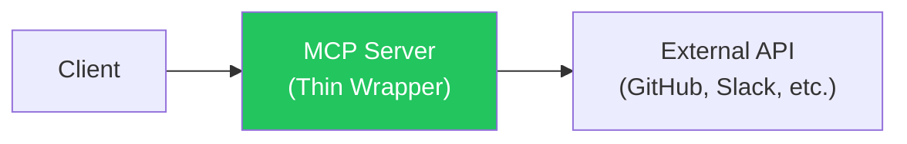
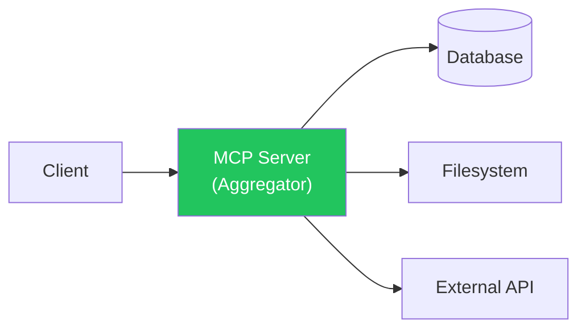
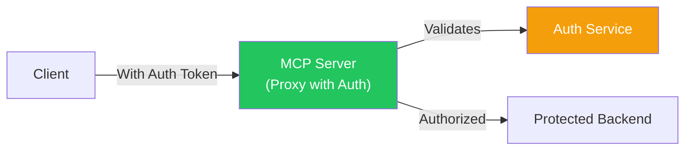

## Introduction

> **An MCP Server is a program that exposes capabilities — tools, resources, and prompts — to AI agents through the standardized Model Context Protocol.**

MCP servers are the "providers" in the MCP ecosystem. They wrap external systems (file systems, databases, APIs, search engines) and make them accessible to any MCP-compatible client. One server, any client.



---

## Why the Server Exists

### The Problem: Every Integration Was Custom

Before MCP, if you wanted an AI agent to access a database, you had to:
1. Build a custom API endpoint
2. Document the endpoint for the AI
3. Handle authentication separately
4. Write custom error handling
5. Maintain compatibility across versions

This was repeated for every tool, every database, every API.

### The Solution: A Universal Server

An MCP Server encapsulates all of that:
- One server interface works with any MCP client
- Capabilities are self-documenting (schemas)
- Authentication is handled at the transport level
- Error handling follows the protocol standard
- Versioning is built into the protocol

---

## Real-World Analogy

### The Food Truck

Imagine a food truck (MCP Server):

- The truck has a **menu board** (capability list) showing what it offers
- You order from the **window** (tool invocation)
- The chef prepares your food using **ingredients and equipment** (backend systems)
- You get your **order** (result)

The food truck doesn't care who the customer is — it serves anyone who comes to the window. Similarly, an MCP server doesn't care which client connects — it serves any MCP-compatible client.

---

## Server Responsibilities

### 1. Expose Capabilities

The server must declare what it can do:



### 2. Handle Tool Requests

When the client calls a tool:

1. Server receives `tools/call` with tool name and arguments
2. Server validates arguments against the tool's input schema
3. Server executes the tool (queries database, calls API, reads file)
4. Server formats the result according to the output schema
5. Server returns `CallToolResult` to the client

### 3. Serve Resources

When the client requests a resource:

1. Server receives `resources/read` with resource URI
2. Server locates the resource (file, database record, API endpoint)
3. Server reads and formats the content
4. Server returns `ReadResourceResult` with content and metadata

### 4. Provide Prompts

When the client requests a prompt:

1. Server receives `prompts/get` with prompt name and arguments
2. Server renders the prompt template with the provided arguments
3. Server returns `GetPromptResult` with the rendered messages

---

## Server Lifecycle



---

## Server Implementation

### Minimal Python Server

```python
from mcp.server import Server
from mcp.server.stdio import stdio_server
from mcp.types import Tool, TextContent

# Create the server
server = Server("my-first-server")

# Define a tool
@server.list_tools()
async def list_tools() -> list[Tool]:
    return [
        Tool(
            name="greet",
            description="Greet someone by name",
            inputSchema={
                "type": "object",
                "properties": {
                    "name": {"type": "string", "description": "Name to greet"}
                },
                "required": ["name"]
            }
        )
    ]

# Handle tool calls
@server.call_tool()
async def call_tool(name: str, arguments: dict) -> list[TextContent]:
    if name == "greet":
        person = arguments["name"]
        return [TextContent(type="text", text=f"Hello, {person}!")]
    raise ValueError(f"Unknown tool: {name}")

# Run the server
async def main():
    async with stdio_server() as (read, write):
        await server.run(read, write, server.create_initialization_options())
```

### Minimal TypeScript Server

```typescript
import { Server } from "@modelcontextprotocol/sdk/server/index.js";
import { StdioServerTransport } from "@modelcontextprotocol/sdk/server/stdio.js";

const server = new Server(
  { name: "my-first-server", version: "1.0.0" },
  { capabilities: { tools: {} } }
);

server.setRequestHandler("tools/list", async () => ({
  tools: [{
    name: "greet",
    description: "Greet someone by name",
    inputSchema: {
      type: "object",
      properties: {
        name: { type: "string", description: "Name to greet" }
      },
      required: ["name"]
    }
  }]
}));

server.setRequestHandler("tools/call", async (request) => {
  if (request.params.name === "greet") {
    return {
      content: [{ type: "text", text: `Hello, ${request.params.arguments.name}!` }]
    };
  }
  throw new Error(`Unknown tool: ${request.params.name}`);
});

const transport = new StdioServerTransport();
await server.connect(transport);
```

---

## Server Architecture Patterns

### Pattern 1: Thin Wrapper

The server is a thin wrapper around an existing API.



**Pros**: Fast to build. **Cons**: Limited control over behavior.

### Pattern 2: Aggregation Server

The server aggregates multiple backend systems.



**Pros**: Single interface for multiple systems. **Cons**: More complex.

### Pattern 3: Proxy Server with Auth

The server adds authentication and access control.



---

## Error Handling

Servers must handle errors gracefully:

| Error Type | Server Response | Recovery |
|------------|----------------|----------|
| **Invalid arguments** | Tool-specific error with details | Client validates before retry |
| **Tool not found** | `MethodNotFound` error | Client checks capability cache |
| **Backend failure** | Tool error with context | Client can retry or alert agent |
| **Rate limited** | Throttling error with retry-after | Client waits and retries |
| **Auth expired** | Auth error | Client re-authenticates |

---

## Security Considerations

1. **Validate all inputs** — Never trust arguments from the client
2. **Use minimal permissions** — Each server should have the least access needed
3. **Sanitize outputs** — Don't leak sensitive data in responses
4. **Log all operations** — Every tool call should be traceable
5. **Implement rate limiting** — Prevent abuse by aggressive agents
6. **Use environment variables** — Never hardcode secrets in server code
7. **Validate resource URIs** — Prevent path traversal attacks

---

## Best Practices

1. **One server per domain** — Filesystem server, database server, API server — each separate
2. **Descriptive tool names** — `search_docs` not `sd` — agents rely on names
3. **Comprehensive schemas** — Include descriptions for every parameter
4. **Graceful degradation** — If a backend is down, return a clear error, not a crash
5. **Idempotent where possible** — Repeated calls should be safe
6. **Version your servers** — Include version in server metadata
7. **Test with MCP Inspector** — Use the official testing tool

## Common Mistakes

| Mistake | Why It's Wrong |
|---------|---------------|
| Exposing too many tools | Overwhelms agent, slows capability discovery |
| Poor tool descriptions | Agent can't figure out when to use the tool |
| No input validation | Security risk — malicious inputs could exploit backends |
| Blocking operations | Tool calls should be async to handle concurrent requests |
| No error context | Agent receives failure without knowing why |

---

## Interview Questions

### Beginner

**Q: What are the three types of capabilities an MCP server can expose?**

> An MCP server can expose: (1) **Tools** — callable actions the agent can invoke, (2) **Resources** — data the agent can read, and (3) **Prompts** — reusable prompt templates.

**Q: How does a server advertise its capabilities to a client?**

> During initialization, the server responds to the `initialize` request with its capabilities object indicating which features (tools, resources, prompts) it supports. The client then queries each capability type individually.

### Intermediate

**Q: Explain the difference between a tool and a resource in an MCP server.**

> A **tool** is an action — it performs work, changes state, and returns a result. Example: `create_file(path, content)` creates a file. A **resource** is data — it provides information without changing state. Example: `docs://readme` returns the content of a README file. Tools are actions; resources are data.

**Q: How would you handle authentication in an MCP server?**

> Authentication depends on the transport: For STDIO transport, use environment variables passed to the server process. For HTTP transport, use standard HTTP auth (API keys in headers, OAuth tokens). The server validates credentials on initialization and rejects unauthorized requests. Token refresh should be handled transparently.

### Senior

**Q: Design an MCP server that provides access to a PostgreSQL database with security in mind.**

> The server would expose tools like `query_database(sql)`, `get_table_schema(table_name)`, and `list_tables()`. Security measures: (1) Use a read-only database user for query tools, (2) Parse SQL to block destructive statements (DROP, DELETE, UPDATE), (3) Set query timeout (30s max), (4) Limit result size (1000 rows), (5) Validate table names against an allowlist, (6) Never expose connection strings in tool responses, (7) Log every query with agent context.

**Q: How do you version an MCP server without breaking existing clients?**

> Versioning strategies: (1) Include server version in `serverInfo` during initialization, (2) Support multiple versions of tools simultaneously (e.g., `search_v1`, `search_v2`), (3) Add new parameters as optional with defaults, (4) Deprecate tools gradually — return deprecation warnings in responses, (5) Use the client's protocol version to conditionally expose capabilities, (6) Communicate breaking changes in the server's capabilities metadata.

### Staff Engineer

**Q: Design a high-availability MCP server deployment for a production enterprise application.**

> Architecture: Deploy behind a load balancer with health checks. Use multiple server instances (horizontal scaling). Use a connection pool for databases. Implement circuit breakers for downstream dependencies. Use Redis for caching frequently accessed resources. Implement distributed tracing (OpenTelemetry). Use a message queue for async tool execution. Deploy with Kubernetes for auto-scaling and self-healing. Use blue-green deployment for zero-downtime updates. Monitor with dashboards for tool call latency, error rates, and resource usage.

### Architecture

**Q: Compare the architecture of an MCP server with a traditional REST API server. What are the key differences?**

> **MCP Server**: Standardized protocol, self-describing capabilities, transport-agnostic (STDIO/HTTP/WS), schema-based tool definitions, streaming support, built-in error protocol. **REST API**: Custom endpoints per resource, no standard discovery mechanism, HTTP-only, response format varies, no streaming, error format varies. **Key advantage of MCP**: Any MCP client can work with any MCP server without custom integration code. With REST, every client needs custom code for every API.

---

## Summary

| Concept | Key Point |
|---------|-----------|
| **Server role** | Provides tools, resources, and prompts to AI agents |
| **Capabilities** | Tools (actions), Resources (data), Prompts (templates) |
| **Lifecycle** | Starting → Listening → Active → Shutting Down |
| **Transport** | STDIO (local), HTTP/WebSocket (remote) |
| **Security** | Validate inputs, use env vars, log everything |
| **Patterns** | Thin wrapper, aggregation, proxy with auth |
| **Key principle** | One server per domain of responsibility |

---

## Navigation

**Previous:** [04 — MCP Client](/ai/phase-07-model-context-protocol/04-mcp-client)

**Next:** [06 — Tools](/ai/phase-07-model-context-protocol/06-tools)

**Related Topics:**
- [MCP Architecture](/ai/phase-07-model-context-protocol/03-mcp-architecture)
- [Tools](/ai/phase-07-model-context-protocol/06-tools)
- [Resources](/ai/phase-07-model-context-protocol/07-resources)
- [Prompts](/ai/phase-07-model-context-protocol/08-prompts)
