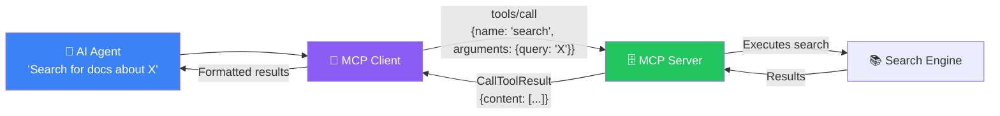
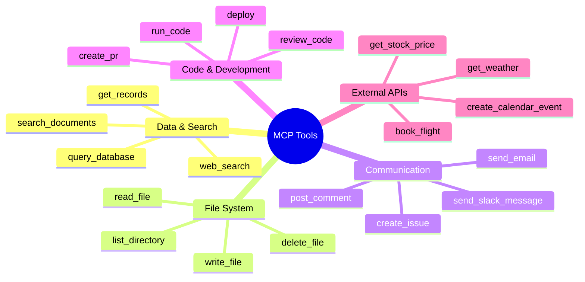
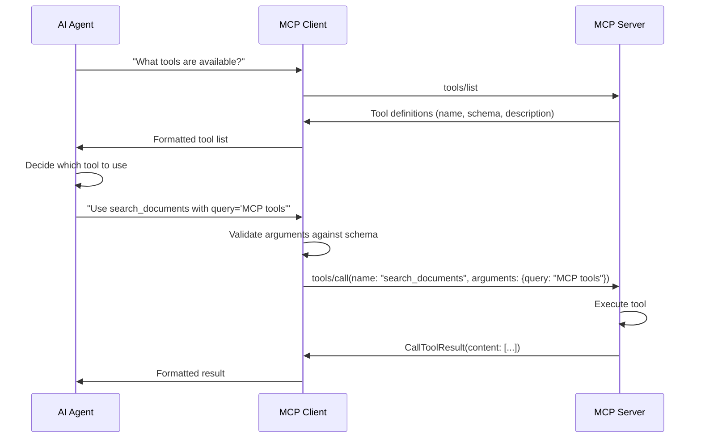
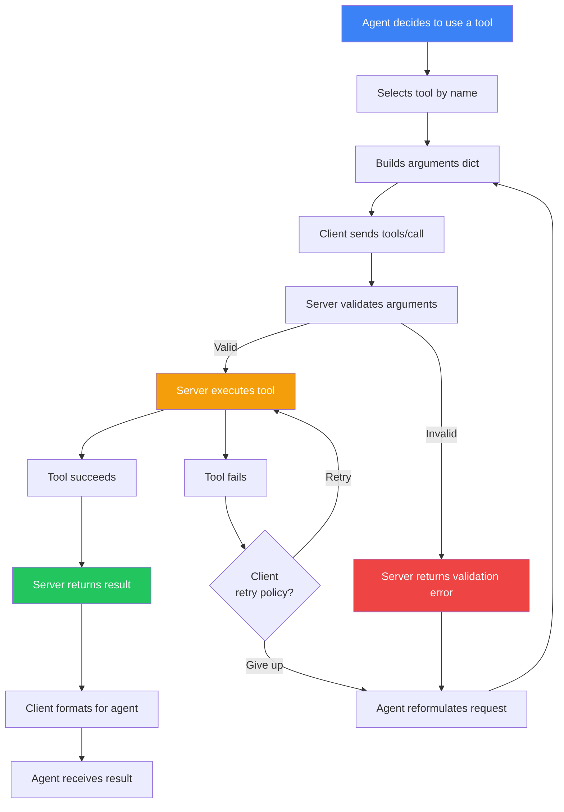
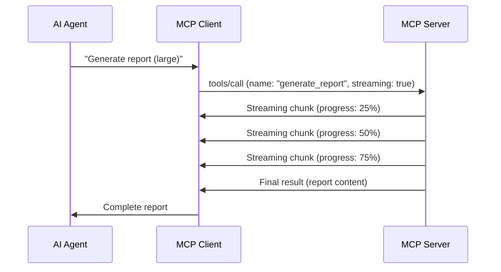
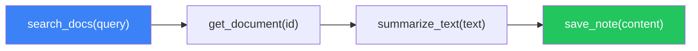
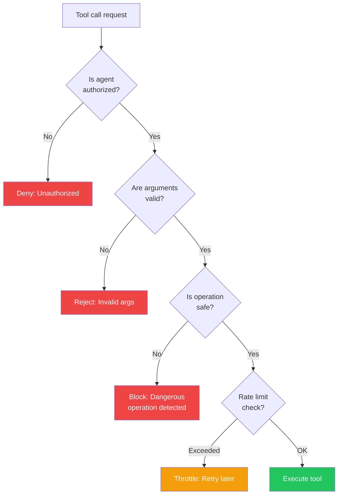

## Introduction

> **Tools are callable actions that an MCP server exposes to AI agents — they are the primary way agents interact with the outside world.**

When an AI agent needs to do something — search a database, send an email, create a file, call an API — it uses a tool. Tools are the difference between an LLM that can only talk and an agent that can act.



---

## Why Tools Exist

### The Problem: LLMs Can Only Generate Text

A large language model (LLM) can only predict the next token. It cannot:
- Query a database
- Read a file
- Send an HTTP request
- Run code
- Access real-time data

### The Solution: Tools Bridge the Gap

Tools give LLMs the ability to interact with the world. The LLM decides **when** to use a tool and **what arguments** to pass, but the tool itself executes the action.

| Capability | Without Tools | With Tools |
|-----------|---------------|------------|
| **Real-time data** | Only knows training data | Can query live APIs |
| **Actions** | Can only generate text | Can create, update, delete |
| **Computation** | Limited reasoning | Can run code, query databases |
| **External systems** | No access | Full API integration |

---

## Real-World Analogy

### The Chef's Kitchen Tools

Imagine a chef (the AI agent):

- The chef has knowledge (recipes, techniques) — this is the LLM
- But the chef needs tools to cook:
  - **Knife** (Tool: `cut_ingredients`)
  - **Stove** (Tool: `heat_pan`)
  - **Oven** (Tool: `bake`)
  - **Mixer** (Tool: `mix`)

The chef decides which tool to use and when. But the tool itself does the physical work. The chef can't bake bread just by thinking about it — they need the oven.

---

## Tool Definition

Every tool has a definition that the client discovers during initialization:

```json
{
  "name": "search_documents",
  "description": "Search the knowledge base for documents matching a query",
  "inputSchema": {
    "type": "object",
    "properties": {
      "query": {
        "type": "string",
        "description": "The search query text"
      },
      "max_results": {
        "type": "integer",
        "description": "Maximum number of results to return (default: 5)",
        "default": 5
      },
      "filter_by": {
        "type": "string",
        "description": "Optional category filter",
        "enum": ["all", "technical", "business", "product"]
      }
    },
    "required": ["query"]
  }
}
```

### Tool Schema Components

| Component | Description | Example |
|-----------|-------------|---------|
| **name** | Unique identifier for the tool | `search_documents` |
| **description** | What the tool does (agent uses this to decide) | `Search the knowledge base...` |
| **inputSchema** | JSON Schema defining valid arguments | Properties with types and constraints |
| **output** | Tool result format (text, image, resource) | `TextContent` or `ImageContent` |

---

## Common Tool Categories



---

## Tool Discovery Flow



---

## Tool Invocation Lifecycle



---

## Tool Result Types

Tools can return different types of content:

```python
# Text result
TextContent(type="text", text="Search results: ...")

# Image result
ImageContent(type="image", data="base64...", mimeType="image/png")

# Resource result (embedded resource)
EmbeddedResource(
    type="resource",
    resource=ResourceContents(
        uri="file://report.pdf",
        mimeType="application/pdf",
        text="PDF content..."
    )
)
```

---

## Advanced Tool Patterns

### Streaming Tools

For long-running operations:



### Tool Chaining

Multiple tools called in sequence:



### Conditional Tools

Tools that are only available in certain contexts:

- **Admin tools** — Available only to authenticated admin users
- **Environment tools** — Available only in specific environments (dev/staging/prod)
- **Permission-based tools** — Available based on user roles

---

## Tool Safety



---

## Best Practices

1. **One purpose per tool** — Each tool should do one thing well
2. **Descriptive names** — Agents use names to decide; `search_knowledge_base` is better than `skb`
3. **Comprehensive descriptions** — Explain when and why to use each tool
4. **Schema validation** — Define required vs optional parameters clearly
5. **Meaningful defaults** — Reduce agent decision fatigue
6. **Idempotent reads** — Reading tools should be safe to repeat
7. **Scoped permissions** — Each tool should have minimal access

## Common Mistakes

| Mistake | Why It's Wrong |
|---------|---------------|
| Too many tools (20+) | Agent can't decide which to use; discovery is slow |
| Vague tool names | `do_thing` — agent has no idea what this does |
| Missing descriptions | Agent can't understand tool purpose |
| Required fields without defaults | Every call needs explicit values |
| Silent failures | Agent thinks tool succeeded but it didn't |
| No rate limiting | Agent can spam expensive tools |

---

## Interview Questions

### Beginner

**Q: What is an MCP Tool and how does it differ from a regular API endpoint?**

> An MCP Tool is a callable action exposed by an MCP server to AI agents. Unlike a regular API endpoint, a tool has a standardized schema, is discovered through the MCP protocol, and is designed to be called by an LLM that decides when to use it based on the tool's name and description.

**Q: What information does a tool definition include?**

> A tool definition includes: (1) **name** — unique identifier, (2) **description** — explains what the tool does, (3) **inputSchema** — JSON Schema describing valid arguments and types, and optionally (4) output type information.

### Intermediate

**Q: How does an AI agent decide which tool to use?**

> The agent receives a list of tool definitions (names, descriptions, schemas) during capability discovery. When the agent encounters a task that requires external action (searching, writing, computing), it examines the available tools and selects the one whose name and description best match the required action. The agent then generates the appropriate arguments according to the tool's schema.

**Q: Explain the validation flow when an agent calls a tool.**

> (1) Agent selects tool and builds arguments, (2) Client receives the request and validates arguments against the tool's inputSchema, (3) Client sends `tools/call` to the server, (4) Server validates arguments again, (5) Server executes the tool, (6) Server returns `CallToolResult`, (7) Client formats the result for the agent.

### Senior

**Q: Design a tool system that prevents prompt injection attacks through tool arguments.**

> Prevention strategies: (1) Validate all string arguments against expected patterns (regex allowlists), (2) Use enum types for categorical arguments instead of free text, (3) Never pass user input directly as tool arguments — sanitize through the server, (4) Implement tool-specific rate limiting, (5) Log all tool calls with full argument dumps for audit, (6) Use a safety classifier on arguments before execution, (7) Implement confirmation dialogs for destructive tools (delete, update).

**Q: How would you handle a tool that takes 5+ minutes to complete?**

> Use async tool execution pattern: (1) Return a `task_id` immediately, (2) Execute the long-running operation asynchronously, (3) Provide a `check_task_status(task_id)` tool for polling, (4) Optionally support WebSocket transport for push notifications, (5) Set appropriate timeouts at the client level, (6) Consider streaming progress updates for visibility.

### Staff Engineer

**Q: Design a governance system for MCP tools in a large enterprise with hundreds of tools across dozens of servers.**

> Governance system components: (1) **Tool Registry** — Central catalog of all tools, their schemas, owners, and approval status, (2) **Access Control** — Role-based and attribute-based access per tool group, (3) **Audit Trail** — Every tool call logged with agent ID, arguments, result, and timestamp, (4) **Usage Analytics** — Dashboard showing most-used tools, failure rates, and latency, (5) **Versioning** — Tools are versioned; old versions are deprecated with migration paths, (6) **Review Process** — New tools require schema review, security review, and performance review, (7) **Testing** — Sandbox environment for testing tools before production approval.

### Architecture

**Q: Compare and contrast MCP tools with OpenAI function calling. What are the architectural differences?**

> **Similarities**: Both define callable functions with JSON Schema arguments, both let the LLM decide when to call, both return structured results. **Differences**: MCP tools are defined and served externally (by MCP servers), while OpenAI function calling is defined in the API request. MCP supports discovery (agent can ask what tools are available), while function calling requires all tools to be declared upfront. MCP supports multiple transports (STDIO, HTTP, WS), while function calling is HTTP-only. MCP tools are reusable across any MCP client, while function calling is tied to OpenAI's API.

---

## Summary

| Concept | Key Point |
|---------|-----------|
| **Tool purpose** | Give AI agents the ability to act on the world |
| **Tool definition** | name, description, inputSchema |
| **Discovery** | `tools/list` during initialization |
| **Invocation** | `tools/call` with name + arguments |
| **Result types** | Text, Image, Embedded Resource |
| **Safety** | Validation, rate limiting, permissions |
| **Patterns** | Single, chained, streaming, conditional |

---

## Navigation

**Previous:** [05 — MCP Server](/ai/phase-07-model-context-protocol/05-mcp-server)

**Next:** [07 — Resources](/ai/phase-07-model-context-protocol/07-resources)

**Related Topics:**
- [Resources](/ai/phase-07-model-context-protocol/07-resources)
- [Prompts](/ai/phase-07-model-context-protocol/08-prompts)
- [Build Your First MCP Server](/ai/phase-07-model-context-protocol/11-build-your-first-mcp-server)
