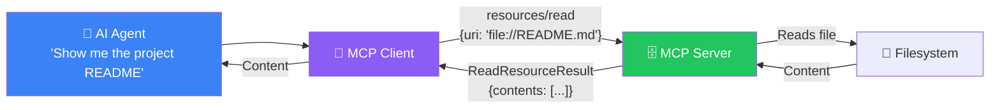
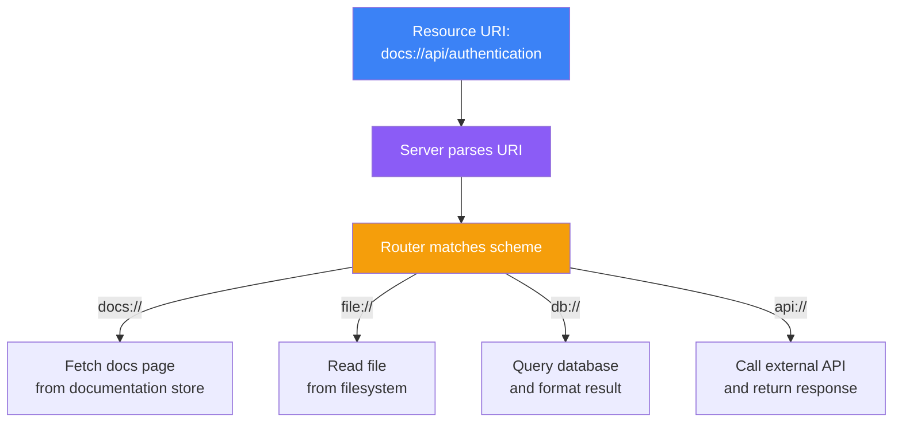
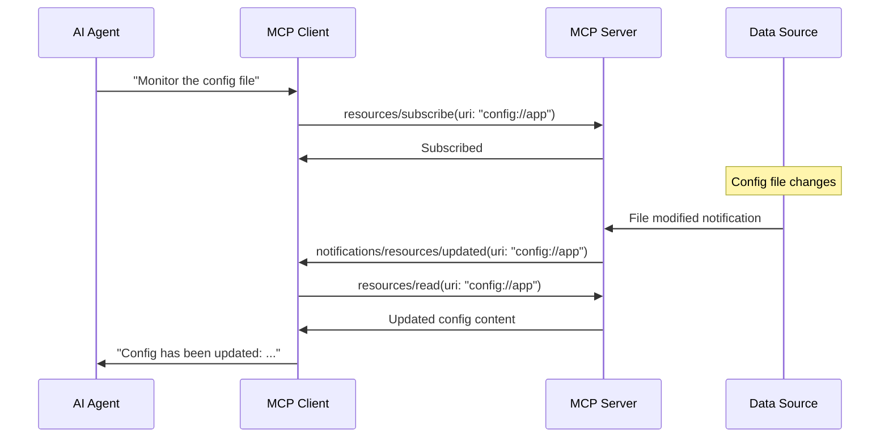
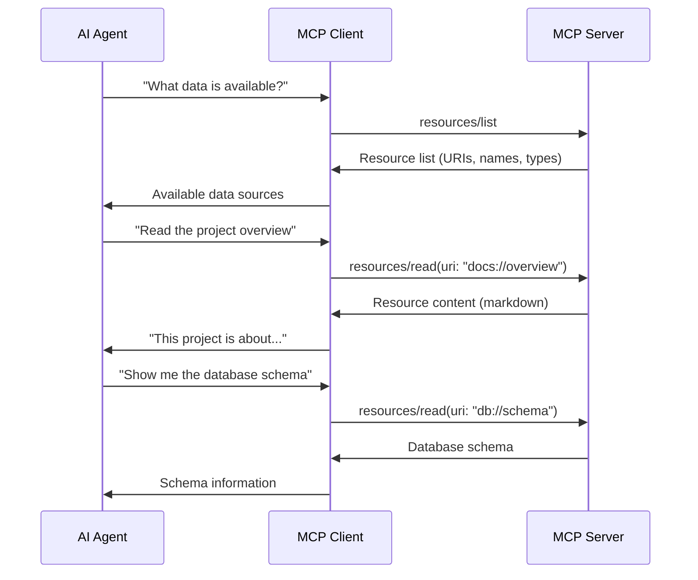
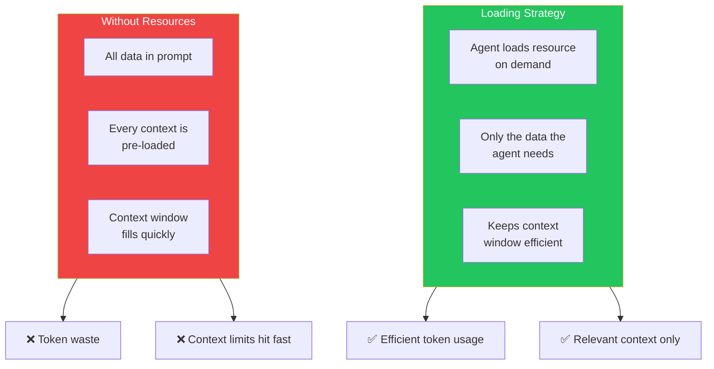

## Introduction

> **Resources are data sources that an MCP server exposes to AI agents — they allow agents to read files, query databases, fetch API data, and access any other information without requiring an action.**

While tools are for **doing**, resources are for **reading**. When an agent needs context, background information, or data to analyze, it reads a resource.



---

## Why Resources Exist

### The Problem: Tools Are for Actions, Not Data

If every data access required a tool call, agents would need to create a tool for reading, another for searching, another for listing — and each tool call would be recorded as an action. Resources provide a cleaner abstraction: **data you can read**.

### Tool vs Resource

| Aspect | Tool | Resource |
|--------|------|----------|
| **Purpose** | Perform an action | Provide data |
| **Side effects** | Usually has side effects | No side effects (read-only) |
| **Arguments** | Complex input schema | Simple URI |
| **Result** | Action result | Raw content |
| **Caching** | Not typically cached | Can be aggressively cached |
| **Pattern** | `tools/call` | `resources/read` |

---

## Real-World Analogy

### The Library

Imagine a library (MCP Server):

- **Books** are resources — you can read them
- The **librarian** is a tool — you ask them to do things (find a book, check availability, reserve)

When you go to the library, you mostly read books (resources). Occasionally you ask the librarian to do something (tools). The distinction matters because reading is free and repeatable, while asking the librarian to act may have consequences.

---

## Resource URI Scheme

Every resource is identified by a URI. The URI scheme tells the server what type of resource to return:

| Scheme | Example | Content Type |
|--------|---------|--------------|
| `file://` | `file:///home/user/docs/report.md` | File content |
| `docs://` | `docs://api/overview` | Documentation page |
| `db://` | `db://users/123/profile` | Database record |
| `log://` | `log://2024/01/15/app.log` | Log file |
| `api://` | `api://weather/today?city=London` | API response |
| `config://` | `config://database/connection` | Configuration |



---

## Resource Types

### 1. Static Resources

Resources that always return the same content:

```python
# Example: Static documentation resource
Resource(
    uri="docs://overview",
    name="Project Overview",
    description="High-level overview of the project",
    mimeType="text/markdown",
    text="# Project Overview\n\nThis project is..."
)
```

### 2. Dynamic Resources

Resources that return content based on URI parameters:

```python
# Example: Dynamic resource based on URI
@server.read_resource()
async def read_resource(uri: str) -> list[Resource]:
    if uri.startswith("db://users/"):
        user_id = uri.split("/")[-1]
        user_data = await database.get_user(user_id)
        return [Resource(
            uri=uri,
            mimeType="application/json",
            text=json.dumps(user_data)
        )]
```

### 3. Directory Resources

Resources that list available sub-resources:

```python
# Example: List all available resources under a path
Resource(
    uri="docs://",
    name="Documentation Index",
    description="List of all documentation resources",
    mimeType="text/markdown",
    text="- [Overview](docs://overview)\n- [API](docs://api)\n- [Setup](docs://setup)"
)
```

---

## Resource Subscription

MCP supports resource subscriptions — the client can subscribe to changes:



---

## Resource Discovery



---

## Resource Templates

Resource templates allow dynamic URI patterns:

```json
{
  "uriTemplate": "docs://{section}/{page}",
  "name": "Documentation Page",
  "description": "Read a documentation page for a specific section",
  "mimeType": "text/markdown"
}
```

Examples of generated URIs:
- `docs://getting-started/installation`
- `docs://api/authentication`
- `docs://guides/advanced-usage`

---

## Resources vs Context Window

One of the most important uses of resources is providing context to the AI agent without filling the prompt:



---

## Best Practices

1. **Use descriptive URI schemes** — `db://`, `docs://`, `file://` make it clear what type of data
2. **Include metadata** — Name, description, and MIME type help agents understand resources
3. **Support templates** — Dynamic resources are more useful than static ones
4. **Cache aggressively** — Resources are read-only, perfect for caching
5. **Pagination for large resources** — Return summaries with links to detail URIs
6. **Subscribe for real-time data** — Use subscriptions instead of polling

## Common Mistakes

| Mistake | Why It's Wrong |
|---------|---------------|
| Exposing sensitive data as resources | Any MCP client can read them |
| No URI validation | Path traversal vulnerabilities |
| Returning too much data | Wastes tokens, fills context window |
| Side effects in resource reads | Resources should be read-only |
| No caching | Every read hits the backend |

---

## Interview Questions

### Beginner

**Q: What is the difference between a Tool and a Resource in MCP?**

> A **Tool** performs an action — it has side effects, takes complex arguments, and returns a result. A **Resource** provides data — it's read-only, identified by a URI, and returns content. Tools are for doing; Resources are for reading.

**Q: How does an agent read a resource?**

> The agent asks the client to read a resource by its URI. The client sends a `resources/read` request to the server with the URI. The server locates the resource, reads its content, and returns it. The client formats the content for the agent.

### Intermediate

**Q: How would you implement pagination for resources that contain large datasets?**

> Implement a resource template like `docs://{page}` where each page returns a subset of the data. Include `next_page` and `total_pages` in the resource metadata. Alternatively, use a directory-style resource at the root URI that lists all available pages: `docs://` returns an index, and `docs://page-1`, `docs://page-2` return individual pages.

**Q: What is a resource subscription and when would you use it?**

> A resource subscription allows a client to receive notifications when a resource changes. The client calls `resources/subscribe` with a URI, and the server sends `notifications/resources/updated` when the resource changes. Use subscriptions for real-time monitoring of configuration files, status pages, or any frequently changing data that an agent needs to track.

### Senior

**Q: Design a caching strategy for MCP resources in a production system.**

> Multi-level caching strategy: (1) **Client-side cache** — Cache frequently accessed resources (TTL based on resource type: static docs = 1 hour, API responses = 1 minute), (2) **Server-side cache** — Use Redis for shared cache across server instances, (3) **Content-addressable cache** — Hash-based keys for deduplication, (4) **Invalidation** — Use resource subscriptions for push-based invalidation, (5) **Stale-while-revalidate** — Serve cached content while fetching fresh data, (6) **Cache headers** — Include cache hints in resource metadata (TTL, cacheable flag).

**Q: How would you handle resource access control in a multi-tenant MCP server?**

> Implement URI-based access control: (1) Each tenant has a unique URI prefix (`tenant-123://`), (2) The server validates the tenant ID from the URI against the client's authentication context, (3) Resource templates include tenant-scoped parameters, (4) The directory resource at the root only shows resources the tenant has access to, (5) All resource reads are logged with tenant context for audit.

### Staff Engineer

**Q: Compare and contrast MCP resources with REST API resources. What are the key architectural differences?**

> **MCP Resources**: URI-scheme-based, read-only by design, self-describing (name + description + MIME type), support subscriptions, designed for AI agent consumption, transport-agnostic. **REST Resources**: URL-path-based, CRUD operations, described externally (OpenAPI/Swagger), no standard subscription model, designed for application consumption, HTTP-only. **Key difference**: MCP resources are optimized for AI agents that need to discover and read data dynamically, while REST resources are optimized for programmatic CRUD operations.

### Architecture

**Q: Design a resource hierarchy for a documentation MCP server that supports multiple product versions.**

> Resource hierarchy: `docs://` (root index listing all products), `docs://{product}` (product index listing versions), `docs://{product}/{version}` (version index listing sections), `docs://{product}/{version}/{section}` (section content), `docs://{product}/{version}/{section}/{page}` (specific page). Each level returns a navigation resource. The server validates version existence and can redirect `docs://{product}/latest` to the current version. Content is cached per version to avoid re-parsing.

---

## Summary

| Concept | Key Point |
|---------|-----------|
| **Resource purpose** | Provide read-only data to AI agents |
| **Identification** | URI scheme (`file://`, `docs://`, `db://`) |
| **Discovery** | `resources/list` capability |
| **Reading** | `resources/read` with URI |
| **Subscriptions** | Real-time updates via notifications |
| **Templates** | Dynamic URI patterns with parameters |
| **Caching** | Aggressive caching (read-only data) |

---

## Navigation

**Previous:** [06 — Tools](/ai/phase-07-model-context-protocol/06-tools)

**Next:** [08 — Prompts](/ai/phase-07-model-context-protocol/08-prompts)

**Related Topics:**
- [Tools](/ai/phase-07-model-context-protocol/06-tools)
- [Prompts](/ai/phase-07-model-context-protocol/08-prompts)
- [MCP Communication](/ai/phase-07-model-context-protocol/09-mcp-communication)
