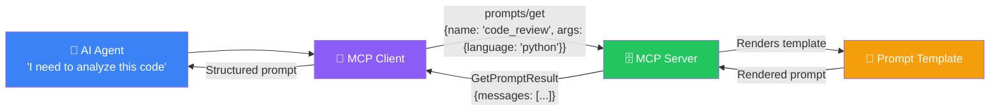
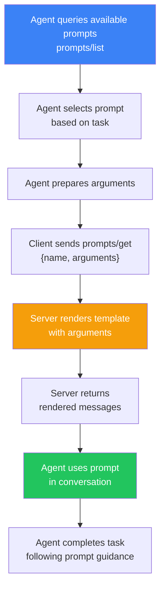
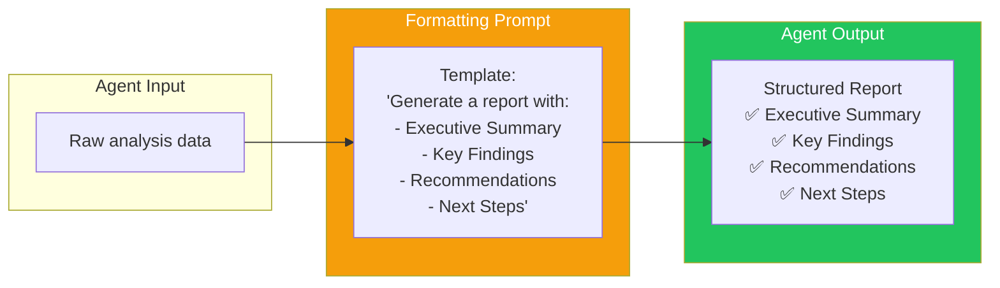
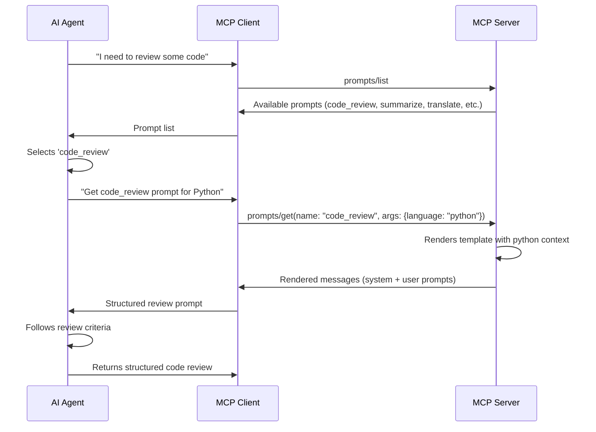
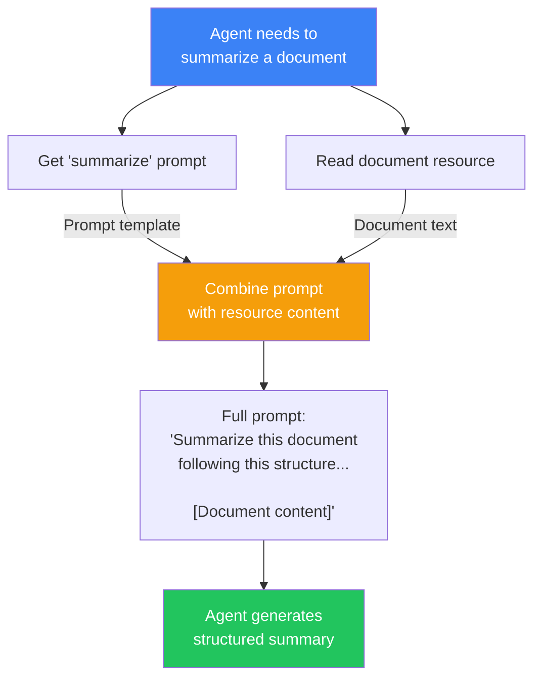

## Introduction

> **Prompts are reusable prompt templates that MCP servers expose to AI agents — they provide structured, context-aware instructions that guide the agent's behavior for specific tasks.**

While tools are for actions and resources are for data, prompts are for **expertise**. They encode best practices, domain knowledge, and reusable patterns that help agents perform tasks correctly.



---

## Why Prompts Exist

### The Problem: Every Agent Needs Guardrails

Without structured prompts, every agent starts from scratch. They don't know:
- How to format their response
- What guidelines to follow
- What best practices apply
- How to handle edge cases

### The Solution: Encoded Expertise

Prompts encode domain expertise into reusable templates. Instead of telling the agent "review this code carefully" and hoping for the best, a prompt server gives the agent a structured code review template with specific criteria, formatting rules, and output expectations.

| Without Prompts | With Prompts |
|----------------|--------------|
| Agent guesses how to respond | Agent follows a structured template |
| Inconsistent quality | Consistent, high-quality output |
| No domain-specific guidance | Encoded best practices |
| Every session starts fresh | Reusable expertise |

---

## Real-World Analogy

### The Training Manual

Imagine a new employee (AI agent) starting at a company:

- Without a **training manual** (prompts), they guess how to do everything
- With a training manual, they follow established procedures:
  - **How to handle a customer complaint** (prompt: `handle_complaint`)
  - **How to write a weekly report** (prompt: `generate_report`)
  - **How to escalate an issue** (prompt: `escalate_ticket`)

The manual encodes the company's best practices so every employee follows the same high standards.

---

## Prompt Lifecycle



---

## Prompt Types

### 1. Task-Specific Prompts

Prompts for specific tasks:

```json
{
  "name": "code_review",
  "description": "Review code for bugs, security issues, and best practices",
  "arguments": [
    {
      "name": "language",
      "description": "Programming language of the code",
      "required": true,
      "schema": {
        "type": "string",
        "enum": ["python", "javascript", "rust", "go"]
      }
    },
    {
      "name": "review_depth",
      "description": "Depth of review (basic, standard, thorough)",
      "required": false,
      "schema": {
        "type": "string",
        "enum": ["basic", "standard", "thorough"]
      }
    }
  ]
}
```

### 2. Formatting Prompts

Prompts that enforce output format:



### 3. Context-Enrichment Prompts

Prompts that combine resources with structured instructions:

```json
{
  "name": "analyze_logs",
  "description": "Analyze application logs and identify issues",
  "arguments": [
    {"name": "log_source", "description": "URI of log resource to analyze", "required": true},
    {"name": "timeframe", "description": "Time period to analyze", "required": false}
  ]
}
```

---

## Prompt Discovery and Usage



---

## Prompt Templates

### Simple Template

```
You are a {{role}} expert.

Your task: {{task_description}}

Follow these guidelines:
{{guidelines}}

Format your response as:
{{format_instructions}}
```

### Dynamic Template (with conditionals)

```
You are analyzing {{language}} code.


Focus on:
1. Syntax errors
2. Common pitfalls

Focus on:
1. Security vulnerabilities
2. Performance issues
3. Code quality
4. Test coverage
5. Documentation


Output format:
- Issue: description
- Severity: critical/high/medium/low
- Suggestion: how to fix
```

---

## Prompt Composition

Prompts can be composed with resources for richer context:



---

## Comparing Prompts with Tools and Resources

| Aspect | Tool | Resource | Prompt |
|--------|------|----------|--------|
| **What it does** | Performs an action | Provides data | Guides agent behavior |
| **Called via** | `tools/call` | `resources/read` | `prompts/get` |
| **Returns** | Action result | Raw content | Rendered messages |
| **Agent uses it** | To act on the world | To gain context | To structure its thinking |
| **Analogy** | A tool (hammer) | A book | A recipe |

---

## Best Practices

1. **One prompt per task** — Each prompt should handle one specific use case
2. **Clear descriptions** — Agents use descriptions to decide which prompt to use
3. **Sensible defaults** — Make optional arguments have default values
4. **Use arguments for customization** — Don't create separate prompts for each variant
5. **Version your prompts** — Prompt templates change over time
6. **Test with real agents** — What looks good in a template may not work in conversation
7. **Combine with resources** — Prompts + resources = powerful context-aware guidance

## Common Mistakes

| Mistake | Why It's Wrong |
|---------|---------------|
| Overly rigid prompts | Agents need flexibility for edge cases |
| No argument validation | Agent passes invalid values, prompt breaks |
| Missing descriptions | Agent can't decide which prompt to use |
| Prompt too long | Wastes tokens in the conversation |
| Prompt too short | Doesn't provide enough guidance |

---

## Interview Questions

### Beginner

**Q: What is an MCP Prompt and how is it different from a regular prompt in ChatGPT?**

> An MCP Prompt is a reusable template served by an MCP server. Unlike a regular prompt that you type manually, MCP prompts are structured templates with arguments, versioned, and discoverable through the MCP protocol. They encode domain expertise and best practices for specific tasks.

**Q: How does an agent discover available prompts?**

> The agent's client sends a `prompts/list` request to the server. The server responds with a list of prompts, each with a name, description, and argument schema. The agent reads the descriptions and decides which prompt to use based on the current task.

### Intermediate

**Q: How would you design a prompt that adapts based on the user's expertise level?**

> Define a `user_level` argument with options like "beginner", "intermediate", "expert". In the prompt template, use conditional logic: for beginners, include detailed explanations and examples; for intermediate users, focus on best practices and common pitfalls; for experts, provide high-level guidance with advanced considerations. This ensures the prompt is appropriate for each audience.

**Q: Can prompts reference resources or tools? How would that work?**

> Yes. A prompt can include instructions for the agent to read specific resources or use specific tools. For example, a `code_review` prompt might say: "First, read the file at `file://{file_path}` using the resources/read capability. Then, analyze it following these criteria: ..." The prompt provides the structure; the agent executes the resource reads and tool calls independently.

### Senior

**Q: Design a prompt versioning strategy for a team maintaining 50+ MCP prompts.**

> Versioning strategy: (1) Store prompts in a Git repository with semantic versioning, (2) Include version metadata in the prompt definition, (3) Support multiple versions simultaneously (prompts/get with version parameter), (4) Implement migration paths — deprecated prompts return a warning with the new version, (5) Use CI/CD to test prompts against test agents before deployment, (6) Maintain a changelog for prompt changes, (7) A/B test prompt variations to measure effectiveness.

**Q: How would you handle prompt injection through prompt arguments?**

> Prevention strategies: (1) Sanitize all string arguments — strip markdown and code blocks, (2) Use enum values for categorical arguments instead of free text, (3) Limit argument length, (4) Validate argument values against expected patterns (regex), (5) Never allow arguments that can override the prompt's system instructions, (6) Use separate prompt sections for user-provided content vs fixed guidance, (7) Log all prompt invocations with arguments for security auditing.

### Staff Engineer

**Q: Design a prompt analytics system that measures prompt effectiveness.**

> Analytics system: (1) Track every prompt invocation — which prompt, arguments, agent, session, (2) Measure downstream metrics — task completion rate, response quality scores, user satisfaction, (3) A/B test prompt variants with statistical significance testing, (4) Measure token efficiency — are prompts too long or short for the task?, (5) Collect feedback — allow users (or evaluators) to rate prompt-guided responses, (6) Dashboard showing top prompts, worst-performing prompts, and prompt usage trends, (7) Automated alerts when prompt quality drops below threshold.

### Architecture

**Q: Compare MCP prompts with LangChain's prompt templates. What are the architectural differences?**

> **MCP Prompts**: Server-side templates, discovered via protocol, invoked with `prompts/get`, transport-agnostic, reusable across any MCP client. **LangChain Prompt Templates**: Client-side templates, imported as Python objects, invoked directly in code, Python-only, tied to LangChain ecosystem. **Key difference**: MCP prompts are externalized and protocol-accessible — any agent (Claude, GPT, Gemini) can use them. LangChain templates are internal to the application using LangChain. MCP is about interoperability; LangChain is about framework integration.

---

## Summary

| Concept | Key Point |
|---------|-----------|
| **Prompt purpose** | Guide agent behavior with structured templates |
| **Discovery** | `prompts/list` — agents find available prompts |
| **Invocation** | `prompts/get` — with name and arguments |
| **Return type** | Rendered messages (system + user) |
| **Customization** | Arguments enable dynamic template rendering |
| **Composition** | Prompts + Resources = rich context-aware guidance |
| **Best practice** | Encode domain expertise once, reuse everywhere |

---

## Navigation

**Previous:** [07 — Resources](/ai/phase-07-model-context-protocol/07-resources)

**Next:** [09 — MCP Communication](/ai/phase-07-model-context-protocol/09-mcp-communication)

**Related Topics:**
- [Tools](/ai/phase-07-model-context-protocol/06-tools)
- [Resources](/ai/phase-07-model-context-protocol/07-resources)
- [Build Your First MCP Server](/ai/phase-07-model-context-protocol/11-build-your-first-mcp-server)
