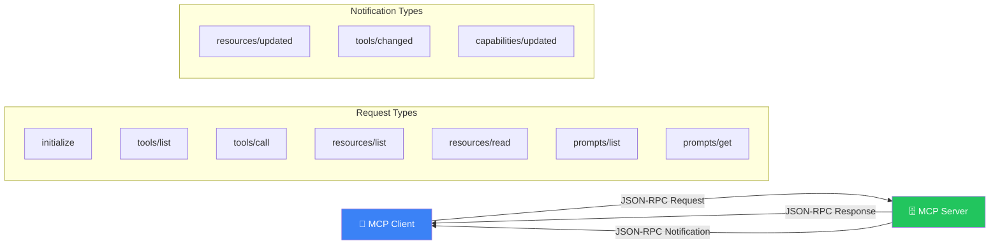
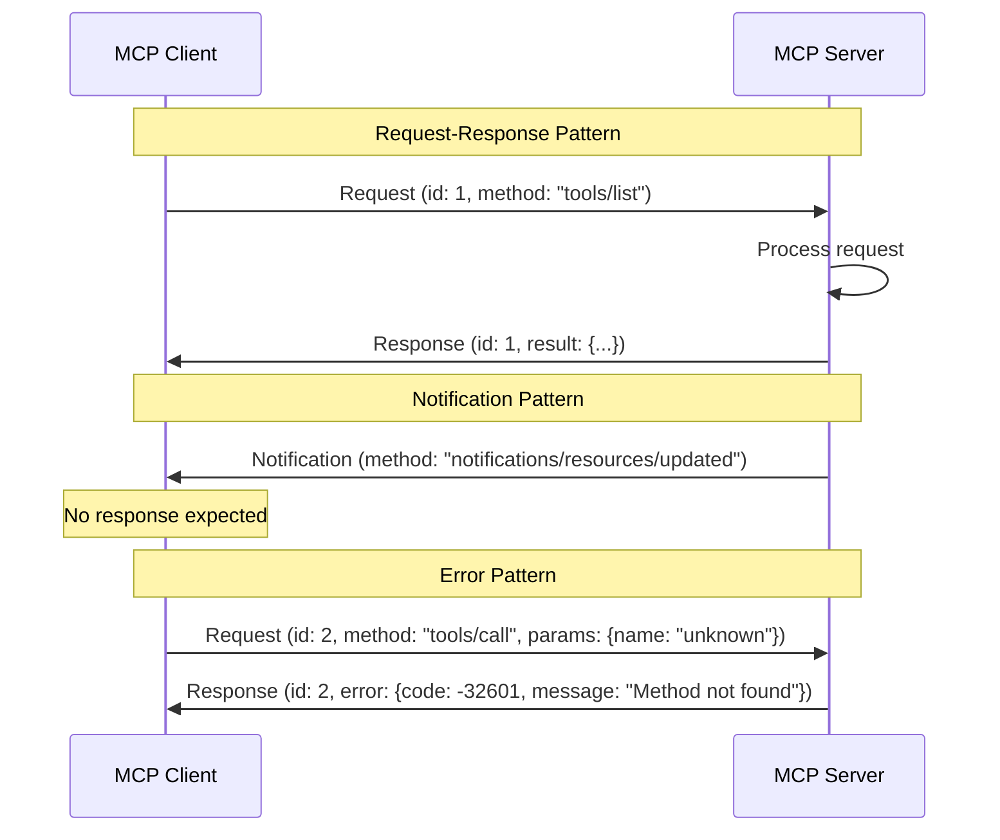
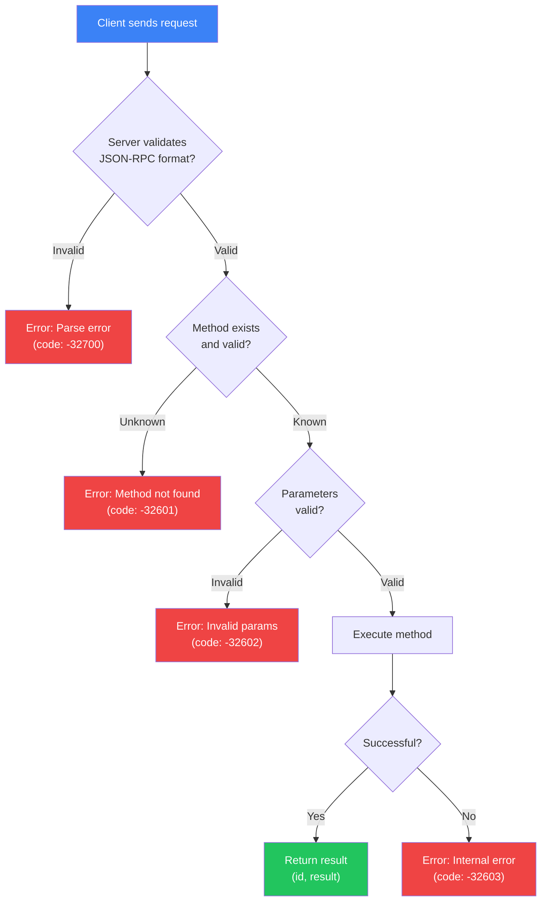
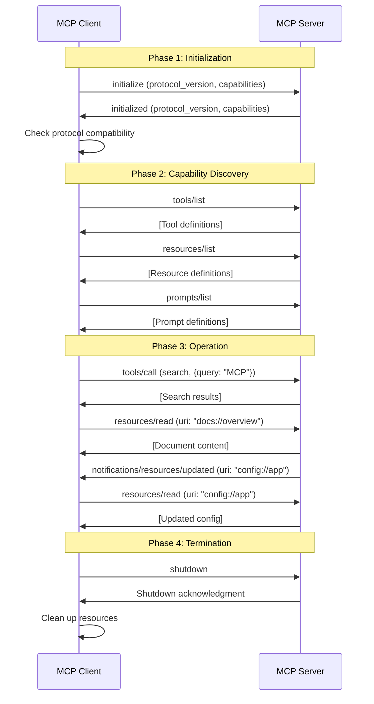
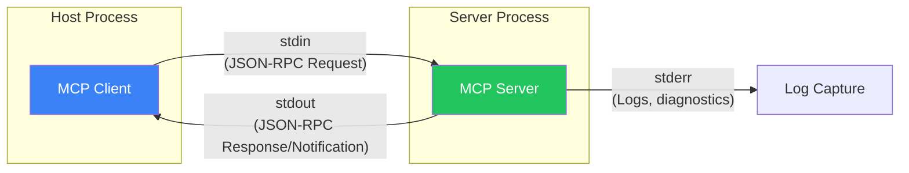
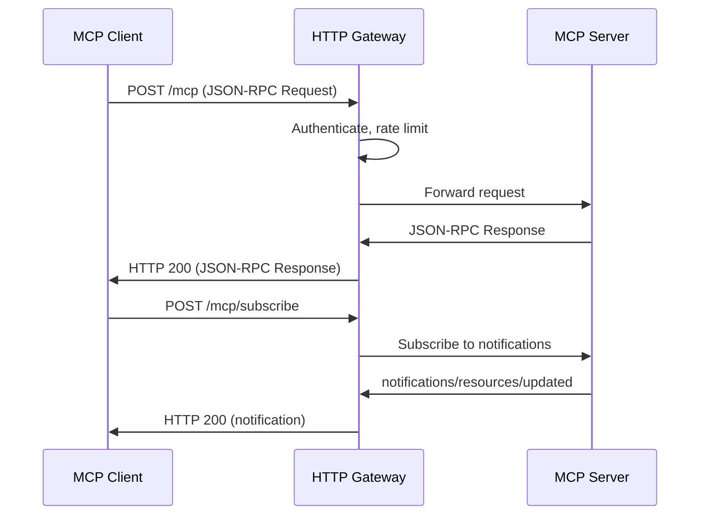
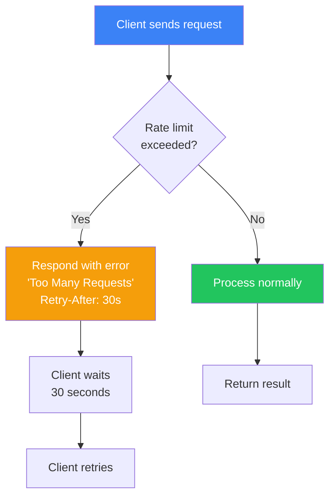

## Introduction

> **MCP Communication follows a structured protocol where clients and servers exchange JSON-RPC messages for initialization, capability discovery, tool invocation, resource access, and real-time notifications.**

Every interaction in MCP — from connecting to a server to calling a tool to receiving updates — follows a defined message flow. Understanding this communication pattern is essential for building robust MCP applications.



---

## Why Communication Matters

### The Problem: Ad-Hoc Integrations Are Fragile

Without a standard communication protocol:
- Every integration invents its own message format
- Error handling is inconsistent
- There's no standard way to discover capabilities
- Real-time updates require custom polling

### The Solution: JSON-RPC over MCP

MCP uses **JSON-RPC 2.0** as its message protocol — a lightweight, standardized format for remote procedure calls. This means every MCP interaction follows the same structure, whether it's listing tools, calling a function, or receiving a notification.

---

## Real-World Analogy

### The Restaurant Ordering System

Imagine a restaurant with a standardized ordering system:

- **You place an order** (Request) — "I'd like the steak, medium rare"
- **The kitchen confirms** (Response) — "Your order is received, estimated 15 minutes"
- **The waiter checks on your table** (Notification) — "Your steak is almost ready"

Every interaction follows the same format: request → processing → response. Even when something goes wrong (out of steak), the response format is the same — just with an error code.

---

## Message Types

MCP uses three message types:

### 1. Requests

A request expects a response:

```json
{
  "jsonrpc": "2.0",
  "id": 1,
  "method": "tools/list",
  "params": {}
}
```

### 2. Responses

A response to a request:

```json
{
  "jsonrpc": "2.0",
  "id": 1,
  "result": {
    "tools": [
      {
        "name": "search",
        "description": "Search the knowledge base",
        "inputSchema": {
          "type": "object",
          "properties": {
            "query": {"type": "string"}
          },
          "required": ["query"]
        }
      }
    ]
  }
}
```

### 3. Notifications

A notification does not expect a response:

```json
{
  "jsonrpc": "2.0",
  "method": "notifications/resources/updated",
  "params": {
    "uri": "config://app/settings"
  }
}
```



---

## Request Flow



---

## Communication Lifecycle



---

## Transport Communication

### STDIO Transport

Communication over standard input/output:



Messages are delimited by newlines:

```
--> {"jsonrpc":"2.0","id":1,"method":"initialize","params":{"protocolVersion":"2024-11-05","capabilities":{}}}
<-- {"jsonrpc":"2.0","id":1,"result":{"protocolVersion":"2024-11-05","capabilities":{"tools":{}}}}
--> {"jsonrpc":"2.0","id":2,"method":"tools/list","params":{}}
<-- {"jsonrpc":"2.0","id":2,"result":{"tools":[]}}
```

### HTTP Transport

Communication over HTTP/HTTPS:



---

## Error Handling

Standard JSON-RPC error codes:

| Code | Error | Meaning |
|------|-------|---------|
| -32700 | Parse error | Invalid JSON |
| -32600 | Invalid request | Not a valid JSON-RPC message |
| -32601 | Method not found | Unknown method |
| -32602 | Invalid params | Arguments don't match schema |
| -32603 | Internal error | Server-side failure |
| -32000 to -32099 | Server error | Implementation-specific errors |
| 0+ | Tool error | Tool-specific error codes |

```python
# Example: Error response from server
{
    "jsonrpc": "2.0",
    "id": 5,
    "error": {
        "code": -32602,
        "message": "Invalid params",
        "data": {
            "tool": "search_documents",
            "field": "query",
            "issue": "query cannot be empty"
        }
    }
}
```

---

## Rate Limiting and Backpressure



---

## Best Practices

1. **Always use request IDs** — Responses must match their requests
2. **Handle protocol version mismatch** — Initialize before any other operation
3. **Implement request timeouts** — Don't hang indefinitely
4. **Log all messages** — Every request, response, and notification for debugging
5. **Use notifications for non-critical updates** — Don't expect a response
6. **Implement reconnection** — Handle transport failures gracefully
7. **Validate message format** — Reject malformed JSON-RPC

## Common Mistakes

| Mistake | Why It's Wrong |
|---------|---------------|
| Sending requests before initialization | Server rejects with "not initialized" |
| Ignoring protocol version compatibility | Client and server may have incompatible features |
| Blocking on responses | All operations should be async |
| No timeout handling | Request can hang indefinitely |
| Treating notifications the same as responses | Notifications have no response — don't wait for one |

---

## Interview Questions

### Beginner

**Q: What protocol does MCP use for communication?**

> MCP uses **JSON-RPC 2.0** — a lightweight, standardized remote procedure call protocol. Messages are serialized as JSON and sent over the transport layer (STDIO, HTTP, or WebSocket).

**Q: What are the three types of messages in MCP?**

> (1) **Requests** — Expect a response (e.g., `tools/list`, `tools/call`), (2) **Responses** — Reply to a request (success result or error), (3) **Notifications** — No response expected (e.g., `resources/updated`).

### Intermediate

**Q: Explain the initialization phase and why it's important.**

> Initialization is the first communication between client and server. The client sends an `initialize` request with its protocol version and capabilities. The server responds with its protocol version and capabilities. Both sides check version compatibility. This phase is critical because it establishes the contract for all subsequent communication — the client knows what the server can do, and both know which protocol features are supported.

**Q: How does the server handle errors during tool execution?**

> The server returns a JSON-RPC error response with an error code and message. For standard errors (invalid params, method not found), it uses predefined codes. For tool-specific errors, it uses custom error codes and includes detailed error information in the `data` field. The client can then decide whether to retry, inform the agent, or escalate.

### Senior

**Q: Design a retry strategy for transient communication failures in MCP.**

> Strategy: (1) Classify errors as retryable (timeout, rate limit, connection lost) or non-retryable (invalid params, method not found), (2) Use exponential backoff: 1s, 2s, 4s, 8s, max 30s, (3) Add jitter (±500ms) to prevent thundering herd, (4) Set a max retry count (5 attempts), (5) After max retries, escalate to the agent with an error message, (6) For rate limits, use the Retry-After header if provided, (7) Log all retry attempts for monitoring.

**Q: How would you implement server-side request prioritization for MCP?**

> Prioritization strategy: (1) Classify requests by priority (high: tool calls from user requests, medium: resource reads, low: capability listing), (2) Use a priority queue on the server with configurable concurrency per priority level, (3) High-priority requests can preempt low-priority ones, (4) Set queue timeouts — if a request waits too long, return a timeout error, (5) Monitor queue depth and latency per priority level, (6) Provide priority hints in request params as an extension.

### Staff Engineer

**Q: Compare MCP's JSON-RPC communication model with gRPC for AI agent communication. What are the trade-offs?**

> **MCP/JSON-RPC**: Human-readable, easy to debug, no schema compilation needed, flexible (dynamic arguments), widely supported. **gRPC**: Binary format (Protobuf), strongly typed, code generation, built-in streaming, better performance. **Trade-offs**: MCP's JSON-RPC is more accessible for rapid development and debugging AI agent interactions. gRPC is better for high-throughput, low-latency internal service communication. For AI agents, MCP's flexibility (dynamic tool definitions, self-describing schemas) is more valuable than raw performance.

### Architecture

**Q: Design a communication architecture for an MCP system that handles 10,000+ simultaneous agent connections.**

> Architecture: (1) Load balancer distributing connections across MCP server instances, (2) Each server instance manages a connection pool with configurable max connections, (3) Use HTTP/2 for multiplexing multiple requests over a single connection, (4) Implement connection pooling with keepalive to reduce handshake overhead, (5) Use Redis pub/sub for cross-server notification broadcasting, (6) Separate initialization (handshake) from operation (tool calls) using different server pools, (7) Implement circuit breakers to isolate failing server instances, (8) Use async I/O throughout to handle concurrent connections efficiently.

---

## Summary

| Concept | Key Point |
|---------|-----------|
| **Protocol** | JSON-RPC 2.0 |
| **Request** | Method call expecting a response |
| **Response** | Result or error matching a request |
| **Notification** | One-way message, no response |
| **Initialization** | Version check and capability discovery |
| **Transport** | STDIO, HTTP, WebSocket |
| **Error handling** | Standard JSON-RPC error codes |
| **Rate limiting** | Server can throttle requests |

---

## Navigation

**Previous:** [08 — Prompts](/ai/phase-07-model-context-protocol/08-prompts)

**Next:** [10 — Transports](/ai/phase-07-model-context-protocol/10-transports)

**Related Topics:**
- [MCP Architecture](/ai/phase-07-model-context-protocol/03-mcp-architecture)
- [MCP Client](/ai/phase-07-model-context-protocol/04-mcp-client)
- [Transports](/ai/phase-07-model-context-protocol/10-transports)
