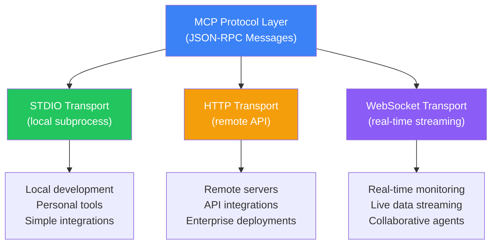
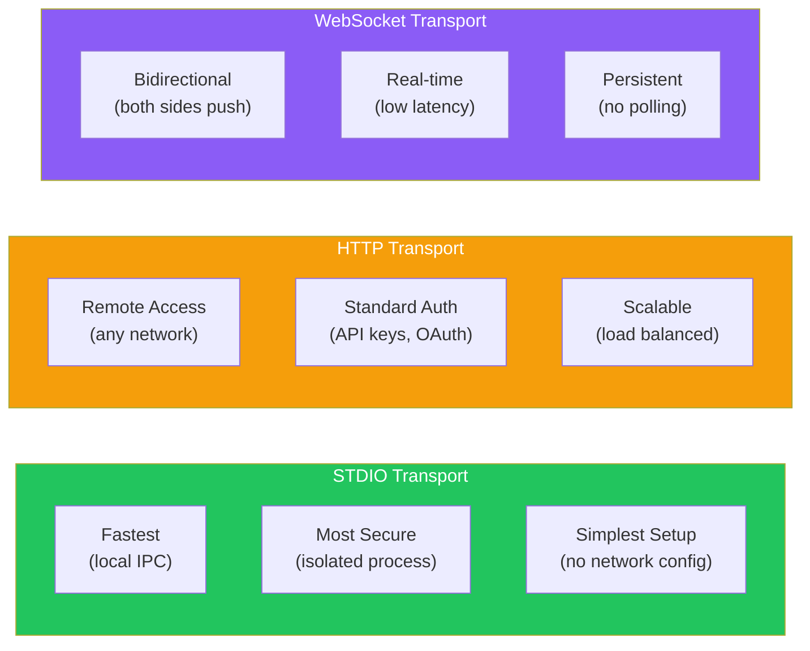
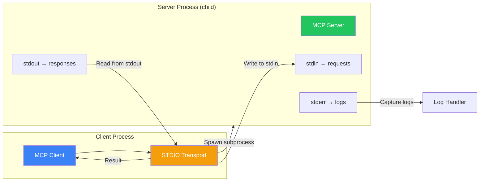
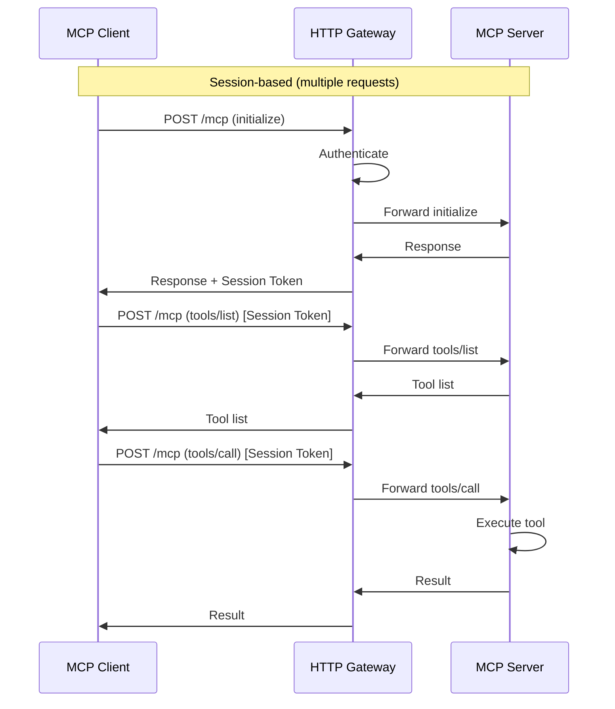
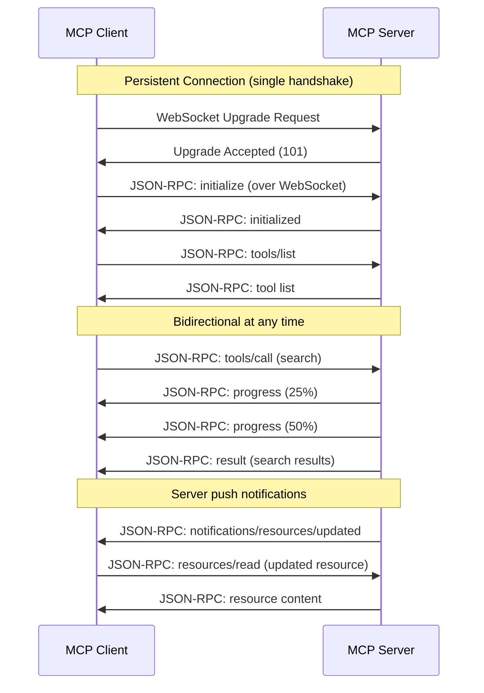
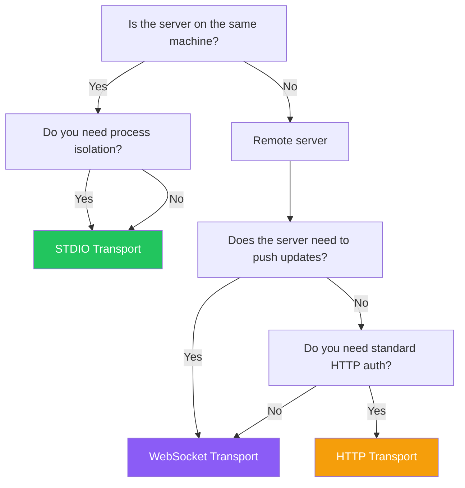

## Introduction

> **Transports are the communication channels that carry JSON-RPC messages between MCP clients and servers — they determine how, where, and under what constraints the communication happens.**

MCP is transport-agnostic by design. The same server can work over STDIO for local use, HTTP for remote access, or WebSocket for real-time bidirectional streaming. The transport layer handles the raw message delivery, while the protocol layer handles the meaning.



---

## Why Multiple Transports Exist

### The Problem: One Transport Doesn't Fit All

- Sometimes the server runs on the same machine as the client (local)
- Sometimes it's on a remote server (cloud)
- Sometimes you need real-time updates (streaming)
- Sometimes security requires isolated processes

### The Solution: Transport Abstraction

MCP separates the protocol from the transport. The same protocol messages work over any transport, allowing developers to choose the best transport for their deployment scenario without changing their server or client code.

---

## Real-World Analogy

### Different Ways to Send a Letter

Imagine sending a message:

- **STDIO** — You hand the letter directly to someone in the same room. Fast, direct, but you have to be together.
- **HTTP** — You mail the letter. Reliable, trackable, works across distances, but slower.
- **WebSocket** — You use a two-way radio. Both sides can talk at any time, great for ongoing conversations.

Each method has its place. You wouldn't use a radio to send a formal contract, and you wouldn't mail a letter to chat with someone sitting next to you.

---

## Transport Comparison



| Feature | STDIO | HTTP | WebSocket |
|---------|-------|------|-----------|
| **Latency** | Microseconds | Milliseconds | Milliseconds |
| **Throughput** | Very high | High | High |
| **Security** | Process isolation | Network security (HTTPS) | Network security (WSS) |
| **Persistence** | No (per-call) | No (per-request) | Yes (persistent) |
| **Bidirectional** | Yes | No (client-initiated) | Yes |
| **Discovery** | Manual configuration | Service discovery | Service discovery |
| **Deployment** | Local only | Remote | Remote |
| **Complexity** | Low | Medium | Medium-High |

---

## STDIO Transport

### How It Works

The client spawns the server as a subprocess and communicates via standard input/output:

```python
# Python: STDIO transport
from mcp.client.stdio import stdio_client

server_params = StdioServerParameters(
    command="python",
    args=["-m", "my_mcp_server"],
    env={"DATABASE_URL": "postgresql://localhost/mydb"}
)

async with stdio_client(server_params) as (read, write):
    # read: stream from server's stdout
    # write: stream to server's stdin
    async with ClientSession(read, write) as session:
        await session.initialize()
        tools = await session.list_tools()
```

```typescript
// TypeScript: STDIO transport
import { Client } from "@modelcontextprotocol/sdk/client/index.js";
import { StdioClientTransport } from "@modelcontextprotocol/sdk/client/stdio.js";

const transport = new StdioClientTransport({
  command: "node",
  args: ["dist/server.js"]
});

const client = new Client({ name: "my-client", version: "1.0.0" });
await client.connect(transport);
const tools = await client.listTools();
```

### Architecture



### When to Use STDIO

- ✅ Local development and testing
- ✅ Running on the same machine (desktop apps)
- ✅ Maximum security (process isolation)
- ✅ Minimal latency requirements
- ✅ Simple deployments with one server
- ❌ Remote servers (different machines)
- ❌ Multi-tenant systems
- ❌ High-availability deployments

---

## HTTP Transport

### How It Works

The client sends HTTP requests to a remote server:

```python
# Conceptual HTTP transport
import httpx
from mcp.client.http import HTTPClientTransport

# Server URL
transport = HTTPClientTransport("https://mcp-server.example.com")

async with ClientSession(transport) as session:
    await session.initialize()
    result = await session.call_tool("search", {"query": "MCP"})
```

### Architecture



### When to Use HTTP

- ✅ Remote servers (different machines / data centers)
- ✅ API-driven integrations
- ✅ When standard HTTP auth is needed (API keys, OAuth)
- ✅ Load-balanced deployments
- ✅ When you need HTTP-level monitoring
- ❌ Real-time bidirectional communication
- ❌ Low-latency local communication
- ❌ When the server needs to push updates

---

## WebSocket Transport

### How It Works

The client establishes a persistent bidirectional connection:

```python
# Conceptual WebSocket transport
from mcp.client.websocket import WebSocketClientTransport

transport = WebSocketClientTransport("wss://mcp-server.example.com/ws")

async with ClientSession(transport) as session:
    await session.initialize()
    
    # Subscribe to resource updates
    await session.subscribe_resource("config://app/settings")
    
    # Receive notifications in real-time
    async for notification in transport.receive():
        if notification.method == "notifications/resources/updated":
            print(f"Resource updated: {notification.params.uri}")
```

### Architecture



### When to Use WebSocket

- ✅ Real-time updates (server pushes to client)
- ✅ Long-running streaming operations
- ✅ Collaborative applications (multiple agents, shared state)
- ✅ When latency matters (gaming, live monitoring)
- ✅ Bidirectional communication needs
- ❌ Simple request-response patterns
- ❌ When infrastructure doesn't support WebSockets
- ❌ Stateless serverless deployments

---

## Transport Selection Guide



---

## Security Considerations by Transport

| Transport | Security Concern | Mitigation |
|-----------|-----------------|------------|
| **STDIO** | Server process can access host files | Run in container / sandbox |
| **STDIO** | No network encryption | N/A (local only) |
| **HTTP** | Man-in-the-middle | Use HTTPS (TLS) |
| **HTTP** | Unauthorized access | API keys, OAuth, JWT |
| **HTTP** | Rate limiting | Gateway-level throttling |
| **WebSocket** | Connection hijacking | WSS (TLS), origin validation |
| **WebSocket** | Message flooding | Rate limiting per connection |
| **All** | Injection attacks | Validate all messages server-side |

---

## Best Practices

1. **Use STDIO for local development** — Fastest feedback loop, no network concerns
2. **Use HTTPS for remote servers** — Always encrypt transport in production
3. **Use WebSocket for streaming** — Real-time bidirectional communication
4. **Never expose STDIO servers to the network** — They're not designed for it
5. **Implement connection pooling for HTTP** — Reuse connections when possible
6. **Set timeouts per transport** — STDIO: 10s, HTTP: 30s, WebSocket: 60s+
7. **Monitor transport health** — Track reconnection rates, latency, error rates

## Common Mistakes

| Mistake | Why It's Wrong |
|---------|---------------|
| Using HTTP for local servers | Adds unnecessary latency and complexity |
| Exposing STDIO servers to the network | Security risk, no auth built in |
| Not handling WebSocket reconnection | Connections drop, agent loses communication |
| No transport-level timeout | Requests can hang indefinitely |
| Mixing transports without abstraction | Client code becomes tightly coupled to transport |

---

## Interview Questions

### Beginner

**Q: What are the three transport protocols supported by MCP?**

> MCP supports three transports: **STDIO** (local subprocess communication), **HTTP/HTTPS** (remote API communication), and **WebSocket** (persistent bidirectional communication for real-time updates).

**Q: When would you use STDIO transport instead of HTTP?**

> Use STDIO when the server runs on the same machine as the client — for example, Claude Desktop connecting to a local filesystem server. STDIO is faster (inter-process communication), more secure (process isolation), and simpler (no network configuration).

### Intermediate

**Q: How does STDIO transport handle messages between client and server?**

> The client spawns the server as a child process. The client writes JSON-RPC messages to the server's standard input (stdin), and reads responses from the server's standard output (stdout). Each message is a single line of JSON, delimited by a newline. Logs and diagnostics are written to stderr, separate from the protocol messages.

**Q: What are the advantages of WebSocket over HTTP for MCP communication?**

> WebSocket provides: (1) Persistent connection — no handshake per message, (2) Bidirectional communication — server can push notifications without polling, (3) Lower latency — no HTTP overhead per message, (4) Streaming — server can send progress updates during long operations, (5) Resource efficiency — single TCP connection for multiple messages.

### Senior

**Q: Design a transport architecture that supports both local and remote MCP servers simultaneously.**

> Design a **Transport Manager** component that: (1) Accepts a transport configuration for each server (scheme determines transport type), (2) Creates the appropriate transport implementation (STDIO, HTTP client, or WebSocket client), (3) Provides a unified interface (connect, send, receive, disconnect) regardless of transport, (4) Handles transport-specific concerns (reconnection for WebSocket, session management for HTTP), (5) Monitors transport health and reports metrics. The client code is unaware of which transport is being used.

**Q: How would you implement a fallback mechanism where HTTP transport falls back to WebSocket?**

> Implementation: (1) Client attempts HTTP connection first, (2) If HTTP fails (server unavailable, timeout), try WebSocket, (3) If HTTP succeeds but server includes a `websocket_upgrade` hint in capabilities, upgrade to WebSocket, (4) Track which transport is active and fallback reason for monitoring, (5) Periodically retry the preferred transport to see if it's available again, (6) Notify the agent if transport changes affect capabilities (e.g., no push notifications on HTTP).

### Staff Engineer

**Q: Compare STDIO transport with Unix domain sockets for local MCP communication.**

> **STDIO**: Simple to implement, no socket file management, standard across all OS, logs via stderr, process lifecycle managed by client, no connection queue. **Unix Domain Sockets**: Can persist beyond client lifetime, multiple clients can connect to one server, connection-oriented (accept/close), can be shared between containers, requires socket file management, not available on Windows. **Verdict**: STDIO is simpler and more portable. UDS is better for persistent servers serving multiple local clients.

### Architecture

**Q: Design a transport-agnostic MCP server that can switch between STDIO and HTTP based on deployment configuration.**

> Architecture: (1) Implement the server logic as a pure async handler (receives JSON-RPC messages, returns responses), (2) Create transport adapters that wrap STDIO and HTTP transports, (3) Configuration file specifies transport type and parameters, (4) On startup, the server reads the configuration and initializes the appropriate transport adapter, (5) The adapter handles transport-specific details (HTTP request parsing, STDIO line delimiters), (6) All transport adapters call the same server handler, (7) This enables the same server binary to run as a local subprocess (STDIO) or as a remote service (HTTP).

---

## Summary

| Transport | Best For | Latency | Setup |
|-----------|----------|---------|-------|
| **STDIO** | Local, same-machine servers | Nanoseconds | Simplest |
| **HTTP** | Remote API servers | Milliseconds | Medium |
| **WebSocket** | Real-time bidirectional | Milliseconds | Most complex |
| **Key rule** | Same machine → STDIO, Remote → HTTP/WS |

---

## Navigation

**Previous:** [09 — MCP Communication](/ai/phase-07-model-context-protocol/09-mcp-communication)

**Next:** [11 — Build Your First MCP Server](/ai/phase-07-model-context-protocol/11-build-your-first-mcp-server)

**Related Topics:**
- [MCP Architecture](/ai/phase-07-model-context-protocol/03-mcp-architecture)
- [MCP Communication](/ai/phase-07-model-context-protocol/09-mcp-communication)
- [Build Your First MCP Server](/ai/phase-07-model-context-protocol/11-build-your-first-mcp-server)
