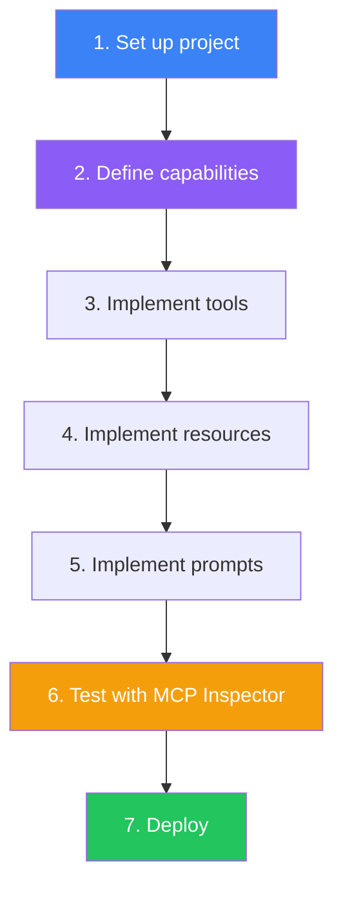
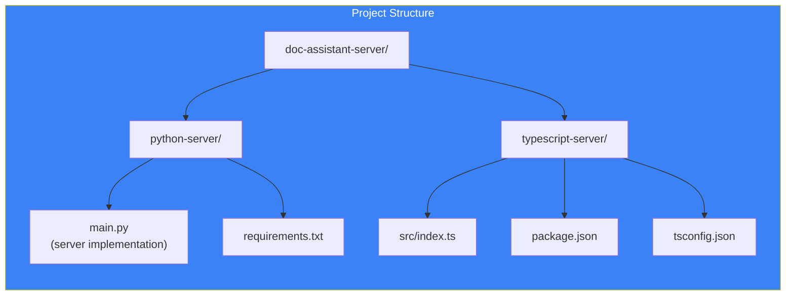
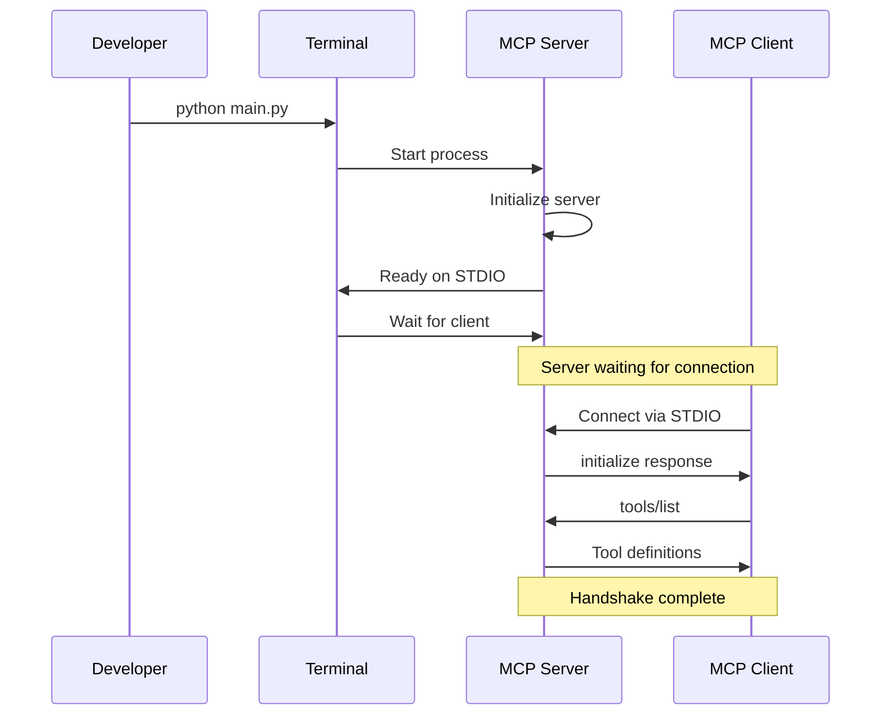
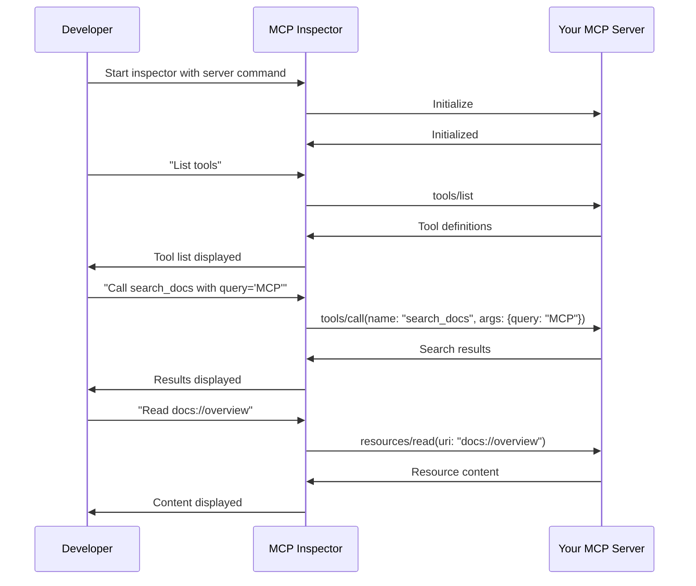
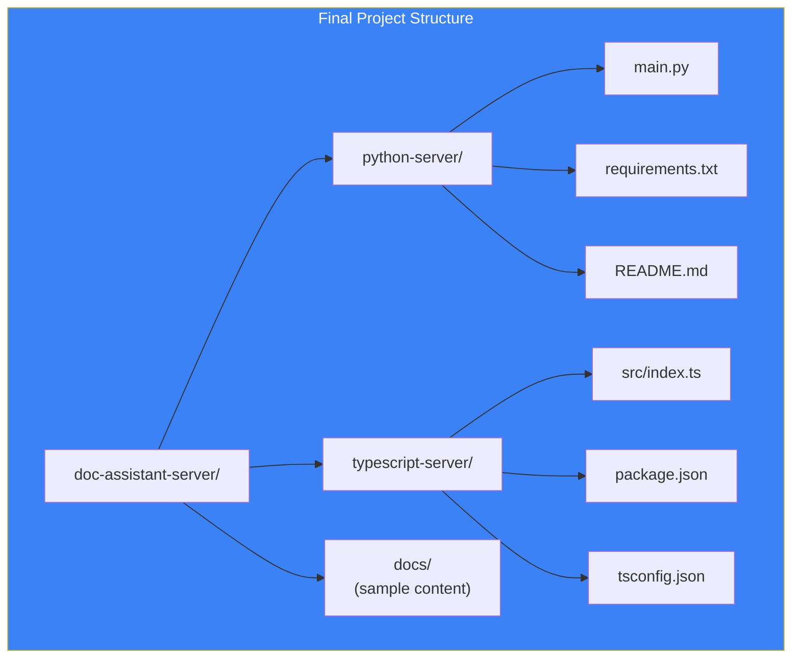

## Introduction

> **Building an MCP server is the fastest way to understand how the protocol works — this guide walks you through creating a complete server with tools, resources, and prompts from scratch.**

By the end of this guide, you'll have a working MCP server that can search files, read documentation, and provide analysis prompts — all accessible from any MCP client.



---

## Why Build Your Own Server?

### The Problem: Pre-built Servers Don't Cover Everything

While there are many community MCP servers (for filesystem, GitHub, Slack, etc.), your specific use case may need custom tools — a proprietary database, an internal API, or a unique workflow. Building your own server gives you full control.

### What You'll Build

A **Documentation Assistant MCP Server** with:
- **Tool**: `search_docs(query, max_results)` — Search documentation files
- **Resource**: `docs://{topic}` — Read documentation by topic
- **Prompt**: `explain_concept(concept, level)` — Get an explanation prompt

---

## Real-World Analogy

### Building a Food Truck

Building an MCP server is like building a food truck:

1. **Design the menu** (Define capabilities) — What will you serve?
2. **Set up the kitchen** (Implement tools) — How will you prepare each dish?
3. **Stock ingredients** (Implement resources) — What data do you need?
4. **Write recipes** (Implement prompts) — What procedures will you follow?
5. **Open for business** (Deploy) — Make it available to customers

Any customer (client) can order from your menu, as long as they follow the standard ordering process.

---

## Project Setup



---

## Step 1: Python Implementation

### 1.1 Install Dependencies

```bash
pip install mcp httpx
```

### 1.2 Create the Server

```python
# main.py
from mcp.server import Server, NotificationOptions
from mcp.server.models import InitializationOptions
from mcp.server.stdio import stdio_server
from mcp.types import (
    Tool, Resource, Prompt, 
    TextContent, ResourceContents,
    GetPromptResult, PromptMessage,
    PromptArgument
)
import json
from pathlib import Path

# Create the server instance
server = Server("doc-assistant")

# --- TOOLS ---

@server.list_tools()
async def list_tools() -> list[Tool]:
    return [
        Tool(
            name="search_docs",
            description="Search documentation for a query",
            inputSchema={
                "type": "object",
                "properties": {
                    "query": {
                        "type": "string",
                        "description": "The search query"
                    },
                    "max_results": {
                        "type": "integer",
                        "description": "Maximum results (default: 5)",
                        "default": 5
                    }
                },
                "required": ["query"]
            }
        ),
        Tool(
            name="get_file_content",
            description="Read a file from the docs directory",
            inputSchema={
                "type": "object",
                "properties": {
                    "path": {
                        "type": "string",
                        "description": "File path relative to docs directory"
                    }
                },
                "required": ["path"]
            }
        ),
        Tool(
            name="list_files",
            description="List files in the docs directory",
            inputSchema={
                "type": "object",
                "properties": {
                    "directory": {
                        "type": "string",
                        "description": "Directory to list (default: root)",
                        "default": "."
                    }
                }
            }
        )
    ]

@server.call_tool()
async def call_tool(name: str, arguments: dict) -> list[TextContent]:
    if name == "search_docs":
        query = arguments["query"]
        max_results = arguments.get("max_results", 5)
        # Simulate search - in production, use a real search engine
        results = [
            f"Result {i}: Document about {query}" 
            for i in range(min(max_results, 3))
        ]
        return [TextContent(
            type="text", 
            text=f"Search results for '{query}':\n" + "\n".join(results)
        )]
    
    elif name == "get_file_content":
        path = arguments["path"]
        try:
            content = Path(f"./docs/{path}").read_text()
            return [TextContent(type="text", text=content)]
        except FileNotFoundError:
            return [TextContent(type="text", text=f"File not found: {path}")]
    
    elif name == "list_files":
        directory = arguments.get("directory", ".")
        files = [str(f) for f in Path(f"./docs/{directory}").iterdir()]
        return [TextContent(
            type="text",
            text="Files:\n" + "\n".join(files)
        )]
    
    raise ValueError(f"Unknown tool: {name}")

# --- RESOURCES ---

@server.list_resources()
async def list_resources() -> list[Resource]:
    return [
        Resource(
            uri="docs://overview",
            name="Documentation Overview",
            description="High-level overview of the documentation",
            mimeType="text/markdown"
        ),
        Resource(
            uri="docs://getting-started",
            name="Getting Started Guide",
            description="How to get started with the project",
            mimeType="text/markdown"
        )
    ]

@server.read_resource()
async def read_resource(uri: str) -> list[ResourceContents]:
    # Map URIs to content
    content_map = {
        "docs://overview": "# Documentation Overview\n\nThis is the documentation for our project.",
        "docs://getting-started": "# Getting Started\n\nFollow these steps to get started..."
    }
    
    if uri in content_map:
        return [ResourceContents(
            uri=uri,
            mimeType="text/markdown",
            text=content_map[uri]
        )]
    
    raise ValueError(f"Resource not found: {uri}")

# --- PROMPTS ---

@server.list_prompts()
async def list_prompts() -> list[Prompt]:
    return [
        Prompt(
            name="explain_concept",
            description="Get an explanation of a concept at a specified level",
            arguments=[
                PromptArgument(
                    name="concept",
                    description="The concept to explain",
                    required=True
                ),
                PromptArgument(
                    name="level",
                    description="Explanation depth (basic, intermediate, advanced)",
                    required=False
                )
            ]
        )
    ]

@server.get_prompt()
async def get_prompt(name: str, arguments: dict) -> GetPromptResult:
    if name == "explain_concept":
        concept = arguments["concept"]
        level = arguments.get("level", "intermediate")
        
        level_instructions = {
            "basic": "Use simple language and analogies. Assume no prior knowledge.",
            "intermediate": "Assume the reader has basic understanding. Focus on depth.",
            "advanced": "Use technical language. Cover edge cases and advanced patterns."
        }
        
        instruction = level_instructions.get(level, level_instructions["intermediate"])
        
        return GetPromptResult(
            messages=[
                PromptMessage(
                    role="system",
                    content={
                        "type": "text",
                        "text": f"You are an expert explaining '{concept}'.\n{instruction}\n\nStructure your explanation:\n1. Core concept (definition)\n2. How it works\n3. Why it matters\n4. Example\n5. Key takeaways"
                    }
                )
            ]
        )
    
    raise ValueError(f"Unknown prompt: {name}")

# --- RUN THE SERVER ---

async def main():
    async with stdio_server() as (read, write):
        await server.run(
            read, write,
            InitializationOptions(
                server_name="doc-assistant",
                server_version="1.0.0",
                capabilities=server.get_capabilities(
                    notification_options=NotificationOptions(),
                    experimental_capabilities={}
                )
            )
        )

if __name__ == "__main__":
    import asyncio
    asyncio.run(main())
```

---

## Step 2: TypeScript Implementation

### 2.1 Install Dependencies

```bash
npm init -y
npm install @modelcontextprotocol/sdk
npm install -D typescript @types/node
npx tsc --init
```

### 2.2 Create the Server

```typescript
// src/index.ts
import { Server } from "@modelcontextprotocol/sdk/server/index.js";
import { StdioServerTransport } from "@modelcontextprotocol/sdk/server/stdio.js";
import { 
  ListToolsRequestSchema, 
  CallToolRequestSchema,
  ListResourcesRequestSchema,
  ReadResourceRequestSchema,
  ListPromptsRequestSchema,
  GetPromptRequestSchema
} from "@modelcontextprotocol/sdk/types.js";

const server = new Server(
  { name: "doc-assistant", version: "1.0.0" },
  { capabilities: { tools: {}, resources: {}, prompts: {} } }
);

// --- TOOLS ---

server.setRequestHandler(ListToolsRequestSchema, async () => ({
  tools: [{
    name: "search_docs",
    description: "Search documentation for a query",
    inputSchema: {
      type: "object",
      properties: {
        query: { type: "string", description: "The search query" },
        max_results: { 
          type: "integer", 
          description: "Maximum results",
          default: 5 
        }
      },
      required: ["query"]
    }
  }, {
    name: "get_file_content",
    description: "Read a file from the docs directory",
    inputSchema: {
      type: "object",
      properties: {
        path: { type: "string", description: "File path relative to docs" }
      },
      required: ["path"]
    }
  }]
}));

server.setRequestHandler(CallToolRequestSchema, async (request) => {
  const { name, arguments: args } = request.params;
  
  if (name === "search_docs") {
    const query = args.query;
    const results = [`Result 1: Document about ${query}`, `Result 2: More about ${query}`];
    return {
      content: [{ type: "text", text: `Search results:\n${results.join("\n")}` }]
    };
  }
  
  if (name === "get_file_content") {
    return {
      content: [{ type: "text", text: `Content of ${args.path}...` }]
    };
  }
  
  throw new Error(`Unknown tool: ${name}`);
});

// --- RESOURCES ---

server.setRequestHandler(ListResourcesRequestSchema, async () => ({
  resources: [{
    uri: "docs://overview",
    name: "Documentation Overview",
    description: "High-level overview",
    mimeType: "text/markdown"
  }]
}));

server.setRequestHandler(ReadResourceRequestSchema, async (request) => {
  const { uri } = request.params;
  return {
    contents: [{
      uri,
      mimeType: "text/markdown",
      text: "# Overview\n\nDocumentation content..."
    }]
  };
});

// --- PROMPTS ---

server.setRequestHandler(ListPromptsRequestSchema, async () => ({
  prompts: [{
    name: "explain_concept",
    description: "Explain a concept at a specified level",
    arguments: [
      { name: "concept", description: "The concept to explain", required: true },
      { name: "level", description: "Explanation depth", required: false }
    ]
  }]
}));

server.setRequestHandler(GetPromptRequestSchema, async (request) => {
  const { name, arguments: args } = request.params;
  
  if (name === "explain_concept") {
    return {
      messages: [{
        role: "system",
        content: {
          type: "text",
          text: `Explain '${args.concept}' at ${args.level || "intermediate"} level.`
        }
      }]
    };
  }
  
  throw new Error(`Unknown prompt: ${name}`);
});

// --- RUN ---

const transport = new StdioServerTransport();
await server.connect(transport);
console.error("Doc Assistant MCP Server running on stdio");
```

---

## Server Startup Sequence



## Step 3: Configure for Claude Desktop

Add the server to Claude Desktop's configuration:

```json
{
  "mcpServers": {
    "doc-assistant": {
      "command": "python",
      "args": ["path/to/main.py"],
      "env": {}
    }
  }
}
```

Or for the TypeScript version:

```json
{
  "mcpServers": {
    "doc-assistant": {
      "command": "node",
      "args": ["path/to/dist/index.js"],
      "env": {}
    }
  }
}
```

---

## Step 4: Test with MCP Inspector



Run the inspector:

```bash
npx @modelcontextprotocol/inspector python main.py
```

---

## Project Structure



---

## Best Practices

1. **Start with one tool** — Add capabilities incrementally
2. **Test with MCP Inspector** — Debug before connecting to a client
3. **Use environment variables** — Never hardcode configuration
4. **Handle errors gracefully** — Return descriptive error messages
5. **Document your tools** — Comprehensive descriptions help agents use them correctly
6. **Add logging** — Debug production issues with stderr logs
7. **Version your server** — Include version in server metadata

## Common Mistakes

| Mistake | Why It's Wrong |
|---------|---------------|
| Missing required fields in schemas | Tool calls fail with validation errors |
| Blocking the event loop | Server can't handle multiple requests |
| Not handling unknown tools | Server crashes on unexpected calls |
| Hardcoded paths | Server breaks when moved |
| No error handling in tools | Server crashes on invalid input |

---

## Interview Questions

### Beginner

**Q: What are the minimum steps to create an MCP server?**

> (1) Create the server instance with a name and version, (2) Define capabilities (tools, resources, prompts), (3) Implement capability handlers (list + call/read/get), (4) Connect to a transport (STDIO for local), (5) Run the server.

**Q: What's the purpose of the `mcpServers` configuration in Claude Desktop?**

> It tells Claude Desktop how to start each MCP server. The configuration specifies the command, arguments, and environment variables for starting the server process. Claude Desktop manages the lifecycle — spawning the process, communicating over STDIO, and cleaning up on exit.

### Intermediate

**Q: How do you add a new tool to an existing MCP server?**

> (1) Add the tool definition to the `list_tools` handler (name, description, input schema), (2) Add a handler for the new tool name in the `call_tool` function, (3) Validate arguments, execute the action, and return the result. No changes needed to the client — the tool is automatically discovered on the next `tools/list` call.

**Q: How would you implement logging in an MCP server?**

> For STDIO transport, write logs to stderr (not stdout, which carries protocol messages). Use Python's logging module configured to write to stderr. For HTTP transport, use standard logging libraries and optionally send logs to a logging service. Include request IDs in logs to correlate client requests with server-side operations.

### Senior

**Q: Design an MCP server that connects to a PostgreSQL database with proper connection pooling.**

> Design: (1) Initialize a connection pool on server startup (configurable pool size), (2) Expose tools: `query_database(sql)`, `get_schema(table)`, `list_tables()`, (3) Each tool call acquires a connection from the pool, executes the query, formats results, and returns the connection, (4) Implement query timeout (30s) to prevent long-running queries, (5) Add read-only user for SELECT-only tools, (6) Handle connection failures with retry logic, (7) Close the pool on server shutdown, (8) Log all queries for monitoring.

**Q: How would you test an MCP server before deploying it to production?**

> Testing strategy: (1) Unit test each handler independently, (2) Integration test with a real transport (use MCP Inspector), (3) Test error cases (invalid arguments, missing resources, tool failures), (4) Load test with multiple concurrent tool calls, (5) Test reconnection behavior (kill and restart the server), (6) Test with multiple MCP clients connecting simultaneously, (7) Validate all schemas against the JSON Schema specification, (8) Run a full end-to-end test with Claude Desktop.

### Staff Engineer

**Q: Compare the development experience of building an MCP server in Python vs TypeScript.**

> **Python**: Simpler syntax, more data science/ML libraries available, async implementation is straightforward with asyncio, dynamic typing reduces boilerplate but can lead to runtime errors. **TypeScript**: Full type safety catches errors at compile time, better ecosystem for web development, async/await is first-class, SDK types provide autocomplete for all MCP types. **Verdict**: Python is faster to prototype; TypeScript is safer for production. Both are equally capable.

### Architecture

**Q: Design an MCP server that supports hot-reloading of tools without restarting.**

> Architecture: (1) Store tool implementations in a plugin directory (one file per tool), (2) Use a file watcher to detect changes, (3) On change, dynamically load/reload the plugin module, (4) Update the internal tool registry, (5) Send a `notifications/tools/changed` notification to all connected clients, (6) Clients re-query `tools/list` to get updated definitions, (7) Handle partial failures — if one plugin fails to load, keep the others running, (8) Log all reloads for monitoring.

---

## Summary

| Step | Action | Key Tool |
|------|--------|----------|
| **1** | Set up project | Python SDK or TypeScript SDK |
| **2** | Define capabilities | `list_tools`, `list_resources`, `list_prompts` |
| **3** | Implement handlers | `call_tool`, `read_resource`, `get_prompt` |
| **4** | Connect transport | `StdioServerTransport` or HTTP equivalent |
| **5** | Test | MCP Inspector |
| **6** | Configure | Claude Desktop `mcpServers` config |
| **7** | Deploy | Local (STDIO) or Remote (HTTP/WebSocket) |

---

## Navigation

**Previous:** [10 — Transports](/ai/phase-07-model-context-protocol/10-transports)

**Next:** [12 — Build Your First MCP Client](/ai/phase-07-model-context-protocol/12-build-your-first-mcp-client)

**Related Topics:**
- [MCP Server](/ai/phase-07-model-context-protocol/05-mcp-server)
- [Tools](/ai/phase-07-model-context-protocol/06-tools)
- [Resources](/ai/phase-07-model-context-protocol/07-resources)
- [Prompts](/ai/phase-07-model-context-protocol/08-prompts)
