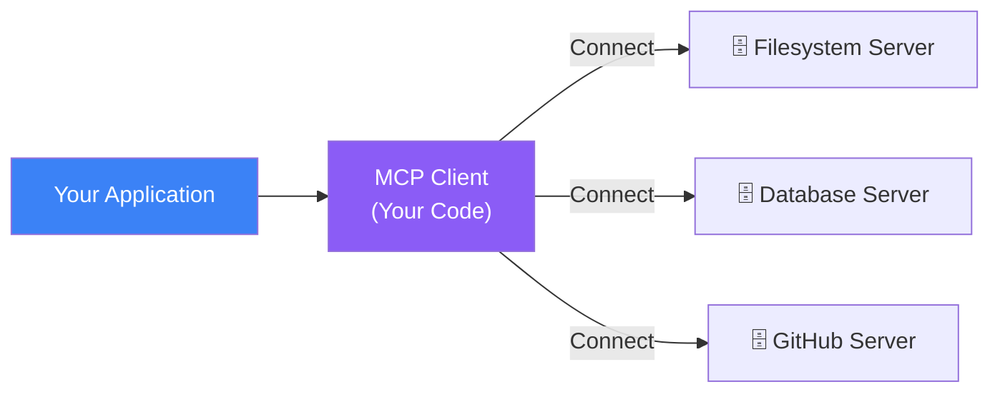
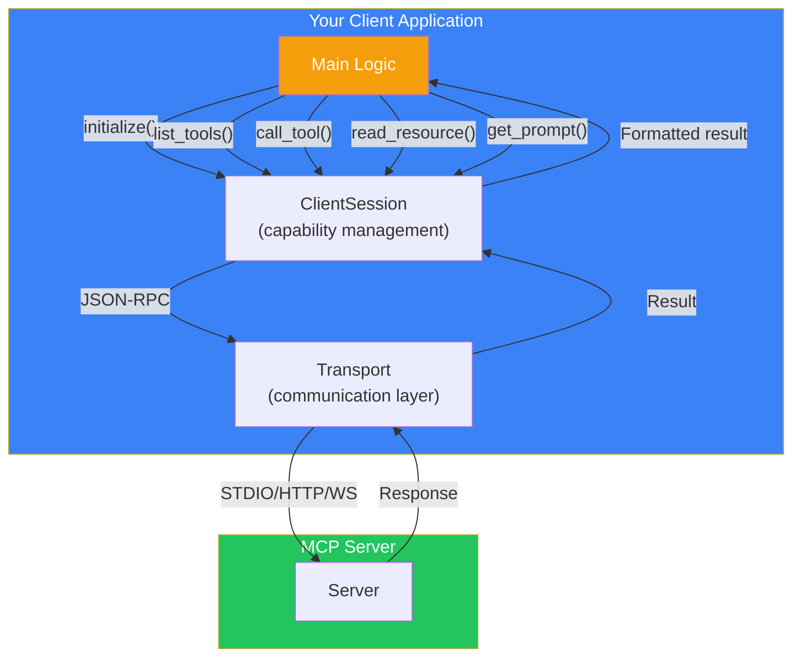
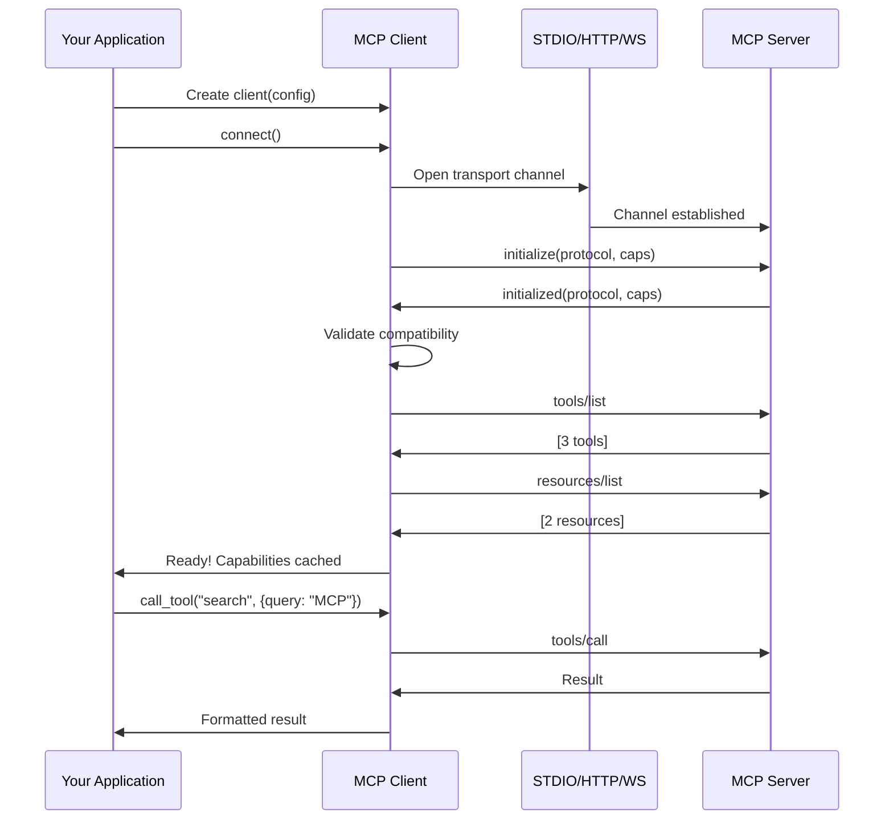
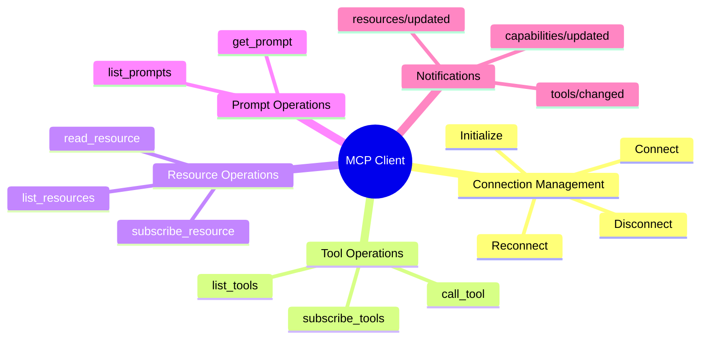
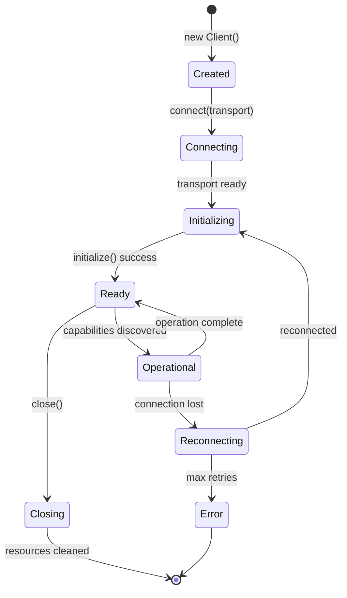

## Introduction

> **Building an MCP client gives your AI application or tool the ability to connect to any MCP server and leverage its capabilities — tools, resources, and prompts — through a standardized interface.**

While pre-built clients exist (Claude Desktop, Cursor, VS Code), building your own client lets you embed MCP capabilities into custom applications, automate workflows, and create specialized AI tools.



---

## Why Build a Custom Client?

### The Problem: Not All Applications Use Built-in Clients

Claude Desktop has built-in MCP support, but what if you're:
- Building a custom chatbot interface?
- Creating an automation pipeline?
- Developing a specialized AI tool?
- Running MCP in a serverless function?

### The Solution: SDK-Powered Clients

The MCP SDKs (Python and TypeScript) make it easy to build custom clients with just a few lines of code.

| Use Case | Built-in Client | Custom Client |
|----------|----------------|---------------|
| Chat with Claude Desktop | ✅ Perfect | ❌ Unnecessary |
| Custom web app | ❌ Not available | ✅ Build your own |
| Automation script | ❌ Not available | ✅ Build your own |
| Serverless function | ❌ Not available | ✅ Build your own |

---

## Real-World Analogy

### The Universal Remote Control Programmer

Building an MCP client is like programming a universal remote:

- The remote (client) knows the **standard protocol** (IR codes = JSON-RPC)
- You **discover** what devices (servers) are available
- You **learn** what each device can do (capabilities)
- You **send commands** (tool calls) and **read displays** (resources)
- The remote handles the complexity so you can focus on what you want to do

---

## Step 1: Python Client

### 1.1 Install Dependencies

```bash
pip install mcp httpx
```

### 1.2 Basic Client

```python
import asyncio
from mcp import ClientSession
from mcp.client.stdio import stdio_client, StdioServerParameters

async def main():
    # Configure the server to connect to
    server_params = StdioServerParameters(
        command="python",
        args=["path/to/server.py"],
        env={}  # Optional environment variables
    )
    
    # Connect to the server
    async with stdio_client(server_params) as (read, write):
        async with ClientSession(read, write) as session:
            # Step 1: Initialize
            await session.initialize()
            print("✅ Connected to MCP server")
            
            # Step 2: Discover capabilities
            tools = await session.list_tools()
            print(f"📋 Available tools ({len(tools)}):")
            for tool in tools:
                print(f"  - {tool.name}: {tool.description}")
            
            resources = await session.list_resources()
            print(f"\n📄 Available resources ({len(resources)}):")
            for resource in resources:
                print(f"  - {resource.name} ({resource.uri})")
            
            prompts = await session.list_prompts()
            print(f"\n💬 Available prompts ({len(prompts)}):")
            for prompt in prompts:
                print(f"  - {prompt.name}: {prompt.description}")
            
            # Step 3: Call a tool
            print("\n🔧 Calling search_docs tool...")
            result = await session.call_tool(
                name="search_docs",
                arguments={"query": "MCP", "max_results": 3}
            )
            for content in result.content:
                print(f"  {content.text}")
            
            # Step 4: Read a resource
            print("\n📖 Reading docs://overview resource...")
            resource_result = await session.read_resource("docs://overview")
            for content in resource_result.contents:
                print(f"  {content.text}")
            
            # Step 5: Get a prompt
            print("\n💡 Getting explain_concept prompt...")
            prompt_result = await session.get_prompt(
                name="explain_concept",
                arguments={"concept": "MCP", "level": "basic"}
            )
            for msg in prompt_result.messages:
                print(f"  [{msg.role}]: {msg.content.text[:100]}...")

asyncio.run(main())
```

---

## Step 2: TypeScript Client

### 2.1 Install Dependencies

```bash
npm init -y
npm install @modelcontextprotocol/sdk
npm install -D typescript @types/node
npx tsc --init
```

### 2.2 Basic Client

```typescript
import { Client } from "@modelcontextprotocol/sdk/client/index.js";
import { StdioClientTransport } from "@modelcontextprotocol/sdk/client/stdio.js";

async function main() {
  // Step 1: Create transport
  const transport = new StdioClientTransport({
    command: "node",
    args: ["dist/server.js"],
    env: {}
  });

  // Step 2: Create and connect client
  const client = new Client(
    { name: "my-client", version: "1.0.0" },
    { capabilities: {} }
  );

  await client.connect(transport);
  console.log("✅ Connected to MCP server");

  // Step 3: List tools
  const tools = await client.listTools();
  console.log(`📋 Available tools (${tools.length}):`);
  tools.forEach(tool => console.log(`  - ${tool.name}: ${tool.description}`));

  // Step 4: Call a tool
  console.log("\n🔧 Calling search_docs...");
  const result = await client.callTool({
    name: "search_docs",
    arguments: { query: "MCP", max_results: 3 }
  });
  console.log(`  ${result.content[0].text}`);

  // Step 5: List resources
  const resources = await client.listResources();
  console.log(`\n📄 Resources (${resources.length}):`);

  // Step 6: Read a resource
  if (resources.length > 0) {
    const resource = await client.readResource({
      uri: resources[0].uri
    });
    console.log(`\n📖 ${resources[0].uri}:`);
    console.log(`  ${resource.contents[0].text}`);
  }

  // Step 7: List prompts
  const prompts = await client.listPrompts();
  console.log(`\n💬 Prompts (${prompts.length}):`);

  // Cleanup
  await client.close();
  console.log("\n👋 Disconnected");
}

main().catch(console.error);
```

---

## Client Architecture



---

## Client-Server Handshake Sequence



## Client Capabilities



---

## Advanced Client: Multi-Server Management

```python
import asyncio
from mcp import ClientSession
from mcp.client.stdio import stdio_client, StdioServerParameters

class MCPServerManager:
    """Manages multiple MCP server connections."""
    
    def __init__(self):
        self.sessions = {}
    
    async def add_server(self, name: str, command: str, args: list[str], env: dict = None):
        """Add and connect to an MCP server."""
        params = StdioServerParameters(
            command=command,
            args=args,
            env=env or {}
        )
        
        read, write = await stdio_client(params).__aenter__()
        session = await ClientSession(read, write).__aenter__()
        await session.initialize()
        
        self.sessions[name] = {
            "session": session,
            "read": read,
            "write": write,
            "params": params
        }
        
        # Discover capabilities
        tools = await session.list_tools()
        print(f"Connected to '{name}' with {len(tools)} tools")
        return True
    
    async def call_tool(self, server_name: str, tool_name: str, arguments: dict):
        """Call a tool on a specific server."""
        if server_name not in self.sessions:
            raise ValueError(f"Server '{server_name}' not connected")
        
        session = self.sessions[server_name]["session"]
        return await session.call_tool(tool_name, arguments)
    
    async def find_and_call(self, tool_name: str, arguments: dict):
        """Find which server has a tool and call it."""
        for name, info in self.sessions.items():
            tools = await info["session"].list_tools()
            if any(t.name == tool_name for t in tools):
                return await info["session"].call_tool(tool_name, arguments)
        
        raise ValueError(f"Tool '{tool_name}' not found on any server")
    
    async def disconnect_all(self):
        """Disconnect from all servers."""
        for name, info in self.sessions.items():
            await info["session"].__aexit__(None, None, None)
        self.sessions.clear()

# Usage
async def main():
    manager = MCPServerManager()
    
    # Connect to multiple servers
    await manager.add_server("filesystem", "python", ["fs_server.py"])
    await manager.add_server("database", "python", ["db_server.py"])
    await manager.add_server("github", "node", ["gh_server.js"])
    
    # Call tools across servers
    result = await manager.call_tool("filesystem", "list_files", {"path": "."})
    result = await manager.find_and_call("search_docs", {"query": "MCP"})
    
    await manager.disconnect_all()
```

---

## Client Lifecycle



---

## Error Handling in Clients

```python
import asyncio
from mcp import ClientSession
from mcp.client.stdio import stdio_client

class RobustClient:
    """MCP Client with error handling and reconnection."""
    
    def __init__(self, server_params, max_retries=3):
        self.server_params = server_params
        self.max_retries = max_retries
        self.session = None
    
    async def connect_with_retry(self):
        for attempt in range(self.max_retries):
            try:
                self.read, self.write = await stdio_client(
                    self.server_params
                ).__aenter__()
                self.session = await ClientSession(
                    self.read, self.write
                ).__aenter__()
                await self.session.initialize()
                return True
            except Exception as e:
                print(f"Connection attempt {attempt + 1} failed: {e}")
                if attempt < self.max_retries - 1:
                    await asyncio.sleep(2 ** attempt)  # Exponential backoff
                else:
                    raise
    
    async def safe_call_tool(self, name, arguments):
        if not self.session:
            raise RuntimeError("Not connected")
        
        try:
            return await self.session.call_tool(name, arguments)
        except Exception as e:
            print(f"Tool call failed: {e}")
            # Attempt reconnection
            await self.connect_with_retry()
            return await self.session.call_tool(name, arguments)
```

---

## Best Practices

1. **Always initialize before operations** — Don't skip the handshake
2. **Cache capabilities** — Reduce redundant `list` calls
3. **Implement reconnection** — Servers may restart
4. **Set timeouts** — Prevent hanging on slow servers
5. **Handle partial failures** — One server failing shouldn't crash the entire client
6. **Log all operations** — Essential for debugging MCP interactions
7. **Clean up resources** — Close sessions properly

## Common Mistakes

| Mistake | Why It's Wrong |
|---------|---------------|
| Not calling initialize() | Server rejects all requests |
| Ignoring protocol version | Client and server may be incompatible |
| No timeout on tool calls | Client hangs forever on slow servers |
| Hardcoding server paths | Breaks when deploying to different environments |
| Not handling disconnection | Client fails silently, agent gets no response |

---

## Interview Questions

### Beginner

**Q: What are the basic steps to connect an MCP client to a server?**

> (1) Create a transport (STDIO, HTTP, or WebSocket), (2) Create a ClientSession with the transport, (3) Call `initialize()` to perform the handshake, (4) Discover capabilities with `list_tools()`, `list_resources()`, `list_prompts()`, (5) Invoke tools, read resources, or get prompts as needed.

**Q: How does a client discover what a server can do?**

> The client calls `list_tools()`, `list_resources()`, and `list_prompts()` after initialization. The server returns definitions for each capability, including names, descriptions, and schemas. The client caches these definitions for the session.

### Intermediate

**Q: How would you implement a client that connects to two MCP servers simultaneously?**

> Create a manager class that maintains a dictionary of named sessions. For each server, create a separate transport and ClientSession. When the agent wants to call a tool, the manager searches all connected servers for the tool name and routes the call to the appropriate server. Each server connection is managed independently with its own retry and error handling.

**Q: How does a client handle server disconnection and reconnection?**

> The client should implement a reconnection strategy: (1) Detect the disconnection (transport read failure), (2) Attempt to reconnect with exponential backoff (1s, 2s, 4s, 8s), (3) On reconnection, re-initialize and re-discover capabilities, (4) If reconnection fails after max retries, report the error to the agent. The agent should be notified of any capability changes after reconnection.

### Senior

**Q: Design a client-side caching strategy for MCP capabilities to reduce initialization time.**

> Strategy: (1) Cache tool/resource/prompt definitions locally (keyed by server identity), (2) Include a cache validity timestamp, (3) On reconnection, try cached capabilities first for immediate availability, (4) Refresh in the background with fresh `list` calls, (5) Update cache when receiving `tools/changed` or `capabilities/updated` notifications, (6) Invalidate cache on protocol version mismatch, (7) Use checksums to detect changes without full re-listing.

**Q: How would you implement request prioritization in an MCP client?**

> Implement a priority queue system: (1) Classify requests (high: user-facing tool calls, medium: resource reads, low: discovery/list), (2) Process high-priority requests immediately, (3) Queue lower-priority requests with configurable concurrency, (4) Allow high-priority requests to preempt lower-priority ones, (5) Set queue timeouts to prevent starvation, (6) Monitor queue depth and report backpressure to the agent.

### Staff Engineer

**Q: Compare the Python and TypeScript MCP SDKs for building clients. What are the strengths of each?**

> **Python SDK**: More mature, better async support with asyncio, simpler syntax for scripting and automation, richer ecosystem for data processing, easier integration with ML/AI tools. **TypeScript SDK**: Type safety (compile-time error checking), better for web applications and browser-based clients, more efficient for real-time applications, larger SDK community. **Verdict**: Python for data/automation clients, TypeScript for web/integration clients.

### Architecture

**Q: Design a client architecture that supports dynamic discovery of MCP servers on a local network.**

> Architecture: (1) Use mDNS/DNS-SD for service discovery — MCP servers advertise themselves on the local network, (2) The client listens for service announcements and maintains a live server registry, (3) When a new server appears, the client automatically connects and discovers capabilities, (4) When a server disappears, the client removes it from the registry and notifies the agent, (5) The client maintains health checks for all connected servers, (6) Provides a unified interface where the agent can specify tool capabilities and the client routes to the appropriate server.

---

## Summary

| Step | Action | Key Code |
|------|--------|----------|
| **1** | Import SDK | `from mcp import ClientSession` |
| **2** | Create transport | `StdioClientTransport(command, args)` |
| **3** | Connect | `ClientSession(read, write)` |
| **4** | Initialize | `session.initialize()` |
| **5** | Discover | `session.list_tools()` |
| **6** | Operate | `session.call_tool()`, `read_resource()`, `get_prompt()` |
| **7** | Clean up | `session.close()` |

---

## Navigation

**Previous:** [11 — Build Your First MCP Server](/ai/phase-07-model-context-protocol/11-build-your-first-mcp-server)

**Next:** [13 — MCP with AI Agents](/ai/phase-07-model-context-protocol/13-mcp-with-ai-agents)

**Related Topics:**
- [MCP Client](/ai/phase-07-model-context-protocol/04-mcp-client)
- [MCP Server](/ai/phase-07-model-context-protocol/05-mcp-server)
- [MCP with AI Agents](/ai/phase-07-model-context-protocol/13-mcp-with-ai-agents)
